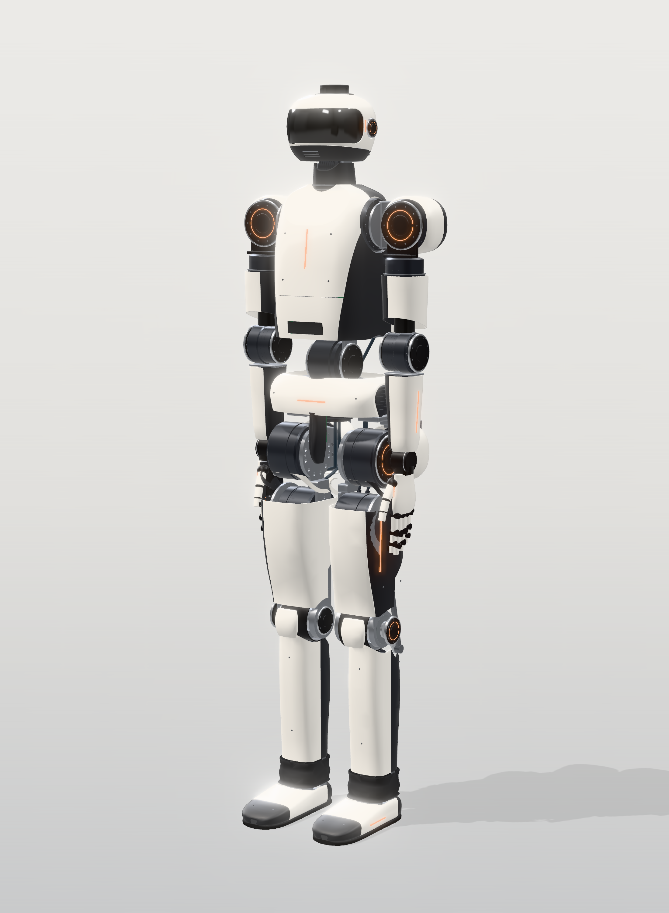

# KESTREL K1 Mk II — full-size work humanoid: engineering design and build package



A 1.81 m, ~103 kg electric humanoid, engineered from loads up for physical work: 30 kg carried two-handed, 50 kg
lifted momentarily, 10 kg per hand at full reach, 15 kg in one hand. Every joint requirement comes from whole-body
inverse dynamics over 18 design scenarios at the 113.7 kg design mass. Every actuator is sized against its full
torque-speed envelope at the minimum battery voltage, and the mass, power and structure close consistently. The
design is backed by CAD, manufacturing drawings, a construction tutorial, a test-and-commissioning plan, a cost
analysis and cited component research.

**Status:** Mk II design package, **not built and not tested.** Calculated margins are calculations, not proof. The
engineering tables in [docs/generated/](docs/generated/), the CAD, drawings and renders are Mk II. See
[docs/01 §7](docs/01-concept.md) and [docs/11](docs/11-testing-commissioning.md) for what is uncertain and how each item
gets retired.

## Ways to build one

| Build | Parts | What it is | Folder |
|---|---|---|---|
| **K1 Mk II** | ≈ A$226k | the work humanoid: custom liquid-cooled actuators, 13-DOA hands, shells | this package |
| **S1** | ≈ A$39k | same skeleton, off-the-shelf actuator modules on CAN, bolted aluminium frame | [simple/](simple/README.md) |
| **S1-Scrap / K1-Scrap** | A$500–1,280 | same skeleton from salvaged drill motors, hand-made capstans and hand tools; slow, always-balanced walking | [scrap/](scrap/README.md) |
| **S1-Fast / K1-Fast** | A$1,550–2,670 | the scrap builds with quasi-direct-drive hoverboard hub-motor legs on ODESC drives: 0.8–1.0 m/s, 18 cm stairs | [scrap/](scrap/README.md) |

## Key numbers (Mk II)

| | |
|---|---|
| Height / mass | 1.806 m / 103.3 kg estimated (113.7 kg design mass, +10 % growth) |
| DOF | 30 body (legs 6+6, waist 2, arms 7+7, neck 2) + 2 × 13-DOA hands (palm camera, ≥ 200 N grasp target) |
| Actuators | 26 rotary in 7 classes + 4 wrist linear (KW-L2, 24 V) + 26 hand micro-actuators |
| Knee / hip pitch | liquid-cooled custom KM-130x50-LC (N50UH, 50 mm stack) on 150 A GaN drives. Knee 17:1: **493 / 295 N·m** peak / continuous, through a four-bar (0.84–1.46) → 415–719 N·m at the joint. Hip pitch 14:1: **406 / 243 N·m**, 15.2 rad/s |
| Other joints | hip roll, waist pitch RI115-PH 29:1 (427 N·m); hip yaw, waist yaw, ankles RI85-PH 28:1 (129 N·m); shoulders KM-115x32-N50 + C25 cycloid 30:1; elbow, shoulder yaw KM-85x26-N50-4t + C20 cycloid 30:1; wrist yaw, neck KH-14 |
| Work loads (simulated) | 30 kg box squat and carry at 0.6 m/s; 50 kg momentary lift from thigh height; 10 kg per hand at full reach; 15 kg one-handed |
| Walking (simulated) | 0.8 m/s nominal, 1.2 m/s fast, 0.18 m stairs, 0.30 m single-leg step-up |
| Bus / battery | 16S Li-ion, 59.2 V nominal; **two hot-swap 16S4P packs**, 2 × 1.15 kWh (128 × Molicel P50B); swap one at a time without shutdown |
| Power / runtime | 267 W idle, 402 W normal, 451 W walking, 3.1 kW simultaneous peak · **4.9 h mixed, 4.3 h walking** |
| Cooling | liquid loop: knee and hip-pitch jackets + AI-computer cold plate, torso radiator, dry-break couplings at the hips |
| Protection / service | IP65 body, IP67 legs and hands (target); leg module off in ≤ 10 min via a V-band limb interface |
| Compute | Jetson AGX Thor (T5000) + PREEMPT_RT EtherCAT controller + independent SIL3-class safety MCU |
| Parts cost | ≈ A$226k Mk II baseline parts + test rig ([generated/cost_summary.md](docs/generated/cost_summary.md); K1 was ≈ A$196k); analysis in [docs/12](docs/12-cost-analysis.md) |

Optional, not baseline: **KA-150X** knee/hip actuator (719 / 524 N·m). It needs a 20S bus and 200 A drives, which
means replacing every other drive in the robot (docs/04 §6).

## What changed in Mk II

K1 proved the method; Mk II raises the work loads to the R7 industrial benchmark
([research/R7](docs/research/R7-commercial-humanoids.md) §d) using the actuator designs of
[research/R10](docs/research/R10-actuator-state-of-the-art.md). K1 values from the K1 documents and the K1 generated
tables (git commit 96eb3d9).

| Item | K1 | Mk II | Where |
|---|---|---|---|
| Design scenarios | 15; 20 kg box, 5 kg per hand | 18; adds 30 kg carry (CW), 15 kg one-handed (AO), 50 kg momentary lift (LM); 30 kg box, 10 kg per hand | docs/04 §1 |
| Mass estimate / design | 84.1 / 92.6 kg | 103.3 / 113.7 kg (actuators +14.0, battery +3.5, electronics and cooling +0.7, harness +0.4, hands +0.5, shells +0.1 kg) | docs/03 §14 |
| Knee | KM-130x45, 14:1, 99 A, ducted air: 395 / 139 N·m | KM-130x50-LC (N50UH, 3 turns × 2 paths, liquid jacket), 17:1, 150 A GaN: 493 / 295 N·m | docs/04 §5 |
| Hip pitch | KM-130x40, 14:1: 399 / 123 N·m, 10.3 rad/s | same motor as the knee, 14:1: 406 / 243 N·m, 15.2 rad/s | docs/04 §5 |
| Hip roll, waist pitch | ILM85x26, 32:1: 276 / 73 N·m | RI115-PH, 29:1: 427 / 125 N·m; output flange 10 × M4 PCD 85 → **12 × M5 12.9 PCD 100** | docs/04 §7, docs/03 §5 |
| Hip yaw, waist yaw, ankles | RI85-PH, 23:1: 106 N·m | RI85-PH, 28:1: 129 N·m | docs/04 §7 |
| Shoulders | ILM85x13 + strain-wave 50:1 (gear-limited 127 N·m) | KM-115x32-N50 + C25 machined cycloid 30:1 (gear rating 160 N·m, validation target) | docs/04 §8, docs/13 §4.2 |
| Elbow, shoulder yaw | RI85-PH + strain-wave 50:1 (gear-limited 73 N·m) | KM-85x26-N50-4t + C20 cycloid 30:1 (gear rating 105 N·m, validation target) | docs/04 §8 |
| Wrist pitch/roll | DCX 16 L on the 12 V hand rail (36 mm/s, 241 N against 132 mm/s, 611 N needed) | KW-L2: flat brushless motor on the screw, 24 V rail, own driver | docs/04 §9, docs/13 §4.4 |
| Battery | one 16S6P pack, 1.68 kWh, on rails, swapped powered down | two hot-swap 16S4P packs, 2 × 1.15 kWh, blind-mate bay with sequenced contacts | docs/03 §10 |
| Runtime | 3.8 h mixed, 3.3 h walking | 4.9 h mixed, 4.3 h walking | generated power budget |
| Cooling | ducted air on knee and hip pitch | liquid loop (2 pumps, radiator + fans, compensator, Thor cold plate, dry-break couplings) | docs/03 §9 |
| Hands | 10 DOA, ≥ 50 N grasp | 13 DOA, ≥ 200 N grasp, palm camera | docs/03 §8 |
| Ingress | IP54 target | IP65 body, IP67 legs and hands, −20 to 40 °C (target) | docs/03 §12 |
| Limb interface | bolted actuator flanges | V-band clamp + blind-mate service plate with dry-break couplings | docs/03 §13 |

Not achieved against the R7 targets: robot mass (103.3 kg against ≤ 84 kg), joint speed (hip 15.2 against 16 rad/s),
waist yaw range, the quick-change wrist and autonomous fast charging. The full scorecard is in
[docs/01 §5.1](docs/01-concept.md).

## Deliverables

| # | Deliverable | Where |
|---|---|---|
| 1 | Robot concept, Mk II capability targets, R7 benchmark | [docs/01-concept.md](docs/01-concept.md) |
| 2 | Professional visual design (20 views) | [docs/02-industrial-design.md](docs/02-industrial-design.md) · [renders/](renders/) · interactive [viewer/index.html](viewer/index.html) |
| 3 | Mechanical architecture: liquid cooling loop, hot-swap battery bay, IP65/IP67 sealing, limb interface, mass budget | [docs/03-mechanical-architecture.md](docs/03-mechanical-architecture.md) |
| 4 | Actuator catalogue (Mk II family, KA-150X option, KW-L2) | [docs/04-actuator-catalogue.md](docs/04-actuator-catalogue.md) · [generated/joint_catalogue.md](docs/generated/joint_catalogue.md) |
| 5 | Electrical architecture | [docs/05-electrical-architecture.md](docs/05-electrical-architecture.md) |
| 6 | Sensor architecture | [docs/06-sensor-architecture.md](docs/06-sensor-architecture.md) |
| 7 | Software architecture | [docs/07-software-architecture.md](docs/07-software-architecture.md) |
| 8 | Complete BOM | [docs/08-bom.md](docs/08-bom.md) · [data/bom.csv](data/bom.csv) |
| 9 | Manufacturing package | [docs/09-manufacturing-package.md](docs/09-manufacturing-package.md) · `cad/out/step/` · `cad/out/drawings/` |
| 10 | Visual construction tutorial (14 phases, A–G each) | [docs/10-construction-tutorial/](docs/10-construction-tutorial/README.md) · everything in one illustrated PDF: [KESTREL-K1-build-tutorial.pdf](docs/10-construction-tutorial/KESTREL-K1-build-tutorial.pdf) |
| 11 | Testing & commissioning | [docs/11-testing-commissioning.md](docs/11-testing-commissioning.md) |
| 12 | Cost analysis | [docs/12-cost-analysis.md](docs/12-cost-analysis.md) |
| 13 | Scratch-build motors & actuators (Mk II: KM-130x50-LC with jacket, KM-115/KM-85 N50UH motors, C20/C25 cycloids, KW-L2) | [docs/13-scratch-build-motors-actuators.md](docs/13-scratch-build-motors-actuators.md) |
| — | Locomotion training (walk, slopes, stairs up/down) on a CPU; Isaac Lab 3.0 config for GPUs | [train/](train/README.md) |
| — | Component research with sources (R7 commercial benchmark, R10 actuator state of the art) | [docs/research/](docs/research/) |
| — | Generated engineering tables | [docs/generated/](docs/generated/) |

## Repository layout

| Path | What it is |
|---|---|
| `calc/` | Engineering model: `kestrel/params.py` (geometry + mass budget, single source of truth), `model.py` (MJCF), `gait.py` (ZMP preview-control walker + dynamics filter), `dynamics.py` (inverse dynamics + contact wrench split), `scenarios.py`, `requirements.py`, `linkages.py` (knee four-bar synthesis), `motor_design.py` (calibrated frameless-motor model), `actuators.py` (sizing), `power.py`, `structure.py`, `bom.py`, `catalogue.py`; `run_all.py` regenerates everything |
| `cad/` | CadQuery: `build_robot.py` (240-part robot), `hand.py`, `build_details.py` (actuator cutaways + STEP), `detail_parts.py`, `make_drawings.py`, `cycloid_profile.py`; outputs in `cad/out/` |
| `viewer/` | three.js viewer (full / ghost / skeleton / exploded) and `render.mjs` (headless renders) |
| `sim/kestrel_k1.xml` | MuJoCo model generated from `params.py` with sized torque limits |
| `train/` | CPU locomotion training: MuJoCo terrain curriculum, PPO, console trainer, evaluation/GIF; `train/isaaclab/` Isaac Lab 3.0 task |
| `diagrams/` | engineering diagrams (SVG), generated by `make_diagrams.py` |
| `data/` | scenario results, requirements, actuator family, knee linkage, power budget, BOM |
| `renders/` | 20 rendered views |

## Regenerate

```bash
cd projects/kestrel-humanoid/calc
python3 -m venv .venv && . .venv/bin/activate && pip install -r requirements.txt
```

```bash
python run_all.py && python -m kestrel.catalogue && python -m kestrel.bom
```

```bash
cd ../cad && python build_robot.py && python build_details.py && python detail_parts.py && python make_drawings.py
```

```bash
cd ../viewer && node render.mjs /path/containing/node_modules ../renders 2
```

Change a mass, a dimension or an actuator in `calc/kestrel/params.py` or `calc/kestrel/actuators.py`,
re-run, and every requirement, sizing, power, structure and cost table follows.
