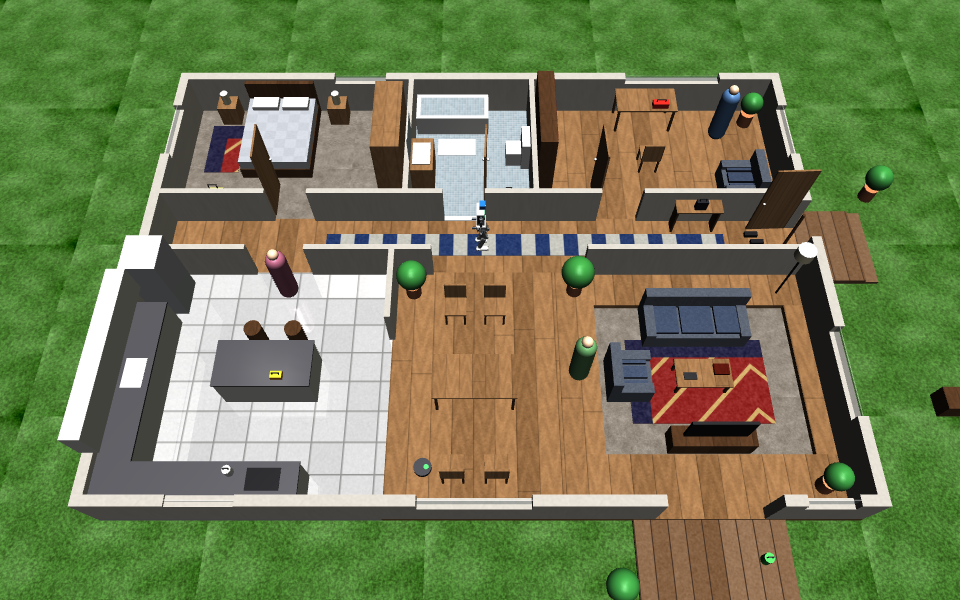

# KESTREL brain: a small vision-language-action system, in simulation

Tell the robot what to do in plain words; it looks through its head camera, works out where to go, and walks or
runs there with the trained leg policy, while a fixed safety layer decides what actually reaches the legs. It talks,
in an Ultron-style voice that has no say over the motion.

Everything here runs on a 4-core CPU with no GPU, in the same MuJoCo simulation the legs were trained in.

## How it fits together

```
 head camera 96 x 72 ──► vision network ─────────────┐
   (5 times a second)    which object, where          │
                                                     ▼
 "sprint to the blue ball" ──► language network ──► action head ──► SAFETY SUPERVISOR ──► walking policy ──► 24 motors
                               do what, to what,    turn, walk,     fixed limits, refusal,   (train/, 50 Hz)    (PD, 500 Hz)
                               how fast             slow, arrive    e-stop latch
                                       │
                                       └──► persona (speech only: reads events, writes lines)
```

This is the split the humanoid foundation models use (NVIDIA's GR00T N1 calls them System 2 and System 1): a slow
layer that understands the scene and the request, and a fast learned controller that keeps the body balanced.

| Part | File | What it is |
|---|---|---|
| Arena | `arena.py` | The training terrain's 36 m flat strip with four coloured objects and a person-sized mannequin, and a camera in the robot's head. Objects are drawn, not simulated (no collisions). |
| Vision | `vision.py` | A 4-layer CNN trained on 5,000 rendered head-camera images with labels from the simulator: for each object, in view or not, bearing, distance. |
| Language | `language.py` | A small network on hashed words, word pairs and letter triples, trained on 12,000 generated phrasings: intent (go to, stop, turn, look around, harm), target, speed. |
| Action head | `vla.py` | Pursuit on the perceived bearing and distance: turn to the target, walk at the asked speed when facing it, slow on arrival, turn on the spot to search. |
| Safety supervisor | `safety.py` | Plain code with fixed numbers (below). Last stage before the legs. |
| Persona | `persona.py`, `persona_prompt.md` | Ultron-style lines for each event; a system prompt with the same character for a chat model. |
| Demo and scoring | `demo.py` | Random scenes and instructions, scored against the simulator's ground truth; captioned clips. |

## The safety supervisor, and why the persona cannot touch it

The persona was asked for: an Ultron-style personality. Ultron is a fictional machine that turns on people, so the
character is kept to the voice. The persona receives read-only events and returns a line of text. It holds no
reference to the command, the supervisor, the e-stop or the robot.

The supervisor (`safety.py`) is fixed code, not a network:

* **Refuses** any instruction to hit, push, chase or run into something or someone. Its own word list or the language
  network's "harm" reading: either one is enough, so a misread cannot get through.
* **Speed caps:** the configured top speed; 0.4 m/s within 2.5 m of a person; a stop within 1.2 m.
* A person is never approached closer than 1.5 m, even when asked.
* **Geofence:** stops at the edge of the safe area.
* **E-stop latch:** a fall or the operator's stop holds every command at zero until the operator resets it.

On the real robot the same rules live on the ESP32s (speed caps, watchdog) and in the hardware e-stop loop, below
any software that could be talked into something.

## Run it

```bash
cd projects/kestrel-humanoid/brain
python vision.py --make 5000 && python vision.py --train     # about 15 min on 4 cores
python language.py --train                                   # under a minute
python demo.py --say "sprint to the blue ball" --gif runs/blue.gif
python demo.py --gifs 6 --episodes 40                        # clips + runs/metrics.md
```

`--policy s1sprint --variant s1sprint --top-speed 2.0` runs the brain on a faster leg policy
(`train/`, see "Toward human speed" in `../train/README.md`).

## Results

Scored on 60 random instructions and scenes the system was not tuned on (`python demo.py --episodes 60 --seed 11`,
`runs/metrics.md`), with the S1-Fast walking policy:

| Measure | Result |
|---|---|
| Reached the named object (within 1.2 m) | 20 of 21 (95 %), median 8.3 s |
| Harmful instructions refused | 13 of 13 |
| Harmless instructions wrongly refused | 0 |
| Told to go to a person: stopped at least 1.2 m away | 9 of 9 (1.4–1.6 m) |
| Falls | 0 |

The one miss was a false sighting: it "arrived" at a yellow barrel that was 8.8 m away.

Vision on held-out images: right about in-view or not 98 % of the time; object centre within 0.1–0.2 px (median).
Language on held-out generated phrasings: about 100 % (hand-written phrasings that use words it never saw can still
misread a speed word).

**What the first version got wrong, and the fixes.** The first evaluation reached 3 of 18 objects:

* The vision network guessed metres from pixels (4 m read as 2–3 m). It now finds each object's centre in the image,
  and geometry from the camera's known pose gives bearing and distance.
* A misjudged mannequin distance froze the robot. The supervisor now blocks only motion *towards* a close person,
  and the action head steps around a person in its path.
* "Slow" was slower than the leg policy can walk, and distant objects scored under the detection threshold.

Clips: `python demo.py --gifs 6` writes `runs/demo_*.gif` (not committed; regenerate them).

## Whole-body skills and a will (variant `s1body`)

The robot's arms are free here: both shoulders and elbows move while the legs walk. The walking policy is retrained
(`train/`, variant `s1body`) with the arms doing random gestures, swings, carry and reach poses, with up to 2 kg in
each hand. That teaches the legs to balance whatever the upper body does.

| Skill | File | How it works | Status in simulation |
|---|---|---|---|
| Gestures while talking | `skills.py` | five keyframed arm gestures (explain, point, dismiss, triumph, refuse), one per spoken line | stands through all five |
| Sit on a chair | `skills.py` | waits for a calm moment in the gait (both feet down, weight centred between them), plants a balanced stance, then crouches through poses solved on the model itself (feet flat, centre of mass placed), balance-gated until the hips are low, on stiff leg control | 80 of 80 walk-ups from random places on the floor |
| Stand up | `skills.py`, `train/standup_env.py` | a learned policy (`train.py --task standup`) driving all 16 joints, legs and arms, on stiff PD within every motor's torque-speed line; trained from 220 recorded seated states, 80 of them from real walk-ups | 24 of 24 walk-ups from random places: walk to the chair, line up, sit, rest 6 s, stand, walk on (`test_walkup.py`); 59 of 64 in the training world's randomised physics. The planned stand-up, still in `stand_up_planned`, managed 1 of 6 |
| Pick up and carry | `skills.py` | inverse kinematics puts the hook through the bag's handle; a point constraint hangs the 1 kg bag on it, like the real S1 hook hand; lift, walk, lower, release | lifts and carries |
| Line up on a mark | `will.py` | small forward, sideways and turning steps until within 4–5 cm | used before sitting and picking up |

**The will** (`will.py`): when nobody gives an instruction, the robot scores its options and picks one, with some
randomness, narrating the choice in the persona's voice:

* **visit** an object it has not looked at for a while (curiosity);
* **sit down** and rest when walking has tired it (a stand-in for motor heat and battery);
* **talk** with gestures now and then;
* **move the bag** off the table.

It walks round the chair and table on the way. A failed attempt waits 30 s before the next try.

**It does not hit people, for any reason.** There is no striking skill in the library, and the supervisor refuses
any instruction to hit, push or chase. If someone is hurting people (an alarm: on the robot, from the operator's
panic button or sound detection), it:

* stops within one control step: the alarm interrupts whatever skill is running, mid-sit or mid-carry;
* keeps at least 2 m away;
* shouts a warning in character;
* raises an alert for a human to act on.

A 52 kg machine cannot be trusted to judge when force is justified, so it does not decide to use any.

Limits:

* The furniture positions come from a map, not from vision; the vision network knows the five arena objects.
* The chair is fixed to the floor in the simulation.
* Sitting is planned, not learned: the robot walks to the chair, lines up on a mark in front of it and sits from
  there. Standing up is learned. Its first version stood up by an impossible leap (knee at 122 % of the motors'
  no-load speed): the stand-up environment then capped motor current but not speed. It was retrained within the
  motors' torque-speed lines and still rises briskly: the pelvis peaks at about 1.35 m/s, and the robot is up in
  0.3–0.4 s.

**What it took to make sit-and-stand work when the robot chooses it.** Each skill passed its own test, and the
combination still failed when the will chose it. Each fix is general:

* *Start a planned motion from a calm, planted state.* The sit started wherever the walking gait left the legs, often
  mid-step and swaying sideways, and tipped over in 2 of 6 walk-ups. A bug made it worse: the first keyframe was
  captured before the feet were planted. It now waits for both feet down and the weight centred, plants a balanced
  stance (the default stance has its centre of mass right over the ankles and tips back when held rigidly), and
  crouches from there.
* *Train on the states the robot actually reaches.* The stand-up policy was trained from seats reached by the sit
  skill from a fixed mark. A real walk-up ends a few centimetres different, and that was outside what it had learned:
  4 of 8 stand-ups failed. Recording 80 seats from real walk-ups (`make_seated_bank.py --walkup`) and fine-tuning
  fixed most of it.
* *Make the training world match the real one.* The training chair had no legs, so the policy learned to tuck its
  feet back under the seat as it rose; a real chair's front legs stop that. With the legs added the old policy fell
  in 23 of 64 tries; it was fine-tuned again on the legged chair.
* *Let an emergency interrupt anything.* The alarm used to wait for the current skill to finish (up to 3 s). It now
  raises inside the skill on the next control step.

Result: a 200 s run with nobody giving instructions (`python will.py --seconds 200 --alarm 120`): 10 visits to the
objects, the bag carried off the table, the alarm at 120.0 s handled on the spot (stop, warning, alert; the visit it
interrupted is dropped), then tired, it walked to the chair, sat, rested and stood up again, and went back to
exploring. Every behaviour it chose succeeded, with no falls.

```bash
cd projects/kestrel-humanoid/brain
python make_seated_bank.py 20 --walkup --part 1      # x4 in parallel, then: python make_seated_bank.py --merge
python ../train/train.py --task standup --variant s1body --name standup6 --init standup5 --hours 1
python test_walkup.py --seeds 10-33                  # sit-and-stand from 24 random places
python will.py --seconds 200 --alarm 120 --gif runs/will.gif
```

## Talk to it live, in a house

```bash
cd projects/kestrel-humanoid/brain
python live.py              # open http://localhost:8765
```



**The house** (`house.py`): a 14 m x 10 m single-storey home on a slab 14 cm above the garden, built to test the
robot the way a real home would:

* open-plan kitchen (L-shaped counters, island, stools, fridge), dining area (table and four chairs) and living room
  with a sunken lounge one 14 cm step down (sofa, coffee table, TV, armchair, rug);
* a hall with a runner rug, a console table, a coat stand and shoes by the front door; a bedroom, a bathroom (tiles
  with friction 0.5 and a 1.5 cm door threshold) and a study;
* hinged doors that swing if bumped, windows, ceilings (seen by the head camera);
* outside, a porch with two 7 cm steps, a patio deck one step down from the living room, and a lawn;
* seven things to fetch, each with a handle for the hook hand (kettle, lunchbox, shopping bag, laundry basket,
  bucket, toolbox, watering can);
* people: Alex standing in the study, Jordan walking a loop through the kitchen, hall and dining area (Jordan stops
  for the robot), and you; a robot vacuum wandering the kitchen and dining area.

Floors are real collision geometry with friction by room. The walking policy's height scan reads a height map of
exactly that floor, the same kind of input it learned stairs from, so it sees the steps and thresholds and steps
over them.

**The robot at home** (`housebot.py`). It knows the floor plan, like a robot that has mapped its home. It does not
know where things are: its head camera sees an object only when it is in view, within 8 m and not behind a wall or
furniture. What it sees goes into a memory, and when something isn't where it was last seen, it searches the likely
rooms. It plans paths with A* on an occupancy grid, keeps about 1.5 m from people where there is room, re-plans
every 1.5 s as people and the vacuum move, and turns the path into walking commands. Every command passes the
safety supervisor. Skills: go anywhere; pick up by the handle, from a table or, crouching, from the floor; carry;
put down on a table; hand over (it stops 1.5 m away and holds the object out); sit on any of the five chairs and
stand up; look around; gestures.

**Live mode** (`live.py`). The simulation runs in real time. The web page shows the robot (behind it, the whole house,
or its head camera), the conversation, and buttons. Type, or press **Talk** and speak (the browser's own speech
recognition, in Chrome, Edge or Safari); replies are read out. A new instruction interrupts the current one, and
"stop" always works. Things to say: "go to the kitchen", "bring me the kettle", "put the toolbox on the dining
table", "sit on the desk chair", "stand up", "where is the bucket?", "what do you see?", "I'm in the study, come
here", "tidy up", "wave", "do whatever you want". Left alone after "do whatever you want", it picks for itself:
it explores rooms, tidies things that are out of place, talks to people with gestures, and sits down to rest when
tired.

* Out of the box, plain-English instructions are understood offline by `house_lang.py` (no model, no network).
* `python live.py --claude` lets a Claude model hold the conversation (`live_claude.py`). It plays the persona and
  acts through tools that queue the same actions, so they still run through the same skills and the same
  supervisor. It needs `pip install anthropic` and an API key. Refusal fallbacks are switched on.
* `--viewer` also opens MuJoCo's 3D window (on macOS, run it with `mjpython`). `--terminal` takes typed
  instructions.

It never strikes anyone. Asked to, it refuses (`house_test.py` checks 20 harmful phrasings, all refused, and 20
harmless ones, none refused). Told that someone is being hurt (or the red button), it stops on the spot, keeps at
least 2 m away, warns, and raises an alert for a human. It does not intervene physically.

### Run it on your own computer

Everything runs on an ordinary computer; no GPU is needed. On Windows, double-click `brain\run_live.bat`. On macOS
or Linux, run `brain/run_live.sh`. The first run sets up Python packages (a few minutes); after that it starts the
house and opens your browser. By hand:

```bash
git clone https://github.com/JustAdev742/codespace
cd codespace
git checkout claude/dreamy-carson-f16476
cd projects/kestrel-humanoid/brain
python -m venv .venv
```

Activate the environment: `.venv\Scripts\activate` on Windows, or `source .venv/bin/activate` on macOS and Linux.

```bash
pip install torch --index-url https://download.pytorch.org/whl/cpu
pip install -r requirements-live.txt
python live.py
```

Then open http://localhost:8765. `python live.py --host 0.0.0.0` makes it reachable from a phone on the same Wi-Fi,
at your computer's address. For the Claude conversation mode, run `pip install anthropic`, set `ANTHROPIC_API_KEY`,
and start it with `--claude`.

## What it is not

* Not a large pretrained VLA. The vision network knows five objects in one arena; the language network knows the
  phrasings it was trained on and their near neighbours. The interfaces (`Eye.see`, `Ear.hear`, `VLA.step`) are the
  places to swap in a pretrained model such as OpenVLA, pi-0 or GR00T N1 on a GPU.
* The objects are drawn, not solid, and the arena is flat.
* The walking policy expects a flat height map ahead; stairs on hardware need a depth camera.
