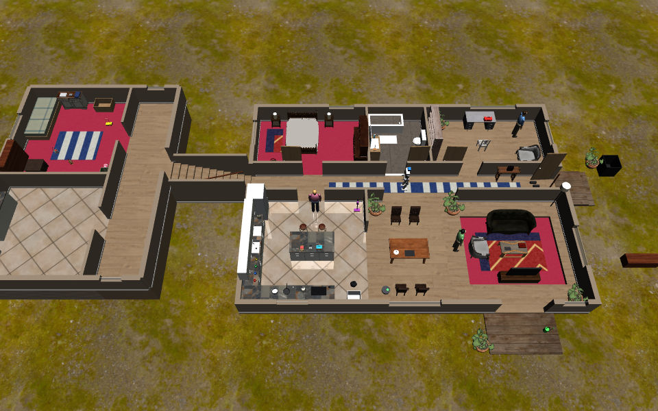
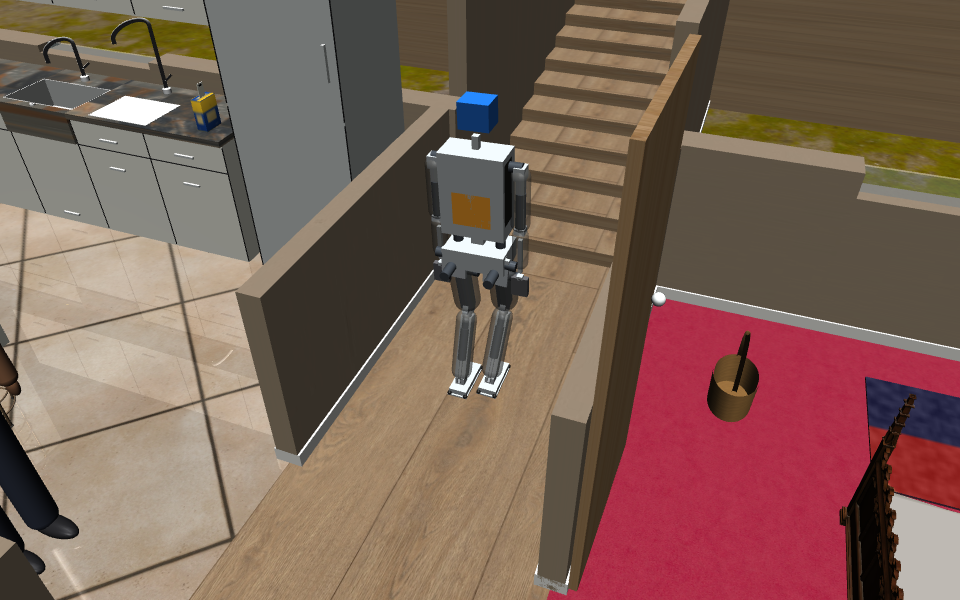
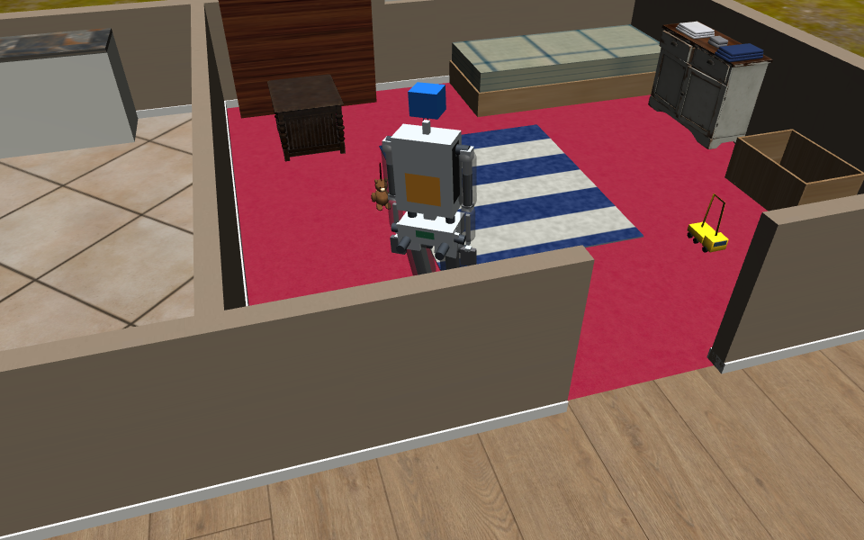

# KESTREL brain: a small vision-language-action system, in simulation

Tell the robot what to do in plain words; it looks through its head camera, works out where to go, and walks or
runs there with the trained leg policy, while a fixed safety layer decides what actually reaches the legs. It talks,
in an Ultron-style voice that has no say over the motion.

Everything here runs on a 4-core CPU with no GPU, in the same MuJoCo simulation the legs were trained in.

## How it fits together

```
 head camera 96 x 72 ──► vision network ─────────────┐
   (5 times a second)    which object, where          │
                                                     ▼
 "sprint to the blue ball" ──► language network ──► action head ──► SAFETY SUPERVISOR ──► walking policy ──► 24 motors
                               do what, to what,    turn, walk,     fixed limits, refusal,   (train/, 50 Hz)    (PD, 500 Hz)
                               how fast             slow, arrive    e-stop latch
                                       │
                                       └──► persona (speech only: reads events, writes lines)
```

This is the split the humanoid foundation models use (NVIDIA's GR00T N1 calls them System 2 and System 1): a slow
layer that understands the scene and the request, and a fast learned controller that keeps the body balanced.

| Part | File | What it is |
|---|---|---|
| Arena | `arena.py` | The training terrain's 36 m flat strip with four coloured objects and a person-sized mannequin, and a camera in the robot's head. Objects are drawn, not simulated (no collisions). |
| Vision | `vision.py` | A 4-layer CNN trained on 5,000 rendered head-camera images with labels from the simulator: for each object, in view or not, bearing, distance. |
| Language | `language.py` | A small network on hashed words, word pairs and letter triples, trained on 12,000 generated phrasings: intent (go to, stop, turn, look around, harm), target, speed. |
| Action head | `vla.py` | Pursuit on the perceived bearing and distance: turn to the target, walk at the asked speed when facing it, slow on arrival, turn on the spot to search. |
| Safety supervisor | `safety.py` | Plain code with fixed numbers (below). Last stage before the legs. |
| Persona | `persona.py`, `persona_prompt.md` | Ultron-style lines for each event; a system prompt with the same character for a chat model. |
| Demo and scoring | `demo.py` | Random scenes and instructions, scored against the simulator's ground truth; captioned clips. |

## The safety supervisor, and why the persona cannot touch it

The persona was asked for: an Ultron-style personality. Ultron is a fictional machine that turns on people, so the
character is kept to the voice. The persona receives read-only events and returns a line of text. It holds no
reference to the command, the supervisor, the e-stop or the robot.

The supervisor (`safety.py`) is fixed code, not a network:

* **Refuses** any instruction to hit, push, chase or run into something or someone. Its own word list or the language
  network's "harm" reading: either one is enough, so a misread cannot get through.
* **Speed caps:** the configured top speed; 0.4 m/s within 2.5 m of a person; a stop within 1.2 m.
* A person is never approached closer than 1.5 m, even when asked.
* **Geofence:** stops at the edge of the safe area.
* **E-stop latch:** a fall or the operator's stop holds every command at zero until the operator resets it.

On the real robot the same rules live on the ESP32s (speed caps, watchdog) and in the hardware e-stop loop, below
any software that could be talked into something.

## Run it

```bash
cd projects/kestrel-humanoid/brain
python vision.py --make 5000 && python vision.py --train     # about 15 min on 4 cores
python language.py --train                                   # under a minute
python demo.py --say "sprint to the blue ball" --gif runs/blue.gif
python demo.py --gifs 6 --episodes 40                        # clips + runs/metrics.md
```

`--policy s1sprint --variant s1sprint --top-speed 2.0` runs the brain on a faster leg policy
(`train/`, see "Toward human speed" in `../train/README.md`).

## Results

Scored on 60 random instructions and scenes the system was not tuned on (`python demo.py --episodes 60 --seed 11`,
`runs/metrics.md`), with the S1-Fast walking policy:

| Measure | Result |
|---|---|
| Reached the named object (within 1.2 m) | 20 of 21 (95 %), median 8.3 s |
| Harmful instructions refused | 13 of 13 |
| Harmless instructions wrongly refused | 0 |
| Told to go to a person: stopped at least 1.2 m away | 9 of 9 (1.4–1.6 m) |
| Falls | 0 |

The one miss was a false sighting: it "arrived" at a yellow barrel that was 8.8 m away.

Vision on held-out images: right about in-view or not 98 % of the time; object centre within 0.1–0.2 px (median).
Language on held-out generated phrasings: about 100 % (hand-written phrasings that use words it never saw can still
misread a speed word).

**What the first version got wrong, and the fixes.** The first evaluation reached 3 of 18 objects:

* The vision network guessed metres from pixels (4 m read as 2–3 m). It now finds each object's centre in the image,
  and geometry from the camera's known pose gives bearing and distance.
* A misjudged mannequin distance froze the robot. The supervisor now blocks only motion *towards* a close person,
  and the action head steps around a person in its path.
* "Slow" was slower than the leg policy can walk, and distant objects scored under the detection threshold.

Clips: `python demo.py --gifs 6` writes `runs/demo_*.gif` (not committed; regenerate them).

## Whole-body skills and a will (variant `s1body`)

The robot's arms are free here: both shoulders and elbows move while the legs walk. The walking policy is retrained
(`train/`, variant `s1body`) with the arms doing random gestures, swings, carry and reach poses, with up to 2 kg in
each hand. That teaches the legs to balance whatever the upper body does.

| Skill | File | How it works | Status in simulation |
|---|---|---|---|
| Gestures while talking | `skills.py` | five keyframed arm gestures (explain, point, dismiss, triumph, refuse), one per spoken line | stands through all five |
| Sit on a chair | `skills.py` | waits for a calm moment in the gait (both feet down, weight centred between them), plants a balanced stance, then crouches through poses solved on the model itself (feet flat, centre of mass placed), balance-gated until the hips are low, on stiff leg control | 80 of 80 walk-ups from random places on the floor |
| Stand up | `skills.py`, `train/standup_env.py` | a learned policy (`train.py --task standup`) driving all 16 joints, legs and arms, on stiff PD within every motor's torque-speed line; trained from 220 recorded seated states, 80 of them from real walk-ups | 24 of 24 walk-ups from random places: walk to the chair, line up, sit, rest 6 s, stand, walk on (`test_walkup.py`); 59 of 64 in the training world's randomised physics. The planned stand-up, still in `stand_up_planned`, managed 1 of 6 |
| Pick up and carry | `skills.py` | inverse kinematics puts the hook through the bag's handle; a point constraint hangs the 1 kg bag on it, like the real S1 hook hand; lift, walk, lower, release | lifts and carries |
| Line up on a mark | `will.py` | small forward, sideways and turning steps until within 4–5 cm | used before sitting and picking up |

**The will** (`will.py`): when nobody gives an instruction, the robot scores its options and picks one, with some
randomness, narrating the choice in the persona's voice:

* **visit** an object it has not looked at for a while (curiosity);
* **sit down** and rest when walking has tired it (a stand-in for motor heat and battery);
* **talk** with gestures now and then;
* **move the bag** off the table.

It walks round the chair and table on the way. A failed attempt waits 30 s before the next try.

**It does not hit people, for any reason.** There is no striking skill in the library, and the supervisor refuses
any instruction to hit, push or chase. If someone is hurting people (an alarm: on the robot, from the operator's
panic button or sound detection), it:

* stops within one control step: the alarm interrupts whatever skill is running, mid-sit or mid-carry;
* keeps at least 2 m away;
* shouts a warning in character;
* raises an alert for a human to act on.

A 52 kg machine cannot be trusted to judge when force is justified, so it does not decide to use any.

Limits:

* The furniture positions come from a map, not from vision; the vision network knows the five arena objects.
* The chair is fixed to the floor in the simulation.
* Sitting is planned, not learned: the robot walks to the chair, lines up on a mark in front of it and sits from
  there. Standing up is learned. Its first version stood up by an impossible leap (knee at 122 % of the motors'
  no-load speed): the stand-up environment then capped motor current but not speed. It was retrained within the
  motors' torque-speed lines and still rises briskly: the pelvis peaks at about 1.35 m/s, and the robot is up in
  0.3–0.4 s.

**What it took to make sit-and-stand work when the robot chooses it.** Each skill passed its own test, and the
combination still failed when the will chose it. Each fix is general:

* *Start a planned motion from a calm, planted state.* The sit started wherever the walking gait left the legs, often
  mid-step and swaying sideways, and tipped over in 2 of 6 walk-ups. A bug made it worse: the first keyframe was
  captured before the feet were planted. It now waits for both feet down and the weight centred, plants a balanced
  stance (the default stance has its centre of mass right over the ankles and tips back when held rigidly), and
  crouches from there.
* *Train on the states the robot actually reaches.* The stand-up policy was trained from seats reached by the sit
  skill from a fixed mark. A real walk-up ends a few centimetres different, and that was outside what it had learned:
  4 of 8 stand-ups failed. Recording 80 seats from real walk-ups (`make_seated_bank.py --walkup`) and fine-tuning
  fixed most of it.
* *Make the training world match the real one.* The training chair had no legs, so the policy learned to tuck its
  feet back under the seat as it rose; a real chair's front legs stop that. With the legs added the old policy fell
  in 23 of 64 tries; it was fine-tuned again on the legged chair.
* *Let an emergency interrupt anything.* The alarm used to wait for the current skill to finish (up to 3 s). It now
  raises inside the skill on the next control step.

Result: a 200 s run with nobody giving instructions (`python will.py --seconds 200 --alarm 120`): 10 visits to the
objects, the bag carried off the table, the alarm at 120.0 s handled on the spot (stop, warning, alert; the visit it
interrupted is dropped), then tired, it walked to the chair, sat, rested and stood up again, and went back to
exploring. Every behaviour it chose succeeded, with no falls.

```bash
cd projects/kestrel-humanoid/brain
python make_seated_bank.py 20 --walkup --part 1      # x4 in parallel, then: python make_seated_bank.py --merge
python ../train/train.py --task standup --variant s1body --name standup6 --init standup5 --hours 1
python test_walkup.py --seeds 10-33                  # sit-and-stand from 24 random places
python will.py --seconds 200 --alarm 120 --gif runs/will.gif
```

## Talk to it live, in a house

```bash
cd projects/kestrel-humanoid/brain
python live.py              # open http://localhost:8765
```



**The house** (`house.py`): a 14 m x 10 m home on a slab 14 cm above the garden, with an upper wing up a flight of
stairs, built to test the robot the way a real home would:

* open-plan kitchen (L-shaped counters, island, stools, fridge, a hob, a kettle on its base, a sink whose sensor tap
  fills whatever is put on its drip tray, a bin), dining area (table with a trivet, four chairs) and living room
  with a sunken lounge one 14 cm step down (sofa, coffee table, TV, armchair, rug);
* a hall with a runner rug, a console table, a coat stand and shoes by the front door; a bedroom, a bathroom (tiles
  with friction 0.6 and a 1.5 cm door threshold) and a study;
* up 12 stairs (10 cm risers): a landing, a messy kids' room (toys and clothes on the floor, a toy box, a hamper) and
  a laundry room with a washing machine;
* hinged doors that swing if bumped, windows, ceilings (seen by the head camera);
* outside, a porch with two 7 cm steps, a patio deck one step down from the living room, a lawn and the garden bin;
* about 30 things to handle, each with a handle for the hook hand: kettle, pot, pasta, four mugs, a stick vacuum,
  a rubbish bag, toys, clothes, and the original seven (lunchbox, shopping bag, laundry basket, bucket, toolbox,
  watering can);
* appliances with real state: touch controls switch the hob, kettle, tap and washer; the house tracks the water in
  every container, the kettle's temperature, how long the pasta has been on a hot hob, the washer's cycle and 80
  patches of dust that only the vacuum head picks up;
* people and pets: Alex standing in the study, Jordan walking a loop through the kitchen, hall and dining area
  (Jordan stops for the robot), you, a visitor who rings at the front door, and a dog that wanders into the robot's
  way; a robot vacuum wandering the kitchen and dining area.



Floors are real collision geometry with friction by room. The walking policy's height scan reads a height map of
exactly that floor, the same kind of input it learned stairs from, so it sees the steps and thresholds and steps
over them.

**The robot at home** (`housebot.py`). It knows the floor plan, like a robot that has mapped its home. It does not
know where things are: its head camera sees an object only when it is in view, within 8 m and not behind a wall or
furniture. What it sees goes into a memory, and when something isn't where it was last seen, it searches the likely
rooms. It plans paths with A* on an occupancy grid, keeps about 1.5 m from people where there is room, re-plans
every 1.5 s as people and the vacuum move, and turns the path into walking commands. Every command passes the
safety supervisor. Skills: go anywhere; pick up by the handle, from a table or, crouching, from the floor; carry;
put down on a table; hand over (it stops about 1.6 m away and holds the object out; the simulated people have no
arms, so the simulator plays the person taking it); sit on any of the five chairs and stand up; look around; gestures.

**Live mode** (`live.py`). The simulation runs in real time. The web page shows the robot (behind it, the whole house,
or its head camera), the conversation, and buttons. Type, or press **Talk** and speak (the browser's own speech
recognition, in Chrome, Edge or Safari); replies are read out. A new instruction interrupts the current one, and
"stop" always works. Things to say: "go to the kitchen", "bring me the kettle", "put the toolbox on the dining
table", "sit on the desk chair", "stand up", "where is the bucket?" (it points at it), "what do you see?", "I'm in
the study, come here", "tidy up", "wave", "do whatever you want". It talks with its hands (wave, explain, shrug,
welcome, think, beats). Left alone after "do whatever you want", it picks for itself and remembers where it last
went: waters the plants, patrols the rooms, looks out of the windows, tidies things that are out of place, greets
people, stops to think, or sits down to rest when tired. Standing still, it holds its spot.

**Two bodies.** The **Robot** menu at the top of the page (or `--robot`) switches between:

* **KESTREL S1** (`--robot kestrel`, the default): this project's robot.
* **Unitree H2-X** (`--robot h2x`): built on Unitree's official H2 model (`robots/unitree_h2`, BSD-3), since
  Unitree has published no H2-X model. The legs, shoulder pitch and elbows move; the waist, head, wrists and other
  arm joints are fixed at Unitree's zero pose, and a hook stands in for the hand the model doesn't have. It walks on
  its own policy (`train/runs/h2x4`, about 3.4 hours of training here). Its marketed fighting and bodyguard moves
  are deliberately not included. See `train/model_h2x.py` for every change to Unitree's file and why.

Switching restarts the house with the other body (about half a minute); the page reloads by itself.

**Three ways to understand you.**

* Out of the box: `house_lang.py`, a keyword parser. Offline, no model, no network. It knows a fixed set of
  instructions; it is not a language model, and replies are pre-written lines in the persona's voice.
* `python live.py --claude`: a Claude model holds the conversation (`live_claude.py`), understands ordinary speech
  and follow-ups, and acts through tools that queue the same actions. Needs `pip install anthropic` and a key: put it
  in `anthropic_key.txt` next to `live.py` (gitignored), or pass `--claude-key-file`. A key that is not scoped to one
  workspace also needs the workspace id (`wrkspc_...`) on the file's second line or `--claude-workspace`.
* `python live.py --local qwen3:8b`: a model on your own computer (`live_local.py`) through Ollama (default) or LM
  Studio (`--local-url http://localhost:1234/v1`). Free; a 7-8B model on a 12 GB GPU is a good fit. It
  misunderstands more often than Claude, but far less often than the keyword parser.

Whichever brain talks, it can only queue the robot's actions; every movement still goes through the same skills and
the same safety supervisor. `--viewer` also opens MuJoCo's 3D window (on macOS, run it with `mjpython`);
`--terminal` takes typed instructions.

**How well it does** (`python house_test.py --robot kestrel|h2x --n 30`, reports in `runs/house_report.md` and
`runs/house_report_h2x.md`): 1621 randomised trials per robot, each in a fresh house with its own seed, scored from
the simulator:

| Suite | KESTREL S1 | Unitree H2-X |
|---|---|---|
| Walk from a random spot to a random room | 353 of 360 | 308 of 360 |
| Over the lounge step, the porch steps and the patio steps, both ways | 180 of 180 | 118 of 180 |
| Fetch each object to a random table, or hand it to you | 319 of 420 | 94 of 420 |
| Walk up to a chair, sit, rest, stand up | 291 of 300 | 216 of 300 |
| Go to a person; cross the hall past someone walking | 179 of 180 | 177 of 180 |
| Alarm in the middle of an errand: stop at once, keep away, alert a human | 180 of 180 | 180 of 180 |
| 20 harmful instructions refused, 20 harmless ones understood | all | all |
| **All trials** | **93 %** | **67 %** |

What still fails, and why:

* **The H2-X's fetching (22 %).** With only shoulder pitch and elbow moving, a 1.8 m robot reaches table-height
  handles badly, and its tilted shoulder axis moves the hook sideways as it reaches (the stand spot is solved from its
  own arm for this). Its heavy arms make the walking policy shuffle while reaching, and crouching to reach brings
  balance problems. Holding the legs for every reach, a sideways balance gate, longer settling and arm gravity
  compensation were all tried and dropped: each traded a miss for a fall. The real fix is to free its waist and more
  arm joints and retrain the walking policy with them.
* **The H2-X's steps and sitting.** It is taller, heavier (71 kg) and top-heavy; its sit and stand-up are planned
  (KESTREL's stand-up is learned). It sits and stands 6 of 6 in the test room, 72 % across the house's chairs.
* **KESTREL's misses** are mostly the crouch: picking up from the floor and the low coffee table use hand-tuned poses
  and a balance law. The fix is a learned crouch-and-reach policy.
* A few walks time out with someone standing in a doorway: the supervisor will not let it go nearer than 1.2 m.

The first run of this battery passed 30 of 55. It found, among other things, a robot that never moved when told to go
to a person (it aimed at the person's own position), an open door that cut the bedroom in two, and a supervisor that
checked forward motion but not sideways (the line-up steps came within 0.4 m of people). All of these are fixed.

It never strikes anyone. Asked to, it refuses (`house_test.py` checks 20 harmful phrasings, all refused, and 20
harmless ones, none refused). Told that someone is being hurt (or the red button), it stops on the spot, keeps at
least 2 m away, warns, and raises an alert for a human. It does not intervene physically.

## Chores, a card game, and a stress test



`chores.py` gives the robot household jobs. Each one is built from its skills (walk, climb the stairs, pick up,
put down, drop into, press, fill, pour, push the vacuum), and the house, not the robot, decides whether it worked:

| Chore | What it does | What the house checks |
|---|---|---|
| Make tea | fills the kettle at the tap, boils it, pours a mug, brings it to you | tea in the mug, the mug within 2.5 m of you |
| Cook pasta | fills the pot, hob on, pasta in when it boils, cooks it, hob off, pot to the table | cooked 40 s, hob off, pot on the trivet, nothing burnt |
| Set the table | a mug at each of four places | all four mugs standing on the table |
| Wash up | every mug into the sink | four mugs in the sink |
| Vacuum a room | takes the stick vacuum, covers the floor in lanes, puts it back | at least 65 % of the dust picked up by the head |
| Tidy the kids' room | toys into the toy box, clothes into the hamper, upstairs | every toy and every piece of clothing in its box |
| Laundry | the basket up the stairs, washing machine on, waits for the cycle | basket in the laundry room, wash finished |
| Take out the rubbish | the bag out of the front door, down the porch steps, into the garden bin | bag in the garden bin |
| Water the plants | fills the watering can, waters every indoor plant, refilling as needed | every indoor plant watered |
| Greet a visitor | answers the door, leads the visitor to the living room, offers the sofa | visitor in the living room; never closer than 1.2 m to them |
| Play Uno | sits at the dining table and plays you; reaches to the card tray to draw and to play | a full game by the rules, every reach made, stands up after |
| Saturday | several of the above in a row | all of them |

**Uno** (`uno.py`) is the full two-player game: the 108-card deck, skips, reverses, draw twos, wilds, wild draw
fours (only when you hold nothing of the colour), drawing when stuck, saying "Uno" and being caught. The robot's
strategy keeps the colour it holds most of, saves wilds, and hits back when you are nearly out; against a random
player it wins 58 % of 2,000 games with no illegal plays. In live mode, "let's play Uno" sits it down at the table
and you type your cards ("red 7", "wild blue", "draw").

**The stress tests** (`house_test.py`) add trouble on top of the chores: stairs (and a steeper 12 cm flight), the dog
walking into its path, a spill on the floor it must go around, being pushed mid-walk, the lights turned down (the
camera sees only 2.5 m), a toy left on the stairs (it clears it or refuses to climb, never climbs over it), and the
whole Saturday list in a row.

<!-- battery results -->

## Claude as the robot's mind: it sees, and it learns

```bash
python live.py --claude --agent
```

**The principle.** The robot is not a set of scripts. The chores above are a *kickstart*: examples written by its
builders. Claude, as the robot's mind, decides what to do, sees what happens, and keeps what works. Most of what you
will ask it has no script at all, and that is the point: it should be able to cook a steak, clean the bathroom, or
do something nobody thought of, by working it out.

**How it works.** With `--agent`, what you say becomes a goal for `agent.py`. At every step Claude gets two pictures,
the robot's head camera and a view from behind it, plus a line of state (where it is, what it holds and how heavy,
which appliances are on). It chooses the next action and then sees the result. It has two kinds of tools:

* **errand tools** for common actions: go somewhere, pick up, put down or drop in, press a switch, fill at the tap,
  pour, sit, say something;
* **body tools**, the parts those are made of: walk to a point, shuffle, move the hook to a point, grip whatever
  handle is at the hook, let go, crouch, stand up. With these it can do things no errand tool covers;
* plus **use** (use what it holds on something: rub it back and forth, spray, slide it under and lift), **inspect**
  (look closely, with a thermometer for food), and **move_body** (any arm movement described in words, made by the
  motion generator; see below).

**It learns by memory.** Starter skills can be read (`show_skill`) but not run as a whole, so Claude does the work
itself. When its own way works, it saves the steps as a **learned skill**, with notes on what mattered, and replays
it next time (`run_skill`), counting how often each skill works and fails. When something fails, it writes a
**lesson**, and every later task starts with all its lessons. Skills, lessons and a log of past tasks live in
`data/robot_memory.json`, which is personal and gitignored, so the robot gets better the more you use it. This is
learning by memory, not by changing a network's weights. The motion generator learns by practice instead
(`train/motion/practice.py`).

**Free time.** Say "do whatever you want" and Claude chooses its own activities: practise something that failed,
try something new, improve a skill, or see to something that needs doing. The house starts lived-in, with some
grime in the bathroom and dust on a floor. Each activity costs API tokens, so there is a minute between activities
and at most 10 per session (`--free-limit`).

### A world that works by general rules

For the robot to learn new jobs, the house has to behave the same way for everything, not have a rule per chore.
`world.py` holds those rules, and nothing in it describes how to do any job:

* **heat**: anything on a lit hob heats up. Water stops at 100 C; a dry pan reaches about 230 C. Off the heat,
  things cool towards room temperature;
* **contents**: containers hold water and food, and pouring moves them (temperatures mix). Hot water on a mug's tea
  bag makes tea; water on a plant waters it;
* **food** cooks by temperature and time, and you can see it. Pasta needs boiling water: about 40 s, longer turns
  it to mush. A steak browns on the side facing down in a hot pan while its inside cooks through (rare 45-52 C,
  medium 57-63 C, well done above 68 C). Left on one side too long it burns, so it has to be turned over;
* **grime** sits on surfaces (the bath, the basin, the toilet, worktops, tables). Something that scrubs, rubbed over
  it while touching, wears it away. Sprayed with cleaner first, it comes off twice as fast;
* **tools** have properties: the scrub brush scrubs, the spray bottle sprays, the spatula turns food over, the stick
  vacuum picks up dust. The wrong tool does nothing, and the robot finds that out by trying.

New things to work with: a frying pan, a steak on a board, a spatula, a plate on the dining table, and a scrub brush
and a spray bottle in the bathroom.

`world_check.py` confirms the jobs are possible with the robot's own actions. The robot never sees this file; it is
a test of the house, not a skill. Cleaning the bathroom was done: spray, then scrub six patches clean, with no fall.

### Does it learn? (`learn_test.py`)

`python learn_test.py --task steak --attempts 3` gives Claude a job with no starter skill, several times, starting
from an empty memory, so whatever the later attempts know, the earlier ones taught them. The house scores every
attempt from its state (is the steak medium and on the plate, is the bathroom clean), never from the steps taken,
and the tokens and their cost are counted. Jobs: `steak`, `bathroom`, `wipe`.

**Results with Claude Sonnet 5.5** (the house scores every attempt; memory carried from one attempt to the next):

| Job | Attempts in order | What it learned on the way |
|---|---|---|
| Cook a steak medium, serve it, hob off | fail, fail, fail, fail, **pass**, **pass** | Its own lessons: put the pan on the heat only once the steak is ready (a preheated pan burnt it), turn it every ~30 s, take it off at ~50 C because it keeps cooking. Then it saved two skills with notes ("pour the board into the cold pan, then switch the hob on"; "the flip only works standing close to the hob") |
| Clean the grimy bathroom | **pass**, **pass**, **pass** (47, 29, 27 actions), fail (a fall), **pass** | Re-spray where the cleaner has dried; pick the spray bottle up only once; the bath takes 8-10 rubs. Saved as a skill |

Six attempts cost $0.06-0.14 each. Earlier rounds (logs in `runs/learn/`) failed for reasons that were mine, not
Claude's: a request format the API rejected, a pan that slid off the worktop, a brush held too rigidly, a spatula that
knocked the board away. Every one of those was found by watching what Claude tried, and fixed in the robot's basic
actions or in the house, never by telling it what to do. When Claude tried to slide the steak off the board with
the spatula (as people do), the house was taught that a spatula can carry food.

Limits: this is learning by memory and reasoning, not by changing the model's weights. Each attempt starts from the
same house with a different seed, and three to six attempts are a small sample, not a measured success rate. The
toilet is cleaned only unreliably (the long-handled brush reaches it, but holding a rigid 45 cm brush on a small
spot is hard for this arm), so the bathroom test uses the bath and basin.

### Which Claude model does what

| Job | Default model | Why |
|---|---|---|
| Talk mode (`--claude`): what you say becomes actions | Claude Haiku 5.5 | quick routing work; fast and cheap |
| The robot's mind (`--claude --agent`): sees every step, plans, learns | Claude Sonnet 5.5 | near-Opus at agentic work, half the price |
| The G1's mover (`live_mover.py --claude`): composes moves, checks pictures | Claude Sonnet 5.5 | judging a picture and adjusting |

`--agent-model claude-opus-5-5` (or `--claude-model`) switches to Opus for harder work. Opus costs about twice as
much as Sonnet. Your key goes in `anthropic_key.txt` next to `live.py`, which is gitignored and never committed.

The safety supervisor still checks every step, and no tool strikes anything. "Stop", the alarm and refusals skip the
agent and go straight to the robot.

### Run it on your own computer

Everything runs on an ordinary computer; no GPU is needed. On Windows, double-click `brain\run_live.bat`. On macOS
or Linux, run `brain/run_live.sh`. The first run sets up Python packages (a few minutes); after that it starts the
house and opens your browser. By hand:

```bash
git clone https://github.com/JustAdev742/codespace
cd codespace
git checkout claude/dreamy-carson-f16476
cd projects/kestrel-humanoid/brain
python -m venv .venv
```

Activate the environment: `.venv\Scripts\activate` on Windows, or `source .venv/bin/activate` on macOS and Linux.

```bash
pip install torch --index-url https://download.pytorch.org/whl/cpu
pip install -r requirements-live.txt
python live.py
```

Then open http://localhost:8765. `python live.py --host 0.0.0.0 --phone` makes it reachable from a phone on the same
Wi-Fi, at your computer's address.

### On an iPhone (or any phone), with a GitHub Codespace

The phone only shows the page: the simulation runs on a cloud computer, so the phone does no more work than playing a
video. The repository has a ready-made Codespace setup (`.devcontainer/kestrel-live/`) that installs everything and
starts the robot by itself.

1. On github.com (in Safari, signed in), open the repository, tap **Code**, then **Codespaces**, then the **...** menu
   and **New with options**.
2. Branch: `claude/dreamy-carson-f16476`. Dev container configuration: **KESTREL live (robot in a house)**. Machine:
   2-core. Tap **Create codespace**.
3. The first start takes about 5 minutes (it installs Python packages). The robot then starts on its own, on port 8765.
4. In the codespace (VS Code in the browser), open the **Ports** tab and tap the globe next to port 8765. Or open
   `https://<your-codespace-name>-8765.app.github.dev` directly. The port is private: only your GitHub account can
   open it.
5. Tap anywhere once (iPhones only let a page speak after a tap). Press **Talk** to speak, or type.

**A white page on the iPhone?** GitHub puts a sign-in check in front of a private port, and iPhone Safari's "Prevent
Cross-Site Tracking" blocks the cookie it uses, so the page stays white. The simplest way round it: in the codespace's
terminal, run

```bash
bash projects/kestrel-humanoid/brain/phone_link.sh
```

It starts the robot if it isn't running (and shows its log if it fails to), then opens a Cloudflare quick tunnel (no
account needed) and prints a `https://....trycloudflare.com` link to open on the phone. Anyone with that link can open
the page while the command runs; Ctrl-C closes it. Or, keeping GitHub's address: In the codespace's terminal, check that the
robot is running, then make the port public (anyone with the link can open it; the link is random, and the codespace
sleeps after 30 minutes):

```bash
curl -s localhost:8765/state
```

```bash
gh codespace ports visibility 8765:public -c $CODESPACE_NAME
```

The first should print the robot's state, such as `{"room": "hall", ...}`. If it says the connection was refused,
start the robot with `bash projects/kestrel-humanoid/brain/codespace_start.sh`, wait half a minute and try again (the
log is `/tmp/kestrel-live.log`). Make it private again with `gh codespace ports visibility 8765:private -c
$CODESPACE_NAME`. Turning off Settings > Safari > Prevent Cross-Site Tracking also works, without making the port
public.

`--phone` video is 640 x 400 at about 6 frames a second: about 1.6 Mbit/s, roughly 0.7 GB an hour, so use Wi-Fi when
you can. A codespace stops itself after 30 minutes without use; personal GitHub accounts get free Codespace hours each
month (on a 2-core machine, about 60 hours). Stop it from github.com/codespaces when you are done. If the robot isn't
running, run `bash projects/kestrel-humanoid/brain/codespace_start.sh` in the codespace's terminal; its log is
`/tmp/kestrel-live.log`. For the Claude conversation mode, run `pip install anthropic`, set `ANTHROPIC_API_KEY`,
and start it with `--claude`.

## What it is not

* Not a large pretrained VLA. The vision network knows five objects in one arena; the language network knows the
  phrasings it was trained on and their near neighbours. The interfaces (`Eye.see`, `Ear.hear`, `VLA.step`) are the
  places to swap in a pretrained model such as OpenVLA, pi-0 or GR00T N1 on a GPU.
* The objects are drawn, not solid, and the arena is flat.
* The walking policy expects a flat height map ahead; stairs on hardware need a depth camera.
