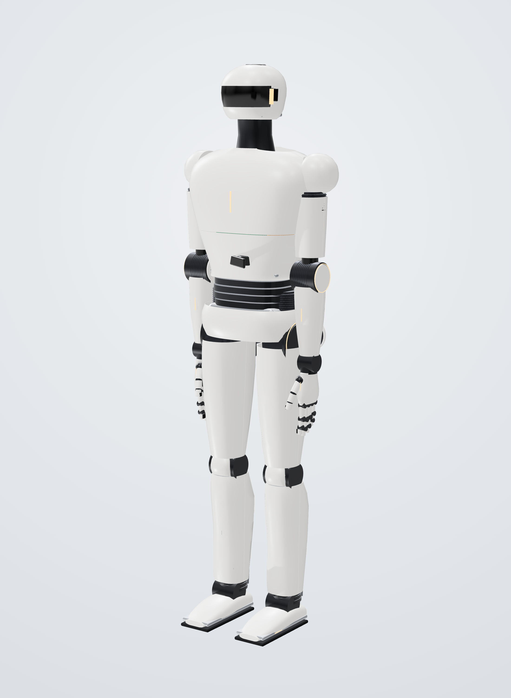
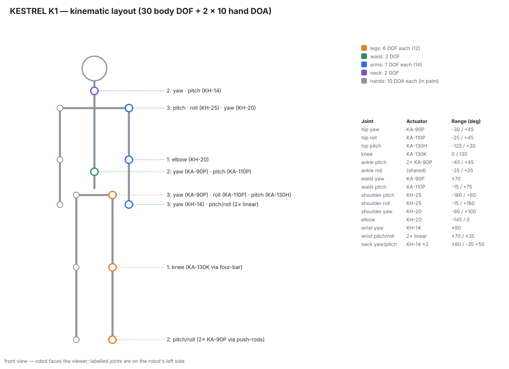

# 01 — Robot concept, capabilities and engineering philosophy

## 1. What KESTREL K1 is

KESTREL K1 is a 1.75 m, ~84 kg electric humanoid built around proprioceptive, custom
actuators. It walks on two legs, carries and manipulates objects with two 10-DOA hands,
and perceives its surroundings with stereo vision, a 360° LiDAR and depth sensing. It is
designed to be **built by one determined person with access to job shops** (CNC, gear
cutting, MJF printing, PCB assembly), and to be **serviced** like a professional machine.
Every major part is a module that can be removed and tested on its own.

This is a serious engineering project, not a render. Every number below is either:

| Tag | Meaning |
|---|---|
| **[sim]** | computed by the engineering model in `calc/` (inverse dynamics, sizing, thermal, power) |
| **[ds]** | taken from a manufacturer datasheet / page (sources in `docs/research/R1–R6`) |
| **[est]** | engineering estimate, to be confirmed by test (docs/11) |
| **[target]** | a requirement the design must meet; not yet demonstrated |

Nothing on this robot has been built or tested yet. The design is consistent and checked
by calculation; it is **not** proven. Section 7 lists what is most likely to be wrong.

## 2. Capability targets

| Capability | Target | Basis |
|---|---|---|
| Height / mass | 1.75 m / **84 kg estimated** (92 kg design mass incl. 10 % growth) | [sim] `docs/generated/mass_budget.md` |
| Walking | 0.8 m/s nominal, 1.2 m/s fast (flat-footed ZMP gait, simulated); 1.5 m/s with a learned heel-toe gait | [sim] / [target] |
| Stairs | 0.18 m rise, 0.28 m tread, 0.9 s per step, step-over-step | [sim] |
| Step-up / lunge | single-leg rise onto a 0.30 m platform in 1.2 s | [sim] |
| Squat & lift | full squat holding a 20 kg box at the chest | [sim] |
| Arm payload | 5 kg per hand at full forward reach (static); 3 kg side raise | [sim] |
| Disturbances | survive an unplanned 0.10 m drop (missed step) without damage; structure survives 0.15 m | [sim] momentary / structural cases |
| Hands | 10 actuated DOF each; ≥ 10 N fingertip, ≥ 50 N power grasp, close ≤ 1 s, ≥ 5 kg payload | [target], ILDA reference [ds] |
| Runtime | 3.7 h mixed duty, 3.2 h continuous walking (1.68 kWh pack) | [sim] `docs/generated/power_budget.md` |
| Perception | stereo + wide VIO cameras, 360° LiDAR, downward depth for footholds, mic array | [ds] |
| Compute | NVIDIA Jetson AGX Thor (T5000) for AI; separate PREEMPT_RT computer for control; independent safety MCU | [ds] |
| Safety | hard-wired e-stop chain → STO on every drive + bus disconnect; independent safety MCU; tested with a gantry harness | design rule |
| Protection | IP54 target for body (splash, dust); gaiters at waist and ankles | [target] |

## 3. Engineering philosophy

1. **Loads first, hardware second.** Joint requirements come from whole-body inverse
   dynamics over 15 design scenarios (walking, stairs, squats, step-ups, drops, arm work),
   not from guesses or copied specifications. `calc/run_all.py` regenerates every table.
2. **Design to the not-to-exceed mass.** All requirements use the estimated mass +10 %
   (91.9 kg). Programmes always gain mass; the actuators must not become marginal when they do.
3. **Each joint gets the transmission its job needs.**
   - **Legs and waist** use quasi-direct-drive planetary actuators at 13–32:1. They tolerate impacts, can be back-driven and are torque-controlled from motor current.
   - **Arms** use strain-wave gears at 50:1 for precision and zero backlash, with output torque flexures for collision detection.
   - **Hands** use ball-screw linkages.

   It is a family of 7 actuator classes, so the robot is not built around one motor everywhere. Each class is sized against the full torque-speed envelope of the joints it serves.
4. **Keep the mass high and central.** The knee actuator sits in the upper thigh and drives
   the knee through a four-bar. The two ankle actuators sit in the calf and drive the foot
   through push-rods. Leg swing inertia falls sharply, and so does the hip torque needed to swing it.
5. **Make speed, torque and heat agree.** A motor can be strong enough on paper and still overheat walking, or be unable
   to reach swing speed at a low battery. The sizing checks every simulated (torque, speed) point at the
   **minimum loaded bus voltage** and the continuous duty at thermal limits.
6. **Deterministic control, independent safety.** Motor timing and balance never depend on
   the AI computer. The safety chain is hard-wired and can stop the robot even if every
   computer has crashed.
7. **Spend money where it buys capability or safety.** Custom motors are used where no
   commercial kit meets the knee/hip thermal duty; commercial frameless kits everywhere
   else; Leaderdrive strain-wave gears (identical published ratings to Harmonic Drive CSG)
   instead of the premium brand; optional items (6-axis F/T sensors) are kept out of the baseline.

## 4. Architecture at a glance

| Subsystem | Choice | Why |
|---|---|---|
| DOF | 12 legs (6 each), 2 waist, 14 arms (7 each), 2 neck = **30 body DOF**; 2 × 10 hand DOA | 6-DOF legs for general footholds; 7-DOF arms for redundancy around obstacles; waist pitch for floor reach |
| Knee & hip pitch | **KA-130K / KA-130H**: custom **KM-130** frameless motor (Ø130) + 2-stage planetary 14:1, ducted air cooling | Only option that covers stairs/step-up torque *and* swing speed *and* walking heat at the 52 V minimum bus — [sim] |
| Hip roll, waist pitch | **KA-110P**: TQ ILM85x26 + 32:1 planetary | 276 N·m peak, low speed |
| Hip yaw, waist yaw, ankles | **KA-90P**: CubeMars RI85-PH + 23:1 planetary | fast (16 rad/s) and light (1.4 kg) |
| Shoulders | **KH-25**: TQ ILM85x13 + size-25 strain-wave 50:1 | stiffness for the whole-arm moment |
| Shoulder yaw, elbow | **KH-20**: RI85-PH + size-20 strain-wave 50:1 | |
| Wrist yaw, neck | **KH-14**: custom KM-50 + size-14 strain-wave 50:1 | |
| Wrist pitch/roll | 2 parallel ball-screw linear actuators in the forearm | small wrist, low distal mass |
| Hands | 10 palm-housed micro linear actuators per hand, four-bar fingers | robust, back-drivable, human-proportioned |
| Power | **16S Li-ion, 59.2 V nominal (48–67.2 V)**, 16S6P Molicel P50B, 1.68 kWh | 13S was rejected by the sizing: no motor/ratio covered the knee at 42 V — docs/05 §2 |
| Drives | EtherCAT servo modules: Elmo Platinum Twitter class (knee, hip pitch), Novanta Everest S NET (all others) | 80–100 V rating gives margin over the 67.2 V bus + regeneration; SIL3 STO inputs |
| Control compute | UP Squared Pro 7000, PREEMPT_RT, IgH EtherCAT master at 1 kHz | native i226 driver, deterministic |
| AI compute | Jetson T5000 on Seeed J601 carrier (8× GMSL2) | perception + VLA/LLM workloads |
| Safety | FORT SIL3 wireless e-stop + wired pendant → dual-channel relay → STO + solid-state bus disconnect; TMS570 safety MCU | independent of software |

## 5. Benchmarks — how the requirements compare

| Robot (source) | Height / mass | Knee peak | Hip peak | Ankle | Waist |
|---|---|---|---|---|---|
| Unitree H1-2 [ds R1] | ~178 cm / 70 kg | ~360 N·m | ~220 N·m | 2 × 75 N·m | ~220 N·m |
| Fourier GR-2 [ds R1] | 175 cm / 63 kg | — | max joint 380 N·m | — | — |
| Tesla Optimus (2022, secondary) | — / 57–73 kg | rotary classes 20/110/180 N·m; linear up to 8 kN | | | |
| **KESTREL K1 requirement** [sim] | 175 cm / 84 kg (92 design) | **352 N·m** repeated, 428 momentary | **337 N·m** (pitch) | **172 N·m** joint (≈ 2 × 93 N·m actuators) | **205 N·m** |

KESTREL K1's requirements sit where they should for its heavier mass. The hip pitch is
higher than H1-2's because the simulated fast gait is a conservative flat-footed ZMP walk,
and the stance hip must cancel the swing leg's reaction torque while the torso is held
upright.

## 6. What "finished" means

1. All 30 joints commissioned through gates G0–G9 (docs/11), with logged thermal margins.
2. Walks untethered at ≥ 0.8 m/s for 1 h, climbs 0.18 m stairs, recovers from a 20 N·s push.
3. Picks and places 5 kg objects with either hand, using perception and a skill API.
4. Every module can be swapped in ≤ 30 min with hand tools, and has a bench test procedure.

## 7. Biggest uncertainties (top 8; full register in docs/11 §9)

| # | Uncertainty | Impact | How it is retired |
|---|---|---|---|
| 1 | Custom KM-130 motor torque constant and thermal resistance (model calibrated to two datasheets ±5 %, not built) | knee/hip pitch thermal margin | FEA (FEMM) + build one motor first, dyno thermal step test (Phase 5) |
| 2 | Custom planetary gear quality (backlash, efficiency 0.92 assumed, tooth life) | efficiency, noise, endurance | buy gears from a gear shop to ISO 6; 10⁵-cycle dyno endurance before leg assembly |
| 3 | Mass growth beyond +10 % | every joint requirement | weigh every module; re-run `run_all.py`; KA-130 utilisation is 81 % peak |
| 4 | Real gait differs from the ZMP model (impacts, slipping) | peak and RMS torques | supported-walking logs vs model; actuator margins 1.2×; RL policy trained with torque penalties |
| 5 | Prices: 84 % of baseline cost is estimate or quote-only | budget | obtain quotes before committing (docs/12) |
| 6 | Strain-wave gear from a second-source vendor | arm precision/life | buy one, measure backlash/stiffness before buying 12 |
| 7 | EtherCAT 28-slave 1 kHz timing on the chosen RT computer | control stability | latency/jitter test at G0 with all slaves before limb work |
| 8 | Hand durability (ball screws, linkages) | uptime | 10⁴-cycle finger endurance on a single finger rig |

## 8. Document map

| # | Deliverable | File |
|---|---|---|
| 1 | Concept | this file |
| 2 | Industrial design & views | [02-industrial-design.md](02-industrial-design.md) |
| 3 | Mechanical architecture | [03-mechanical-architecture.md](03-mechanical-architecture.md) |
| 4 | Actuator catalogue | [04-actuator-catalogue.md](04-actuator-catalogue.md) |
| 5 | Electrical architecture | [05-electrical-architecture.md](05-electrical-architecture.md) |
| 6 | Sensor architecture | [06-sensor-architecture.md](06-sensor-architecture.md) |
| 7 | Software architecture | [07-software-architecture.md](07-software-architecture.md) |
| 8 | Bill of materials | [08-bom.md](08-bom.md) · [`data/bom.csv`](../data/bom.csv) |
| 9 | Manufacturing package | [09-manufacturing-package.md](09-manufacturing-package.md) |
| 10 | Visual construction tutorial | [10-construction-tutorial/](10-construction-tutorial/README.md) |
| 11 | Testing & commissioning | [11-testing-commissioning.md](11-testing-commissioning.md) |
| 12 | Cost analysis | [12-cost-analysis.md](12-cost-analysis.md) |
| 13 | Optional: scratch-build every motor & actuator | [13-scratch-build-motors-actuators.md](13-scratch-build-motors-actuators.md) |
| — | Research notes with sources | [research/](research/) |
| — | Generated engineering tables | [generated/](generated/) |
