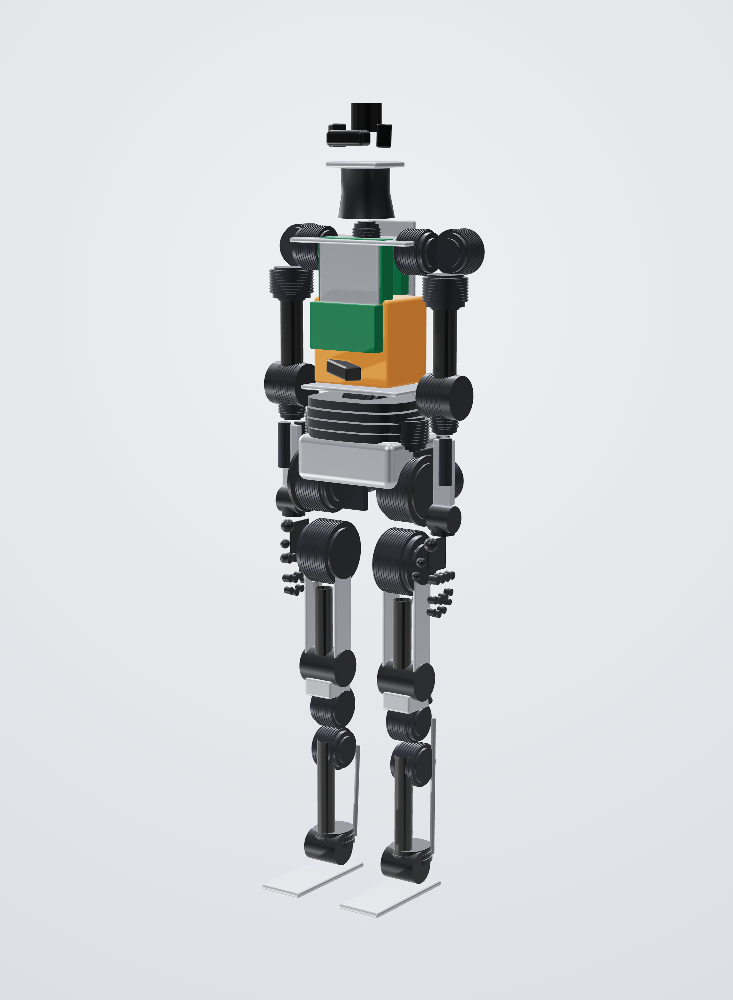
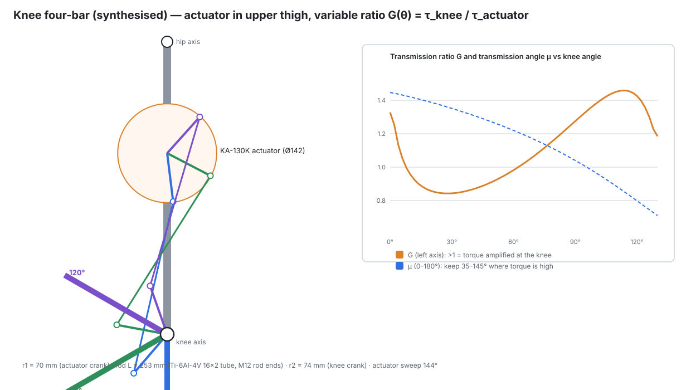
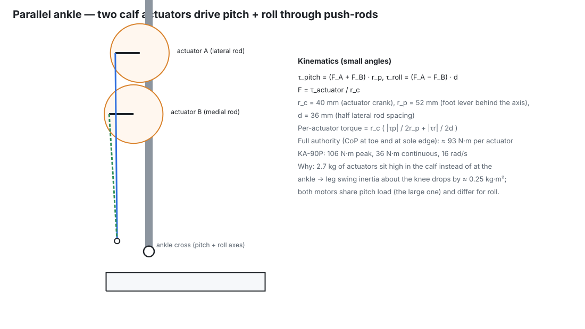
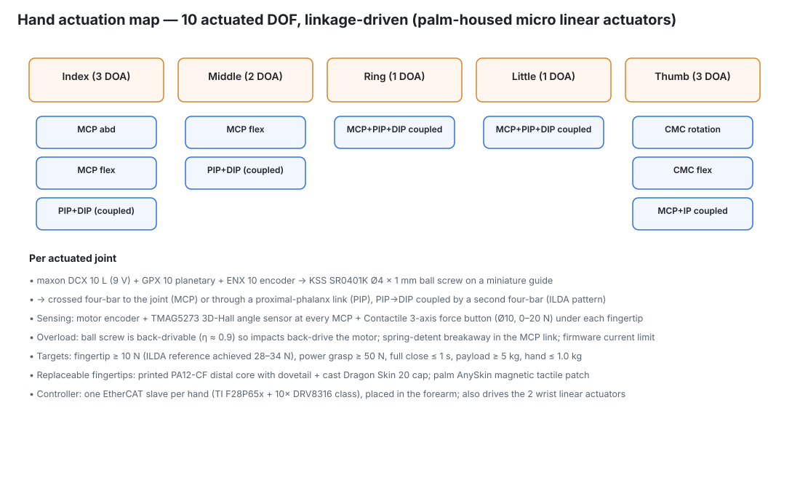

# 03 — Mechanical architecture: skeleton, joints, transmissions, materials



Source of truth: `calc/kestrel/params.py` (geometry, mass budget), `cad/build_robot.py`
(packaging), `calc/kestrel/structure.py` (hand calculations, results in
[generated/structure_checks.md](generated/structure_checks.md)).

## 1. Skeleton and load paths

```
            head ── neck (KH-14 ×2)
                      │
   arm ─ KH-25 ─┐   torso: 7075 spine plate + ribs, battery bay (load-bearing enclosure)
   (7 DOF)      └── shoulder pitch actuators mounted on upper rib
                      │ waist pitch (KA-110P) ── waist yoke ── waist yaw (KA-90P)
                      │
                 PELVIS BOWL (7075, 5-axis) ← central hub: hip yaw ×2, waist yaw
                 ╱                 ╲
    hip yaw (KA-90P)            hip yaw
    yaw–roll yoke                    …
    hip roll (KA-110P, gluteal)
    roll–pitch bracket
    hip pitch (KA-130H, coaxial with hip centre)
    THIGH: twin 7075 plates + Ø40 CF tube; knee actuator (KA-130K) 160 mm below hip
           → four-bar (Ti push-rod) → knee hub
    SHANK: CF tube Ø40×2 + 7075 upper fitting carrying two KA-90P ankle actuators
           → two Ti push-rods → foot levers
    ANKLE CROSS (Ti-6Al-4V, needle rollers) → FOOT PLATE (7075 ribbed) → replaceable sole
```

Ground reaction loads run sole → foot plate → ankle cross → shank tube → knee hub → thigh
plates → hip pitch output → roll bracket → yoke → hip yaw bearing → pelvis bowl. **Every
actuator output bearing is a crossed-roller bearing that carries the joint's full moment
load.** The gear never sees bending, only torque.

Principal dimensions (joint centre to joint centre): ankle height 75 mm, shank 420, thigh
420 (hip centre at 915 mm), hip half-width 105, waist pitch 1085, shoulders 1420 at
±200, upper arm 300, forearm 260, hand 190. Ranges are in the DOF diagram
(`diagrams/dof_map.svg`).

## 2. Material selection (every major part has a reason)

| Component | Material | Why this material (and why not the alternatives) |
|---|---|---|
| Pelvis bowl, torso spine/ribs, yokes, brackets, thigh plates, foot plate, actuator housings | **7075-T6/T651** (σy 503 MPa, E 71.7 GPa, ρ 2.81) [ds R6] | Best strength-to-weight of machinable aluminium, and it hard-anodises. 6061 (σy 276 MPa) would need ~1.8× section for the same stress. Titanium is 1.6× denser, 10× the cost and hard to machine, with no stiffness-to-weight advantage. |
| Thigh/shank tubes, upper-arm tubes | **CFRP roll-wrapped tube** (axial E ≈ 90 GPa, design σ 350 MPa) [ds R6] | Highest bending stiffness per kg for long members; bonded into 7075 end fittings (structural epoxy, 25 mm engagement). Can't be tapped, so no fasteners go into the CF. |
| Knee push-rod, ankle push-rods, ankle cross, wrist cross, ankle pins | **Ti-6Al-4V** (σy 880 MPa, fatigue 510/240 MPa) [ds R6] | High fatigue strength in slender, highly cycled parts; corrosion-free contact with CF and steel. The knee rod is buckling-critical, and Ti gives 1.6× aluminium's stiffness. |
| Planetary gears (sun, planets, ring) | **18CrNiMo7-6 carburised** (58–62 HRC case) or 17-4PH H900 for low-duty stages | Case-hardened alloy steel for tooth bending and contact fatigue (Lewis check SF 2.7 at the momentary case). Aluminium or plastic gears are not acceptable at 395 N·m. |
| Shafts, rotor hubs | 7075 (rotor hub), 17-4PH (high-load shafts, pins, bushings) | 17-4PH: 1170 MPa yield, stainless, and machinable before ageing. |
| Strain-wave gears | supplied component sets (flexspline = alloy steel) | not field-manufacturable (docs/13) |
| Bearings | through-hardened bearing steel (52100), crossed-roller outputs | purchased |
| Shells | **PA12 HP MJF** (E 1.7 GPa, 48 MPa, 20 % elongation) | Light, tough, prints complex lofts directly, and paints well. CFRP shells are lighter but brittle in a fall and expensive per change. |
| Visor | Polycarbonate | impact-resistant, optical |
| Gaiters / bellows | TPU 95A | elastic, abrasion resistant |
| Fasteners | 12.9 alloy (zinc-flake coated) for joints; A4 stainless for shells; Ti Gr5 where weight/corrosion matter | preload capacity for the slip-critical flanges |

## 3. Joint assemblies

### 3.1 Hip (yaw → roll → pitch)
* **Yaw**: KA-90P in the pelvis bowl, axis vertical, 75 mm above the hip centre; its output
  crossed-roller carries the whole leg. Range −30/+45°.
* **Roll**: KA-110P mounted on the yaw–roll yoke **behind** the hip (x = −118 mm, the
  gluteal volume) so it clears the Ø142 hip pitch housing. Axis passes through the hip
  centre. Range −25/+45°.
* **Pitch**: KA-130H **coaxial with the hip centre** (y 61–149 mm). That keeps the hips
  within ±150 mm so the hanging arms clear them (wrists sit at y ≈ ±167 mm). Range −125/+30°.
  Roll and pitch axes intersect at the hip centre, which gives analytic leg IK.

### 3.2 Knee: actuator in the thigh, four-bar drive



* KA-130K mounted 160 mm below the hip axis. That gives an 18 mm running clearance to the hip actuator
  (the two Ø142 housings are on fixed centres 160 mm apart).
* Four-bar synthesised by `calc/kestrel/linkages.py`:
  - actuator crank r1 = 70 mm;
  - Ti-6Al-4V push-rod L = 253 mm (Ø16 × 2 mm tube), M12 PTFE-lined rod ends;
  - knee crank r2 = 74 mm;
  - the ratio G = τ_knee/τ_act runs **0.86 at 20–40°** (faster swing) and rises to **1.38–1.43 at 100–120°** (stairs, step-up);
  - near full extension G rises to 1.33, a mild "knee-lock" when standing.
* Range 0–130° with a hard stop at 132°. A single four-bar cannot sweep 145° with good transmission
  angles, so kneeling is not supported. The deep squat (≈ 125°) is.
* Moving the 4.2 kg actuator from the knee to near the hip cuts leg inertia about the hip
  by ≈ 0.63 kg·m², and the hip pitch swing torque with it.
* Knee hub: 2 × thin-section angular-contact bearings, preloaded, 7075 hub with a 17-4PH bushing.

### 3.3 Ankle: parallel push-rods



* Two KA-90P actuators in the calf (z = 400 and 300 mm) drive the foot through Ti push-rods
  to levers 52 mm behind the ankle axis, at ±36 mm laterally. Pitch is the sum of the rod forces
  and roll is their difference.
* Ankle cross: Ti-6Al-4V with 4 drawn-cup needle-roller bearings (HK1212 class) on hardened
  pins Ø12. The cross-pin double-shear SF is 51 at the structural drop.
* Full-authority requirement 172 N·m pitch / 50 N·m roll (centre of pressure at the toe and at the sole edge, at
  design mass) maps to **93 N·m per actuator** against 106 N·m available.
* Ranges: pitch −45/+45°, roll ±25°; elastomer bumpers at the ends.

### 3.4 Waist
Yaw: KA-90P in the pelvis top. Pitch: KA-110P on the waist yoke (−15/+75°) gives floor
reach and the box squat (205 N·m requirement, H1-2 class). Both are surrounded by the TPU
bellows.

### 3.5 Shoulder, elbow, wrist
* Shoulder pitch: KH-25 in the chest (y = ±135 mm), output outward.
* Shoulder roll: KH-25 behind the shoulder centre, under the deltoid cap.
* Shoulder yaw: KH-20 in the upper arm (axis along the arm).
* Elbow: KH-20, −145/0°.
* Wrist yaw (pronation): KH-14 in the proximal forearm.
* Wrist pitch/roll: two ball-screw linear actuators (DCX 16 L + GPX 16 + KSS Ø6×2) in the
  forearm acting on a Ti wrist cross through 22 mm (pitch) and 16 mm (roll) lever arms. That gives
  13 N·m pitch and 10 N·m roll with a slim wrist.
* All arm joints carry an output torque flexure (4 strain gauges, ADS1262), so the arm is
  collision-sensitive like a cobot arm.

### 3.6 Neck
Yaw (KH-14 in the upper torso) and pitch (KH-14 in the neck yoke). 12 N·m each covers a
0.8 rad nod in 0.3 s with a 2 kg head plus shock margin.

## 4. Transmission technology selection

| Technology | Torque density | Backdrivability / impact | Precision | Efficiency | Builder feasibility | Used for |
|---|---|---|---|---|---|---|
| **Low-ratio planetary (QDD, 6–32:1)** | medium–high | **excellent**: back-drivable, survives impacts | backlash 3–10 arcmin | **0.90–0.95** | gears from a gear shop to drawing | **legs, waist** |
| **Strain-wave (harmonic), 50:1** | very high | poor back-drive; flexspline can ratchet under shock | **zero backlash**, < 1 arcmin | 0.65–0.80 | buy only | **arms, neck, wrist yaw** |
| Cycloidal (RV / single-stage) | very high | good shock rating (5× momentary) | < 1–2 arcmin | 0.80–0.90 | wire-EDM discs possible | scratch-build alternative to harmonic (docs/13) |
| Planetary roller screw + linkage | very high | good | high | 0.80–0.89 [ds R1, Rollvis] | expensive purchased | rejected: knee four-bar is simpler and cheaper |
| Ball screw (micro) | high | back-drivable (η ≥ 0.9) | high | 0.90 | buy | **wrist pitch/roll, fingers** |
| Belt / cable | medium | good | compliant | 0.95 | easy | rejected for main joints (creep, re-tensioning) |

Why harmonic in the arms but not the legs: arm loads are smooth and precision matters. Leg joints take
ground impacts and walking needs low reflected inertia and back-drivability. The
reflected rotor inertia of the knee at 14:1 is 0.24 kg·m². A 100:1 harmonic would reflect about 50× more.

## 5. Bearings, shafts, couplings

| Location | Bearing | Fit / preload |
|---|---|---|
| Actuator outputs (all 26) | crossed-roller (KA-130: ~ID90/OD120; KA-110/90: ~ID60/OD90; KH: per strain-wave size) | housing H6 / shaft k5, manufacturer preload class C1 |
| Motor rotors | thin-section deep-groove pair (68xx/61xx), one fixed, one floating with wave spring | j5 / H6 |
| Knee hub | 2 × angular-contact (back-to-back) | 50 N axial preload |
| Rod ends | PTFE-lined spherical, M12 (knee), M8 (ankle) | — |
| Ankle / wrist crosses | drawn-cup needle rollers on hardened pins | pins m6 |

Couplings: none. Every actuator output bolts directly to the next link through a
**friction joint** (12 × M5 12.9 on PCD 105 for KA-130; 2.18 slip safety factor at the momentary torque) plus 2
dowels for location. The flange slip torque is deliberately the **mechanical overload fuse**:
it slips before the gear teeth fail.

## 6. Mechanical stops and overload protection

1. **Soft limits** 3° inside mechanical range (software, RT controller).
2. **Hard stops**: machined lugs with replaceable 90A polyurethane bumpers absorb the full
   rotor kinetic energy at maximum speed. Knee stop energy at 11 rad/s is ½·0.24·11² ≈ 15 J.
3. **Drive torque limits** set per joint at the gear's repeated-peak rating (strain-wave gears:
   firmware limit, because motor peak × ratio exceeds the gear's repeated peak — [ds R1]).
4. **Flange friction slip** at ≈ 2× momentary torque (above).
5. **Hands**: back-drivable ball screws, spring-detent breakaway links, current limits.

## 7. Vibration management

* First structural mode targets: leg > 40 Hz, arm > 25 Hz (≥ 4× the whole-body control
  bandwidth of ~8 Hz). Check by FEA modal analysis, then a tap test with an accelerometer at G2.
* The pelvis IMU sits on a 4-point silicone isolator mount (≈ 80 Hz corner) to reject gear mesh
  and drive PWM vibration while passing balance dynamics.
* Gear mesh frequencies are kept off structural modes by choosing tooth counts (documented in docs/09).
* Cable bundles are clipped every 80 mm to prevent fretting and chatter.

## 8. Hands (mechanical)



* **Architecture selected: linkage-driven, palm-housed micro linear actuators.** This is the ILDA pattern
  (Kim et al., Nat. Commun. 2021: 15 maxon DCX 8 + Ø4 × 1 ball screws, 34 N fingertip,
  1.1 kg) and the commercial Inspire hands use the same approach [R5].
* **Why not tendons:**
  - about 24 % force loss over a 1 m sheath [R5, MM-Hand];
  - creep and re-tensioning;
  - coupling with wrist motion;
  - tendon breakage every few thousand cycles in open designs [R5, ORCA].
* **Why not direct-drive fingers:** custom micro BLDC motors and drives in every phalanx are beyond a sensible build.
* **Why not joint servos (LEAP):** about 30 % oversize, which breaks the human proportion target.
* **10 actuated DOF:**
  - thumb 3 (CMC rotation, CMC flexion, MCP+IP coupled);
  - index 3 (MCP abduction, MCP flexion, PIP+DIP);
  - middle 2;
  - ring 1 and little 1 (fully coupled flexion).
* **Per actuator:** maxon DCX 10 L + GPX 10 + ENX 10 encoder → KSS SR0401K Ø4 × 1 mm ball screw
  on a miniature guide → crossed four-bar.
  - Sizing (research arithmetic, R5): ≈ 42 N continuous / ≈ 98 N stall at the nut with a 4:1 head.
  - The design uses a 16:1 head for the MCP flexors (force) and 4:1 for the abduction and thumb rotation (speed).
* **Mass target ≤ 1.0 kg.** Precedents: Inspire 540–790 g with 6 actuators; ILDA 1.1 kg with 15.

## 9. Thermal management

| Heat source | Path | Design |
|---|---|---|
| KA-130K/H windings (cont. 50–70 W copper loss in walking) | stator → potted epoxy (1.5 W/m·K) → finned 7075 housing → ducted air | 2 × 45 mm blowers per thigh pull air in at the knee and exhaust under the pelvis; derate factor 1.0 assumes this duct (thermal test, docs/11 §4) |
| Other actuators | stator → housing → link structure (heat sink) → shell gap | natural convection; derate 0.85 |
| Drives | GaN/MOSFET stage on the annular PCB bonded to the rear cap | rear cap fins in the duct air stream |
| Jetson Thor (40–130 W) | module → cold plate → heat pipes → torso blower duct | front intake under the chest light, rear exhaust grille in the back door |
| Battery (≈ 15 W at 450 W draw; ≈ 50 W at peaks) | cells → mica → aluminium enclosure | NTC on 8 cells; BMS derates above 45 °C |

## 10. Cable routing through moving joints

* All rotary actuators have a hollow centre: Ø20 mm (KA-130), Ø15 (KA-90/110), Ø12 (KH).
  Power and EtherCAT pass **through** the joint axis, so the cable twists instead of bending.
* Cable: igus chainflex CF Robot (torsion ±180°/m at 5 M cycles, [ds R3]) for EtherCAT and
  power; 200 °C silicone for short power drops.
* Joints with > 180° range (shoulder pitch 240°, shoulder roll 175°) get a **clock-spring
  service loop** in a printed cassette beside the actuator.
* Each limb has one 12/14 AWG power pair + one EtherCAT pair in and out (daisy chain), so
  only 4 conductors cross each joint.

## 11. Sealing (IP54 target)

* Shell overlaps and 1 mm gaps shed splash. Actuators have O-ring sealed housings and a V-ring lip seal on the output.
* TPU bellows at the waist and ankles; foam gaskets on the back door; conformal coating (acrylic) on all PCBs.
* Duct intakes have 30 ppi foam filters, replaceable from outside.
* Not for submersion or pressure-washing. IP rating to be verified with the spray test in docs/11.

## 12. Modularity and service

* **26 rotary actuator modules in 7 classes.** Any module of a class swaps with another: same flanges,
  same connector, the drive identifies itself over EtherCAT, and calibration is stored in the drive.
* Limb modules: lower leg (shank + ankle + foot), upper leg, forearm + hand, upper arm. Each
  joins at one actuator flange (12 bolts) plus one power/EtherCAT connector.
* Wear parts: soles, fingertip caps, bumpers, gaiters, rod ends. All are listed in the BOM spares.

## 13. Structural verification status

Hand calculations ([generated/structure_checks.md](generated/structure_checks.md)) all
meet the required safety factors (≥ 1.5 on yield for the 0.15 m structural drop, ≥ 2 vs
fatigue for normal loads):

| Check | Safety factor |
|---|---|
| Knee push-rod buckling | 5.5 |
| Thigh plates at the knee reaction moment | 7.4 |
| Shank CF tube bending | 2.8 |
| Flange slip at the momentary case | 2.2 |
| Stage-2 planetary sun teeth (Lewis) | 2.7 |
| Foot plate fatigue | 3.6 |

Some parts are clearly oversized (knee rod axial SF 11–14), so mass can come out after FEA. Next steps: FEA of the pelvis bowl, yokes, knee hub and
foot plate; modal analysis; then proof loading at 1.5× the structural case (docs/11 §3).
