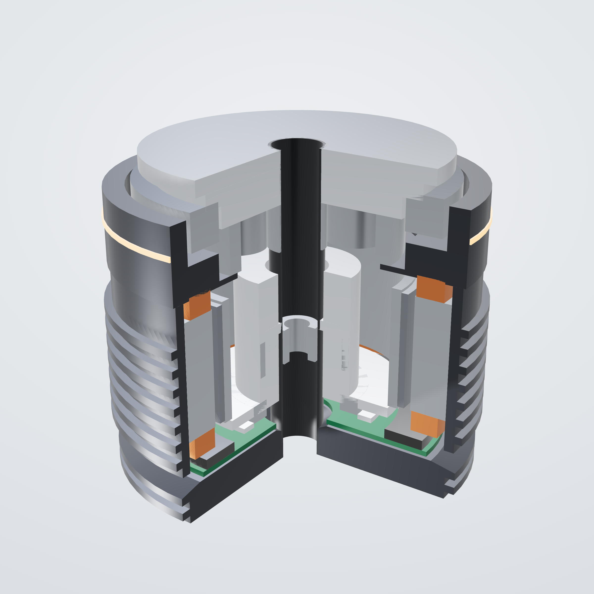

# 04 — Actuator catalogue

Per-joint spec sheets (requirement vs. delivered, with margins) are generated in
[generated/joint_catalogue.md](generated/joint_catalogue.md). The actuator family table and
motor data are in [generated/actuator_family.md](generated/actuator_family.md). Custom motor
design sheets are in [generated/km_motor_designs.md](generated/km_motor_designs.md).
Torque-speed envelope plots are `docs/img/envelope_*.png`.

## 1. How the actuators were engineered (not chosen)

1. **Loads.** Whole-body inverse dynamics (MuJoCo `mj_inverse` + a contact-wrench solve with
   centre-of-pressure feasibility checks) over 15 scenarios at 92.6 kg design mass
   ([generated/joint_requirements.md](generated/joint_requirements.md)). Walking uses a
   dynamically consistent ZMP preview-control gait with Kajita's dynamics filter, so the
   simulated CoP stays inside the sole for 100 % of samples.
2. **Requirement classes.**
   - Continuous: RMS of sustained walking × 1.2.
   - Hold: static postures.
   - Repeated peak: normal operation × 1.2.
   - Momentary: an unplanned 0.10 m drop, which the gear must survive.
   - Speed: × 1.15.

   Analytic minimums cover what simulation does not exercise: full-authority ankle torque (centre of pressure at the toe),
   turning in place, and tool use at the wrist.
3. **Linkage mapping.**
   - Knee: four-bar ratio G(θ).
   - Ankle: two push-rods sharing pitch and roll.
   - Wrist: two linear actuators.
4. **Search.** For each class: frameless motor (9 datasheet kits + 7 custom designs) × gear
   type × ratio × drive. Every simulated (torque, speed) sample is checked against:
   * the motor's voltage-limited line at the **52 V minimum loaded bus**:
     `ω(T) = 0.75·(V/√6 − R_ph·T/Kt)·3/Kt`, where 0.75 is calibrated to TQ's published rated speed;
   * peak torque = min(motor saturation, Kt × drive peak current);
   * continuous thermal torque × derate (0.85, or 1.0 with the ducted cooling of KA-130);
   * strain-wave repeated/momentary/average ratings and maximum input speed [ds R1].
5. **Feedback.** Sized masses go back into the dynamic model, and the loop repeats until masses change by less than 3 % (2 iterations).

## 2. The family

| Class | Joints (qty) | Motor | Gear | Peak / cont. out | No-load @52 V | Mass [est] | Build class |
|---|---|---|---|---|---|---|---|
| **KA-130K** | knee (2) | **KM-130x45 custom** | 2-stage planetary 14:1 | 395 / 139 N·m (×G 0.86–1.43 at the knee) | 11.0 rad/s | 4.2 kg | build |
| **KA-130H** | hip pitch (2) | **KM-130x40 custom** | 2-stage planetary 14:1 | 399 / 123 N·m | 10.3 rad/s | 3.8 kg | build |
| **KA-110P** | hip roll (2), waist pitch (1) | TQ ILM85x26 [ds] | 2-stage planetary 32:1 | 276 / 73 N·m | 5.9 rad/s | 1.8 kg | modify |
| **KA-90P** | hip yaw (2), waist yaw (1), ankle (4) | CubeMars RI85-PH [ds] | 2-stage planetary 23:1 | 106 / 36 N·m | 16.0 rad/s | 1.4 kg | modify |
| **KH-25** | shoulder pitch (2), roll (2) | TQ ILM85x13 [ds] | strain-wave size 25, 50:1 | 175* / 46 N·m | 7.1 rad/s | 1.4 kg | modify |
| **KH-20** | shoulder yaw (2), elbow (2) | CubeMars RI85-PH [ds] | strain-wave size 20, 50:1 | 188* / 64 N·m | 7.3 rad/s | 1.25 kg | modify |
| **KH-14** | wrist yaw (2), neck (2) | **KM-50x20 custom** | strain-wave size 14, 50:1 | 34* / 9 N·m | 9.0 rad/s | 0.7 kg | build |
| **KW-L** | wrist pitch/roll (4, parallel pairs) | maxon DCX 16 L + GPX 16 [ds] | KSS Ø6 × 2 ball screw | 13 / 10 N·m at the wrist | ≥ 6 rad/s | 0.3 kg | modify |

\* Strain-wave classes are **firmware-limited to the gear's repeated-peak rating**: CSG-25-50 127 N·m, CSG-20-50 73 N·m, CSG-14-50 23 N·m [ds R1].
Their momentary ratings (242 / 127 / 46 N·m) protect against impacts.

**Why a family of 7, not 30 unique actuators and not 1 universal actuator:** each joint is
sized from its own envelope, then grouped where one design covers several joints with ≥ 1.0 margin on every axis.
Unique designs per joint would multiply development, spares and test effort by 4×, for
< 5 % mass saving. One universal actuator would put 4 kg knee actuators in the wrists.

## 3. Highlights per joint

The full table is in [generated/joint_catalogue.md](generated/joint_catalogue.md). Margins below are delivered capability / requirement, and the requirements already include their 1.2× and 1.15× margins.

| Joint | Repeated req | Continuous req | Speed req | Peak margin | Cont. margin | Speed margin |
|---|---|---|---|---|---|---|
| Knee | 351 N·m | 113 N·m | 9.5 rad/s | 1.41 (envelope) | **1.04** | 1.37 |
| Hip pitch | 336 N·m | 91 N·m | 9.7 rad/s | 1.19 | 1.35 | 1.06 |
| Hip roll | 133 N·m | 65 N·m | 4.0 rad/s | 2.08 | 1.11 | 1.47 |
| Ankle pitch | 173 N·m | 21 N·m | 8.0 rad/s | 1.59 | 4.5 | 1.53 |
| Waist pitch | 208 N·m | 14 N·m (hold 106) | 1.5 rad/s | 1.33 | — | 3.9 |
| Shoulder pitch | 67 N·m | 18 N·m (hold 54) | 6.2 rad/s | 1.9 (gear-limited 127) | 2.5 | 1.16 |
| Elbow | 55 N·m | 6 N·m | 7.0 rad/s | 1.33 (gear-limited 73) | 11 | 1.05 |

**The knee's continuous margin (1.04) is the tightest number in the robot.** It assumes the
ducted-air thermal design works as calculated, and it is the first thing tested on the dyno (docs/11 §4).
If it falls short there are three fallbacks:
1. a liquid-cooled stator jacket (design in docs/13 §6), roughly 1.6× the continuous rating;
2. a gait with straighter knees (the RL policy is trained with a torque-squared penalty; the simulated
   less-crouched gait lowers knee RMS by 10–20 %);
3. a 50 mm stack variant (KM-130x50).

## 4. Custom motor KM-130 — complete design requirements

Used in KA-130K (45 mm stack) and KA-130H (40 mm stack). Detailed numbers are in
[generated/km_motor_designs.md](generated/km_motor_designs.md). Manufacturing is covered in docs/13.

**Why custom is genuinely better here:** the knee needs about 10 N·m of *continuous* motor
torque at 14:1 while reaching ≈ 130 rad/s at the motor on a 52 V bus. The verified commercial frameless kits do not get there:
- the largest, RI115-PH and ILM115x25, deliver 5.5 and 3.9 N·m continuous;
- nothing verified sits between Ø115 and integrated 72 V actuators.

A Ø130 inner-rotor design reaches Km ≈ 1.19 N·m/√W against 0.66 for RI115-PH.

| Item | Requirement / design |
|---|---|
| Topology | inner-rotor surface-PM, concentrated (tooth) double-layer winding, 36 slots / 42 poles (kw1 0.933), hollow rotor Ø86 mm ID (nests planetary stage 1 + cable bore) |
| Magnetic circuit | airgap Ø96.2 mm, mechanical gap 0.60 mm; N42SH arc magnets 3.0 mm thick, 85 % pole arc; Bg 0.97 T, Bg1 1.20 T at 80 °C; tooth 1.60 T, yoke 1.40 T design flux density |
| Stator | 0.20 mm NO20 (or 0.35 mm M270-35A) laminations, bonded stack (self-bonding varnish or glued), OD 130 / stack 40–45 mm; slot area 59 mm², 42 % fill; Class H (180 °C) slot liners (Nomex 410 0.13 mm) |
| Winding (KM-130x45) | 5 turns × 2 parallel paths, star, about 1.78 mm equivalent conductor (use 7 × Ø0.67 mm Litz/multi-strand grade 2 enamel); Kt 0.310 N·m/A rms; R(LL) 32.6 mΩ @ 20 °C |
| Rotor | 1010/1018 steel back-iron ring (4 mm), magnets bonded with high-temperature epoxy (Loctite 9492 class) + **carbon-fibre or Inconel sleeve 0.3 mm** (retention at 2,000 rpm); balanced to G2.5 |
| Bearings | rotor on 2 thin-section deep-groove bearings (68xx), wave-spring preload; output on the crossed-roller |
| Housing & cooling | stator potted into a finned 7075 housing with thermally conductive epoxy (≥ 1.5 W/m·K); end turns potted; ducted blower air over the fins; 2 NTC (EPCOS B57861S) embedded in the end turns |
| Ratings (model) | 10.8 N·m continuous (7 A/mm², 83 W copper), 34.8 N·m peak (139 A, saturation-limited), no-load 1964 rpm @ 52 V; mass 2.32 kg; rotor J 1.1e-3 kg·m² |
| Controller requirements | FOC at ≥ 20 kHz PWM / ≥ 20 kHz current loop; 100 V class power stage; ≥ 99 A rms peak (drive limit used in sizing), 50 A rms continuous; dual absolute encoders (motor + output, BiSS-C); NTC inputs; STO; regenerative braking into the bus with an over-voltage clamp |
| Validation | FEMM 2-D: Kt, cogging (< 1 % of rated torque target), saturation curve. Bench: R, L, back-EMF constant, hi-pot 1,000 V, locked-rotor torque vs current, thermal step at 10 N·m to steady state |

## 5. KM-50x20 (wrist yaw, neck)

12 slots / 14 poles, Ø50 × 20 mm, 18 turns per coil. Kt 0.106 N·m/A, 0.28 N·m continuous, 0.9 N·m peak, 230 g.
At 50:1 it gives 34 N·m peak and 9 N·m continuous at the output. A commercial alternative is
any 50 mm frameless kit with Kt ≈ 0.1 N·m/A and ≥ 5,000 rpm at 52 V. CubeMars RI50 class
specs were **not** verified during research.

## 6. Gearbox designs

| Class | Stage 1 | Stage 2 | Material | Notes |
|---|---|---|---|---|
| KA-130K/H 14:1 | sun z20 / 3 planets z15 / ring z50, m0.8, 3.5:1 (inside rotor) | sun z18 / 4 planets z18 / ring z54, m1.25, 4.0:1 | 18CrNiMo7-6 carburised 58–62 HRC, ground to ISO 1328 grade 6 | stage-2 sun Lewis SF 2.7 at the momentary case; profile shift + tip relief in detail design |
| KA-110P 32:1 | 4:1 | 8:1 compound (stepped planets) | as above | |
| KA-90P 23:1 | 4.6:1 | 5:1 | as above / 17-4PH | |
| KH-* | Leaderdrive LHSG component set (CSG-identical published ratings, rated at 3,500 rpm input) | — | supplied | backlash ≤ 10 arcsec [ds R1] |

Efficiency 0.92 (planetary, two stages) and 0.75 (strain-wave) are **assumptions**. They are measured
on the dyno in Phase 1 and fed back into `calc/kestrel/actuators.py` (`ETA`).

## 7. Sensors in every actuator

| Sensor | Part | Purpose |
|---|---|---|
| Output absolute encoder | RLS AksIM-2 (BiSS-C, 19–20 bit, ±0.004–0.02° after self-calibration) [ds R2] | joint angle, gear-error mapping, link deflection |
| Motor encoder | AksIM-2 (KA-130/110) or MagnTek MT6835 (21 bit) [ds R2] | commutation, velocity |
| Torque | KH-25/20: strain-gauge flexure (4 × HBK XY41, ADS1262); KA-*: motor current + dual-encoder windup | collision detection, force control |
| Temperature | 2 × NTC in the windings, 1 on the power stage | thermal model + trip |
| Current | drive internal (3-phase) | torque control |

## 8. Phase-0 option: commercial integrated actuators

To develop software while custom actuators are built, a lower-performance development mule
can use commercial units (see [research/R1](research/R1-actuators-gears-benchmarks.md)).

| Joint | Phase-0 unit | Main limitation |
|---|---|---|
| Knee, hip pitch | MyActuator X12-320 (EtherCAT) | 125 rpm no-load and a 55 V maximum, so it needs a 13S bus for the mule; ~70 % of K1 speed |
| Hip roll, waist pitch | MyActuator X10-200 / X12-320 | |
| Hip yaw, waist yaw, ankles | RobStride RS04 (CAN only) or MyActuator X8-120 | |
| Arms | MyActuator RH-25 / RH-20 | heavier |

These cannot reach the K1 envelope on 16S (voltage limits). Use them only for software development at reduced speed.

## 9. Build / modify / buy summary

* **Build (custom-manufactured):** KM-130 motors (4), KM-50 motors (4), all planetary gear sets (14), all actuator housings (26).
* **Modify (buy the core, design around it):** TQ/CubeMars frameless kits (18), Leaderdrive strain-wave sets (12), maxon micro-drives (24 including hands).
* **Buy complete:** drives (26), encoders, bearings, sensors.
