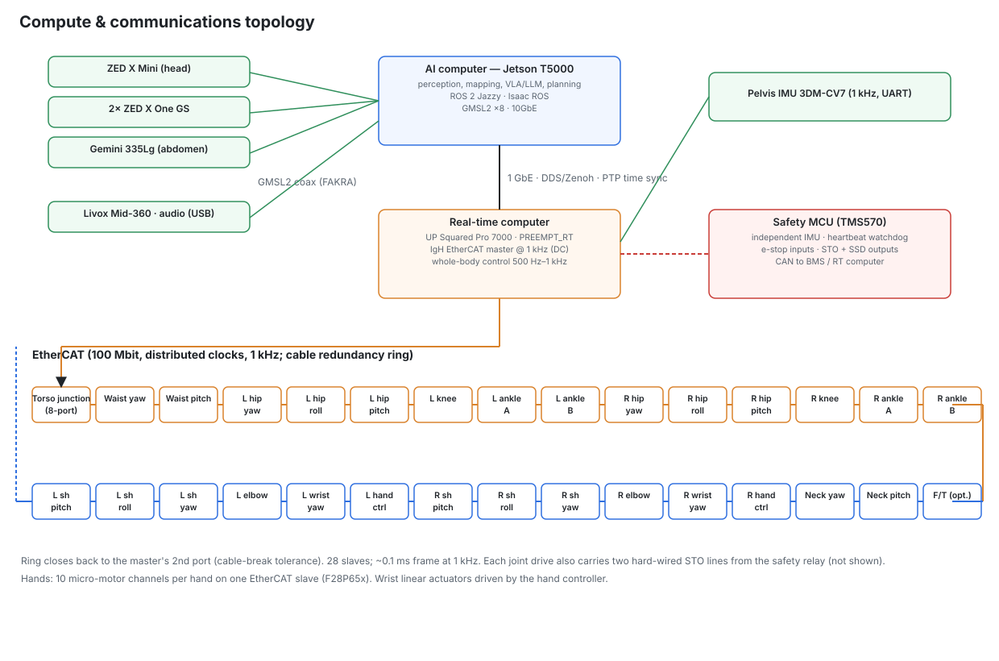

# 05 — Electrical and electronic architecture (K1 Mk II)

Power numbers come from `calc/kestrel/power.py` ([generated/power_budget.md](generated/power_budget.md)); actuator
data from [generated/actuator_family.md](generated/actuator_family.md). Component data and sources are in
[research/R2](research/R2-drives-encoders-safety.md), [R3](research/R3-power.md), [R7](research/R7-commercial-humanoids.md)
and [R10](research/R10-actuator-state-of-the-art.md). Parts checked on the manufacturer's page for this revision are
cited with their URL (accessed 2026-11-09). **[E]** marks my own arithmetic or engineering estimate. Datasheet values that
were *not* retrieved are written as selection rules ("must be ≥ …"), never as part data.

> The SVG diagrams `power_architecture.svg`, `battery_pack.svg` and `safety_chain.svg` still show Mk I (one pack,
> one disconnect). The Mk II single-line diagram is in §4.1 and the Mk II stop chain in §8; they take precedence.

## 0. What changed from Mk I

| Item | Mk I | **Mk II** | Why |
|---|---|---|---|
| Battery | one 16S6P pack (96 cells, 1.68 kWh), swapped powered-down | **two hot-swap 16S4P packs** (2 × 64 Molicel P50B, 2 × 1.15 kWh) | R7 #3: swap ≤ 3 min without shutdown, more energy |
| BMS | one Orion BMS 2 outside the pack | **one BMS inside each pack** (TI BQ76952 + BQ77216) | a removable pack must protect itself and have dead terminals |
| Disconnect | one TPS48111 solid-state switch | **per-pack power path**: ideal-diode OR path + bidirectional tie path, removal interlock | keeps the robot powered while either pack is out |
| Knee / hip-pitch drives | 99 A Elmo-class | **4 × HC2** 150 A pk / 75 A cont GaN EtherCAT drives | R10: peak torque × speed is set by V × I |
| Wrist pitch/roll | maxon DCX 16 L (18 V winding) on the 12 V hand rail | **KW-L2**: maxon ECX FLAT 32 L on a new **24 V arm rail** | K1 wrist missed force (241 vs 611 N) and speed (36 vs 132 mm/s), R10 §1.2 |
| Hands | 10 DOA, 20 micro-drivers | **13 DOA per hand**, 26 micro-motor drivers, palm cameras | R7 #4, #15 |
| Cooling | ducted air, 6 blowers | **liquid loop**: 2 pumps, radiator + 2 fans, compute cold plate | R10 §5.1: continuous ×1.55 on the knee |
| E-stop | STO, then the whole robot powered off | STO, then **actuator bus only** cut; compute, logging and cooling stay up | a work robot should not reboot its computers on every stop |
| Charging | 10 A, ≈ 3 h, supervised | **2 kW dock**, ≤ 1.5 h, BMS-supervised unattended | R7 #8 |
| Peak power | 2.7 kW | **3.08 kW** (59 A at 52 V) | heavier robot, 30 kg payload scenarios |

## 1. Power budget (computed, not guessed)

Actuator electrical power is computed from every joint's simulated torque and speed through its sized motor
(copper loss = (τ_m/Km)²), gear efficiency in both directions, linkage, 3 % drive loss and 50 % regeneration recovery.
Electronics are an itemised list in `power.py` (Thor 75 W typical / 130 W peak; Mk II cooling 35 / 60 W).

| Operating mode | Average power | Runtime on 1,951 Wh usable |
|---|---|---|
| Idle standing (perception on) | 267 W | 7.3 h |
| Normal mixed (40 % stand / 30 % walk 0.8 m/s / 30 % manipulation) | 402 W | **4.9 h** |
| Continuous walking 0.8 m/s | 451 W | 4.3 h |
| Demanding (1.2 m/s or continuous stairs) | 635 W | 3.1 h |
| **Simultaneous peak** (electronics peak 361 W + worst actuator instant 2,715 W) | **3,076 W → 59 A at 52 V** | — |

Peaks per zone and per drive, from the same scenario data (`data/scenario_series.npz`, power model of `power.py`) [E]:

| Load | Peak electrical | Peak at 52 V | Worst RMS (W1/W2/ST/CW) |
|---|---|---|---|
| Right leg zone (hip yaw, hip roll, hip pitch, knee, 2 ankle) | 1,865 W | 35.9 A | — |
| Left leg zone | 1,500 W | 28.8 A | — |
| HC2 hip pitch (each) | 1,611 W | 31.0 A | 313 W / 6.0 A |
| HC2 knee (each) | 1,090 W | 21.0 A | 241 W / 4.6 A |
| Arm zone (5 Everest joints, each arm) | 381 W | 7.3 A | — |
| Waist zone (waist yaw + pitch) | 314 W | 6.0 A | — |

**Regeneration is small.** Returned energy is ≤ 3 % of the drawn energy in every repeated scenario except the deep
squat (23 %). The largest regen pulse is the momentary missed-step drop SD: 1.9 kW raw for < 0.4 s, 122 J [E].
This is why the power path can run in a discharge-only (ideal-diode) mode most of the time without a runtime penalty
worth designing around (§4.7).

## 2. Bus voltage: still 16S (59.2 V nominal, 48–67.2 V, V_MIN 52 V loaded)

13S (≤ 54.6 V) was rejected for Mk I because no motor/ratio covered the knee and hip-pitch envelopes at 42 V. Mk II stays at
16S: the peak lever is drive current, not voltage. At 52 V and 150 A, KA-130K2 reaches 493 N·m (knee, 17:1) and
406 N·m (hip, 14:1) with no-load speed margins of 1.61 and 1.56
([generated/joint_catalogue.md](generated/joint_catalogue.md)), so 20S is only needed for the KA-150X option (§2.1).

Consequences, unchanged from Mk I:
* **Still extra-low voltage** under AS/NZS 3000 (≤ 120 V ripple-free DC [R6]), but above the 60 V ES1 "touch-safe"
  limit. Hence IP2X shrouded connectors everywhere, covers that need a tool, and dead pack terminals when a pack is out
  of the robot (§3.2).
* Every part on the bus must be rated for 67.2 V plus the 70 V chopper clamp: Everest S NET (8–80 V), HC2 (100 V GaN,
  EPC9186HC-class stage ≤ 76 V input [R10 S26]), LM5050-1 (75 V), LM5069 / TPS48111-Q1 (80 V operating, 100 V abs max),
  INA228 (85 V). moteus (54 V), ODrive (58 V) and Orion Jr 2 (60 V) remain excluded [R2, R3].

### 2.1 Box: what the KA-150X option would need (20S)

> **KA-150X** (R10 §5.3: KM-150x50-LCS, 719 N·m peak / 524 N·m continuous) needs a **20S bus (65 V minimum loaded,
> 84 V full) and 200 A, 150 V-class drives**. It is not a drive swap. It changes the whole electrical system:
>
> | Area | Effect at 20S |
> |---|---|
> | Arm, ankle, yaw, neck drives | **Everest S NET is excluded** (80 V continuous, 85 V for 100 ms [R2]). All 22 need 100–150 V drives. 100 V parts at 84 V full plus an ≈ 88 V regen clamp leave < 16 % headroom [R10 §3.2.7], so 120–150 V devices |
> | Knee / hip drives | custom 200 A, 150 V-class (paralleled devices); HC2's ≤ 76 V GaN stage cannot be reused |
> | Power path | LM5050-1 (75 V), LM5069 and TPS48111-Q1 (80 V operating) and INA228 (85 V) are all out of range. A 100 V-class OR/hot-swap set must be re-selected; LM5146-Q1 (100 V) survives for the 24 V arm rails |
> | BMS | BQ76952 is 3–16S, 80 V. 20S needs a stacked or higher-count AFE; not selected here |
> | Packs | 20S4P = 80 cells per pack, 160 cells, 2 × 1.44 kWh (+25 % energy, +2.3 kg cells) [E]; or 20S3P (120 cells, 2 × 1.08 kWh, −6 % energy) |
> | DC-DC | the 36–75 V bricks are out; a 40–110 V input class is needed |
> | Chopper, charger | clamp ≈ 88 V; charger 84 V CC/CV |
> | Insulation | still ELV (< 120 V DC), but creepage/clearance and connector ratings re-checked for 84 V + transients |
> | Cost / schedule | ≈ A$38k option (B135, rough), plus a second drive development; firmware is the long pole |
>
> **Decide before any drive is bought.** R7 #9 makes the same point. On the Mk II scenario set the 16S KA-130K2 already
> meets every leg requirement. Its smallest margin is hip-pitch peak at 1.12
> ([generated/joint_catalogue.md](generated/joint_catalogue.md)), so the baseline stays 16S. KA-150X is for running,
> jumping or heavier sustained loads than the Mk II scenarios.

## 3. Battery: two hot-swap 16S4P packs

### 3.1 Pack specification

| Item | Specification |
|---|---|
| Cells | **Molicel INR-21700-P50B**: 5.0 Ah (4.85 min), 3.6 V, 60 A continuous, DCIR 12.8 mΩ, ≤ 71 g [ds R3] |
| Configuration | **2 × 16S4P**, 64 cells per pack, **128 cells**. Per pack: 59.2 V nominal, 67.2 V full, 48 V cut-off (3.0 V/cell), 19.4 Ah minimum, **1.15 kWh** nominal (1.12 kWh at minimum capacity). Robot: 2.24 kWh, **1,951 Wh usable** (90 % DoD, 3 % losses, `power.py`) |
| Runtime | 4.9 h normal mixed, 4.3 h walking, 3.1 h demanding [sim]. With a charged spare pair, availability is set by the ≤ 3 min swap, not by runtime |
| Current | peak 59 A: **7.4 A/cell** with both packs, **14.8 A/cell** on one pack (25 % of the 60 A rating). One-pack sag at peak = 59 A × 51 mΩ = **3.0 V** [E] |
| Mass | 5.90 kg per pack budget (params.py): cells 4.54 kg, leaving 1.36 kg for BMS, FETs, fuse, enclosure, busbars and connector half. Tight; the enclosure must be ≤ 1.3 kg |
| Layout | two packs side by side in the torso (each ≈ 98 × 150 × 185 mm), inserted fore-aft from the back through gasketed hatches; cam lever + secondary catch, floating blind-mate connector (bay mechanics: docs/03 §10). A 2 mm aluminium + mica fire wall between the bays keeps an event in one pack from propagating to the other |
| Cold start | 15 W heater film per pack, switched by the BMS from the pack itself; below 0 °C the pack discharges at ≤ C/5 until warm (docs/03 §10.2) |
| Interconnect, thermal runaway | as Mk I: Ni-plated Cu + Ni sandwich strips with fuse-link bonds, mica between layers and groups, aluminium enclosure with its own vent path, no flammable foam |
| Spares | B028 buys 200 cells (the 200+ price tier makes 200 cells cheaper than 144 at the single-cell price): 128 in packs, the rest for matching rejects and a third pack (option B133) |
| Standards | IEC 62619 / UL 2271 design practice; each pack is > 100 Wh, so it is dangerous goods for freight (UN3480) [R6]. A person carries the pack: handle, ≤ 6 kg, IP67 on its own, dead terminals |

### 3.2 Per-pack BMS (KES-BMS16, inside each pack)

| Function | Part / design |
|---|---|
| Primary AFE | **TI BQ76952**: 3–16 series cells, 80 V, 85 V tolerance on cell-connect pins, integrated charge pump for high-side N-FET protection, up to 9 external thermistors, I²C/SPI/HDQ ([ti.com/product/BQ76952](https://www.ti.com/product/BQ76952)) |
| Secondary protection | **TI BQ77216** 3–16S over-voltage protector on separate cell taps [ds R3]; its output disables the pack switch through a separate path from the AFE |
| Pack switch | back-to-back 100 V N-FETs (charge and discharge) driven by the BQ76952, inside the pack. **Pack terminals are dead unless the pack is seated** (pilot loop closed) **and** the robot or charger has completed a CAN handshake |
| Pack fuse | 100 A UL Class T, in the pack (§4.6) |
| Sensing | 16 cell voltages; 8 cell NTCs + 1 FET NTC; 0.5 mΩ shunt for coulomb counting; vent-gas/pressure thermal-event sensor (docs/06) |
| MCU | CAN-FD MCU: SoC/SoH, charge/discharge current limits (CCL/DCL), heater control, pack serial number and cycle log kept in the pack, so the history travels with it |
| Reference | TI TIDA-010208 (10–16S, high-side N-FET, BQ77216) [R3] |

The BMS acts independently of the robot. It opens its own pack switch on cell OV/UV/OT/OC/SC. Orion BMS 2 (Mk I) is
no longer used: it is an external box and cannot live inside a 5.9 kg removable pack.

## 4. Hot-swap power path, fusing, precharge, regeneration

### 4.1 Single-line diagram

```
 PACK A (16S4P, 1.15 kWh)                               PACK B (identical)
 cells ─ 100 A fuse ─ BMS FET switch (BQ76952) ─┐       cells ─ fuse ─ BMS switch ─┐
                                    pilot ──┐   │                         pilot ─┐  │
 ═══════ blind-mate connector: power make-first/break-last, pilot make-last/break-first ═══════
 KES-PPM board, bay A (robot side)          │   │       KES-PPM board, bay B      │  │
  OR path:  ──[Q_HS  LM5069 hot-swap]──[Q_OR  LM5050-1 ideal diode]──┐   (same) ──┤
  Tie path: ──[Q_T1 ⇄ Q_T2  TPS48111-Q1 back-to-back]───────────────┤   (same) ──┤
  INA228 + shunt · pilot sense · solenoid-lock driver · interlock AND│            │
                                                                     │            │
 DOCK INLET ──[TPS48111-Q1 charge channel, on the PDU]───────────────┤            │
                                                                     ▼            ▼
 ════════════════════════ MAIN BUS 48–67.2 V (chopper clamp 70 V) ════════════════════
    │                         │                                   │
 brake chopper           LOGIC BUS (not cut by e-stop)        ACTUATOR BUS: zone eFuses (cut 0.5–1.5 s after e-stop)
 2 × 5 Ω 100 W           24 V 300 W: Thor/J601, LiDAR,        leg L 60 A · leg R 60 A · pelvis/waist 20 A
                         cameras                              arm L 20 A · arm R 20 A · neck 10 A
                         12 V 150 W: RT computer, pumps,      (arm zones also feed the forearm driver boards'
                                                               24 V bucks for KW-L2 and the hand)
                         fans, foot boards, HC2 aux
                         safety MCU (own supply + hold-up)
```

### 4.2 Per-pack power-path board (KES-PPM, one per bay, robot side)

Each bay has its own board, mounted on the bay's front bulkhead next to the connector. The board stays in the robot when
the pack is removed, and it is powered from the **main bus side**, so the board of an empty bay is still alive. The two
boards exchange three hard-wired status lines (pilot present, V ≥ 54 V, PGOOD) for the removal interlock, plus CAN-FD.
The dock charge-inlet channel (another TPS48111-Q1 back-to-back switch) is on the PDU.

| Block | Part | Verified ratings (source) | Role |
|---|---|---|---|
| Hot-swap FET control (OR path) | **TI LM5069** | 9–80 V, 100 V abs max; inrush limit plus programmable power limiting in the FET; circuit breaker; adjustable UVLO/OVLO; PGOOD; -1 latch / -2 auto-retry ([ti.com/product/LM5069](https://www.ti.com/product/LM5069)) | blocks forward current when off, soft-starts the bus on insertion, trips on overcurrent. The MCU sheds the path by pulling UVLO low |
| Ideal diode (OR path) | **TI LM5050-1** | 1–75 V operating, 100 V transient, 50 ns response to current reversal, charge-pump gate drive ([ti.com/product/LM5050-1](https://www.ti.com/product/LM5050-1)) | blocks reverse current, so a shorted pack or connector cannot drain the bus and a full pack cannot charge an empty one |
| Bidirectional tie switch | **TI TPS48111-Q1** | 3.5–80 V, 100 V abs max; drives back-to-back N-FETs; 3.7 A / 4 A gate drive; 1.2 µs short-circuit response; IMON ±2 %; integrated pre-charge driver ([ti.com/product/TPS4811-Q1](https://www.ti.com/product/TPS4811-Q1)) | closed only when the packs are matched: lets regen and charging flow back into the packs and halves conduction loss |
| Current / energy monitor | **TI INA228** | 0–85 V common mode, 20-bit, current, voltage, power, energy and charge ([ti.com/product/INA228](https://www.ti.com/product/INA228)) | per-path current for sharing, swap verification (< 1 A before unlock) and energy logging |
| Power FETs | Nexperia PSMN2R0-100SSF class, 100 V, ≈ 2.1 mΩ, LFPAK88 [R2] | 3 in parallel per bank, 4 banks per board (hot-swap, diode, tie ×2): 12 FETs; 2 × 2 more on the PDU charge inlet | |
| Local MCU | small CAN-FD MCU on each PPM | | the bay-A MCU is master and runs the hot-swap state machine (docs/07 §7); the bay-B MCU mirrors it and takes over when bay A is empty. Both talk to their BMS and to the RT computer |

**Conduction loss [E]:** one bank of 3 FETs ≈ 0.7 mΩ, ≈ 1.1 mΩ hot. OR path (2 banks in series) ≈ 2.2 mΩ hot:
- one pack carrying the full 59 A peak: 7.7 W for the duration of the peak (heatsunk to the PDU plate);
- normal mixed duty, both packs: ≈ 3.9 A per pack, 0.03 W.

**Inrush SOA [E]:** the LM5069 power limit is set so a *single* hot-swap FET stays inside its 100 ms SOA line with
2× margin. Parallel FETs do not share in linear mode, so check the curve of the chosen part before layout.

### 4.3 Operating modes and current sharing

| Mode | OR paths | Tie paths | When | Behaviour |
|---|---|---|---|---|
| **Diode (default)** | both on | open | packs differ by > 0.5 V, or any doubt | the higher pack carries the load until its loaded voltage meets the lower one, then both share by impedance. Seamless if either pack vanishes. No regen into packs (chopper absorbs it) |
| **Tied** | both on | both closed | both packs healthy, \|V_A − V_B\| < 0.5 V at rest, SoC < 98 % | packs in parallel: regen and charging flow into both; sharing set by DCIR (51 mΩ each), so within about ±10 % for matched packs |
| **Single pack** | one on | open | the other pack removed, tripped or flat | full robot on one pack: 14.8 A/cell at peak, 3 V sag. The RT controller caps actuator power at 1.8 kW and the gait envelope until a second pack is back (docs/07 §7.3) |
| **Swap** | removing pack shed | open | operator request | robot stands still in the swap posture, actuator power capped at 1.5 kW (7.2 A/cell on the remaining pack) |
| **Docked** | per §12 | per §12 | on the dock | charger feeds the bus through the charge channel |

**Why the 0.5 V tie threshold.** Equalisation current when two packs are tied = ΔV / (2 × 51 mΩ + 10 mΩ wiring) [E]:

| \|V_A − V_B\| | 0.25 V | **0.5 V** | 1.0 V | 2.0 V | 5.0 V |
|---|---|---|---|---|---|
| Equalisation current | 2.2 A | **4.4 A** | 8.9 A | 17.8 A | 44.5 A |

0.5 V keeps equalisation at ≈ 1.1 A per cell, well inside the P50B's 5 A standard charge rate [R3]. A fresh pack inserted
next to a half-empty one stays in diode mode, does the work first, and is tied only once the two have converged.

### 4.4 Insertion and precharge

**Connector (B111) selection rules** (mechanics: floating blind-mate on the bay bulkhead, docs/03 §10.2; Anderson
Power Products SBS series with auxiliary contacts as the example):
- keyed;
- ≥ 60 A continuous per power contact (single-pack peak 59 A for seconds, ≈ 12 A continuous worst case), ≥ 100 V DC;
- power contacts make first and break last; the pilot contact makes last and breaks first, with **≥ 2 mm stagger**;
- CAN-FD pair and wake line;
- IP2X when unmated on both halves.

**Insertion sequence:**
1. Power pins mate. The pack switch is still open, so no current flows.
2. The pilot loop closes and wakes the BMS. The PPM MCU and BMS exchange ID, SoC, limits and fault state over CAN-FD.
3. The BMS closes its pack switch. Only the PPM's input capacitance (≈ 10 µF) is charged.
4. The PPM enables the LM5069 for that channel:
   - **pack voltage above the bus:** the power limit ramps Q_HS and the new pack takes over the load gradually. The
     bus rises from the old pack's voltage to the new one, e.g. 55 → 66 V: 6.5 mF × 11 V = 72 mC, ≈ 7 ms at 10 A [E];
   - **pack voltage below the bus:** the OR path stays reverse-biased (standby) until the bus sags to it.
5. The tie switch closes later, only if the tie conditions in §4.3 are met.

**Cold start.** At power-on the zone eFuses are open, so the PPM only charges the PDU bus and the logic DC-DCs (≈ 0.5 mF,
1.1 J at 67 V: ≈ 20 ms at a 60 W power limit) [E]. Each zone eFuse then soft-starts its own zone. The largest is a leg,
≈ 1.8 mF: at 1 V/ms that is ≈ 70 ms and ≈ 2 A [E]. A separate precharge resistor is not needed. Total bus capacitance
≈ 6.5 mF [E] (22 Everest carriers × 200 µF, 4 HC2 × ≈ 450 µF, bucks and DC-DCs).

### 4.5 Removal interlock: a pack cannot be removed while it is the only source

**Mechanism.** The bay mechanics are in docs/03 §10.2:
- an over-centre cam lever that draws the pack onto the connector;
- a separate secondary catch that must be pressed before the lever opens;
- a sealed micro-switch that opens in the first 10° of lever travel.

The electrical additions (B112):
- a **fail-locked solenoid pin that blocks the secondary catch** (unpowered = locked);
- a lock-position switch;
- a "release" button and a 3-colour LED per bay.

The lever micro-switch is wired **in series with the pilot loop**. Opening the lever therefore sheds that channel and
turns the pack's FETs off before any contact moves, as docs/03 intends. The solenoid adds the missing rule that the lever
cannot be reached while that pack is the only source. **docs/03 §10.2 needs the solenoid pin added to the catch** (open
item for the mechanical owner).

**Unlock rule.** The solenoid driver for pack X is enabled only through a **hardware AND** on board PPM-X. Its inputs come
from comparators on PPM-X and from hard-wired status lines from PPM-Y. The firmware request is one input; the other four
cannot be overridden by firmware:

| # | Condition | Implementation |
|---|---|---|
| 1 | the other pack Y is present | Y pilot loop closed |
| 2 | Y can carry the robot | V_Y ≥ 54 V at the PPM input (≈ 3.4 V/cell under load) |
| 3 | Y is actually connected | Y's LM5069 PGOOD high |
| 4 | X has been shed | X path current < 1 A (INA228 alert / IMON comparator) and X tie switch open |
| 5 | the robot is ready | firmware "swap permitted": swap posture reached, 1.5 kW cap active, BMS-Y DCL ≥ 1.5 kW |

**Swap sequence** (docs/03 §10.3 with the lock added):
1. Press release. The RT computer moves to the swap posture.
2. The PPM opens X's tie path, then sheds its OR path (LM5069 UVLO low).
3. The PPM checks conditions 1–5. The solenoid retracts and the LED turns green.
4. The operator opens the hatch, presses the catch, lifts the lever and pulls the pack.

**If the latch is forced or the override is used:** the pilot pin breaks ≥ 2 mm before the power pins. At a 0.3 m/s pull
that is ≥ 6 ms, against < 0.1 ms to shed both paths of that channel, so the power contacts always break at zero current
(no arc at 67 V) [E].

**Dead robot.** When both packs are flat, a keyed manual override behind the back cover retracts the solenoid pins
mechanically. Opening that cover trips the cover switch into the e-stop chain.

### 4.6 Fusing and protection coordination for the 3.1 kW peak

Prospective short-circuit current [E]:
- one pack: 67.2 V / (51 mΩ + 5 mΩ) ≈ **1.2 kA**;
- both packs into a bus fault: ≈ **2.2 kA**.

| Layer (fastest first) | Device | Setting [E] | Must not trip on |
|---|---|---|---|
| Tie path | TPS48111-Q1 two-level OC | short circuit 150 A (1.2 µs response); overcurrent 80 A, 10 ms | 59 A single-pack peaks |
| OR path | LM5069 circuit breaker + power limit | breaker ≈ 120 A; current limit 80 A with a fault timer sized for 2 s peaks | 59 A for 2 s |
| Pack | BQ76952 short-circuit / overcurrent detection driving the in-pack FETs | SCD above the robot-side limits so the robot side clears first | — |
| Pack (backup) | **100 A UL Class T fuse** in each pack (B031). Selection rule: ≥ 125 V DC rating, ≥ 20 kA DC interrupting; confirm on the datasheet before purchase | carries 59 A indefinitely (59 % of rating) | the full-robot peak from one pack |
| Zones | TPS4811-class eFuses on the PDU | leg 60 A fast / 25 A I²t; pelvis-waist 20 A; arms 20 A; neck 10 A | sim zone peaks 36 / 6 / 14 / 0.4 A |
| Arm 24 V | LM5146-Q1 hiccup current limit on the forearm driver board | 16 A | 13.8 A momentary (970 N wrist case) |

**Contactor re-sizing.** There is no mechanical contactor in the Mk II power path:
- per-pack contactors (e.g. Gigavac GX11, ≥ 100 A continuous at ≥ 80 V DC, with precharge) would lose the seamless OR-ing
  that hot-swap needs, and add ≈ 0.46 kg each [R3];
- a contactor is still recommended on the **bench supply**.

MOSFET switches fail short. That is why the **safety function is STO** (§8), not bus disconnection. Bus isolation has two
independent switches in series (the in-pack BMS FETs and the robot-side PPM FETs), and pulling both packs is the
service isolation (the Mk II equivalent of a manual service disconnect).

### 4.7 Regeneration

| Condition | Where regen goes |
|---|---|
| Tied mode | into both packs, limited by the BMS CCL. The CCL goes over CAN-FD to the RT controller, which caps drive regen current |
| Diode mode, single pack, SoC > 98 %, or BMS CCL = 0 | the bus rises until the **brake chopper** clamps it: comparator on at 70 V, off at 68 V |

**Chopper re-sizing [E].** Two 5 Ω 100 W aluminium-clad resistors in parallel = 2.5 Ω, so 28 A and 1.96 kW at 70 V.
That absorbs the SD pulse (1.9 kW peak, 122 J). The deep squat (278 J over 3.8 s, 73 W average) is within the
continuous rating. Mk I's 8 Ω / 100 W (612 W at 70 V) is too small when regen cannot reach the packs. The bus
capacitors alone absorb only ½ × 6.5 mF × (70² − 67.2²) ≈ 1.3 J, so the clamp is mandatory.

## 5. Power distribution and conversion

* **PDU board (KES-PDU2, beside the two PPM boards):**
  - main bus busbar;
  - brake chopper;
  - bus V/I telemetry;
  - **split into a logic bus and an actuator bus**;
  - 6 zone eFuses (TPS4811-class, programmable trip, ≤ 5 µs short-circuit response);
  - the dock charge-inlet channel (TPS48111-Q1 back-to-back, §12) and the pump/fan PWM drivers (§13).

| Zone (actuator bus) | Loads | Sim peak | eFuse | Feed cable |
|---|---|---|---|---|
| Leg L / leg R | HC2 hip pitch + HC2 knee + Everest hip yaw, hip roll, 2 ankle | 1.9 kW / 36 A | 60 A fast, 25 A I²t | **10 AWG** silicone pair through the hip (3.3 mΩ/m; 0.28 V and 10 W at 36 A over a 2.4 m loop) |
| Pelvis / waist | waist yaw + waist pitch | 314 W / 6 A | 20 A | 14 AWG |
| Arm L / arm R | 5 Everest + forearm driver board (24 V buck) | 381 W + 330 W momentary → 14 A | 20 A | 14 AWG through the shoulder (52 V runs to the forearm; conversion is local) |
| Neck | 2 Everest | 23 W | 10 A | 16 AWG |

| Logic bus | Loads | Converter |
|---|---|---|
| 24 V, 300 W, isolated, input 36–75 V (B033) | Thor carrier (J601 accepts 19–48 V [R4]), LiDAR (9–27 V), GMSL camera power-over-coax through the carrier: ≈ 170 W peak | Vicor DCM / TDK-Lambda / RECOM class. **Not verified**: the input range must cover 67.2 V plus the 70 V clamp |
| 12 V, 150 W, input 36–75 V (B034) | RT computer 35 W, 2 coolant pumps ≤ 20 W (spec; 34 W with the PMP-420 alternative), 2 radiator fans + 2 blowers ≈ 14 W, foot boards / ToF 4 W, LEDs 4 W, PPM/PDU MCUs, HC2 aux 4 × 2 W: **≈ 85–100 W peak** | as above |
| Safety MCU | own 12 V → 3.3 V supply plus a 200 ms supercap hold-up | — |

The cooling pumps are on the logic bus on purpose: after a stop the windings keep heating the jackets for minutes.

**New 24 V arm rail for KW-L2 and the hands.** One synchronous buck per arm, on the KW-L2 forearm driver board (B107,
docs/09 MK2-17):
- controller **TI LM5146-Q1**: 5.5–100 V input, up to 20 A, 100 kHz–1 MHz, hiccup current limit, enable and power-good
  ([ti.com/product/LM5146-Q1](https://www.ti.com/product/LM5146-Q1)); 100 V FETs;
- rated **24 V, 15 A peak (< 1 s) / 8 A continuous**;
- feeds the two KW-L2 bridges and the hand controller, which makes its own 12 V for the micro-motors;
- local conversion keeps the conductors through elbow and wrist yaw at 52 V and 14 AWG;
- the 100 V rating also survives a 20S bus.

**Per-arm 24 V load** for the Mk II wrist requirement (19 N·m pitch repeated, 29 N·m momentary; §6.4) [E]:

| Load | Peak electrical | DC current at 24 V |
|---|---|---|
| KW-L2 actuator A at the 754 N repeated corner | ≈ 155 W (mostly copper loss at low speed) | 6.5 A |
| KW-L2 actuator B at the same corner (≈ 120 N) | ≈ 5 W | 0.2 A |
| Hand: 13 micro-motors through the hand's 12 V buck + logic | ≈ 40 W | 1.7 A |
| **Per arm, repeated corner** | **≈ 200 W** | **≈ 8.4 A** |
| Per arm, 970 N momentary (< 1 s) | ≈ 330 W | ≈ 13.8 A (inside the 15 A peak rating) |

Typical per-arm draw is 10–20 W (holding).

## 6. Joint drives

| Joints | Drive | Key ratings |
|---|---|---|
| Knee ×2, hip pitch ×2 | **HC2** (custom, B025) | 150 A rms peak / 75 A rms continuous, 100 V-class GaN stage (EPC9186HC-class: 150 A rms, ≤ 76 V input [R10 S26, vendor press]), EtherCAT, 2 × BiSS-C, 2-channel hardware STO |
| Other 22 rotary joints | **Novanta Everest S NET** | 8–80 V continuous, 85 V for 100 ms; 45 A continuous / 60 A for 1 s; EtherCAT, 50 kHz current loop; 2 absolute encoder inputs (BiSS-C/SSI); SIL3/PLe STO; 23 g [R2] |
| Wrist pitch/roll ×4 (KW-L2) | **KW-L2 forearm driver board** (B107, one per forearm): TI F28P65x (own EtherCAT slave) + 2 × TI DRV8353 (9–100 V gate driver [R2]) with 100 V FETs rated ≥ 20 A, plus the 24 V buck | 2-channel STO input (buck EN + bridge disable) |
| Hand micro-motors ×26 | 13 H-bridges per hand controller (F28P65x, TIDA-010992 pattern [R2]), from the hand's local 12 V buck | — |

### 6.1 HC2 design and current arithmetic

**Architecture:**
- TI F28P65x control MCU, which has an on-chip EtherCAT ESC and SIL2-capable hardware [R2], following the TI
  TIDA-010979 joint-drive architecture [R2];
- three GaN half-bridges on an EPC9186HC-class layout, at 40 kHz PWM;
- 2 × BiSS-C: rotor AksIM-2 and output AksIM-2;
- an annular 6-layer, 2 oz board in the KA-130 rear cap, bolted to the jacket's rear face (the jacket is the drive's
  cold plate);
- **12 V aux input** from the logic bus for the MCU, encoders and low-side gate drivers (§8);
- **DC-link over-voltage trip at 74 V.** The EPC9186HC-class stage is quoted at ≤ 76 V input [R10 S26], only 6 V over
  the 70 V chopper clamp (docs/09 §11 H8). The HC2 uses 100 V-rated DC-link capacitors and gate-driver parts, so the
  trip protects the GaN devices' derating. The chopper must clamp before 74 V on every regen event (§14 item 5).

**Firmware is the long pole.** Buy one EPC9186HC2 evaluation board first (B109) and spin the HC2 twice (B110).

| Quantity | Value [E] | Note |
|---|---|---|
| Motor current at peak | 150 A rms → 31.5 N·m (saturation-corrected, R10) | 493 N·m knee actuator (17:1), 406 N·m hip (14:1) |
| Motor current at the motor's thermal rating | T_cont 18.85 N·m / Kt 0.2242 = **84 A rms** | **exceeds HC2's 75 A continuous** |
| Drive-limited continuous | 75 A × 0.2242 = 16.8 N·m → **263 N·m knee / 217 N·m hip actuator** | actuator_family.md lists 295 / 243 (motor-thermal). At the knee's worst four-bar ratio (0.84): 221 N·m vs 142 required = **margin 1.56** (the catalogue's 1.75 is not reachable with HC2). Hip 217 vs 98 = 2.2 |
| Scenario RMS motor current | knee ≤ 43 A (ST), hip pitch ≤ 43 A (CW) | 57 % of the continuous rating |
| Motor current at the continuous requirement | knee 48 A, hip 34 A | — |
| DC input current | peak 31 A (hip pitch sim, 1.6 kW); **firmware DC-bus limit 45 A per HC2**; RMS ≤ 6 A | sets the 12 AWG drop |
| DC-link ripple | I_C,rms ≈ 0.56 × I_phase (M 0.9, cos φ 0.9, standard 3-phase VSI expression) → 42 A rms at 75 A, 84 A rms for 2 s at 150 A | ≥ 16 × 4.7 µF 100 V X7R + 4 × 100 µF 100 V polymer per drive, at the bridge |
| Phase connection | 3 copper busbars ≈ 12 mm² each, ≤ 60 mm, heatsunk to the jacket | 6.3 A/mm² at 75 A |
| Losses | ≈ 20 W at 75 A (conduction + switching), into the jacket | counted in the loop budget (§13) |

### 6.2 HC2 cabling

| Run | Conductor | Current | Drop / loss [E] |
|---|---|---|---|
| Leg zone eFuse → HC2 DC input | 12 AWG silicone pair, ≤ 0.5 m | 31 A peak (45 A limit), ≤ 6 A RMS | 0.23 V / 10 W at 45 A for a moment; 0.2 W at RMS |
| HC2 → motor | integrated busbars (above) | 150 A rms for 2 s | — |
| HC2 aux 12 V | 2 × 20 AWG in the leg harness | < 0.3 A | — |
| EtherCAT + STO | J-LINK (§9), unchanged | — | — |

### 6.3 Everest S NET carrier PCBs (22)

As Mk I, with one change: HC2 replaces the 4 knee/hip carriers.

**Carrier contents:**
- EtherCAT magnetics and two connectors (IN/OUT);
- **RS-422 receivers**: Everest feedback inputs are single-ended 3.3 V while AksIM-2 BiSS-C is RS-422 [R2];
- 5 V / 300 mA encoder supply;
- NTC inputs;
- ADS1262 strain-gauge front-end (KH-C25/C20 only);
- STO input filtering;
- 2 × 100 µF 100 V polymer bulk capacitors and an SMCJ75A TVS.

### 6.4 KW-L2 wrist actuator electrical data

Motor **maxon ECX FLAT 32 L high torque, 24 V**
([maxon product page](https://www.maxongroup.com/maxon/view/product/motor/ecmotor/ECX-Flat/ECX-Flat-32/ECXA32LZF50E6ILACO1Y330A)):
- 98.5 mN·m nominal at 8,220 rpm, 540 mN·m stall, 10,600 rpm no-load, 14,000 rpm maximum;
- 4.19 A nominal, 71 g, Hall sensors;
- €140.00 at 5–19 pieces.

It drives the ball screw directly (Ø8 × 2 mm in docs/09 MK2-16). Force per motor torque at η 0.88:
- 2 mm lead: 2π × 0.88 / 0.002 m = **2.765 N per mN·m** (R10);
- 1 mm lead: **5.53 N per mN·m**.

**Derived motor constants [E]** (no-load current ignored; use the datasheet value when ordering):
- k_t ≈ 30,000 / (π × 10,600/24) ≈ 21.6 mN·m/A;
- terminal R ≈ 24 V / (540/21.6 A) ≈ 0.96 Ω.

The **Mk II** wrist requirement is from [generated/joint_requirements.md](generated/joint_requirements.md) and the
generated catalogue: pitch 19 N·m repeated / 29 N·m momentary, 14 N·m held (AO, 15 kg one-handed), 6 rad/s. That gives a
754 N combined corner per actuator, ≈ 970 N momentary, 318 N held and 216 N at 132 mm/s (docs/09 §11 H10). R10 sized
KW-L2 for the K1 wrist (611 N), so it is re-checked here [E from the datasheet values above]:

| Requirement | 2 mm lead (docs/04/09 baseline) | 1 mm lead (recommended if rated) |
|---|---|---|
| 754 N repeated corner | 273 mN·m = **2.77 × nominal**; ≈ 12.6 A, ≈ 150 W copper; short-time only | 136 mN·m = 1.39 × nominal; ≈ 6.3 A |
| ≈ 970 N momentary | 351 mN·m = 3.6 × nominal (65 % of stall); ≈ 16 A, ≈ 250 W for < 1 s | 175 mN·m = 1.8 × nominal |
| 216 N at 132 mm/s | 78 mN·m → 9,070 rpm → **302 mm/s** (2.3×) | 39 mN·m → 9,830 rpm → **164 mm/s** (1.24×) |
| 318 N held for 60 s (AO) | 115 mN·m = 1.17 × nominal. The 60 s rating is 1.5 × nominal (HOLD_FACTOR) → margin **1.29** | 58 mN·m = 0.58 × nominal: continuous |
| Driver current rating | ≥ 20 A per bridge | ≥ 10 A |

**Conclusions:**
- With the 2 mm lead the motor meets every force and speed point electrically, but the repeated corner needs 2.8 × and the
  momentary case 3.6 × nominal torque. That works only if the winding's thermal time constant allows it. The maxon
  datasheet value has not been read; **read it before ordering and set the I²t limit from it**.
- A **1 mm lead** (KSS lists Ø6 × 1 [R5]) halves every torque, keeps a 1.24 speed margin, and makes the 15 kg hold
  continuous. Adopt it if the screw's dynamic rating is ≥ 1.5 kN; that rating is not yet retrieved (R10).
- Either way the driver is sized for 20 A, and the 24 V rail for the 2 mm case (§5).

## 7. Communication buses



* **EtherCAT: 30 slaves** (docs/09 §11 H11):
  - 22 Everest S + 4 HC2 + 2 hand controllers + 2 KW-L2 forearm driver boards;
  - one ring with cable redundancy back to the RT computer's second i226 port; 1 kHz cycle with distributed clocks;
  - IgH EtherLab 1.6 master [R2, R4];
  - process data ≈ 30 × (32 B out + 48 B in) ≈ 2.4 kB, ≈ 0.2 ms per frame at 100 Mbit/s [E]. Jitter must be measured at
    G0.
* **RT ↔ AI computer:** 1 GbE, ROS 2 (Zenoh or CycloneDDS), PTP (IEEE 1588).
* **Sensors to Thor:** GMSL2 on the J601's 8 deserialiser ports:
  - 4 used in Mk I (ZED X Mini, 2 × ZED X One, Gemini 335Lg) + **2 palm cameras** = 6 of 8;
  - Ethernet for the Mid-360; USB for the mic array.
* **CAN-FD (power bus):** BMS A, BMS B (through the pack connectors), the two PPM MCUs, PDU MCU, dock charger (through the dock
  contacts while docked), safety MCU, RT computer.
* **I²C / analogue on the PDU MCU:**
  - 2 Sensirion flow sensors, 6 coolant NTCs, the loop pressure transducer;
  - pump and fan tach and PWM;
  - the INA228s are read by their own PPM MCU;
  - leak inputs, which are also wired to the safety MCU (§8).
* **Hard-wired:** STO pairs, the e-stop chain, the leak line, and the pack pilot loops (never over a bus).

## 8. Safety and emergency stop / STO chain (Mk II)

| Element | Part | Function |
|---|---|---|
| Wireless e-stop | **FORT Wireless E-Stop Pro**: SIL3 (IEC 61508, exida), 200 m line of sight, RCM certified for Australia [ds R2] | primary stop during all mobile testing; loss of heartbeat = stop |
| Wired pendant | 5 m tether, dual-channel NC mushroom head | bench and early-gate testing |
| On-robot buttons | 2 × NC: back of torso and chest | local stop |
| Back-cover switch | NC, opened by the cover that gives access to the pack override key | dead-robot pack release is only possible in a stopped state |
| Safety relay | dual-channel, monitored reset, Cat 3 / PL d (Pilz PNOZ s / Phoenix PSR class) + delayed-contact expansion (B044) | instantaneous contacts: STO; delayed contacts (0.5–1.5 s): actuator-zone eFuse enables |
| Safety MCU | **TI TMS570LC4357**: 2 × Cortex-R5F lockstep, TÜV-assessed SIL3-capable [ds R2] + TDK IIM-46230 IMU | trips the chain on: tilt > 35°; winding > 150 °C; bus over-voltage or over-current; RT heartbeat lost for 2 ms; comms loss > 50 ms; **leak at an HC2 drive**; **coolant > 75 °C** |
| BMS ×2 | KES-BMS16 | each opens its own pack switch on cell faults, independently of everything else |

**Stop sequence:**
1. **t = 0.** Any input opens the chain, and the safety relay removes STO_A/STO_B from all 26 drives:
   - 22 Everest S: SIL3 STO;
   - 4 HC2: custom 2-channel STO. Channel A cuts the high-side gate-driver supply; channel B disables the PWM buffers.
     Both states are read back;
   - both KW-L2 forearm driver boards: a 2-channel disable (24 V buck EN + bridge disable), so the KW-L2s and hands are a
     Cat 0 stop. The ball screws are back-drivable (docs/03), so a held object can slip. That is accepted.
2. **0.5–1.5 s.** The delayed contacts open the actuator-zone eFuses and remove DC energy from the drives (Cat 1). A
   commanded Cat 1 first runs a controlled crouch (≤ 1.5 s).
3. **The logic bus stays up.** Thor, RT computer, safety MCU, sensors, logging and coolant pumps keep running, so no reboot
   and no lost flight-recorder data. Mk I powered everything down here.
4. **Full power-off** is the keyed main switch, which tells the PPM to shed every path, or pulling both packs.

**HC2 braking after STO.** Shorting the phases of the KA-130K2 gives ≈ 423 N·m·s/rad of joint damping at low speed
(R10 §3.4), so a collapsing knee meets ≈ 210 N·m at 0.5 rad/s. The HC2 applies this **active short circuit** (all three
low-side GaN switches on) in hardware after STO, powered from its 12 V aux, and only below a speed threshold. It is a
**non-safety comfort function**: STO is the safety function.

The phase short-circuit current (λ/L_s) must be below 150 A before ASC is enabled. Motor inductance is not in the model,
so measure it on the first motor (docs/11).

**Feedback (EDM).** FAULT_N (wired-OR) and the drives' STO status over EtherCAT go to the safety MCU, which refuses reset
if any drive reports STO inconsistent.

The AI computer can request motion only through the RT controller. It has no path to STO, to the eFuses or to the PPM.
Wireless e-stop response time is **not published** [R2] and must be measured (docs/11 §5).

## 9. Wiring and connectors

| Run | Conductor | Connector | Notes |
|---|---|---|---|
| Pack → PPM (each pack) | 8 AWG (8.4 mm²) tinned silicone, 200 °C, ≤ 0.4 m | hot-swap pack connector (B111) on the pack; Amphenol SurLok Plus 5.7 mm (100–120 A, IP67, IP2X) [ds R3] PPM side | twisted pair |
| PPM → PDU | busbar | bolted | — |
| PDU → leg zone | **10 AWG** silicone pair | SurLok 3.6 mm (50–70 A) | through the hip hollow shaft; separated from coolant lines by a divider |
| Leg zone → HC2 | 12 AWG | XT60H latching | — |
| PDU → arm / waist / neck | 14 AWG / 14 / 16 AWG pair | XT60H / XT30 | 52 V to the forearm buck |
| KW-L2 forearm driver board → hand controller (24 V) | 16 AWG | XT30 | ≤ 0.2 m |
| Zone → each Everest (daisy chain) | 16 AWG | XT30-class 2-pin, IP2X | short drops only |
| EtherCAT + STO + fault | igus chainflex CF Robot, 4 × 2 × 0.25 mm² shielded, torsion-rated [ds R3] | **J-LINK**: Harwin Gecko-MT 10-pin latching | through every joint bore |
| HC2 12 V aux | 2 × 20 AWG in the leg harness | Gecko-MT 2-pin | — |
| Encoder (inside actuator) | 6-core shielded, 0.14 mm² | JST GH 6-pin | 5 V, GND, MA±, SLO± (BiSS-C) |
| GMSL2 head/torso | 50 Ω mini-coax | FAKRA-Z | ≤ 1.5 m |
| **GMSL2 palm cameras** | torsion-rated 50 Ω micro-coax through elbow, wrist yaw and wrist cross (B117) | FAKRA-Z break at the forearm module joint | torsion/flex test on the arm before closing shells; GMSL2 also runs over STP if coax fails the test |
| Coolant / leak sensor wiring | 4-core shielded 0.14 mm² | JST GH | run above the coolant lines, never below |

**J-LINK pinout (10-pin, identical IN and OUT):** unchanged from Mk I.

| Pin | Signal |
|---|---|
| 1 / 2 | ETH_TX+ / ETH_TX− |
| 3 / 4 | ETH_RX+ / ETH_RX− |
| 5 / 6 | STO_A / STO_B (dual-channel safety signal from the relay; the carrier adapts it to the drive's STO input level, **to be confirmed from the Everest S datasheet**, not verified in research) |
| 7 | STO_COM |
| 8 | FAULT_N (open-drain, wired-OR to the safety MCU) |
| 9 | CHASSIS (cable shield) |
| 10 | NODE_ID / spare |

**Rules:**
- every connector is IP2X and latching;
- strain relief within 30 mm of every connector;
- no conductor bends tighter than 10× its diameter at a joint; cables cross the joint through the hollow axis (twist, not bend);
- label both ends (zone-joint-function);
- crimp with the manufacturer's tool and pull-test 10 % of crimps.

**Liquid and electricity:**
- drives and connectors sit above and upstream of every coolant joint;
- all coolant fittings in the torso sit over the leak-sensing cable;
- HC2 boards are conformal-coated.

## 10. Grounding and EMC

* **Star point:** BUS− is bonded to the chassis at one point, the PDU, through a 10 mm² strap. The structure is the chassis
  reference. The robot side of each pack connector is the only BUS− entry. Packs carry no chassis bond of their own, so
  hot-swap cannot create a ground loop.
* **Bonding.** Motor housings and liquid jackets are bonded to the structure through the flange joints, with a braid across
  each anodised joint (mask the bonding pads). The coolant (40 % propylene glycol with inhibitor, docs/03 §9.4) is
  **conductive**: treat every wet surface as connected to the jacket (chassis). Conformal coat the HC2 boards and keep the
  leak pads under them (docs/06 §1.5).
* **HC2 (GaN).** Switching edges are much faster than on the silicon drives:
  - keep the power loop inside the board (EPC layout practice);
  - DC-link ceramics at the bridge;
  - a common-mode choke on the 12 V aux and on the EtherCAT drop;
  - 40 kHz PWM, away from the pelvis IMU's isolator band.
* **Everest drives:** phase leads ≤ 150 mm, twisted three-phase; 2 × 100 µF polymer + 1 µF ceramic at each drive's bus
  input; TVS 75 V.
* **Shields:** EtherCAT shields terminated 360° at the J-LINK shells. Cameras use coax only.
* **Pre-compliance checks:**
  - LISN + spectrum analyser on the bus with all four HC2s switching;
  - near-field probe sweep around the legs during walking;
  - ESD gun on exposed metal, including the pack handles and dock contacts (±8 kV air).

## 11. Compute power and placement

| Unit | Supply | Power | Location / cooling |
|---|---|---|---|
| Jetson T5000 + J601 | 24 V (logic bus) | 40–130 W (75 W typical) | upper chest, **liquid cold plate** (B124) on the loop supply, upstream of the legs |
| UP Squared Pro 7000 | 12 V (logic bus) | ≈ 20–35 W | upper back, conduction to the spine plate + torso blower |
| Safety MCU | 12 V + hold-up | 2 W | upper back, isolated from the RT computer |
| 2 PPM boards + PDU | bus | MCU < 1 W each; FET loss ≤ 8 W per PPM at a single-pack peak | PPMs on the bay front bulkheads, PDU beside them; heatsunk to the torso floor plate |

The T4000 (40–70 W) drops into the same socket if heat or cost is an issue [R4].

## 12. Charging and docking

**Targets (R7 #8):** ≥ 2 kW, ≤ 1.5 h full charge, run:charge ≥ 4:1, no human present.

| Quantity | Value [E] |
|---|---|
| Charge power / current | 2.0 kW at ≈ 60 V = 33 A total → **4.2 A per cell** (8 cells in parallel when tied, 0.84 C), inside the P50B's 5 A standard charge [R3] |
| Time, 10 → 80 % SoC | 0.7 × 2,235 Wh / (2.0 kW × 0.95) ≈ **49 min** (CC throughout) |
| Time, full | ≈ 0.9 h CC + ≈ 0.4 h CV taper ≈ **1.3 h** (meets ≤ 1.5 h) |
| Run:charge | 10–80 % cycling at normal duty: 3.8 h run / 0.82 h charge ≈ **4.6:1** (meets ≥ 4:1). Full cycles: 4.9 / 1.3 ≈ 3.8:1 (just short) |
| Optional fast mode | 3.3 kW (≈ 6.9 A/cell, 1.4 C) only at 15–40 °C cell temperature and SoC < 70 %. Above the P50B's 5 A standard rate (25 A maximum [R3]), so it costs cycle life. Off by default |

**Dock (B115):**
- the robot backs onto spring-blade contacts at the lower back: CHG+, CHG−, CAN-H, CAN-L, each ≥ 50 A, 100 V;
- docking fiducials for alignment;
- a smoke/heat sensor that cuts the charger's mains supply;
- a non-combustible base plate.

**Charger (B037):**
- 16S CC/CV, 67.2 V / 30 A;
- CAN-controlled by the master PPM MCU, which aggregates both BMS CCLs;
- **RCM-approved for Australia** (TC Charger/Elcon or Delta-Q class; quote).

**Dock contacts are dead until** the robot's PPM and the charger complete a CAN handshake. The robot-side contacts are dead
unless the PDU closes the charge channel (TPS48111-Q1) on the PPM's command.

**Charging sequence:**
1. Docked: the charge channel closes and the charger holds the bus. The robot's ≈ 235 W electronics load is carried by the
   charger, so pack charge power = 2 kW − load.
2. Packs matched (≤ 0.5 V): both tie paths close and both packs charge in parallel.
3. Packs unmatched: the PPM disables the higher pack's OR path and keeps its tie open. It charges the lower pack alone
   until the two match, then ties both. Without this step the higher pack would discharge into the lower one through its
   OR path.

**Unattended-charging protection:**
- BMS CCL derated by cell temperature; no charge outside 0–45 °C (Mk I rule, [R6, ACCC]);
- cell-temperature rate-of-rise trip;
- in-pack gas sensor;
- dock smoke/heat cut-off;
- charger output contactor opened by loss of CAN heartbeat.

**Off-board charging.** Spare packs are charged in an optional 2-bay charger (B134, 2 × 1 kW) through the same pack
connector and BMS CAN. With three packs (B133), the robot runs continuously.

## 13. Liquid-cooling electrical (pumps, fans, sensing)

The loop's mechanical and thermal design is in **docs/03 §9**. This section covers its electrical side and the BOM parts.

**Loop:**

```
radiator → compensator (+ fill port + pressure transducer) → Thor cold plate → split:
  pump L → check valve → left knee jacket (+ HC2) → left hip-pitch jacket (+ HC2) → return
  pump R → check valve → right leg, same
→ return manifold → radiator
```

- The loop is **sealed**, with a 0.3 bar spring-diaphragm compensator and no open reservoir, so it survives a fall or
  lying down.
- The **knee comes first**: it carries twice the heat of the hip.
- Coolant is 40 % propylene glycol with a mixed-metal inhibitor (freezes ≈ −21 °C, R7 #6).
- Two dry-break coupling pairs per leg (docs/03 §9.2–9.4).

| Item | BOM part (requirement from docs/03 §9.4) | Price-verified alternative (checked 2026-11-09) | Electrical interface |
|---|---|---|---|
| Pumps ×2 (B119) | brushless 12 V, ≥ 0.8 L/min at ≥ 60 kPa, tach, ≤ 0.15 kg, ≤ 10 W; TCS Micropumps M510 class [E price] | **Koolance PMP-420**: 6–12 V brushless, 17 W max, 11 L/min, 5.8 m head, tach, 284 g, US$83.36 ([koolance.com](https://koolance.com/pump-g-1-4-bsp-pmp-420)). Over the mass and power spec, and marginal at 0.8 L/min / 60 kPa | each on its own PWM high-side switch on the PDU, with current sense and tach to the PDU MCU |
| Radiator (B120) | 240 × 120 mm, ≤ 30 mm core, ≈ 20 W/K, mixed-metal-safe; Alphacool NexXxoS ST30 240 class [E price] | **Koolance HX-720**: 2 × 120 mm all-aluminium, G1/4, 1.18 kg, US$69.60 ([koolance.com](https://koolance.com/radiator-2-fan-120mm-18-fpi-aluminum)). Double the docs/03 mass estimate | — |
| Fans ×2 (B121) | 120 mm **IP68** (wet duct), 12 V PWM + tach; San Ace 9WP class | — | PWM + tach on the PDU MCU |
| Electronics blowers ×2 (B080) | 12 V, sealed electronics core | — | PDU |
| Flow ×2 (B127) | **Sensirion SLF3S-4000B**: 600 ml/min full scale, I²C, 3 bar ([sensirion.com](https://sensirion.com/products/catalog/SLF3S-4000B)); one per leg branch | — | 3.3 V, 6 mA. Specified for water; calibrate on the glycol mix |
| Temperature ×6, pressure ×1, leak ×8 + cable | docs/06 §1.5 | — | PDU MCU; HC2 leak pads and one coolant probe also go directly to the safety MCU |

**Cooling power [E]:**
- with spec pumps: 2 × 10 + 2 fans + 2 blowers ≈ 35–45 W maximum, inside the 60 W peak in `power.py` (docs/03 §9.5 gives
  25–45 W);
- with the PMP-420 alternative: up to 2 × 17 + 6 + 8 = 48 W, still inside 60 W.

**Heat load [E]** (copper loss of the four jacketed motors from the scenario torques):

| Source | W1 | W2 | CW |
|---|---|---|---|
| Jacketed motors, copper loss | 104 W | 181 W | 168 W |
| Iron loss, 4 motors | | ≈ 60 W | |
| HC2 losses, 4 drives | | ≈ 20–30 W | |
| Thor | | 75 W (130 W peak) | |
| **Loop total** | | **≈ 350–420 W** | |

This agrees with docs/03 §9.1, which computes 390–440 W at the continuous *requirement*. At ≈ 1 L/min the coolant rises
≈ 6 K through the loop. The radiator needs **≈ 20 W/K** to hold the supply near 59 °C at 40 °C ambient (docs/03 §9.5).
Its UA is an assumption, so **confirm on the loop bench (B131)**.

All four KA-130K2 motors at their full jacket rating (4 × 215 W copper) would be ≈ 1 kW, which this radiator cannot
reject. The jacket's continuous rating is therefore a **per-joint** rating, and the loop needs a **system-level thermal
derate** (docs/07 §6).

**Mass.** docs/03 §9.7 estimates ≈ 1.5 kg for the torso part of the loop, against 1.25 kg in `params.py`. The
price-verified Koolance alternatives would add ≈ 0.85 kg more:
- pumps 2 × 0.284 kg against 0.30 kg for both;
- radiator 1.18 kg against 0.60 kg.

Use them only for the bench loop (B131) unless the spec parts cannot be bought.

## 14. Electrical validation items (before buying more than one)

1. **HC2:** 150 A for 2 s and 99 A for 10 s into a locked rotor; STO reaction time and read-back; ASC phase current at the
   speed threshold (needs L_s); thermal at 75 A on the jacket.
2. **Hot-swap:**
   - swap each pack 50× through the swap sequence while standing on the gantry, and insert a full pack next to a
     half-empty one: bus step, no drive under-voltage, no arc marks;
   - simulate an unplanned pack loss while walking (trip one BMS): no interruption, single-pack cap applied;
   - try to release the only remaining pack: the catch must stay locked with firmware forced to "permit" (hardware AND);
   - measure the pilot-first-break time on the chosen connector and lever switch.
3. **Single-pack peak:** 3.1 kW from one pack at 20 % SoC; check sag against V_MIN 52 V and the RT power cap.
4. **Equalisation:** tie two packs at 0.5 V and 1 V difference; measure current vs §4.3.
5. **Chopper and HC2 over-voltage:** SD drop on the gantry in diode mode; bus peak ≤ 72 V, which must stay below the HC2's
   74 V trip and its ≤ 76 V GaN stage rating (docs/09 §11 H8).
6. **Loop:**
   - radiator W/K and pump flow at the real pressure drop;
   - jacket thermal resistance (R10 §7);
   - 2-bar decay test of every quick-disconnect after 100 mate cycles.
7. **Charging:** 2 kW for 1.3 h on the dock with thermal logging; unmatched-pack sequence; loss of CAN heartbeat → charger
   off.
8. **KW-L2 and the 24 V arm rail:**
   - force–speed curve at 24 V: 754 N for 2 s and 970 N for 0.5 s, winding temperature rise, I²t limit set from it;
   - both arms at the corner plus the hand at stall: buck temperature in the closed forearm.
