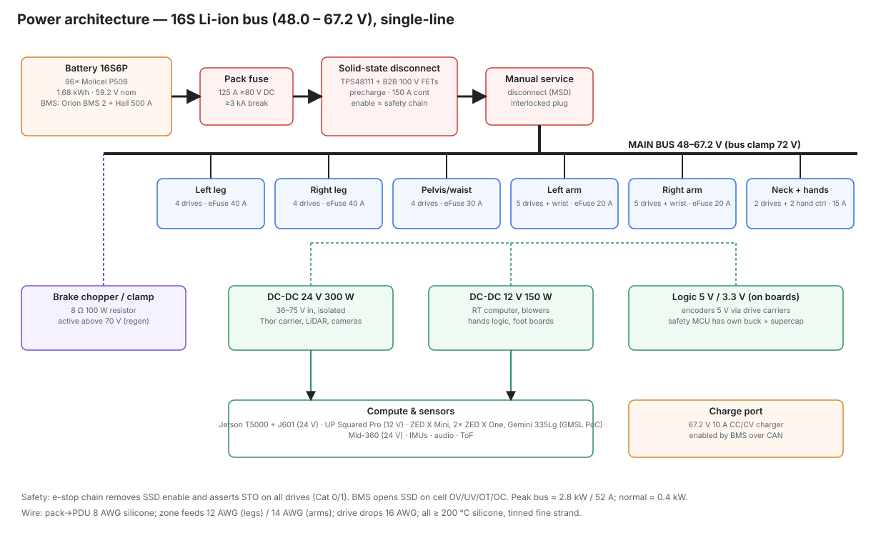
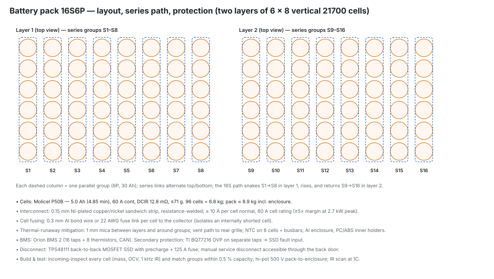
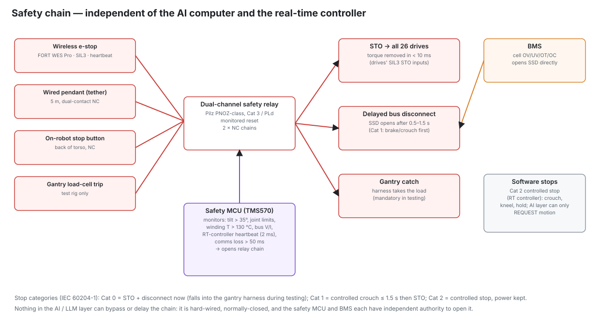

# 05 — Electrical and electronic architecture

Power numbers come from `calc/kestrel/power.py`
([generated/power_budget.md](generated/power_budget.md)). Component data and sources are in
[research/R2](research/R2-drives-encoders-safety.md) and [research/R3](research/R3-power.md).

## 1. Power budget (computed, not guessed)

Actuator electrical power is computed from every joint's simulated torque and speed through its sized
motor (copper loss = (τ_m/Km)²), gear efficiency in both directions, linkage, 3 % drive loss
and 50 % regeneration recovery. Electronics are an itemised list (Thor 75 W typical / 130 W peak, and so on).

| Operating mode | Average power |
|---|---|
| Idle standing (perception on) | ≈ 265 W |
| Normal mixed (40 % stand / 30 % walk 0.8 m/s / 30 % manipulation) | ≈ 385 W |
| Continuous walking 0.8 m/s | ≈ 440 W |
| Demanding (1.2 m/s or continuous stairs) | ≈ 625 W |
| **Simultaneous peak** (electronics peak + worst actuator instant) | **≈ 2.7 kW → ≈ 53 A at 52 V** |

Electronics take ≈ 210 W of the ≈ 385 W normal draw, so compute efficiency matters as much as actuator efficiency.

## 2. Bus voltage: why 16S (59.2 V nominal, 48–67.2 V)

13S (≤ 54.6 V) was evaluated first because it stays under the 60 V touch-safe threshold. **The sizing
found no motor/ratio combination that covered the knee and hip-pitch envelopes at a 42 V
minimum loaded bus.** The knee needs both ≈ 300 N·m on stairs and ≈ 9 rad/s in swing, and with a 60–99 A
drive limit that product cannot be met at 42 V (`calc/kestrel/actuators.py`
diagnostics). At 16S (52 V minimum loaded) it can.

Consequences:
* **Still extra-low voltage** under AS/NZS 3000 (≤ 120 V ripple-free DC [R6]). It is above the 60 V
  "touch-safe" ES1 limit, so the design adds: IP2X shrouded connectors everywhere; an interlocked manual
  service disconnect; covers that need a tool to remove; and a rule that the pack is disconnected before
  any shell or connector work (docs/10 P0).
* Drives must be 80–100 V class (Everest S NET 8–80 V continuous / 85 V for 100 ms; Elmo
  100 V class). moteus (54 V maximum), ODrive (58 V) and Orion Jr 2 (60 V) are excluded [R2, R3].
* Unitree H1/H1-2 use the same 67.2 V class [R1].

## 3. Battery pack

| Item | Specification |
|---|---|
| Cells | **Molicel INR-21700-P50B**: 5.0 Ah (4.85 min), 3.6 V, 60 A continuous, DCIR 12.8 mΩ, ≤ 71 g [ds R3] |
| Configuration | **16S6P** = 96 cells; 59.2 V nominal, 67.2 V full, 48 V cut-off (3.0 V/cell); 29.1 Ah minimum; **1.68 kWh** nominal, 1.46 kWh usable (90 % depth of discharge) |
| Runtime | 3.8 h normal mixed duty, 3.3 h continuous walking, 2.3 h demanding [sim] |
| Current | peak ≈ 53 A pack = 8.8 A/cell (15 % of rating). The pack is energy-limited, not power-limited, so 16S5P would also carry the current. 6P is chosen for runtime. |
| Mass | cells 6.8 kg; pack ≈ 8.9 kg with enclosure, busbars, BMS, fuse and solid-state disconnect [est] |
| Alternative | **16S7P Molicel P45B** (1.73 kWh, 10.2 kg): an Australian distributor exists (Master Instruments / Batteries Direct), which lowers counterfeit risk [R3] |
| Layout | two layers of 6 × 8 vertical cells, ≈ 150 × 196 × 185 mm, low in the torso behind the abdomen plate; slides out rearwards on rails |
| Interconnect | 0.15 mm nickel-plated Cu + Ni sandwich strips, resistance spot welded (kWeld-class welder at 1.5 kA, or a laser-welding service); each cell connected through a 0.3 mm Al bond wire / fuse link |
| Thermal runaway | 1 mm mica sheets between layers and around groups; aluminium enclosure with a vent path to the rear grille; no flammable foams; NTCs on 8 cells and 2 busbars |
| BMS | **Orion BMS 2** (4–180S, 200 mA passive balancing, 8 thermistors, 2× CAN, 2.5 kV isolation; 24-cell unit US$820 [ds R3]) + 500 A Hall sensor. Its charge/discharge current limits (CCL/DCL) go out over CAN to the RT controller, which caps regeneration and peak power. Orion Jr 2 cannot be used: its 60 V maximum is below 67.2 V. |
| Secondary protection | TI BQ77216 3–16S over-voltage protector on separate cell taps, wired straight to the disconnect's fault input [ds R3] |
| Later cost/mass-down | custom TI BQ76952 + BQ77216 + BQ34Z100 board based on TIDA-010208 [R3] |
| Standards to follow | IEC 62619 / UL 2271 design practice (closest scope for a robot pack); UN3480 dangerous-goods freight to import loose cells; Australia Post does not accept > 100 Wh batteries [R6] |

## 4. Disconnect, fusing, precharge, regeneration

| Function | Design | Sizing |
|---|---|---|
| Pack fuse | 125 A, ≥ 80 V DC, ≥ 3 kA breaking (EV/MIDI class, **verify the DC rating**) | prospective short ≈ 67 V / (34 mΩ pack + 5 mΩ wiring) ≈ 1.7 kA |
| Solid-state disconnect | **TI TPS48111** back-to-back N-FET controller (3.5–80 V, 1.2 µs short-circuit response, two-level overcurrent, integrated precharge driver [ds R3]) + 2 × 4 parallel 100 V 2 mΩ MOSFETs per direction (e.g. Infineon ISC022N10NM6 [ds R2]) | 150 A continuous: 8 FETs per direction, 0.5 mΩ effective → 11 W at 150 A, heatsunk to the enclosure; normal 8 A → 0.03 W |
| Precharge | TPS48111 precharge path, 20 Ω / 10 W pulse-rated resistor | bus capacitance ≈ 26 drives × ~180 µF ≈ 5 mF → τ = 0.1 s; resistor energy ½CV² ≈ 11 J |
| Contactor alternative | Gigavac GX11 (150 A, 12–800 V, 0.46 kg) | heavier; use for a bench pack |
| Manual service disconnect | keyed, interlocked plug in series with the main negative; its pilot contact also opens the disconnect's enable | |
| Regeneration | Normally absorbed by the battery (6P accepts 150 A charge; regen peaks < 20 A). When the pack can't accept it (full, disconnect open, BMS CCL = 0) a **brake chopper** clamps the bus: comparator at 70 V on, 68 V off, 100 V MOSFET, **8 Ω 100 W** aluminium-clad resistor (9 A at 72 V). Drives also limit regen current from the BMS CCL. | bus capacitors alone absorb only ½C(72² − 67²) ≈ 1.7 J, so the clamp is mandatory |
| Charging | 16S CC/CV 67.2 V 10 A charger, enabled by the BMS over CAN; charge only at 0–45 °C on a non-flammable surface with supervision [R6, ACCC] | 0.33C: about 3 h |

## 5. Power distribution and conversion

* **PDU board** (custom, beside the battery):
  - main bus;
  - 6 zone branches, each with a TPS4811-class eFuse (programmable trip, ≤ 5 µs short-circuit response): left leg 40 A, right leg 40 A, pelvis/waist 30 A, left arm 20 A, right arm 20 A, neck + hands 15 A;
  - bus voltage/current telemetry to the RT controller;
  - brake chopper.
* **DC-DC 24 V, 300 W, isolated, input 36–75 V** (telecom range, covers 48–67.2 V). Feeds the Thor carrier (J601 accepts 19–48 V [R4]), the LiDAR (9–27 V), and the GMSL camera power-over-coax through the carrier.
* **DC-DC 12 V, 150 W, input 36–75 V.** Feeds the RT computer (12 V), blowers, hand logic and foot boards.
* Candidates: Vicor DCM, TDK-Lambda i6A/i7A, RECOM. **Not verified during research.** Confirm that each part's input range covers 67.2 V plus the 72 V clamp transient. The Mean Well RSD-300C (33.6–62.4 V) is usable only on the bench.
* Local 5 V / 3.3 V bucks on each board. Encoders get 5 V (≈ 150 mA per AksIM-2) from the drive carrier.
* The safety MCU has its own 12 V → 3.3 V supply plus a supercap hold-up (200 ms), so it can log the event and command a Cat 1 stop through a brown-out.

## 6. Joint drives

| Joints | Drive | Key ratings [ds R2] |
|---|---|---|
| Knee ×2, hip pitch ×2 | **Elmo Platinum Twitter R70/100** class (or a custom GaN drive per TI TIDA-010979) | 95 V max; 70 A amplitude continuous (49.5 A rms), 2× peak (≈ 99 A rms); EtherCAT; SIL3 STO; 35 × 30 × 15 mm, 26 g |
| All other 22 rotary joints | **Novanta Everest S NET** | 8–80 V continuous, 85 V for 100 ms; 45 A continuous / 60 A for 1 s; EtherCAT, 50 kHz current loop; 2 absolute encoder inputs (BiSS-C/SSI); SIL3/PLe STO; 34.5 × 26 × 14 mm, 23 g |
| Wrist linear ×4, hand ×20 | hand controller (F28P65x + DRV8316-class integrated half-bridges, per TIDA-010992) | 12 V |

**Carrier PCB** (custom, one per actuator, annular for KA-130):
- the drive module socket;
- EtherCAT magnetics and two RJ-less connectors (IN/OUT);
- **RS-422 receivers**: Everest feedback inputs are single-ended 3.3 V while AksIM-2 BiSS-C is RS-422 [R2];
- a 5 V / 300 mA encoder supply, NTC inputs, an ADS1262 strain-gauge front-end (KH-25/20 only), STO input filtering, bulk bus capacitance (2 × 100 µF 100 V polymer) and a TVS (SMCJ75A).

## 7. Communication buses

* **EtherCAT**: 28 slaves (26 drives + 2 hands) in one ring with cable redundancy back to the RT
  computer's 2nd i226 port. 1 kHz cycle with distributed clocks. IgH EtherLab 1.6 master (GPLv2, native
  igc driver for i225/i226 on kernels 5.14–6.12 [R2, R4]). Process data ≈ 28 × (32 B out + 48 B in).
  The frame takes ≈ 0.1 ms at 100 Mbit/s. Jitter must be measured at G0 (no published figure for 40 slaves).
* **RT ↔ AI computer**: 1 GbE, ROS 2 (Zenoh or CycloneDDS), PTP (IEEE 1588) so camera, IMU and
  joint data share one clock.
* **Sensors to Thor**: GMSL2 coax (FAKRA) for the 4 cameras on the J601's MAX96712 deserialisers; Ethernet
  for the Mid-360; USB for the mic array.
* **CAN-FD**: BMS ↔ RT computer ↔ safety MCU (500 kbit/s classic CAN for the Orion).
* **Hard-wired**: STO pairs and the e-stop chain (never over a bus).

## 8. Safety and emergency isolation

| Element | Part | Function |
|---|---|---|
| Wireless e-stop | **FORT Wireless E-Stop Pro**: SIL3 (IEC 61508, exida), 200 m line of sight, **RCM certified for Australia** [ds R2] | primary stop during all mobile testing; loss of heartbeat = stop |
| Wired pendant | 5 m tether, dual-channel NC mushroom head | bench and early-gate testing |
| On-robot button | NC, back of torso | local stop |
| Safety relay | dual-channel, monitored reset, Cat 3 / PLd (Pilz PNOZ s / Phoenix PSR class) | opens STO to all drives (< 10 ms) and, after 0.5–1.5 s, the disconnect enable (Cat 1) |
| Safety MCU | **TI TMS570LC4357**: 2× Cortex-R5F lockstep, TÜV-assessed SIL3-capable [ds R2] + TDK IIM-46230 IMU | trips the chain on tilt > 35°, winding > 150 °C, bus over-voltage or over-current, RT heartbeat lost for 2 ms, or comms loss > 50 ms |
| BMS | Orion BMS 2 | opens the disconnect on cell OV/UV/OT/OC independently |

The AI computer can request motion only through the RT controller. It has no path to the drives' STO or
to the disconnect. Response times of the wireless e-stop are **not published** [R2] and must be measured
(docs/11 §5).

## 9. Wiring and connectors

| Run | Conductor | Connector | Notes |
|---|---|---|---|
| Pack → disconnect → PDU | 8 AWG (8.4 mm²) tinned silicone, 200 °C | Amphenol SurLok Plus 5.7 mm (100–120 A, IP67, IP2X touch-safe) [ds R3] | ≤ 0.3 m, twisted pair |
| PDU → leg zone | 12 AWG silicone pair | **XT60H** latching (60 A) or SurLok 3.6 mm (50–70 A) | through hip hollow shafts |
| PDU → arm / waist / neck zones | 14 AWG silicone pair | XT60H | |
| Zone → each drive (daisy chain) | 16 AWG | XT30-class 2-pin, IP2X | short drops only |
| EtherCAT + STO + fault | igus chainflex CF Robot, 4 × 2 × 0.25 mm² shielded, torsion-rated [ds R3] | **J-LINK**: Harwin Gecko-MT 10-pin latching | through every joint bore |
| Encoder (inside actuator) | 6-core shielded, 0.14 mm² | JST GH 6-pin | 5 V, GND, MA±, SLO± (BiSS-C) |
| GMSL2 | 50 Ω mini-coax | FAKRA-Z | ≤ 1.5 m |

**J-LINK pinout (10-pin, identical IN and OUT):**

| Pin | Signal |
|---|---|
| 1 / 2 | ETH_TX+ / ETH_TX− |
| 3 / 4 | ETH_RX+ / ETH_RX− |
| 5 / 6 | STO_A / STO_B (dual-channel safety signal from the relay; the carrier adapts it to the drive's STO input level, **to be confirmed from the Everest S / Elmo datasheets**, not verified in research) |
| 7 | STO_COM |
| 8 | FAULT_N (open-drain, wired-OR to the safety MCU) |
| 9 | CHASSIS (cable shield) |
| 10 | NODE_ID / spare |

**Rules:**
- every connector is IP2X and latching;
- strain relief within 30 mm of every connector;
- no conductor bends tighter than 10× its diameter at a joint; cables cross the joint through the hollow axis (twist, not bend);
- label both ends (zone-joint-function);
- crimp with the manufacturer's tool and pull-test 10 % of crimps.

## 10. Grounding and EMC

* **Star point:** BUS− is bonded to the chassis at one point, the PDU, through a 10 mm² strap. The
  structure is the chassis reference.
* Motor housings are bonded to the structure through the flange joints. A bonding braid crosses each
  actuator where the joint has anodised faces (anodise is an insulator, so mask the bonding pads).
* Drives: phase leads ≤ 150 mm, twisted three-phase; 2 × 100 µF polymer + 1 µF ceramic at each
  drive's bus input; TVS 75 V.
* EtherCAT shields are terminated 360° at the J-LINK shells. Cameras use coax only.
* The PWM frequency (20–50 kHz) is kept away from the IMU's mount resonance.
* Pre-compliance checks: an LISN + spectrum analyser scan of the bus, a near-field probe sweep around the
  legs during walking, and an ESD gun on exposed metal (±8 kV air).

## 11. Compute power and placement

| Unit | Supply | Power | Location / cooling |
|---|---|---|---|
| Jetson T5000 + J601 | 24 V | 40–130 W (75 W typical) | upper chest, cold plate + heat pipes into the torso blower duct |
| UP Squared Pro 7000 | 12 V | ≈ 20–35 W | upper back, conduction to the spine plate |
| Safety MCU | 12 V | 2 W | upper back, isolated from the RT computer |

The T4000 (40–70 W) drops into the same socket if heat or cost is an issue [R4].
