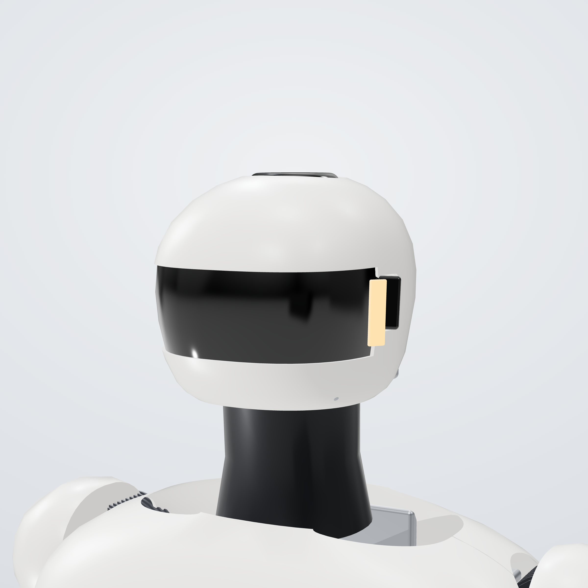

# 06 — Sensor architecture



Component data and sources: [research/R4](research/R4-sensors-compute.md), [research/R5](research/R5-hands.md), [research/R2](research/R2-drives-encoders-safety.md).

## 1. Sensor set: what, where, why, how it's processed

| Sensor (qty) | Where | Measures | Why it's necessary | Interface → processing |
|---|---|---|---|---|
| **Stereolabs ZED X Mini** (1): 2× 1920×1200 global shutter, 50 mm baseline, 0.1–8 m, IMU, 150 g, ≈ 1.5 W [ds] | head, behind the visor, pitched 10° down | dense depth + RGB of the manipulation and walking workspace | grasping, object pose, near obstacles; global shutter avoids motion blur while walking | GMSL2 → Thor (ZED SDK / Isaac ROS stereo) at 30–60 fps |
| **ZED X One GS** (2): AR0234 mono global shutter, 110° HFOV, 50 g [ds] | head temples, yawed ±55° | wide peripheral images | visual-inertial odometry (cuVSLAM) with large overlap-free coverage; people detection to the sides | GMSL2 → Thor cuVSLAM at 30 fps, hardware-synced |
| **Orbbec Gemini 335Lg** (1): active stereo, 0.17–20 m (best 0.25–6 m), 90×65° [ds] | abdomen window, pitched 35° down | depth of the ground 0.3–2.5 m ahead | foothold and step-edge detection (stairs), terrain height map for the locomotion policy | GMSL2 → Thor (elevation mapping) at 30 fps |
| **Livox Mid-360** (1): 360° × −7…+52°, 0.1–40 m @10 %, 200 k pts/s, 265 g, 6.5 W [ds] | crown of head | 3D point cloud, all-round | mapping and localisation independent of lighting; long-range obstacles; people-presence zone monitoring | Ethernet → Thor (FAST-LIO2 LiDAR-inertial odometry, nvblox) at 10 Hz |
| **MicroStrain 3DM-CV7-AHRS** (1): gyro bias instability 1.5 °/h, 1 kHz, 8.3 g [ds] | pelvis, on a silicone isolator | angular rate, acceleration, attitude | **balance**: base orientation and angular velocity are the most important inputs to state estimation | UART → RT computer at 1 kHz (IEKF) |
| **TDK IIM-46230** (1): 4.1 °/h [ds] | safety MCU board | independent attitude | tilt/fall detection with no dependence on the main computers | SPI → safety MCU at 1 kHz |
| Board IMUs (ICM-42688-P class, 4) | each foot board, each hand controller | impact acceleration | touchdown/impact detection; slip detection | SPI → foot/hand MCU → EtherCAT |
| **Joint output encoders** RLS AksIM-2 (26) [ds] | every rotary actuator output | absolute joint angle (19–20 bit) | kinematics, gear-error compensation, link deflection | BiSS-C → drive → EtherCAT 1 kHz |
| Motor encoders (26): AksIM-2 (7, legs/waist) or MT6835 (19) | every rotor | rotor angle | commutation, velocity; with the output encoder → transmission wind-up | drive internal, 10–50 kHz |
| Strain-gauge torque flexures (10) | KH-25 / KH-20 outputs | joint torque | collision detection and compliant arm control without current noise from strain-wave friction | ADS1262 on the carrier → EtherCAT |
| Motor current (26 × 3-phase) | drives | torque estimate | torque control for the QDD legs (low ratio → current ≈ torque) | drive internal |
| **Foot load cells** (4 per foot) | sole corners, under the foot plate | vertical force at 4 points | **contact detection + centre-of-pressure** for balance; the redundancy pair for leg-kinematics contact estimation | foot board ADC → EtherCAT (via ankle drive I/O) at 1 kHz |
| Ankle 6-axis F/T Bota PixONE T60 (option, 2) [ds] | between shank and ankle | full wrench | precise ZMP and terrain compliance research; excluded from the baseline (cost) | EtherCAT 3.8 kHz |
| Wrist 6-axis F/T Bota SensONE T5 (option, 2) [ds] | wrist | hand wrench | precise force control; the baseline estimates the wrench from the arm torque flexures | EtherCAT |
| **Contactile 3D force buttons** Ø10, 0–20 N (10) [ds] | under each fingertip pad | 3-axis fingertip force (±0.04–0.08 N resolution) | grip force control, slip onset | I²C → hand controller at 500 Hz |
| Magnetic tactile skin (AnySkin pattern, 5× MLX90393) (2) | palms | contact location and force | whole-hand grasp feedback; swappable skins without recalibration [ds R5] | I²C → hand controller at 200 Hz |
| Finger joint angle TMAG5273 (≥ 16) | MCP joints | absolute finger angles | position after power-up and under back-driving | I²C → hand controller |
| **ToF multizone ST VL53L5CX** (8): 8×8 zones, 4 m [ds] | shins ×2, forearms ×2, head rear, hands ×2, torso rear | near-field distance | slow-down zones near people and obstacles out of camera view; arm collision anticipation | I²C → local MCU → EtherCAT at 15 Hz |
| **ReSpeaker XVF3800** mic array (1): 4 mics, AEC, DoA [ds] | head lower rear | audio + direction of arrival | speech interface, sound localisation | USB → Thor |
| Temperatures: NTC in every winding (52), drive power stage (26), battery (10), TMP117 on boards | everywhere | °C | thermal derating and protection | drives / BMS → EtherCAT / CAN |
| Bus V/I, cell voltages | PDU, BMS | electrical state | energy estimation, protection | CAN / EtherCAT |

## 2. Why each choice

* **Global-shutter stereo in the head, not a rolling-shutter RGB-D.** The head moves fast during gait
  and rolling shutter smears depth. The ZED X Mini replaces the full ZED X originally recommended
  because the 164 mm ZED X body does not fit a human-proportioned head (found in the CAD packaging).
* **Separate downward depth sensor.** The head cannot see the feet during stair ascent without pitching down. A dedicated foothold sensor keeps
  the head free to look ahead.
* **LiDAR is justified** for the target environments (mixed lighting, glass, large indoor spaces). It is
  also an independent second modality for localisation, so the robot isn't relying on vision alone near stairs.
* **Load cells, not a 6-axis ankle F/T, in the baseline.** Four load cells give vertical force and centre of pressure,
  which is what the balance controller needs, for ≈ 2 % of the F/T cost.
* **Dual encoders on every joint** give true output position (gear backlash and windup excluded) and a
  free torque estimate on the legs.

## 3. Data flow and timing

```
1 kHz   pelvis IMU, joint encoders, motor currents, foot load cells ──► RT computer (state estimator, WBC)
200–500 Hz  fingertip force, palm skin ──► hand controller (local grip loops) ──► RT / Thor
30–60 Hz  ZED X Mini, 2× ZED X One, Gemini 335Lg ──► Thor GPU (stereo, VIO, elevation map, detection)
10 Hz   Mid-360 ──► Thor (LiDAR odometry, mapping, zone monitor)
15 Hz   ToF array ──► RT computer (speed scaling near obstacles)
```

All streams are timestamped against a single PTP clock: the RT computer is grandmaster, and the J601 and
Mid-360 support PTP. Camera exposure is hardware-triggered from one GMSL frame sync.

## 4. Calibration (each repeated after any head or limb disassembly)

| Calibration | Method | Tool |
|---|---|---|
| Camera intrinsics + stereo extrinsics | checkerboard / ChArUco sequences | Kalibr, ZED SDK |
| Camera-IMU extrinsics + time offset | dynamic excitation sequence | Kalibr camera-IMU |
| LiDAR-to-head extrinsics | planar target + hand-eye optimisation | `lidar_align` / Kalibr |
| Head-to-body (kinematic) | move the head through 30 poses viewing a ground AprilTag board | custom least squares |
| Joint zero offsets | machined zero pins at each joint (Ø4 mm dowel holes) | done at assembly |
| Encoder self-calibration | AksIM-2 built-in routine, one full rotation | RLS tool |
| Load cells | dead weights 0–80 kg per foot | test stand |
| Torque flexures | lever arm + calibrated weights, ±full scale | arm fixture |
| IMU | 6-position static + thermal soak | — |

## 5. Failure handling

Every sensor has a staleness watchdog in the RT controller. Losing the pelvis IMU, any joint encoder or
both feet's load cells triggers a Cat 1 controlled stop (crouch). Losing one camera drops to LiDAR plus
the remaining cameras and reduces speed. Losing LiDAR and all cameras means stop walking and hold
balance.
