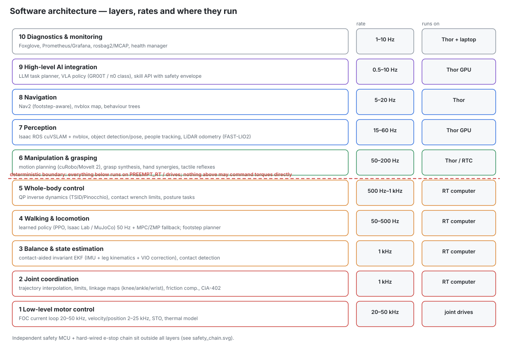

# 07 — Software and control architecture (K1 Mk II)

**Rule zero:** physical motion is deterministic and safe without the AI computer. Large models (LLM/VLA) choose *what* to
do. They never set motor timing, torques, thermal limits, power-path state or safety behaviour. The deterministic
boundary sits between layer 6 and layer 5: everything at or below layer 5 runs on the PREEMPT_RT computer, inside the
drives, or on the bare-metal power, hand and safety MCUs. Mk II adds three subsystems (liquid-loop thermal management,
the hot-swap power path, payload estimation). All three sit **below** that boundary (§6–§9).

## 1. Hardware split

| Computer | Runs | OS / middleware |
|---|---|---|
| Everest S drives (22) | layer 1 | vendor firmware (CiA-402 over EtherCAT) |
| **HC2 drives (4)** | layer 1 for knee and hip pitch | **custom firmware** on TI F28P65x: FOC, CiA-402 over EtherCAT, I²t and thermal model, active short-circuit braking. STO is hardware, not firmware (docs/05 §8) |
| Hand controllers (2) | finger current/position loops (13 per hand), tactile reflexes | bare-metal on F28P65x |
| **KW-L2 forearm driver boards (2)** | wrist commutation, current and position loops, force limit and I²t for the two KW-L2 actuators; 24 V arm-rail control | bare-metal on F28P65x, own EtherCAT slave |
| **PPM MCUs (one per bay)** | hot-swap state machine (§7; bay A master, bay B mirror), pack handshake, tie/OR path control, charge-inlet command (§9) | bare-metal, CAN-FD |
| **PDU MCU** | zone eFuses, chopper monitoring, dock charge-inlet switch, **pump and fan control loops** (§6), coolant sensor acquisition | bare-metal, CAN-FD |
| **BMS MCUs (1 per pack)** | cell protection, SoC/SoH, CCL/DCL, pack history | bare-metal, CAN-FD |
| **RT computer** (UP Squared Pro 7000) | layers 2–5, locomotion policy inference (CPU, ONNX Runtime), health manager, thermal and power derates, payload estimator | Ubuntu 24.04 + PREEMPT_RT, CPU isolation (`isolcpus`, IRQ affinity), IgH EtherCAT 1.6, ros2_control (Jazzy), Pinocchio |
| **AI computer** (Jetson T5000) | layers 6–10 | JetPack 7, ROS 2 Jazzy, Isaac ROS, TensorRT |
| Safety MCU | independent monitor | bare-metal, SafeTI libraries, MISRA-C |

## 2. Layers

### 1. Low-level motor control (drives)
* FOC current loop: Everest S 50 kHz current / 25 kHz servo loop [R2]. HC2 at its 40 kHz PWM rate. Velocity and position
  loops inside the drive for safe fallback; field weakening enabled with a limited Id.
* The RT computer runs **cyclic synchronous torque (CST)** mode at 1 kHz for the legs, plus impedance terms computed on the
  RT side. The arms use CST with the torque-flexure feedback, which the Mk II cycloid reducers make necessary (R10 §3.4).
* In-drive protection:
  - I²t;
  - winding-temperature model + NTC; on the HC2 the model uses the jacket-outlet NTC as boundary (§6.2);
  - over-voltage, encoder plausibility, STO;
  - an HC2 DC-bus current limit of 45 A (docs/05 §6.1).

### 2. Joint coordination (RT, 1 kHz)
* Maps between joint space and actuator space for:
  - the **knee four-bar** (G(θ) from `data/knee_fourbar.json`);
  - the **ankle** and **wrist** parallel linkages (exact IK, not the small-angle form). The wrist IK is checked against the
    Mk II wrist-cross angle sensors;
  - gear-error tables from the dual encoders.
* Joint limits (soft limits 3° inside the hard stops), velocity/torque limits from the actuator envelopes, and
  friction + cogging compensation (identified on the dyno; the cycloid arms need a larger friction model).
* **Torque limits come from a single limits table** that the thermal manager (§6) and the power manager (§7) can only
  lower, never raise above the actuator envelope.

### 3. Balance and state estimation (RT, 1 kHz)
* **Contact-aided invariant EKF** (base pose, velocity, IMU biases) fusing:
  - the pelvis IMU;
  - leg kinematics with foot contact probabilities (load cells + joint torque + impact IMU);
  - low-rate VIO / LiDAR odometry corrections from the AI computer.
* Outputs: base state, CoM (including the **estimated payload**, §8), centroidal momentum, contact states.
* Requirements: < 0.5 ms compute; drift < 1 % of distance walked without vision.

### 4. Walking and locomotion (RT, 50 Hz policy / 500 Hz–1 kHz tracking)
* **Primary: learned locomotion policy** (PPO), trained in simulation on the generated KESTREL model (`sim/kestrel_k1.xml`,
  with actuator torque-speed limits, reflected inertia and linkage maps).
  - **Domain randomisation:** mass, friction, motor constants, latency, terrain (flat, slopes, stairs up/down, rough), and in
    Mk II **payload 0–30 kg at the hands**.
  - **Observations:** base angular velocity, gravity vector, joint positions/velocities, previous action, commanded
    velocity, local height map; Mk II adds the **payload-mass estimate** and a **thermal-headroom signal** per leg (§6.3).
  - **Output:** joint position targets with gains, or torques through the WBC.
* **Fallback / bring-up: ZMP preview-control walker** (`calc/kestrel/gait.py`).
* Footstep planner for stairs using the elevation map; step height up to 0.18 m.

### 5. Whole-body control (RT, 500 Hz–1 kHz)
* QP-based inverse dynamics (TSID/Pinocchio formulation):
  - tasks: CoM / centroidal momentum, foot and hand poses, posture, torso orientation;
  - constraints: friction cones, CoP inside the sole, joint torque and velocity limits **from the limits table** (layer 2).
* The rigid-body model is **augmented with the payload body** attached to the hand frames (§8).
* Solver: OSQP / ProxQP warm-started, < 0.6 ms on 2 isolated cores. If the QP fails the controller holds the last feasible
  command and requests a Cat 2 stop.

### 6. Manipulation and grasping (Thor + RT, 50–200 Hz)
* Motion planning: NVIDIA cuRobo (GPU) or MoveIt 2, collision models generated from the CAD.
* Grasp synthesis from the ZED X Mini point cloud, refined in the last 10–15 cm by the **palm camera** (pre-contact
  alignment, handle/edge detection).
* 13-DOA hand synergies (power, pinch, lateral, tripod, hook) with thumb opposition; tactile slip reflex at 200 Hz in the
  hand controller.
* Arm impedance control with torque-flexure feedback; contact-force limits (ISO/TS 15066 transient values as design targets).

### 7. Computer vision and perception (Thor, 15–60 Hz)
Isaac ROS stereo disparity, **cuVSLAM**, **nvblox**; FAST-LIO2 as an independent second estimate; detection, segmentation
and tracking with TensorRT; elevation mapping for the feet; palm-camera grasp refinement.

### 8. Navigation (Thor, 5–20 Hz)
Nav2 with a footstep-aware local planner, behaviour trees, keep-out zones around detected people, speed scaled by distance
to the nearest person. Mk II adds **dock navigation**: return to the dock at low SoC; fiducial alignment for the final
0.3 m (§9).

### 9. High-level AI integration (Thor, 0.5–10 Hz, asynchronous)
* **LLM task planner** turns natural-language goals into a sequence of **skills**: walk_to, look_at, pick, place, open,
  hand_over, carry, dock, swap_battery.
* **VLA policies** for dexterous skills. They output *end-effector / hand targets*, never joint torques.
* **Skill API with a safety envelope.** Every skill call is checked before the RT controller accepts it:
  - workspace bounds, speed and force limits, people-proximity rules;
  - **payload limits** (§8.3);
  - **battery state and power mode** (§7.3), and **thermal state** (§6.3).
  Rejections go back to the planner with the reason.
* The planner can *ask* for a battery swap or a dock. It cannot command the PPM, the pumps, the limits table or any stop
  category.
* The RT controller treats AI requests as advisory. If messages stop it decelerates to a stand.

### 10. Diagnostics and system monitoring (all computers, 1–10 Hz)
* **Health manager** covering:
  - temperatures, I²t, EtherCAT error counters, QP status, estimator covariance, sensor staleness;
  - Mk II: **coolant temperatures, branch flows, loop pressure, pump/fan health, leak pads, pack SoC/SoH/temperatures,
    power-path state, single-pack time, charge sessions**.
* Tools: Foxglove for live views, rosbag2/MCAP logging, Prometheus/Grafana for long-term trends (pack cycle counts and
  radiator degradation, i.e. fan speed needed per watt).
* A flight-recorder ring buffer (last 30 s at 1 kHz) is dumped on any stop. Mk II keeps the logic bus powered through a stop
  (docs/05 §8), so the dump completes.

## 3. Independent safety monitoring and emergency stop

See [05-electrical-architecture.md §8](05-electrical-architecture.md) for the hardware chain.

| Stop | Trigger | Action |
|---|---|---|
| Cat 0 | wireless or wired e-stop, on-robot buttons, back-cover switch, safety MCU hard fault | STO all 26 drives immediately; the forearm 24 V rails (KW-L2, hands) off; actuator-zone eFuses open after 0.5–1.5 s; **logic bus stays up** (compute, logging, cooling); robot falls into the **gantry harness** (testing) or onto its knees/hands in later phases; HC2 active-short braking softens the knee and hip collapse |
| Cat 1 | safety MCU limit: tilt, winding > 150 °C, heartbeat, bus OV/OC, **leak at an HC2 drive**, **coolant > 75 °C**; software fault | controlled crouch ≤ 1.5 s, then the Cat 0 sequence |
| Cat 2 | operator stop, AI request, QP infeasible, **coolant > 70 °C**, **both pumps failed**, **single pack < 10 % SoC**, torso leak | controlled stop to a stable stand/kneel, power kept |
| (not a stop) | one pack faults or is removed | power path continues on the other pack without interruption; single-pack mode (§7.3) |

**Mk II safety-layer changes:**
1. A stop no longer powers the computers off. Only actuator energy is removed. Rule zero still holds: the safety MCU and
   the relay act without any computer.
2. Two new safety-MCU inputs:
   - HC2 leak pads (hard-wired);
   - coolant over-temperature, from a probe read directly by the safety MCU, not via the PDU MCU.
3. HC2 STO is a custom 2-channel hardware implementation (gate-supply cut + PWM-buffer disable, both read back). It is
   **not certified**. It is tested at every power-up (§3.1).
4. The pack removal interlock is **not** a safety function, but it uses a hardware AND that firmware cannot override
   (docs/05 §4.5).
5. Unattended charging is supervised by the BMS and the dock hardware, not by the AI (§9).

### 3.1 Power-up self-test (before motion is enabled)
- STO toggle test on every drive: both channels, read back over EtherCAT and FAULT_N.
- Pump spin-up, with flow on both branches within ±20 % of the expected value.
- Leak pads read "dry" and not open-circuit.
- Both BMS present (or one, in single-pack mode with the reduced envelope); PPM path currents plausible.
- Safety MCU IMU against pelvis IMU agree within 2°.

## 4. Software stack summary

| Function | Component | Licence |
|---|---|---|
| RT OS | Ubuntu 24.04 + PREEMPT_RT | GPL |
| EtherCAT master | IgH EtherLab 1.6 (DC support, igc driver) | GPLv2 |
| Control framework | ros2_control + custom RT loop (no DDS in the 1 kHz path) | Apache-2.0 |
| Dynamics | Pinocchio, TSID / ProxQP | BSD |
| HC2 firmware | TI C2000 SDK on F28P65x + EtherCAT slave stack for the on-chip ESC (licence terms to confirm before release) | TI / vendor |
| Power and cooling MCUs | bare-metal C, CAN-FD, MISRA-C subset; state machines generated from the tables in §6–§7 | project |
| Training | MuJoCo (+ MJX) light trainer; Isaac Lab task for RTX machines | Apache-2.0 / BSD |
| Perception | Isaac ROS (cuVSLAM, nvblox), ZED SDK, Livox SDK2, FAST-LIO2 | NVIDIA / vendor / GPL |
| Planning | Nav2, cuRobo / MoveIt 2, BehaviorTree.CPP | Apache / NVIDIA / BSD |
| AI | TensorRT, open VLA models, local LLM | various |
| Monitoring | Foxglove, MCAP, Prometheus/Grafana | MIT / Apache |

## 5. Development workflow

1. Simulation first: `sim/kestrel_k1.xml` is generated from the same parameters as the hardware design.
2. Software-in-the-loop: the RT stack runs against MuJoCo through the same ros2_control interface. Mk II adds simulated
   pack, coolant and payload models, so the state machines in §6–§8 can be exercised before hardware.
3. Hardware-in-the-loop per actuator on the dyno (gate G1), then per limb (G2). HC2 firmware on the dyno before it is fitted.
4. Every controller change passes a scripted simulation regression before it touches hardware:
   - stand, walk, stairs, push;
   - Mk II: carry 30 kg, single-pack walk, swap while standing, pump failure.
5. Version every calibration (encoder offsets, flexure gains, camera extrinsics, flow-sensor factors) in git with the
   hardware serial numbers; pack serials are logged by the BMS.

## 6. Thermal management of the liquid loop

The loop's mechanical and thermal design is in docs/03 §9; its electrical side is in docs/05 §13 and its sensors in
docs/06 §1.5. Typical loop heat is ≈ 350–440 W in fast walking or carrying. The radiator target is ≈ 20 W/K, which puts
the supply at ≈ 59 °C in 40 °C air (docs/03 §9.5). So the **loop**, not each jacket, sets the long-term continuous limit.

### 6.1 Who does what

| Function | Runs on | Rate | Notes |
|---|---|---|---|
| Pump and fan control loops, sensor acquisition, leak inputs | PDU MCU | 10 Hz | keeps running with no Linux computer alive |
| Per-joint winding model, I²t | HC2 / Everest firmware | ≥ 1 kHz | uses the jacket-outlet NTC on the HC2 joints |
| Loop heat estimate, system derate, policy headroom signal | RT computer health manager | 100 Hz | writes into the limits table (lower-only) |
| Hard trips (winding 150 °C, coolant 75 °C, HC2 leak) | drives / safety MCU | — | independent of all of the above |

### 6.2 Control

| Loop | Law | Details |
|---|---|---|
| Fans | PI on the supply temperature (radiator outlet) | setpoint 45 °C or ambient + 15 K, whichever is higher; feed-forward from the estimated loop heat Q̂ |
| Pumps | flow control on the two branch flow sensors (one pump per leg branch) | 0.5 L/min per leg nominal, rising to 0.8 L/min when Q̂ > 300 W (docs/03 §9.5); if one pump fails, its leg goes to the air-only rating (§6.4) |
| Loop heat estimate | Q̂ = Σ 1.5·R_LL(T)·I_q² over the four jacketed motors + an iron-loss map vs speed + HC2 loss model + Thor power | used for feed-forward and for the derate |
| Winding temperature | two-node model per KA-130K2: T_winding = T_jacket,out + P_cu·R_th,wj, R_th,wj identified on the dyno (target 0.25 K/W, R10) | online winding resistance from the FOC voltage equation; Kt compensated for magnet temperature (−0.12 %/K, R10 §3.4) |

### 6.3 Derating tiers

The thresholds sit above the ≈ 59 °C supply that docs/03 §9.5 predicts at 40 °C ambient, so a hot day is not a derate.

| Supply coolant temperature | Action |
|---|---|
| < 60 °C | full limits; fans and pumps on their control laws |
| 60–65 °C | fans and pumps at maximum; KA-130K2 continuous (I²t) limits scaled linearly down to 85 %; the policy's thermal-headroom observation falls; the skill API flags "heavy carry may be refused" |
| > 65 °C | **Thor to its 40 W mode** and gait speed limit (walk ≤ 0.6 m/s, no stairs with payload), as docs/03 §9.6 specifies; the planner is told why |
| > 70 °C | Cat 2: controlled stop to a stand or kneel |
| > 75 °C | safety MCU Cat 1 (independent probe) |
| Winding 130 °C / 150 °C | warn / trip (unchanged) |

The Thor cold-plate temperature limit is not yet known (docs/03 §9.5 open item). If NVIDIA's limit is below ≈ 60 °C, the
40 W mode moves down to the 60 °C tier. The AI layers lose rate first, and motion does not depend on them.

The **thermal-headroom signal** is per leg, 0–1:
- min over the leg's two jacketed joints of (150 °C − T_winding) / (150 °C − T_supply);
- given to the RL policy as an observation, so it learns to shorten stance on a hot knee rather than hit a limit (the
  thermal-aware policy result in R10 S33).

### 6.4 Leak and flow-fault response

| Detection | Probable cause | Response |
|---|---|---|
| Leak pad at an HC2 drive | jacket, O-ring or quick-disconnect leak onto 67 V electronics | **safety MCU Cat 1**: crouch, STO, zone cut. Pumps stopped (pressure drives the leak). No restart until inspected; the log records which pad |
| Leak pad at pump, manifold, cold plate, or the torso cable; or loop pressure < 0.15 bar (docs/03 §9.6) | leak in the torso or anywhere in the loop | Cat 2 to a stand/kneel. Pumps stopped. Both legs on air-only limits for the stop. Thor to 40 W mode, and AI layers may shut down |
| Slow pressure decay at rest (still above 0.15 bar) | slow leak or air | finish the current skill on derated limits (60–65 °C tier behaviour), return to dock, maintenance flag |
| One branch flow < 50 % of commanded with normal pump current | kink or blockage in that leg | that leg derated to its **air-only** rating (docs/03 §9.6: knee ≈ 160 N·m at the worst angle against 142 required, ≈ 1.13; hip ≈ 1.6); walking speed limited; Cat 2 if its winding temperatures keep rising |
| Pump tach lost, current anomaly, or branch ΔT rising | pump failure (one leg) | that leg to its air-only rating (docs/03 §9.6); the check valve stops back-flow through the dead pump; finish the task at reduced duty, then sit |
| Both pumps failed | — | Cat 2 to stand, then sit; no walking until repaired |

## 7. Hot-swap and power state machine

Runs on the **bay-A PPM MCU** (master); the bay-B MCU mirrors the state and takes over when bay A is empty. The **unlock**
output additionally needs the hardware AND of docs/05 §4.5, so a firmware fault can
fail to unlock a pack but cannot unlock the only source.

The RT computer:
- provides the swap posture and applies the power caps;
- reads the state over CAN-FD.

Thor can only request a swap (skill `swap_battery`) and display the state.

### 7.1 States

| State | OR A / OR B | Tie A / Tie B | Power cap to RT | Meaning |
|---|---|---|---|---|
| OFF | off / off | open | — | key off; BMS in standby, pack terminals dead |
| PRECHARGE | ramping | open | 0 | logic bus up, zone eFuses soft-starting one by one |
| DIODE | on / on | open | 3.1 kW | default with two packs |
| TIED | on / on | closed | 3.1 kW | packs matched; regen and charging into both |
| SINGLE_A / SINGLE_B | one on | open | **1.8 kW**, walk ≤ 0.8 m/s, payload ≤ 15 kg, no stairs | one pack absent, faulted or flat |
| SWAP_REQ_X | on / on | open | 1.5 kW, stand still | operator pressed release on bay X |
| SHED_X | X off | open | 1.5 kW | X path shed, current falling |
| UNLOCKED_X | X off | open | 1.5 kW | solenoid retracted, LED green, waiting for removal |
| INSERTED_X | X off (BMS handshake) | open | as SINGLE | new pack seated, being checked |
| DOCKED | per §9 | per §9 | charger-limited | on the dock |
| FAULT | per fault | open | per fault | e.g. both paths failed to share, PPM over-temperature |

### 7.2 Transitions (guards → actions)

| From → to | Guard | Action |
|---|---|---|
| OFF → PRECHARGE | key on, ≥ 1 pack handshake OK | LM5069 soft-start of the bus; logic DC-DCs up; zones soft-started in turn |
| PRECHARGE → DIODE / SINGLE | bus within 1 V of the highest pack, zones PGOOD | release the power cap |
| DIODE → TIED | both BMS OK, \|V_A − V_B\| < 0.5 V at < 2 A per path for 10 s, SoC < 98 % | close tie A then tie B |
| TIED → DIODE | any BMS warning, SoC ≥ 98 %, path current imbalance > 30 % for 1 s, or a swap request | open both ties |
| DIODE/TIED → SWAP_REQ_X | release pressed on bay X; other pack OK with SoC ≥ 15 % | ties open; ask the RT for the swap posture (stand, arms low) and apply the 1.5 kW cap |
| SWAP_REQ_X → SHED_X | RT confirms posture and cap | pull LM5069-X UVLO low |
| SHED_X → UNLOCKED_X | I_X < 1 A for 200 ms **and** hardware AND true | energise solenoid X, LED green, start 30 s timer |
| UNLOCKED_X → SINGLE_Y | pilot X lost (lever opened, pack withdrawn) | log the removal, relock the solenoid |
| UNLOCKED_X → DIODE | 30 s elapsed with the pack still seated | relock, re-enable OR-X (the pack stays) |
| SINGLE_Y → INSERTED_X | pilot X closes (pack home, lever closed) | BMS-X wake and handshake: ID, SoC, faults, max cell ΔV < 50 mV, temperature 0–50 °C (heater first if below 0 °C) |
| INSERTED_X → DIODE | handshake OK | BMS-X closes its pack switch; LM5069-X enabled (soft takeover if the new pack is higher) |
| INSERTED_X → SINGLE_Y | handshake failed | BMS-X keeps its terminals dead, bay LED red, reason logged and shown |
| any → SINGLE_Y | pack X pilot lost, BMS-X fault, or OR-X fault, *without* a request | hardware shed is already done; log; tell RT to apply the single-pack cap; skill API told |
| SINGLE → Cat 2 request | remaining pack < 10 % SoC or BMS DCL < 0.8 kW | RT sits the robot down safely |
| DIODE/TIED → (dock request) | combined SoC < 15 % | planner told to dock; if it does not within 10 min, Cat 2 at 8 % |

### 7.3 Power modes seen by the rest of the software

The RT computer turns the PPM state into:
- a cap on Σ actuator electrical power (enforced by scaling the WBC torque limits and the policy's velocity command);
- a gait envelope.

The skill API rejects tasks that need more, such as stairs or a heavy carry in single-pack mode, and says why.

| Mode | Σ actuator cap | Envelope |
|---|---|---|
| Two packs | 3.1 kW (design peak) | full |
| Single pack | 1.8 kW (one-pack sag ≤ 1.8 V) | walk ≤ 0.8 m/s, payload ≤ 15 kg, no stairs, no LM lifts |
| Swap | 1.5 kW | stand still |

## 8. Payload estimation (30 kg sustained / 50 kg momentary)

The Mk II scenario set includes:
- SQ (squat with a 30 kg box);
- CW (walk 0.6 m/s carrying 30 kg);
- AH/AL (10 kg per hand);
- AO (15 kg one-handed);
- LM (50 kg momentary lift).

The WBC, the estimator and the policy all need the payload's **mass and centre of mass**. An unmodelled 30 kg at the chest
moves the robot CoM by ≈ 0.1 m [E] and adds ≈ 30 % of the robot's weight to the knees.

### 8.1 Two independent measurements

| Estimator | Measurement | Model | When valid |
|---|---|---|---|
| **A. Ground reaction** | total vertical force from the 8 foot load cells | m_p = (ΣF_z − m_robot·(g + a_z,CoM)) / g, with a_z,CoM from the estimator | quasi-static phases: double support, \|a_CoM\| < 0.5 m/s² |
| **B. Arm wrench** | generalised-momentum observer on the arm joints (torque flexures + current), giving a 6-D wrench at each hand | m_p and CoM offset c_p from the two hand wrenches; bimanual split by measured wrench | arms not in contact with anything but the payload |

Fusion is a small Kalman filter on [m_p, c_p] with both measurements, and recursive least squares with forgetting for slow
drift. **Target accuracy:** m_p within ±1.5 kg, c_p within ±3 cm, within 0.5 s of lift-off [E; to verify with calibrated
weights on the gantry].

### 8.2 Lift detection and use

**A lift is detected when:**
- ΣF_z rises by more than 2 kg-equivalent, while
- the hand wrench builds and the object leaves the ground (palm camera / head camera confirm).

**The robot holds still for ≥ 0.5 s** until the estimate converges, **then** it may walk.

**What the estimate feeds:**
- **WBC model:** a rigid payload body attached to the hand frames, mass m_p at c_p (inertia from a box approximation of the
  detected object).
- **Estimator:** CoM and centroidal momentum include the payload.
- **Locomotion policy:** payload mass as an observation. Trained with payload randomised 0–30 kg, so it is in-distribution.
- **Thermal manager:** the expected loop-heat rise is pre-applied (CW raises the jacketed-motor copper loss to 168 W against
  104 W in W1, docs/05 §13).

### 8.3 Payload limits enforced by the skill API (not by the AI)

| Estimated payload | Allowed |
|---|---|
| ≤ 15 kg | all skills; single-pack mode allowed |
| 15–30 kg | carry ≤ 0.6 m/s (the CW case), squat lift and place; **no stairs** until a stair-with-payload scenario is added to `calc/kestrel/scenarios.py` and passed (R7 #1 asks for it; not yet simulated) |
| 30–50 kg | **lift only** (the LM momentary case): lift, re-grip or place, no walking |
| > 50 kg, or an estimate not converged in 2 s | abort: lower the object along the reverse path and release |
| One hand > 15 kg (AO case) | refused |

## 9. Docked charging behaviour

Charging runs without a person present, so it is supervised entirely below the AI boundary.

**Sequence:**
1. Thor's navigation brings the robot to the dock (§2, layer 8). The final 0.3 m is a fiducial-guided back-in.
2. The RT controller lowers the robot onto the dock contacts and holds a low-power stance.
3. The PPM and charger handshake over CAN (dock contacts). The PDU closes the charge-inlet channel on the PPM's command.

**Charge control:**
- The master PPM MCU sends the charger a current setpoint = min(CCL_A + CCL_B in tied mode, the CCL of the pack being charged
  in unmatched mode, 30 A).
- The BMS CCLs follow cell temperature: no charge outside 0–45 °C, tapered near the limits.
- With unmatched packs the PPM charges the lower pack alone, then ties both (docs/05 §12).

**Stops charging at once:**
- loss of CAN heartbeat (charger output off);
- cell temperature rate-of-rise above threshold;
- a pack gas sensor;
- dock smoke/heat (cuts the charger's mains supply locally);
- a leak alarm;
- any stop category.

**Pumps** run during charging whenever a pack temperature or the coolant temperature is above 35 °C. Thor, which is on the
loop, can do offline work (map building, training-data upload) while docked.

**Logging:** every session records energy in, peak cell temperature and duration per pack serial, for SoH tracking.
