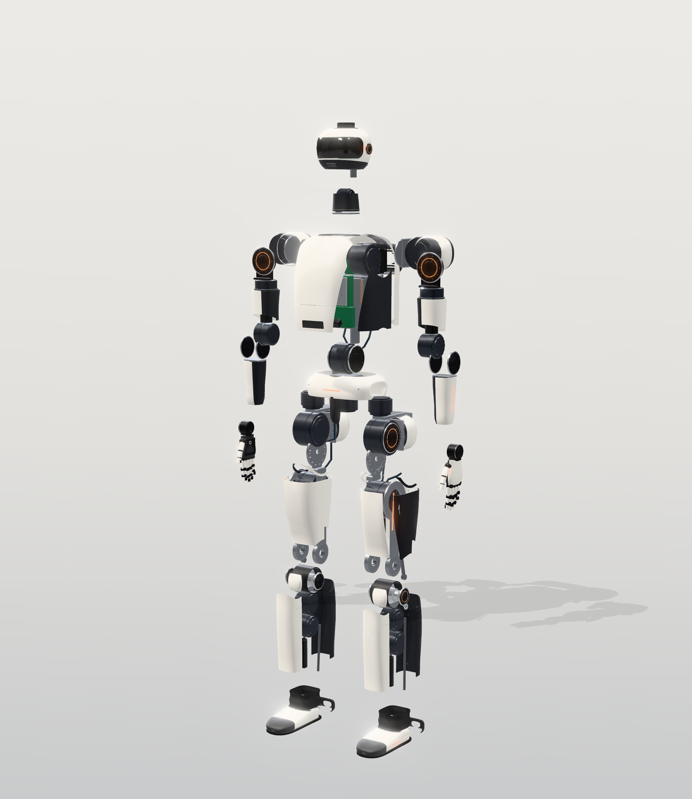

# 10 — Visual construction tutorial (KESTREL K1 Mk II)

This is the step-by-step build guide for the **Mk II** revision. **All phases plus the commissioning, manufacturing
and scratch-build appendices in one illustrated file: [KESTREL-K1-build-tutorial.pdf](KESTREL-K1-build-tutorial.pdf)**
(regenerate it with `make_handbook.py`). Work through the phases **in order**. Each phase ends in a test gate
(docs/11). Do not start a phase until the previous gate has passed and been logged.

**Before you order metal, clear the design holds in [docs/09 §11](../09-manufacturing-package.md).** Several detailed
parts inherited from K1 (thigh plate hip flange, knee hub, KA-130 bearing seat, hollow bores) cannot carry the Mk II
loads as modelled.

## Mk II at a glance (numbers from `docs/generated/`)

| Item | Mk II value | Replaces (K1) |
|---|---|---|
| Design mass / estimate | **112.7 kg** design (102.5 kg estimate × 1.10) | 92.6 kg |
| Work loads | **30 kg sustained two-handed, 50 kg momentary lift**, 10 kg per hand at reach, 15 kg one-handed | 20 kg squat, 5 kg per hand |
| Knee / hip pitch | KA-130K 17:1 (493 / 295 N·m) and KA-130H 14:1 (406 / 243 N·m), **liquid-cooled KM-130x50-LC**, **150 A GaN drives** | KM-130x45/x40, 99 A drive, ducted air |
| Hip roll, waist pitch | KA-110P: **RI115-PH**, 29:1, 427 / 125 N·m, **output flange 12× M5 12.9 on PCD 100** | ILM85x26, 32:1, 10× M4 on PCD 85 |
| Hip yaw, waist yaw, ankles | KA-90P: RI85-PH, 28:1, 129 / 44 N·m | 23:1 |
| Shoulders, elbows | **KH-C25 / KH-C20: machined two-disc cycloids 30:1** (362 / 158 N·m motor peak, firmware-limited to 160 / 105 N·m) | strain-wave CSG-25/20-50 |
| Wrist yaw, neck | KH-14: KM-50x20 + CSG-14-50 (limited to 23 N·m) | unchanged |
| Wrist pitch/roll | **KW-L2**: maxon ECX FLAT 32 L brushless + **1 mm-lead** ball screw on a **24 V** forearm rail | DCX 16 L on 12 V |
| Hands | **13 DOA**, linkage + tendon, palm camera, ≥ 200 N power grasp, 1.15 kg | 10 DOA |
| Battery | **two hot-swap 16S4P packs** (2 × 1.15 kWh, 2 × 5.9 kg), in-pack BMS, robot-side ideal-diode / tie power path with a fail-locked removal interlock | one 16S6P pack, powered-down swap |
| Cooling | **sealed liquid loop** (2 pumps, radiator + 2 fans, 40 mL spring compensator, dry-break QDs at the hips) for the knee/hip jackets and the Thor cold plate, plus 2 electronics blowers | blowers and ducts only |

## How each phase is laid out

| Section | Contents |
|---|---|
| **A. Visual reference** | renders, cutaways, diagrams, CAD files and drawing sheets for this phase |
| **B. Parts list** | every part with its BOM ID (`data/bom.csv`, [generated/bom.md](../generated/bom.md); Mk II additions start at B101), quantity, specification |
| **C. Tools & equipment** | what you need on the bench |
| **D. Manufacturing** | how to make the custom parts: material, process, tolerances, finishing |
| **E. Assembly** | ordered steps with orientation, fasteners, torques, adhesives, alignment |
| **F. Electrical** | wiring, connectors, pinouts, voltages, fuses, precautions |
| **G. Testing** | the bench test that proves the assembly before it goes into the robot, with pass criteria |

Mk II additions that are large enough to need their own A–G sequence are **sub-phases** inside the phase where they are
built (for example P05.1).

## Phase map

| Phase | What you build | Gate |
|---|---|---|
| [P00](P00-workshop-and-safety.md) | Workshop layout, lithium and 67 V DC safety, coolant handling, documentation system | — |
| [P01](P01-test-infrastructure.md) | Gantry + fall-arrest harness, dynamometer, coolant test cart, e-stop chain, bench power | — |
| [P02](P02-electronics-bringup.md) | RT computer + EtherCAT master, drive carrier, 150 A GaN drive, safety MCU | G0 |
| [P03](P03-actuator-KA90P-KA110P.md) | KA-90P (first article), then KA-110P with the 12× M5 output flange | G1 |
| [P04](P04-actuator-KH.md) | KH-C25 / KH-C20 cycloid actuators and KH-14; **P04.1 machined cycloid gears** | G1 |
| [P05](P05-actuator-KA130.md) | KM-130x50-LC motors, KA-130K / KA-130H actuators; **P05.1 liquid-cooling jackets** | G1 |
| [P06](P06-battery-pack.md) | Two hot-swap 16S4P packs; **P06.1 hot-swap battery bay** | G0 (packs, bay) |
| [P07](P07-legs.md) | Hip, thigh with knee four-bar and torque limit, shank with ankle push-rods, foot, leg coolant lines | G2 |
| [P08](P08-pelvis-waist-torso.md) | Pelvis, waist, torso frame, battery bay, power distribution, compute; **P08.1 liquid-cooling loop** | G2/G3 |
| [P09](P09-arms-wrists.md) | Shoulders, upper arms, elbows, forearms; **P09.1 KW-L2 wrist actuators** | G2 |
| [P10](P10-hands.md) | Mk II hands: 13 actuators, linkage + tendon fingers, tactile, palm camera | G2 |
| [P11](P11-head-neck-sensors.md) | Neck, head frame, cameras, LiDAR, calibration | G3 |
| [P12](P12-harness-shells-final-assembly.md) | Harness, shells, final leak check, final assembly and inspection | G3 |
| [P13](P13-software-bringup.md) | Software bring-up and progressive commissioning (hand-off to docs/11 G3–G10) | G3–G10 |

## Why this order

1. **Rigs and safety before anything moves.** The gantry, e-stop chain, dyno and coolant cart make every later test
   safe and measurable.
2. **One of each actuator class first.** The first article proves the design (Kt, efficiency, thermal behaviour,
   backlash) before you buy more gear sets. Results feed back into `calc/kestrel/actuators.py`. For Mk II, the
   R10 §7 validation tests (FEMM, jacket thermal resistance, 150 A locked rotor, gear run-in, k_L, cycloid overload,
   KW-L2 force–speed) are part of gate G1 (docs/11 §4.1).
3. **Simplest risk first.** KA-90P (commercial motor, simplest planetary) comes before the cycloids, and both come
   before the custom liquid-cooled KM-130.
4. **Limbs before the body.** Each limb is tested clamped on a stand, with the coolant cart standing in for the robot's
   loop, before it carries the robot's weight.

## Non-negotiable safety rules (repeat them to yourself every session)

* **Keyed main switch off and both packs out** before you touch any connector, shell, harness or coolant fitting.
  The e-stop is not an isolation: the logic bus stays live. A hot swap during the programme is done only with the robot
  supported and the drives in STO (P06.1).
* The bus is **up to 67.2 V DC** (above the 60 V touch-safe limit) and the packs can deliver > 1 kA into a short.
  Insulated tools, one hand where you can, and measure < 5 V before touching a conductor.
* No powered motion of a limb or the robot without the **e-stop in hand** and a second person present from G3 onward.
* **No unrestricted high-torque operation near people.** Reduced torque limits until the gate allows more; nobody in
  the cage while drives are enabled.
* No walking or payload tests without the **gantry harness** attached until gate G6 says otherwise.
* **Coolant and electronics:** fill, drain and open the loop only with both packs out; wipe spills at once; never
  route a fitting above a PCB.
* Charge batteries only when supervised, on a non-flammable surface, in the battery area.
* Magnetised rotors (N50UH) are handled with jigs, never fingers.
* High-torque joints are pinch hazards. Keep hands out of joint envelopes whenever drives are enabled, even in
  "zero torque".
