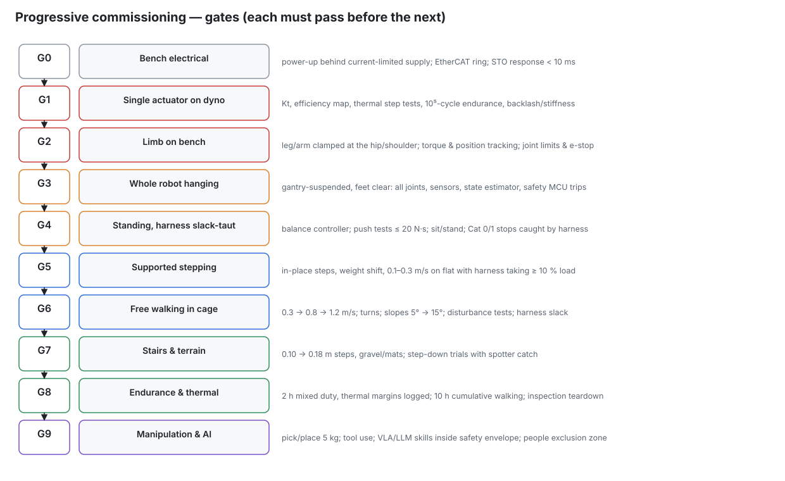

# 11 — Engineering validation, testing and commissioning

Nothing on KESTREL K1 is proven until it passes the tests below. Movement is introduced progressively:
restrained → low speed → supported → free, with independent shutdown at every step.

## 1. Gate checklist (sign and date each)

| Gate | Entry condition | Exit criteria (all required) |
|---|---|---|
| G0 Bench electrical | P02 complete | EtherCAT 1 kHz with distributed clocks, 1 h, 0 lost frames; STO < 10 ms from every e-stop device; safety-MCU trips verified; pack gate (P06 §G) passed |
| G1 Actuator | each actuator built | P03/P04/P05 §G table passed; measured Kt, η, thermal time constant and backlash fed back into `calc/` and the requirements re-checked |
| G2 Limb | limb assembled on its stand | P07/P09/P10 §G tables passed |
| G3 Hanging | robot assembled, suspended | every joint, sensor and estimator verified; Cat 0/1/2 stops tested; thermal soak OK |
| G4 Standing | G3 | stand 10 min unassisted (harness slack-taut); recovery from 20 N·s pushes in 4 directions; sit/stand ×20 |
| G5 Supported stepping | G4 | 100 steps in place, 50 m at 0.3 m/s with the harness carrying ≥ 10 % load; no falls caught by the harness in the last 20 m |
| G6 Free walking (cage) | G5 | 0.3 → 0.8 → 1.2 m/s; turns; slopes 5° → 15°; 1 h cumulative; harness slack throughout |
| G7 Stairs & terrain | G6 | 0.10 → 0.18 m steps up/down ×50 each; gravel, mats, cables on the floor |
| G8 Endurance | G7 | 2 h mixed duty with thermal margins logged; 10 h cumulative walking; teardown: gears, bearings, rod ends, bonds |
| G9 Manipulation & AI | G8 | 5 kg pick/place ×100; tool use; skill API rejects out-of-envelope requests; people exclusion zones enforced |

## 2. Test environment and safe operating limits

* **Cage:** 4 × 3 m mesh panels, foam floor tiles, operator outside with the wireless e-stop on a lanyard.
  The gantry harness is attached from G3 to G5 and slack-attached in G6–G7.
* **Two-person rule** from G3. Nobody inside the cage while drives are enabled, and **no unrestricted
  high-torque operation around people** at any stage of this programme.
* **Limits until G6:** torque limits 50 % of the class peak, speed 50 %, workspace fences in software
  (base within the cage, hands below 1.8 m).
* **Abort criteria:** any unexpected noise or smell, temperature above warn, estimator divergence,
  EtherCAT errors > 0 per minute. Stop and investigate before continuing.

## 3. Structural validation

| What | How | Pass |
|---|---|---|
| Hand calculations | `calc/kestrel/structure.py` ([generated](generated/structure_checks.md)) | all SF ≥ 1.5 (structural case) / ≥ 2.0 (fatigue): **currently met** |
| FEA | pelvis bowl, yokes, knee hub, thigh plates, shank fittings, foot plate, ankle cross under N/M/X loads (CalculiX/FreeCAD FEM or Fusion) | von Mises < σy/1.5 (X); < endurance/2 (N); modes > 40 Hz (legs), > 25 Hz (arms) |
| Proof load | each leg on the stand: 1.5× the structural-case vertical load (≈ 3.3 kN) for 30 s, joints locked | no permanent set > 0.05 mm (dial indicators), no bond creep |
| Bonded joints | coupons: 1.5× axial + torsion | no failure |
| Fatigue | leg stand, 10⁶ cycles of the walking load profile (≈ 140 h at 2 Hz) on one leg before G8 | no cracks (dye penetrant on Ti and 7075 hot-spots) |
| Drop | the structural case (0.15 m) on the stand with a 93 kg sled | no yield; actuators may slip their flanges (inspect and re-torque) |

## 4. Actuator validation (P03–P05 §G)

| Item | Method | Feeds back into |
|---|---|---|
| Joint torque validation | dyno torque vs current across the speed range | `MOTORS` Kt, `ETA` |
| Motor thermal testing | thermal step at continuous torque to steady state; walking-duty replay from `data/scenario_series.npz` | `THERMAL_DERATE`; **the knee continuous margin (1.03) is the critical result** |
| Gearbox endurance | 10⁵ cycles (2 × 10⁵ for KA-130) of the scenario torque profile; backlash and efficiency before and after | gear spec, maintenance interval |
| Efficiency map | speed × torque grid, motoring and regenerating | power budget (`calc/kestrel/power.py`) |
| Overload | locked-output impact at 1.5× momentary | flange slip setting |

## 5. Electrical validation

| Item | Method | Pass |
|---|---|---|
| Insulation | 500 V bus → chassis (bond lifted); 1000 V motor windings → stack | > 10 MΩ / > 100 MΩ |
| Pack | P06 §G (capacity, balance, thermal at 1C, BMS trips, short-circuit on the disconnect) | as listed |
| Power quality | scope the bus during a W2 replay on the stand: ripple, regeneration peaks | bus stays 48–72 V; clamp engages above 70 V |
| eFuses | electronic-load trip per zone | ±10 % |
| EMC pre-scan | near-field probe + LISN on the bus during walking; ESD ±8 kV air on exposed metal | no resets, no EtherCAT errors |
| **E-stop response measurement** | scope from the button contact to the phase current reaching zero, for each device; wireless out-of-range timeout | ≤ 10 ms wired; wireless heartbeat timeout measured and logged (not published by the vendor [R2]) |
| EtherCAT timing | log DC sync error and cycle jitter over 1 h with all 28 slaves | jitter < 20 µs, sync error < 1 µs |

## 6. Sensor calibration and validation
See docs/06 §4 for procedures. Validation: walk a 20 m closed loop and compare the estimator against a
motion-capture or total-station reference. Pass: drift < 1 % of distance without vision; < 0.2 % with VIO + LiDAR.

## 7. Control-system testing (progressive)

| Step | Environment | What is tested |
|---|---|---|
| Software-in-the-loop | MuJoCo with `sim/kestrel_k1.xml` + the RT stack through ros2_control | stand, walk 0.8/1.2 m/s, stairs, pushes: regression suite before every hardware session |
| Single joint (G1) | dyno | torque, impedance, limits, faults |
| Single limb (G2) | leg/arm stand | tracking, gravity comp., load cases, linkage maps |
| Balance (G4) | standing, harness | WBC, IEKF, push recovery, controlled stops |
| Supported walking (G5) | harness ≥ 10 % load | ZMP walker first, then the learned policy at 50 % action scale |
| Progressive locomotion (G6–G7) | cage | speed, turns, slopes, stairs, terrain |
| Full-system endurance (G8) | cage | 2 h duty, thermal margins, inspection |

**Sim-to-real checks:**
- compare measured joint torques (current × Kt) against the inverse-dynamics model for identical motions. Expected agreement ±15 %; investigate anything larger.
- re-identify inertial parameters if the mass of any module deviates > 5 % from `params.py`.

## 8. Failure modes (FMEA summary)

| Failure mode | Effect | Detection | Mitigation |
|---|---|---|---|
| Knee motor overheats in sustained walking | derate → slow, then Cat 1 stop | winding NTC + thermal model | ducted cooling; liquid-jacket fallback; gait with lower knee torque |
| Strain-wave ratcheting on impact | arm position loss | dual encoder mismatch | firmware torque limits; momentary rating 1.9× repeated |
| Push-rod or rod-end failure | knee/ankle loss of drive → fall | encoder mismatch (actuator vs joint) | buckling SF 5.5; inspection interval; harness during testing |
| Flange slip | joint offset | dual encoder mismatch | slip = overload fuse; re-zero + re-torque procedure |
| EtherCAT cable break | loss of slaves | master WKC error | ring redundancy; Cat 1 stop if the ring is broken in two places |
| Cell internal short / thermal runaway | fire | BMS (dT/dt, voltage), smoke | per-cell fuse links, mica barriers, disconnect, supervised charging, battery-area storage |
| RT computer crash | loss of control | safety-MCU heartbeat | Cat 1 → STO; harness |
| Estimator divergence | fall | covariance monitor, IMU vs kinematics residual | Cat 1 stop |
| Foot slip | fall | load-cell CoP jump, foot IMU | conservative friction cone (μ = 0.5 assumed vs 1.0 sole); speed limits |
| Hand overload | finger damage | current | breakaway detents, back-drivable screws |
| AI requests unsafe motion | collision | skill-API envelope check | requests are advisory; envelope enforced in the RT layer |

## 9. Uncertainties and assumptions register

| # | Assumption | Value used | How verified |
|---|---|---|---|
| 1 | Mass growth | +10 % (design 92.6 kg) | weigh modules; re-run `run_all.py` |
| 2 | KM-130 Km, Kt | model ±5 % vs two datasheets | dyno (P05) |
| 3 | Thermal derate with ducted air | 1.00 (KA-130); 0.85 others | thermal step tests |
| 4 | Planetary efficiency | 0.92 | dyno |
| 5 | Strain-wave efficiency | 0.75 | dyno |
| 6 | Voltage-limited speed factor | k_L = 0.75 (calibrated to TQ rated speed) | torque-speed sweep at 52 V |
| 7 | Gait model | flat-footed ZMP with dynamics filter (conservative knee); learned gait differs | measured torques vs model |
| 8 | Minimum loaded bus | 52 V (3.25 V/cell) | BMS derating curve; low-SOC walking test |
| 9 | Prices | 84 % estimate/quote | quotes before ordering |
| 10 | Unverified components | DC-DC bricks, fuses, STO signal levels, CubeMars RI50, wireless e-stop response time | datasheets/quotes before design freeze |

## 10. Reporting
Each gate produces a short report in `logs/gates/Gx.md`: test list, data plots, deviations, decisions,
and the updated calc outputs. Keep failed attempts too; they are the most valuable data.
