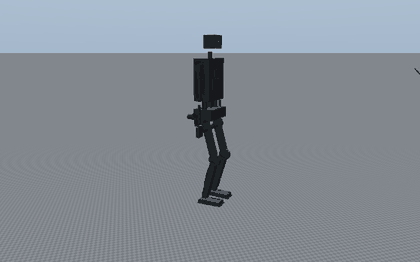

# KESTREL scrap builds: a full-size humanoid for A$500–1,000

S1 and K1 cost A$39k and A$226k because they use commercial or custom actuators. These two builds keep the S1
skeleton (1.75 m) and replace everything with salvaged parts and hand tools, with no CNC or 3D printer. Every joint
is a **cordless-drill motor and its gearbox driving a hand-made Dyneema capstan**, controlled by an ESP32 through a
A$8 H-bridge, with a magnetic angle sensor on the joint.

| | **S1-Scrap** | **K1-Scrap** |
|---|---|---|
| Parts | **A$917 buying everything / A$492 scrounging** ([s1/generated/bom.md](s1/generated/bom.md)) | A$1,280 buying / **A$727 scrounging** ([k1/generated/bom.md](k1/generated/bom.md)) |
| Mass | about 30 kg | about 39 kg |
| Joints | 16 (legs 2 × 6, shoulder pitch and elbow per arm) | 25 (adds waist yaw, 4-DOF arms, a 2-DOF servo neck) + servo grippers |
| Motors | 18 drill gearmotors (two per knee) | 23 drill gearmotors (two per knee) + 4 hobby servos |
| Walking | 0.25 m/s (0.36 fast), always balanced; 15 cm steps; 3 kg box | the same, with a 5 kg box and 1 kg per hand |
| Extras | — | old-phone head and face, EVA-foam armour |

## The fast builds (H2-style quasi-direct drive)

For fast walking the legs need quasi-direct-drive joints: high-torque motors, short reductions, torque control and low
reflected inertia. The fast builds put hoverboard hub motors (up to 50 A, ODESC V4.2 FOC drives, 48 V) on short
bike-chain reductions at the hips, knees and ankles: 2 per hip pitch, 2 per knee, 1 per ankle push-rod (12 in all).

| | **S1-Fast** | **K1-Fast** | S1-Scrap |
|---|---|---|---|
| Walking (sized for) | 0.8 m/s, 1.0 m/s fast | 0.6 m/s, 0.8 m/s fast | 0.25 / 0.36 m/s |
| **Top speed, simulated** | **1.44 m/s** | **1.31 m/s** | 0.42 m/s |
| Stairs, objects | 18 cm stairs, 10 kg box | 18 cm stairs, 5 kg box | 15 cm steps, 3 kg |
| Knee | 335 N·m, 12.9 rad/s | 347 N·m, 12.5 rad/s | 134 N·m, 7.6 rad/s |
| Mass | about 52 kg | about 62 kg | about 30 kg |
| Parts | A$2,342 buying / A$1,553 scrounging ([bom](s1fast/generated/bom.md)) | A$2,673 / A$1,782 ([bom](k1fast/generated/bom.md)) | A$917 / A$492 |

**Unitree H2's walking pace, in simulation.** The sizing calculation replays a prescribed walk with torque and
speed margins. By that measure, hub motors close only at 1.0 and 0.8 m/s, because their large rotors feel like
0.8–0.9 kg·m² at the knee and hip. The walking policies trained in `train/` face the same motors: reflected
inertia, current limits, and the 48 V torque-speed line applied every physics step. They walk faster. S1-Fast
walks **1.44 m/s** on flat ground with its fastest joint at 70 % of no-load speed and its hottest motor at 91 % of
its continuous rating. K1-Fast walks **1.31 m/s**. That is Unitree H2's quoted ~1.4 m/s walk. It is a
simulation result: the chains are modelled as rigid, and the motor constants are one published measurement. See
"Simulated walking" below.
Guide chapter: "The fast builds" in [tutorial/scrap-build-guide.md](tutorial/scrap-build-guide.md).

On A$500, set `SCRAP = SLOW` in `calc/kestrel/variant_s1scrap.py`: one drill per knee (16 drills), 0.12 m/s, 10 cm
steps, about A$463 scrounged.

**Why so slow.** A drill motor reaches 130–180 N·m at the knee through a 270–510:1 total reduction. Its rotor,
multiplied by the ratio squared, feels like 2–4 kg·m² of inertia at the joint, about 20 times the leg's own. So
these robots walk the always-balanced way, not the dynamic way. The same whole-body simulation that sizes K1 and S1
sizes them, with each actuator option checked against its own reflected inertia.

## Simulated walking

Each build has a walking policy trained in [`train/`](../train/README.md) against its own actuators (2.5 h each on 4
CPU cores, started from the S1 policy). Speeds come from `play.py --speed-test` on flat ground. A speed counts only
if no robot falls, every leg joint stays under its motor's no-load speed, and every motor stays under its continuous
rating. Terrain success rates are from `play.py` on six terrain types, 16 headings per cell.

| | S1-Fast | K1-Fast | S1-Scrap | K1-Scrap |
|---|---|---|---|---|
| Top speed within motor limits | **1.44 m/s** | **1.31 m/s** | 0.42 m/s | 0.42 m/s |
| Flat, slopes to 15°, stairs down to 18 cm | 100 % at 1.0 m/s | 100 % at 1.0 m/s | flat 100 %, slopes 75–100 % at 0.25 m/s | flat 100 %, slopes 75–100 % at 0.25 m/s |
| Stairs up: 10.2 / 12.8 / 15.4 / 18 cm | 100 / 88 / 69 / 50 % | 100 / 75 / 25 / 25 % | to 5 cm (100 %) | to 7.6 cm (100 %) |
| Tables | [speed](../train/runs/s1fast/speed.md), [terrain](../train/runs/s1fast/eval_1.0.md) | [speed](../train/runs/k1fast/speed.md), [terrain](../train/runs/k1fast/eval_1.0.md) | [speed](../train/runs/s1scrap/speed.md), [terrain](../train/runs/s1scrap/eval.md) | [speed](../train/runs/k1scrap/speed.md), [terrain](../train/runs/k1scrap/eval.md) |



The scrap builds' tall stairs are a training problem, not a motor limit. Their curriculum stalled at the easy terrain
rows until a fix to its promotion rule (see `train/README.md`), and stairs fine-tunes are under way. On the real
robot, step-ups start from the scripted motions in `s1/data/gait_SU.csv` and `gait_ST.csv`, which the
simulation checks for balance.

## How it was designed

1. **Parts research** with Australian prices and sources: [docs/research/R11](../docs/research/R11-scrap-build-parts.md).
2. **Requirements:** `calc/kestrel/variant_s1scrap.py` and `variant_k1scrap.py` describe the robots; the "scrap"
   scenario set (slow walk, low steps, light objects) gives each joint's torque and speed.
3. **Actuators:** [`calc/scrap_select.py`](calc/scrap_select.py) tries one or two drill gearmotors, a hoverboard
   hub motor on a bike chain, and every capstan ratio per joint. Checks: every simulated sample under the
   current-limited torque-speed line (K1's 1.2 / 1.15 margins), continuous current, cord or chain strength. The drill's
   clutch is the missed-step fuse. Drills beat hoverboard motors at every joint at the hoverboard board's stock current.
4. **Parts lists:** [`calc/scrap_bom.py`](calc/scrap_bom.py), two prices per line (buy / scrounge).
5. **Templates and gait:** [`calc/scrap_templates.py`](calc/scrap_templates.py) writes 1:1 printable capstan sectors
   (`s1/templates`, `k1/templates`) and the simulated motions as CSV joint angles (`s1/data/gait_*.csv`): walks,
   stairs, step-up, squat, and a bring-up walk (`gait_W0.csv`, 0.086 m/s). The bring-up walk stays balanced at any
   replay speed. The 0.25 m/s walk does not: it balances dynamically.

## Build it

[tutorial/scrap-build-guide.md](tutorial/scrap-build-guide.md) (PDF: `tutorial/KESTREL-scrap-build-guide.pdf`).

## Re-run after a change

```bash
cd projects/kestrel-humanoid
python scrap/calc/scrap_select.py --variant s1scrap      # or k1scrap; about 3 min
python scrap/calc/scrap_bom.py
python scrap/calc/scrap_templates.py
```
