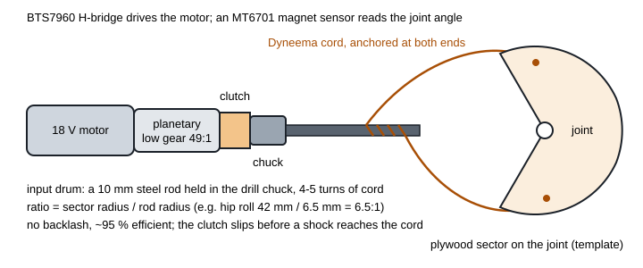

# KESTREL scrap build guide: S1-Scrap and K1-Scrap

This guide builds a full-size, 1.75 m humanoid from salvaged parts and hand tools, with no CNC and no 3D printer.
Every actuator is a cordless-drill motor and its gearbox, driving the joint through a capstan you make from a steel
rod, Dyneema cord and a plywood sector. The robot is sized by the same simulation as K1 and S1.

There are two versions. Build S1-Scrap first; K1-Scrap adds to it.

| | **S1-Scrap** | **K1-Scrap** |
|---|---|---|
| Target cost | A$1,000 | A$1,000 |
| Parts list | **A$917 buying the cheapest**, A$492 scrounging ([../s1/generated/bom.md](../s1/generated/bom.md)) | A$1,280 buying, **A$727 scrounging** ([../k1/generated/bom.md](../k1/generated/bom.md)) |
| Height / mass | 1.75 m / about 30 kg | 1.75 m / about 39 kg |
| Actuated joints | 16: legs 2 × 6, shoulder pitch and elbow per arm | 25: legs 2 × 6, waist yaw, arms 2 × 4, neck 2; plus a one-servo gripper per hand |
| Motors | 18 drill gearmotors (two per knee) | 23 drill gearmotors (two per knee), 4 hobby servos |
| Walking | **0.25 m/s, always balanced** (0.36 m/s fast) | **0.25 m/s** (0.36 m/s fast) |
| Steps, objects | 15 cm steps, 3 kg box, 0.5 kg per hand | 15 cm steps, 5 kg box, 1 kg per hand |
| Looks | bare frame, webcam head | old-phone face, EVA-foam armour in K1 white / graphite / amber |

S1-Scrap fits A$1,000 even if you buy every part. If you scrounge, it costs about half that. **On A$500:** set
`SCRAP = SLOW` in `calc/kestrel/variant_s1scrap.py` and re-run step 11's scripts. That version has one drill per knee
(16 drills), walks at 0.12 m/s with 10 cm steps, and its parts come to about A$463 scrounged.

**What these robots can and cannot do.** A drill gearmotor is strong for its price, but it reaches its torque
through a large gear ratio. The motor's spinning rotor, multiplied by the ratio squared, feels like 2–4 kg·m² of
inertia at the knee, about 20 times the leg's own. So the scrap robots cannot walk the fast, bouncy way
commercial humanoids do. They walk the slow, always-balanced way early research robots did: shift the weight over
one foot, step, shift again. Everything in this guide is sized for that. The simulation that sizes them, and the
torque, speed and missed-step checks, are in [../s1/generated/actuator_selection.md](../s1/generated/actuator_selection.md)
and [../k1/generated/actuator_selection.md](../k1/generated/actuator_selection.md).

| | |
|---|---|
| Build time | about 150–250 hours for S1-Scrap, 250–350 for K1-Scrap, plus the time to collect parts (or 2–4 weeks of delivery if you buy) |
| Skills | hacksaw, drill press, tapping, soldering, crimping, flashing an ESP32 |
| Tools (you have them) | drill press with a 22 mm and a 25 mm Forstner bit or hole saw, hacksaw, jigsaw, files, tap set M3–M8, hex keys, a spring or luggage scale, multimeter, soldering iron, bench supply with current limit |

---

## Step 0: Safety

1. **Salvaged lithium cells are the main hazard.** Test every cell (step 7). Never use a swollen, dented, hot or
   low-voltage cell. Charge only supervised, on a concrete floor or in a steel box, never overnight.
2. **The joints are strong.** The knee can push 134–183 N·m. Keep fingers out of capstans and joints whenever the
   motors are powered.
3. **E-stop first.** The hard-wired e-stop (step 8) works before any motor moves on the robot.
4. **Gantry always.** Hang the robot from a garage beam or an A-frame by chest and pelvis straps with the rope just
   slack, for every powered test.
5. **Two people** from the first powered motion: one holds the e-stop and does nothing else.

---

## Step 1: Collect the parts

The parts lists give two prices per line. "Scrounge" assumes you collect the salvageable parts for little or nothing:

| Part | Where to scrounge it |
|---|---|
| 18 V cordless drills with dead batteries (18 or 23) | council kerbside collections, tip shops, Marketplace "broken drill", friends and family. Ask builders: dead-battery drills are thrown out all the time. The battery is not needed |
| 18650 cells (25–30 good ones) | dead laptop packs, power-tool packs, e-bike packs (e-waste days, computer repairers). Expect 30–50 % of cells to pass the test |
| Aluminium angle and tube | metal recyclers, sold by weight at a fraction of the hardware-store price |
| 12 mm plywood | offcuts from builders, cabinet makers, the hardware-store offcut bin |
| Cables, connectors | old PC power supplies and appliances |

Buy new, from AliExpress (allow 2–4 weeks): BTS7960 H-bridges, MT6701 angle sensors, TCA9548A multiplexers, ESP32-S3
boards, a BNO085 IMU, 608 bearings, 3 mm Dyneema cord, a 5S BMS, the charger buck module. K1-Scrap adds four 20 kg·cm
servos and a PCA9685 board.

**Do not mix drill models:** all 18 (or 23) should be the same model if you can. Then one clutch calibration, one
clamp design and one firmware setting cover all of them.

**Check:** every line of the parts list is in a box, and every drill spins when fed 18 V from the bench supply.

---

## Step 2: Test and convert the drills

The simulation assumes a 550-size 18 V motor and a two-stage planetary of about 49:1 in low gear (400 rpm). Measure
yours before you build anything, because the numbers decide the capstan sizes.

1. **Strip each drill.** Remove the housing screws. Keep the motor, the gearbox, the clutch ring, the chuck and the
   speed-selector slide. Discard the trigger switch and the battery terminals.
2. **Lock low gear.** Slide the selector to low (the slow, strong setting) and fix it with a screw or epoxy, so it
   can never jump to high gear.
3. **Make a clamp.** Two 12 mm plywood plates with a hole bored to the gearbox diameter, clamped round the gearbox
   with 4 × M5 bolts, and a strap over the motor. The clamp bolts to the frame.
4. **Lever test** (the same as S1's): bench supply at 18 V with the current limit at 40 A or the highest it has, a
   0.5 m aluminium bar in the chuck, the bar resting on a luggage scale.
   * Record the force at 10, 20, 30 and 40 A. Torque = force (kg) × 9.81 × 0.5 m. At 40 A the model expects about
     13 N·m at the chuck.
   * Record the no-load speed at 18 V: about 400 rpm (42 rad/s).
   * Note your numbers in `scrap/data/actuators.json` (`Kt`, `R`, `gear`) and re-run
     `python scrap/calc/scrap_select.py --variant s1scrap`. It re-sizes every capstan from your measurements.
5. **Calibrate the clutch.** Each drive has a clutch setting in the table below (N·m at the chuck). With the lever and
   the scale, find the clutch-ring number that slips at that torque, and fix the ring there with a drop of epoxy.
   The clutch is the mechanical fuse: it slips before the shock of a missed step can snap a cord.

**Check:** every drill gives within 15 % of the model torque and speed, and every clutch slips at its set torque.

---

## Step 3: Make the capstan drives

A capstan is a cord wrapped 4–5 times around a small drum (the steel rod in the drill chuck), with both ends anchored
on a large sector bolted to the joint. Turning the rod winds the cord on one side and off the other, and turns the
sector. The ratio is the sector radius divided by the rod radius. There is no backlash and nothing to machine.

**S1-Scrap drives** (from [../s1/generated/actuator_selection.md](../s1/generated/actuator_selection.md)):

| Joint | Motors | Ratio | Sector template | Joint peak / no-load speed | Clutch at the chuck |
|---|---|---|---|---|---|
| Hip yaw | 1 | 2.0:1 | `s1/templates/sector_X-HY.svg` | 24 N·m / 21 rad/s | 21 N·m |
| Hip roll | 1 | 6.5:1 | `s1/templates/sector_X-HR.svg` | 80 N·m / 6.5 rad/s | 16 N·m |
| Hip pitch | 1 | 3.5:1 | `s1/templates/sector_X-HP.svg` | 43 N·m / 12 rad/s | 23 N·m |
| **Knee** | **2** | 5.5:1, **2 cords** | `s1/templates/sector_X-KN.svg` | 134 N·m / 7.6 rad/s | 23 N·m each |
| Ankle (2 per foot) | 1 each | 3.25:1 | `s1/templates/sector_X-AN.svg` | 40 N·m at the crank | 23 N·m |
| Shoulder pitch, elbow | 1 | direct | — (chuck holds the joint shaft) | 13 N·m | 22 / 15 N·m |

**K1-Scrap drives** (from [../k1/generated/actuator_selection.md](../k1/generated/actuator_selection.md)):

| Joint | Motors | Ratio | Sector template | Joint peak / no-load speed | Clutch at the chuck |
|---|---|---|---|---|---|
| Hip yaw | 1 | 2.75:1 | `k1/templates/sector_K-HY.svg` | 34 N·m / 15 rad/s | 23 N·m |
| Hip roll | 1 | 8.25:1 | `k1/templates/sector_K-HR.svg` | 101 N·m / 5.1 rad/s | 16 N·m |
| Hip pitch | 1 | 4.5:1 | `k1/templates/sector_K-HP.svg` | 55 N·m / 9.3 rad/s | 23 N·m |
| **Knee** | **2** | 7.5:1, **2 cords** | `k1/templates/sector_K-KN.svg` | 183 N·m / 5.6 rad/s | 22.6 N·m each |
| Ankle (2 per foot) | 1 each | 4.25:1 | `k1/templates/sector_K-AN.svg` | 52 N·m at the crank | 23 N·m |
| Waist yaw | 1 | 1.5:1 | `k1/templates/sector_K-WY.svg` | 18 N·m | 21 N·m |
| Shoulder pitch | 1 | 1.75:1 | `k1/templates/sector_K-SP.svg` | 21 N·m | 21 N·m |
| Shoulder roll, yaw | 1 | direct | — | 13 N·m | 6 / 10 N·m |
| Elbow | 1 | 1.5:1 | `k1/templates/sector_K-EL.svg` | 18 N·m | 17.5 N·m |
| Neck yaw, pitch | servo | direct | — | 1.9 N·m (stall) | — |

1. **Print the templates at 100 %** ("actual size", no fit-to-page). Check the 50 mm bar with a ruler.
2. **Cut the sectors.** Glue each template to 12 mm plywood with a glue stick. For the knee, glue two layers of
   plywood together first (24 mm), or use 6 mm aluminium plate. Drill the holes on the drill press, cut the outer
   contour with a jigsaw, and file or sand to the line.
3. **Cut the cord groove.** Clamp the sector on an M8 bolt in the drill press and hold a small round file against
   the edge while it turns, to make a 3 mm deep groove on the dashed line. Both knees have two grooves 6 mm apart.
4. **Input drums.** Cut a 60 mm length of 10 mm steel rod per drive and chuck it, 40 mm out of the chuck. Where the
   template says "25 mm tube", sleeve a 25 mm aluminium or steel tube over the rod with epoxy and a cross pin. A
   bigger drum is kinder to the cord.
5. **Bearings.** Every joint turns on 608 bearings: bore a 22 mm seat with the Forstner bit 7 mm deep in plywood
   (a light press fit) and run an M8 bolt through as the axle. Support the free end of each input rod with a 608 in
   a plywood plate, so the cord tension does not bend the chuck.
6. **Wind the cord.**
   * Tie one end through the first anchor hole.
   * Lay the cord along the groove to the rod, wrap it 4–5 turns round the rod, and take it back along the groove to
     the second anchor.
   * Tension it with the M4 anchor screw until the cord is tight enough to "ping" when plucked. Re-tension after the
     first hour of running.
   * For two cords, wind two separate loops, one in each groove, and tension them equally.
7. **Ankles.** Each ankle motor drives a 40 mm crank through its capstan. A push-rod (M8 threaded rod with rod ends)
   runs from the crank to a lever 52 mm behind the ankle axis, as on S1. Two motors per foot give pitch (both rods
   together) and roll (rods opposite).

**Check:** every joint moves through its range by hand (motor unpowered, clutch slipping is fine) with no rub and no
cord slip on the rod.

---

## Step 4: Build the frame

The frame follows S1's skeleton, so the simulation applies. Key dimensions (centre to centre, from
`calc/kestrel/params.py`):

| | mm |
|---|---|
| Hip joints apart | 210 (105 each side of the centre) |
| Hip-yaw axis above the hip centre | 75 |
| Thigh (hip to knee), shank (knee to ankle) | 420, 420 |
| Ankle axis above the floor | 75 |
| Foot | 260 long × 110 wide, ankle 70 mm from the heel |
| Waist above the hip centre (fixed on S1-Scrap) | 100 + 70 |
| Shoulders above the waist, apart | 335, 400 (200 each side) |
| Upper arm, forearm | 300, 260 |
| Neck above the waist | 400 |

1. **Cut the members** from 25 × 25 × 3 mm aluminium angle (pelvis, torso ladder, brackets) and 40 × 40 mm square
   tube (thighs and shanks) with the hacksaw. Square the ends with a file against a square.
2. **Joint plates** are 12 mm plywood: mark them out from the dimensions, drill on the drill press, cut with the jigsaw.
   Bolt them to the aluminium with M5 bolts and nyloc nuts. Plywood is light, takes a 608 press fit, and is easy to
   remake if a part is wrong.
3. **Hip.** The hip-yaw drive sits upright in the pelvis; the hip-roll drive hangs below it; the hip-pitch drive sits
   beside the hip-roll bracket, its capstan sector on the thigh. Lay out each joint so its sector clears its
   neighbours over the full range in the table at the end of this step.
4. **Knee.** The two knee drills bolt side by side to the top of the thigh tube. Their rods are joined on one common
   shaft with a slotted tube, so the motors share the load, and the shaft runs down the side of the thigh to the
   double-groove sector bolted to the shank at the knee axis.
5. **Feet.** 12 mm plywood stiffened with aluminium angle along both edges, a rubber sole from an old tyre tube or door
   mat, and four microswitches (heel and toe, each side) under the sole as contact sensors.
6. **Torso.** An aluminium-angle ladder with plywood back and shoulder plates. The battery and electronics bolt to the
   back plate; keep them low and central.

**Joint ranges** (degrees): hip yaw −25…+35, hip roll −20…+25, hip pitch −100…+30, knee 0…120, ankle pitch −40…+40,
ankle roll −20…+20, shoulder pitch −180…+60, elbow −130…0. K1-Scrap: shoulder roll −10…+150, shoulder yaw ±90, waist
yaw ±60, neck yaw ±80, neck pitch −30…+40. Fit a rubber stop at each end of every range.

**Check:** weigh every sub-assembly as you finish it and write it down. S1-Scrap's model expects about 30 kg in all,
K1-Scrap's about 39 kg. If you are heavier, re-run the selection with the measured masses (step 11).

---

## Step 5: Wire every actuator

1. Each drill motor goes to one **BTS7960**: motor to M+ and M−, the 18 V bus to B+ and B−, and to the ESP32 RPWM,
   LPWM, R_EN and L_EN.
   * Fit a 1 kΩ resistor from R_IS and L_IS to ground. The IS voltage is the motor current / 8.5 A (R11): the firmware
     reads it to limit current to 40 A peak and 14 A continuous.
2. Each joint gets an **MT6701** angle sensor facing a diametric magnet glued to the end of the joint axle. Sensors go
   through **TCA9548A** multiplexers (8 per board), because every MT6701 has the same I²C address.
3. **Controllers:** S1-Scrap uses two ESP32-S3 boards (left leg and arm, right leg and arm); K1-Scrap adds a third for
   the waist, neck and grippers. They talk to each other over one UART bus.
4. Label both ends of every cable.

---

## Step 6: Build the battery

1. **Test every salvaged cell.**
   * Reject any below 2.5 V, or that is swollen, dented, rusty or gets warm.
   * Charge each to 4.2 V, wait a week, and reject any that dropped below 4.1 V.
   * Measure capacity with a cheap charger-tester if you have one, and keep cells within 10 % of each other.
2. **Assemble a 5S pack:** 5 groups in series, 5 cells per group in parallel for S1-Scrap (5S5P, 18 V, about
   12 Ah) and 6 per group for K1-Scrap (5S6P). Use plastic 18650 holders and 12 AWG wire, or a nickel-strip kit. Put
   the 5S BMS on the balance taps.
3. **Charger:** a CC/CV buck module set to 21.0 V and 2 A, fed from an old 24 V laptop or printer supply. Charge
   supervised only.
4. **Pack box:** plywood with a steel or aluminium liner, low in the torso.

---

## Step 7: Power and the e-stop

1. **Power path:** battery → 40 A main fuse → **40 A automotive relay** (the contactor) → 18 V bus → a 15 A fuse per
   limb.
2. **E-stop loop:** the relay coil is fed through the latching mushroom button and a watchdog transistor the ESP32
   holds on. Press the button, or let the firmware stop, and every motor loses power at once.
3. **Logic power:** a 5 V buck straight from the battery side of the relay, so an e-stop does not reset the
   controllers.
4. **First power-up with the bench supply** at 18 V and 2 A, no motors connected: check the e-stop opens the relay
   and the controllers stay on.

**Check:** the e-stop stops everything from every state; insulation from the bus to the frame is over 1 MΩ.

---

## Step 8: Firmware

Each ESP32 runs, at 500 Hz per joint:

1. Read the joint angle (MT6701) and the motor current (BTS7960 IS pin).
2. **Position control:** duty = kp × (target − angle) − kd × speed, limited so the current never exceeds 40 A peak,
   and an I²t estimate never exceeds 14 A continuous. Start with kp low and raise it until the joint holds without
   oscillating.
3. **Soft limits** 3° inside the rubber stops.
4. **Watchdog:** if a controller stops hearing from the others for 50 ms, it drops the e-stop transistor.
5. **Calibration:** hang the robot in the zero pose (legs straight, feet flat, arms down) and record each joint's
   sensor offset.

---

## Step 9: Stand, then walk slowly, in the gantry

The simulated motions are in `scrap/s1/data/` (K1-Scrap: `scrap/k1/data/`) as `gait_*.csv`: joint angles in degrees,
100 rows per second, one column per joint.

| File | Motion | Replay slower than real time? |
|---|---|---|
| `gait_W0.csv` | Bring-up walk, 0.18 m steps, 0.086 m/s | **Yes, at any speed**: it stays balanced standing still |
| `gait_W1.csv`, `gait_W2.csv` | Walk at 0.25 and 0.36 m/s | **No.** They balance dynamically. At quarter speed the robot tips off the stance foot for half of every step |
| `gait_ST.csv` | Stairs up, 15 cm risers, 2 s per step | Yes, down to quarter speed |
| `gait_SU.csv`, `gait_SQ.csv` | Single-leg step-up 15 cm; squat holding the box | Yes, at any speed |

| Stage | Setup | What to do | Pass |
|---|---|---|---|
| 1 | Hanging, feet off the ground | Move each joint to the first row of `gait_W0.csv`, slowly | Holds the pose, no oscillation |
| 2 | Feet on the ground, rope taking most of the weight | Crouch to the first row and stand there | Holds for 5 minutes, motors warm, not hot |
| 3 | Rope slack | Shift the weight from foot to foot (hip roll and ankle roll only) | Stays balanced |
| 4 | Rope slack | Play `gait_W0.csv` at **quarter speed**, then half, then full speed | Steps without the rope taking load |
| 5 | Same | `gait_W1.csv` at **full speed only**, then `gait_W2.csv` | Repeatable, no falls into the rope |
| 6 | Rope still on | `gait_SU.csv` onto a 5 cm board, then 10 cm (S1-Scrap) or 15 cm (K1-Scrap); then `gait_ST.csv` | Only after stage 5 is routine |

The calculation behind the replay column re-runs the simulation at each replay speed and checks that the centre of
pressure stays inside the sole (`scrap/calc/scrap_templates.py` refuses to write `gait_W0.csv` otherwise).

Use the pelvis IMU to correct the ankle and hip roll angles a little each step (keep the torso upright). Once the
scripted walk works, the reinforcement-learning package in `train/` has policies for both scrap robots
(`python play.py --variant s1scrap --run s1scrap`), trained against the same slow actuators and their torque-speed
lines. In simulation they walk flat ground, rough ground and 15° slopes, up to 0.41 m/s (S1-Scrap) and 0.39 m/s
(K1-Scrap) (`train/runs/s1scrap/speed.md`). They climb 7.6 cm stairs but not taller ones (`train/runs/s1scrap/eval.md`),
so use the scripted `gait_SU.csv` and `gait_ST.csv` for steps.

---

## Step 10: K1-Scrap extras

1. **Arms:** four drives per arm (shoulder pitch, roll and yaw, then the elbow), from the K1-Scrap table.
2. **Waist yaw:** the torso sits on a 150 mm lazy-Susan turntable bearing, turned by a drill through its capstan.
3. **Grippers:** three plywood fingers on M3 pivot bolts, closed by fishing-line tendons wound on a servo horn and
   opened by springs, with rubber finger pads.
4. **Head:** an old smartphone in an EVA-foam helmet on the two neck servos. The phone is the camera, a second IMU
   and the face: show eyes on its screen. It connects to the ESP32s over Wi-Fi or USB.
5. **Armour:** cut EVA-foam floor tiles to paper patterns, heat them with a heat gun to curve them, glue the seams
   with contact cement, seal with primer, and paint K1 white with graphite joints and amber light stripes. Strap the
   armour on with Velcro so it comes off for maintenance.

---

## The fast builds: S1-Fast and K1-Fast

The drill builds walk slowly because a drill motor reaches its torque through a 270–510:1 reduction, and its rotor
then feels like 2–4 kg·m² at the knee. Fast walking needs **quasi-direct-drive** joints, as Unitree's robots have:
a high-torque motor, a short reduction, torque control, and a low reflected inertia. The cheapest way to get them
from salvage is the **hoverboard hub motor**, driven hard (up to 50 A) by an **ODESC V4.2** FOC drive on a 48 V bus,
through a short bike-chain reduction. MIT measured 22.5 N·m at 50 A on these motors, and used them with chain drives
in its load-carrying robot legs (R11 §1.4).

| | **S1-Fast** | **K1-Fast** | S1-Scrap (for comparison) |
|---|---|---|---|
| Walking (sized for) | 0.8 m/s, 1.0 m/s fast | 0.6 m/s, 0.8 m/s fast | 0.25 m/s, 0.36 m/s fast |
| **Top speed, simulated** (trained policy, within the motors' limits) | **1.44 m/s** | **1.31 m/s** | 0.41 m/s |
| Stairs, objects | 18 cm stairs, 25 cm step-up, 10 kg box | 18 cm stairs, 20 cm step-up, 5 kg box, 1 kg per hand | 15 cm steps, 3 kg box |
| Leg actuators | **12 hub motors + 12 ODESC drives**, 8 drill gearmotors (hip yaw and roll) | 12 hub motors + 12 ODESC drives, 8 drills; arms, waist and neck as K1-Scrap | 14 drill gearmotors |
| Knee | 2 hub motors, 7.7:1 chain: **335 N·m, 12.9 rad/s** | 2 hub motors, 8:1: **347 N·m, 12.5 rad/s** | 2 drills, 5.5:1 capstan: 134 N·m, 7.6 rad/s |
| Mass | about 52 kg | about 62 kg | about 30 kg |
| Parts | **A$2,342 buying / A$1,553 scrounging** ([bom](../s1fast/generated/bom.md)) | **A$2,673 / A$1,782** ([bom](../k1fast/generated/bom.md)) | A$917 / A$492 |

Twelve hub motors fit inside your 20, which leaves spares. If you already have the motors, take about A$360 off
the "buy" totals. The **ODESC drives are the biggest cost** (12 × about A$60). Each used hoverboard also has a free
two-motor FOC board, but its firmware ships at 15 A per motor and nobody publishes a safe maximum. Test one board at
higher current on the lever rig before you plan around it.

**Unitree H2's pace, in simulation.** The actuators were sized by replaying a prescribed walk with torque and speed
margins. By that measure, hub motors close only at 1.0 m/s (S1-Fast) and 0.8 m/s (K1-Fast; four motors per joint
did not close 1.0 m/s). The reason is the hub motor's large rotor: it feels like 0.8–0.9 kg·m² at the knee and hip.
The walking policies in `train/` face the same motors: reflected inertia, current limits and the 48 V torque-speed
line every physics step. They find a gentler leg swing. **S1-Fast walks 1.44 m/s** on flat ground with its fastest
joint at 70 % of no-load speed and its hottest motor at 91 % of continuous. **K1-Fast walks 1.31 m/s.** That is
Unitree H2's quoted ~1.4 m/s. It is a simulation result: the chains are modelled as rigid, and the motor constants
are one published measurement. Measure yours (step F1) and re-run the selection and the training.

**S1-Fast drives** ([../s1fast/generated/actuator_selection.md](../s1fast/generated/actuator_selection.md)):

| Joint | Actuator | Reduction | Joint peak / no-load speed |
|---|---|---|---|
| Hip yaw | 2 drill gearmotors | 5.5:1 capstan, 2 cords | 134 N·m / 7.6 rad/s |
| Hip roll | 2 drill gearmotors | 7.0:1 capstan, 2 cords | 171 N·m / 6.0 rad/s |
| **Hip pitch** | **2 hub motors** | 14T → 32T, then 12T → 42T, **3 chains** on the last stage (8.0:1) | **347 N·m / 12.5 rad/s** |
| **Knee** | **2 hub motors** | 11T → 26T, then 11T → 36T, **3 chains** on the last stage (7.74:1) | **335 N·m / 12.9 rad/s** |
| **Ankle (2 per foot)** | **1 hub motor each** | 18T → 26T, then 11T → 34T (4.46:1) | 97 N·m at the crank / 22 rad/s |
| Shoulder pitch, elbow | 1 drill gearmotor | 3.0:1 / 2.25:1 capstan | 37 / 28 N·m |

**K1-Fast drives** ([../k1fast/generated/actuator_selection.md](../k1fast/generated/actuator_selection.md)): hip yaw and
hip roll 2 drills each (5.25:1 and 8:1 capstans, 2 cords); **hip pitch 2 hub motors** (18T → 26T, then 11T → 42T, 2
chains, 5.5:1: 239 N·m, 18 rad/s); **knee 2 hub motors** (14T → 32T, then 12T → 42T, 3 chains, 8:1: 347 N·m, 12.5 rad/s);
**ankle 1 hub motor per push-rod** (6.2:1, 134 N·m); arms, waist and neck as K1-Scrap (shoulder pitch 1.75:1, elbow and
waist 1.5:1 capstans; shoulder roll and yaw direct; servo neck).

### F1. Prepare the hub motors

1. **Strip the hoverboards** (or buy hub motors; 6.5–8.5 in 36/48 V 350 W motors behave much the same). Cut off the
   tyre. Keep the motor, its phase and hall cables, and the hoverboard battery packs: their cells build the 48 V pack.
2. **Mounting.** The axle does not turn: clamp its flats between two 6 mm aluminium plates with slots, like a scooter
   fork, and bolt the plates to the frame. The outer shell (the rotor) turns.
3. **Drive sprocket.** Make a 6 mm aluminium adapter plate drilled to the screw pattern of the rotor's side cover (on
   the side away from the cable), centre it on the axle, and bolt the small sprocket from the table to it. Use longer
   screws through the cover.
4. **Two or three motors per joint** drive one jackshaft: each motor's first chain goes to its own sprocket on the
   shared jackshaft (608 bearings in plywood or aluminium plates), and the jackshaft's sprocket drives the joint. Give
   every motor the same first-stage ratio so they share the load.
5. **Lever test** each motor with its ODESC (F3): 0.5 m bar, luggage scale, 10–50 A. The model expects 0.48 N·m per amp
   (about 24 N·m at 50 A). Put your figures in `scrap/data/actuators.json` (`hubfoc`) and re-run the selection.

### F2. Chain drives

* **Sprockets:** bike cassette cogs (11–18T) and chainrings (22–42T); the sizes per joint are in the table. Bolt the
  joint sprocket to the moving link on a plywood or aluminium hub, concentric with the joint's 608 bearings.
* **"2 chains" or "3 chains" on the last stage:** bolt two (or three) identical sprockets together, 3 mm apart with
  washers, and run the chains side by side, all tensioned equally. The last stage carries the joint torque, and one
  bike chain is good for about 1.6 kN of repeated load.
* **Tension:** slot the jackshaft plates, and keep about 5 mm of slack mid-span. Oil the chains.

### F3. ODESC drives

1. One ODESC V4.2 per hub motor: three phase wires, and the five hall wires (5 V, ground, A, B, C) to its hall input.
   Fit a 2 Ω 50 W brake resistor per pair of drives; the legs regenerate when they brake.
2. Configure with `odrivetool` (ODrive 0.5.x firmware): pole pairs 15, motor type high-current, current limit 50 A,
   calibration current 10 A, hall encoder (90 counts per revolution), control mode torque.
3. **CAN:** all drives on one CAN bus to the ESP32s (SN65HVD230 transceivers), 500 kbit/s. Each ESP32 runs the joint PD
   loop at 500 Hz from the MT6701 on the joint, and sends torque commands to its drives.

### F4. The 48 V pack and power

1. **Pack:** 13S4P (48 V, about 10 Ah) from tested hoverboard-pack cells, with a 13S BMS. Charge to 54.6 V at most,
   supervised.
2. **Contactor:** hub motors draw large peak currents, so use a **100 A DC contactor** (12 V coil) in the e-stop loop,
   not the 40 A automotive relay of the drill builds.
3. **18 V branch:** a 48 → 18 V, 20 A buck feeds the drill-driven joints (hip yaw and roll, arms).

### F5. Walking

The fast builds walk dynamically, so they need the walking policy from `train/`, not the scripted CSV gait. Trained
policies are included: `train/runs/s1fast/policy.pt` and `train/runs/k1fast/policy.pt`. The policy outputs joint
position targets 50 times a second; each ODESC holds its joint on them with the PD gains in `train/model.py` and its
current limit.

* Check a policy: `python play.py --variant s1fast --run s1fast --speed 1.0` (terrain table) and
  `python play.py --variant s1fast --run s1fast --speed-test 0.6,0.8,1.0,1.2,1.4,1.6` (top speed against the motor
  limits). K1-Fast: `--variant k1fast --run k1fast`.
* Retrain after you change anything (measured masses, motor constants, a different chain ratio):
  `python train.py --variant s1fast --name s1fast --init s1 --terrain rough --workers 2 --threads 1 --hours 2.5`.
* Bring-up is the staged gantry sequence of step 9 (`gait_W0.csv` first), then the policy at 30 % current limits
  and 0.3 m/s commands. Raise the speed in 0.2 m/s steps only while the rope stays slack. Go past the 1.0 m/s the
  joints were sized for only with the e-stop in hand: the faster speeds in the table are a simulation result.

## Step 11: Change it

* **Measured masses or motors:** put them in `calc/kestrel/variant_s1scrap.py` (or `variant_k1scrap.py`) and
  `scrap/data/actuators.json`, then run `python scrap/calc/scrap_select.py --variant s1scrap`,
  `python scrap/calc/scrap_bom.py` and `python scrap/calc/scrap_templates.py`. You get new capstan sizes, clutch
  settings, templates and a new parts list.
* **Add a component:** add a line to `scrap/s1/data/add_ons.json` (same format as S1's) and re-run the selection.
* **Free hoverboards?** Each one gives two hub motors, an FOC motor board, a 36 V pack and a charger. The selection
  already knows the hub motor (`hub36`, on a bike-chain reduction). At the hoverboard board's stock current, drills
  win at every joint; with the board's current limit raised and measured, add `("hub36", 1)` to `ALLOWED` and try.
* **More speed:** a 6S pack (21.6 V) gives 20 % more speed if your motors tolerate it. Set `bus_V` and re-run.

## Limits

* **Drill builds: slow walking only.** The drives' reflected inertia rules out dynamic walking and running. A missed
  step makes the clutches slip and the robot sit down into the gantry harness; that is the design, not a fault.
* **Fast builds: above 1.0 m/s is simulation only.** The joints were sized for 1.0 m/s (S1-Fast) and 0.8 m/s
  (K1-Fast). The 1.3–1.44 m/s of the trained policies assume rigid chains and the published hub-motor constants.
  Hub motors have no clutch, so a missed step sends its full shock through the chains (sized for it: break load / 2).
* **Everything rests on step 2's measurements.** Re-run the selection with your numbers before cutting the sectors.
* **The salvaged parts are estimates.** Prices and motor constants are marked V, Vs or E in
  [`docs/research/R11-scrap-build-parts.md`](../../docs/research/R11-scrap-build-parts.md).
* **Safety as for K1 and S1:** gantry, e-stop in hand, nobody within reach until the robot has proven itself.
