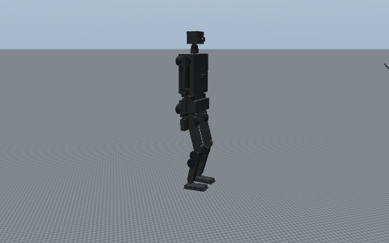
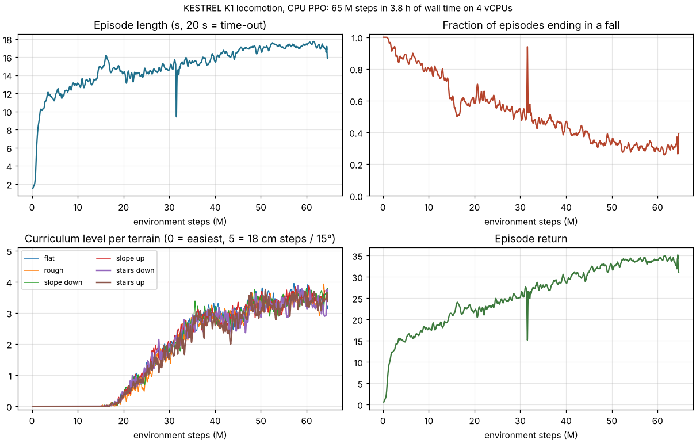

# KESTREL S1: the simple build

S1 is a full-size humanoid that one person can build from parts they can order today. It has the same skeleton as
KESTREL K1, with the same leg and arm geometry. S1 is 1.75 m tall; K1 Mk II is 1.806 m, because its bigger waist
actuators need a 56 mm taller waist. Everything else is chosen to be cheap, quick to put
together, and easy to change:

* it uses off-the-shelf actuator modules on CAN instead of custom motors and gearboxes;
* the frame is bolted from aluminium extrusion, tube and laser-cut plate instead of machined and moulded parts;
* there are no shells.

S1 is not a toy. Its actuators were selected against the same whole-body simulation that sizes K1. That covers
walking, 18 cm stairs, a 20 kg box squat, a 0.30 m single-leg step-up and a missed-step drop, with the same
margins as K1.

<!-- S1_RENDERS -->

**On a tight budget?** [../scrap/](../scrap/README.md) builds S1 from salvaged drill motors and hand-made capstans
for A$500–1,000, with hand tools only. It walks slowly, the always-balanced way.

## At a glance

| | KESTREL S1 | KESTREL K1 Mk II (for comparison) |
|---|---|---|
| Height / estimated mass | 1.75 m / 67.1 kg with the CAD structure (73.9 kg design mass) | 1.806 m / 103.3 kg |
| Actuated joints | 27 + 2 grippers (legs 2 × 6, waist yaw, arms 2 × 6, neck 2) | 30 + two 13-DOA hands |
| Actuators | 4 × MyActuator RMD-X12-P20-320, 23 × RobStride (RS04 / RS03 / RS02 / RS00) | custom liquid-cooled and cycloid family |
| Leg peak torque (joint side) | knee 356 N·m (X12 through a 1.5:1 Poly Chain belt, capped to protect the belt), hip pitch 320 N·m | knee 493 N·m, hip pitch 406 N·m |
| Payload (sized for) | 20 kg box squat, 5 kg per hand at reach | 30 kg sustained / 50 kg momentary |
| Walking | 0.8 m/s nominal, 1.0 m/s fast, 18 cm stairs | 0.8 / 1.2 m/s, 18 cm stairs |
| Bus / battery | 13S 48 V, 48 V 20 Ah pack (~0.96 kWh): ~3 h mixed use, ~2 h walking | 16S, 2 × 1.15 kWh hot-swap |
| Actuator cost | **US$10,325** (≈ A$15,700), 27 units | — |
| Full parts cost (A$, inc GST) | **A$38,990**, or **A$32,300** with a budget wireless e-stop instead of the FORT ([generated/bom.md](generated/bom.md)) | see docs/12 |

## How it was designed

1. **Same skeleton, simpler parts.** `calc/kestrel/variant_s1.py` describes S1 to K1's engineering model: bodies,
   joints, component masses and placements. Run anything in `calc/` with `KESTREL_VARIANT=s1` and you get S1
   instead of K1.
2. **Requirements from simulation.** Whole-body inverse dynamics over the scenario set gives each joint's
   repeated, momentary, continuous and speed requirements: [generated/joint_requirements.md](generated/joint_requirements.md).
   S1 skips the torso bend, because it has no waist pitch, and its fast walk is 1.0 m/s instead of 1.2.
3. **Actuators from a sourced catalogue.** `simple/calc/s1_select.py` tests every maker-verified 48 V integrated
   module in `data/cots_actuators.json` (sources in `docs/research/R9`). It tries each one direct and through the
   allowed reductions (knee belt, hip-roll crank, ankle lever). The tests are:
   * every simulated torque-speed sample, with K1's margins, must sit under a conservative torque-speed line;
   * peak torque with 10 % headroom;
   * missed-step momentary torque;
   * continuous torque with a 0.8 thermal derate.

   The choice minimises price + a mass penalty + a "second brand" penalty, so S1 ends up with two protocols, not
   five. The masses feed back into the model until the selection stops changing:
   [generated/actuator_selection.md](generated/actuator_selection.md).
4. **Frame from the open-source lessons** (`docs/research/R8`): a T-slot torso and pelvis, tube limbs in clamps,
   a hole grid everywhere, an outboard bearing opposite every leg actuator, and a hard-wired e-stop contactor.

## Selected actuators

| Joints | Module | Reduction | Peak / rated | Unit price | Qty |
|---|---|---|---|---|---|
| Hip pitch | MyActuator RMD-X12-P20-320 | direct, with a 40 mm fan on the open hip cradle | 320 / 85 N·m | US$1,090 | 2 |
| Knee | MyActuator RMD-X12-P20-320 | 1.5:1 Gates Poly Chain 8MGT belt (36T / 54T) from the upper thigh | 356 N·m at the knee (X12 capped at 250 N·m) | US$1,090 | 2 |
| Hip roll | RobStride RS04 | 2:1 crank + push-rod | 228 N·m at the joint | US$295 (A$577 at Pakronics) | 2 |
| Hip yaw, waist yaw | RobStride RS04 | direct | 120 / 40 N·m | US$295 | 3 |
| Ankle (2 per ankle) | RobStride RS04 | parallel push-rods: 40 mm cranks, 65 mm foot levers (1.25:1) | ≈ 290 N·m pitch | US$295 | 4 |
| Shoulder pitch, roll | RobStride RS04 | direct | 120 / 40 N·m | US$295 | 4 |
| Shoulder yaw, elbow | RobStride RS03 | direct | 60 / 21 N·m | US$245 | 4 |
| Wrist yaw, pitch | RobStride RS02 | direct | 17 / 7 N·m | US$195 | 4 |
| Neck yaw, pitch | RobStride RS00 | direct | 14 / 5 N·m | US$185 | 2 |

The tightest margins are elbow (1.04), neck (1.05) and knee/hip X12 (1.05). Every one is at least 1.0 after K1's
1.2 torque and 1.15 speed margins and a 10 % design-mass allowance. The masses come from the S1 CAD after its
weight-reduction pass: structure 20.7 kg including fasteners, down from 43.8 kg in the first CAD.

The hip-pitch X12's continuous rating assumes a 40 mm fan across its housing (thermal derate 0.9 instead of 0.8).
Without the fan its continuous margin is 0.96, so fit the fan, and let firmware derate on the actuator temperature.
If S1's built mass comes in above 67.1 kg, re-run the selection; the knees and hips go first.

**The knee belt** is a Gates Poly Chain 8MGT, 36 mm wide, on a 36-tooth driver and a 54-tooth knee pulley. Gates'
published table rates it at 292 N·m on the driver for this 800 mm belt. The simulated running peak times a 1.6 service
factor is 263 N·m, and the missed-step peak is 217 N·m. The X12 could make 320 N·m, so firmware caps the knee X12 at
**250 N·m**. That still covers every requirement and keeps the belt below its rating. The check is regenerated in
[generated/actuator_selection.md](generated/actuator_selection.md). Run the drive once in Gates' free DesignFlex Pro
before ordering. The fallback is a #50 roller chain in the same space.

The peak ratings of these modules last 3–10 s (R9). Long, heavy holds are covered by the continuous check, not the
peak.

**Two electrical rules that come from these choices** ([docs/S1-electrical.md](docs/S1-electrical.md)):

* The X12 is rated to 55 V and a full 13S pack is 54.6 V. Charge to 53.3 V at most, and clamp regeneration at
  54.3 V, until MyActuator confirms a higher limit.
* Five CAN buses at 1 Mbit/s carry a 250 Hz joint loop at under 48 % load. A 500 Hz loop needs seven buses.

## The S1 modularity standard

Everything follows five rules, so adding a component never needs a new design:

1. **Hole grid.** Every plate carries Ø5.5 holes on a 20 mm grid, and every extrusion takes 20-series T-nuts.
   Brackets for new parts bolt on anywhere.
2. **Tube limbs in clamp blocks.** Thigh, shank and upper arm are Ø40 × 3 6061-T6 tube; the forearm is Ø30 × 2.
   To change a segment length, cut a new tube and re-run the calc with the new length.
3. **Adapter plates.** Each actuator mounts through an adapter plate that matches its bolt circle. A different
   module only needs a different adapter.
4. **Spare power and bus capacity.** The power board has spare fused 48 V, 24 V, 12 V and 5 V outputs. Each of the
   5 CAN buses has a spare drop. The wrists carry ISO 9409-1-50 tool flanges.
5. **Add-ons file.** Every component you add gets one line in `data/add_ons.json` (body, measured mass, position).
   The next run of `calc/s1_select.py` puts that mass into the simulation and re-checks every actuator, so you
   find out at once whether the robot still has margin. The spare budget is about 3 kg on the torso or head and
   0.3 kg per hand. Worked example and budget table: step 11 of the [build guide](tutorial/S1-build-guide.md).

## Folder map

| Path | Contents |
|---|---|
| `calc/s1_select.py` | requirement ↔ actuator selection loop |
| `calc/s1_bom.py` | priced bill of materials → `generated/bom.md`, `data/bom.csv` |
| `generated/` | requirements, actuator selection, BOM (generated, do not edit) |
| `data/` | S1 scenario cache, selected family, BOM CSV, `add_ons.json` (your added components) |
| `cad/` | CadQuery model, STEP / STL, DXF for laser cutting, cut list |
| `docs/` | electrical (power, e-stop, CAN, wiring) and software (ROS 2, drivers, safety, RL retargeting) |
| `renders/` | S1 renders |
| `tutorial/` | the simple step-by-step build guide |

The RL training package in `train/` runs S1 directly:
`python train.py --variant s1 --name s1`, then `python play.py --variant s1 --run s1`.

## Walking in simulation



The trained S1 policy is in `train/runs/s1/policy.pt`. It was trained on this VM's CPU: 156 M steps in four
chunks, about 8.3 h. The last two chunks ran on stair-heavy terrain with the 356 N·m knee cap. Evaluation
(`train/runs/s1/eval.md`): commanded 0.6 m/s from 16 headings per cell, success means 2.4 m covered, or 6 stairs,
without falling. In brackets: falls.

| Terrain | 5 cm / 4° / 2 cm | 10.2 cm / 8.4° / 5 cm | 12.8 cm / 10.6° / 7 cm | 15.4 cm / 12.8° / 8 cm | 18 cm / 15° / 10 cm |
|---|---|---|---|---|---|
| Flat | 100 % | 100 % | 100 % | 100 % | 100 % |
| Rough (amplitude) | 100 % | 100 % | 94 % (6 %) | 100 % | 100 % |
| Slopes up / down | 100 % | 100 % | 100 % | 100 % | 100 % |
| Stairs down | 100 % | 100 % | 100 % | 100 % | 100 % |
| Stairs up | 100 % | 100 % | 88 % | 12 % | 50 % (25 %) |

Walking, slopes, rough ground and stairs down to 18 cm work. **Climbing steps above 13 cm is not reliable yet**:
the policy stops at the step or, at 18 cm, sometimes falls. Earlier checkpoints traded these cells against each
other (110 M steps: 38 % at 15.4 cm, 0 % at 18 cm). K1 needed 233 M steps for its 18 cm climbs, so this needs more
training, or a stair curriculum tuned for S1's lighter legs. Bring the real robot up on flat ground and low steps.



## Re-run after a change

```bash
cd projects/kestrel-humanoid
python simple/calc/s1_select.py          # requirements + actuator selection (about 2 min)
python simple/calc/s1_bom.py             # bill of materials
python simple/cad/build_s1.py            # CAD, DXF and cut list
```

## Limits

* The structure masses come from CAD volumes. Weigh every sub-assembly as you build, and re-run the selection if the total grows.
* The actuator torque-speed line is a conservative straight line, not the makers' curves. Validate each module on
  a simple lever-and-scale test before trusting the margins.
* There are no shells and no hand dexterity: the grippers are simple parallel jaws. The tool flange is how you
  upgrade.
* Safety is the same as for K1: run it in a gantry, at reduced torque limits, with the e-stop in hand, and nobody
  within reach until it is proven.
