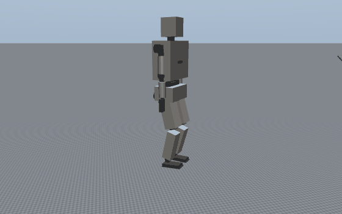
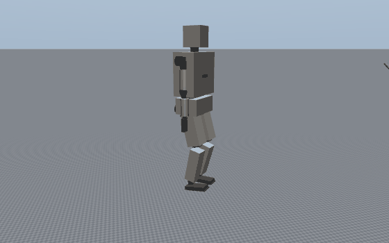
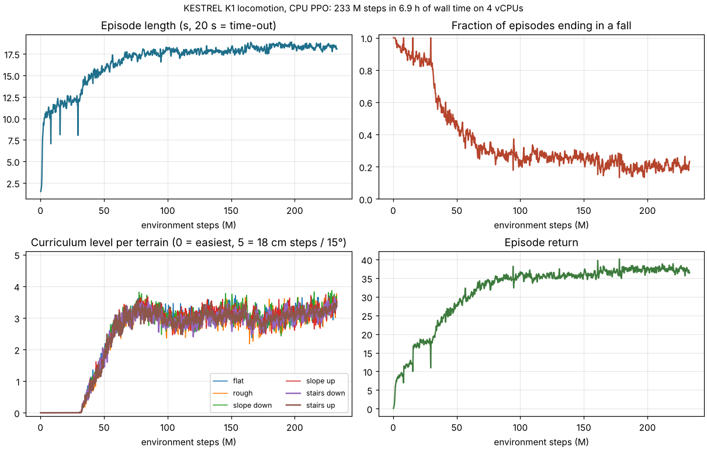

# KESTREL K1: lightweight locomotion training (CPU, no GPU, no Isaac Sim)

A console training package that teaches the K1 legs to walk on flat ground, rough ground and slopes, and up
and down stairs. It runs on a plain CPU. It is a compact copy of Isaac Lab's velocity-tracking locomotion
task (the H1/G1 rough-terrain setup):

* the physics is MuJoCo in C instead of a GPU simulator;
* there are 4 worker processes instead of 4096 GPU environments;
* the PPO is about 150 lines of PyTorch, in the rsl_rl style.

The robot is the K1 design model; masses, inertias and reflected motor inertia come from `calc/kestrel`, and leg
torque limits are the sized actuator peaks. It was trained on the VM described below.

**Mk I vs Mk II.** `runs/rough` below was trained on the K1 Mk I model (84.1 kg, 1.75 m). `calc/kestrel` now
describes Mk II (103.3 kg, 1.806 m, stronger knees and hips), so the model this package builds is Mk II. The Mk II
policy is `runs/mk2`, fine-tuned from the Mk I weights:
`python train.py --name mk2 --init rough --terrain mixed --workers 2 --hours 2.5` (45.8 M steps, 2.5 h). The Mk I
policy walked the heavier, taller Mk II model from the first iteration. Evaluation (`runs/mk2/eval.md`, same protocol
as below):

| Terrain | 5 cm / 4° / 2 cm | 10.2 cm / 8.4° / 5 cm | 12.8 cm / 10.6° / 7 cm | 15.4 cm / 12.8° / 8 cm | 18 cm / 15° / 10 cm |
|---|---|---|---|---|---|
| Flat, slopes up / down | 100 % | 100 % | 100 % | 100 % | 100 % |
| Rough (amplitude; falls) | 100 % | 100 % | 88 % (12 %) | 94 % (6 %) | 100 % |
| Stairs down | 100 % | 100 % | 100 % | 100 % | 100 % |
| Stairs up | 100 % | 100 % | 100 % | 62 % | 0 % (no falls) |



18 cm climbs (50 % for Mk I at 233 M steps) need more training on Mk II. S1 has its own run: `--variant s1`
(`runs/s1`, results in [`simple/README.md`](../simple/README.md)).

### The scrap and fast builds (`--variant s1scrap | k1scrap | s1fast | k1fast`)

Each of the four salvaged-parts builds ([`scrap/README.md`](../scrap/README.md)) trains against its own actuators.
Peak torques, no-load speeds and reflected motor inertia come from `scrap/calc/scrap_select.py`. Every physics
step also applies each motor's torque-speed line, the same line the selection sizes with: torque available =
Kt (V − Kt ω) / R per motor, capped at the current limit (`model.torque_speed`). The K1 and S1 runs above keep a
constant ±peak force limit. Gait clock and command range are per build (`model.GAIT`). All four start from the S1
policy (`--init s1`):

```bash
python train.py --variant s1fast --name s1fast --init s1 --terrain rough --workers 2 --threads 1 --hours 2.5
python play.py --variant s1fast --run s1fast --speed-test 0.6,0.8,1.0,1.2,1.4,1.6 --table runs/s1fast/speed.md
```

`--speed-test` walks 8 robots down the 36 m flat column at each commanded speed. It reports:

* the speed achieved (4 to 10 s);
* the fastest leg joint as a fraction of its motor's no-load speed (above 100 %, the motor's back-EMF exceeds the
  bus and the drive loses torque control);
* the highest RMS joint torque as a fraction of the motor's continuous rating.

A speed counts only if both stay under 100 % with no falls.

| Build | Trained | Top speed within motor limits | At that speed: fastest joint / no-load, RMS / continuous | Terrain table |
|---|---|---|---|---|
| **S1-Fast** (hub-motor legs) | 47 M steps, commands to 1.4 m/s | **1.44 m/s** (commanded 1.6) | 70 %, 91 % | [`runs/s1fast`](runs/s1fast) |
| **K1-Fast**, fast-walk policy | 47 M steps, commands to 1.0 m/s | **1.31 m/s** (commanded 1.2) | 75 %, 65 % | [`runs/k1fast_walk`](runs/k1fast_walk) |
| K1-Fast, all-terrain policy (the default) | + 1.5 h on stairs-heavy terrain | 1.12 m/s (commanded 1.0) | 57 %, 67 % | [`runs/k1fast`](runs/k1fast) |
| S1-Scrap (drills) | 72 M steps (the last 26 M on stairs-heavy terrain), commands to 0.35 m/s | 0.41 m/s (commanded 0.45) | 54 %, 66 % | [`runs/s1scrap/eval.md`](runs/s1scrap/eval.md) |
| K1-Scrap (drills) | 47 M steps, commands to 0.35 m/s | 0.39 m/s (commanded 0.45) | 59 %, 75 % | [`runs/k1scrap/eval.md`](runs/k1scrap/eval.md) |

K1-Fast's fast-walk policy commanded 1.4 m/s walks 1.59 m/s, but its ankle motors then turn at 105 % of no-load
speed, so that figure is not counted. The torque-speed line never limits these policies: the fastest joints stay below the
knee of the line (76 % of no-load for the hub motors, 62 % for the drills). Both fast builds clear the speeds
their actuators were sized for (1.0 and 0.8 m/s) by a wide margin. The sizing replays a prescribed ZMP walk with
torque and speed margins; the learned gait swings the legs with lower peak accelerations.

On terrain at 1.0 m/s both fast builds walk flat ground, slopes to 15° and stairs down to 18 cm (100 %), and climb
stairs to 10.2 cm (100 %). Taller stairs up, at 12.8 / 15.4 / 18 cm: S1-Fast 88 / 69 / 50 %; K1-Fast's all-terrain
policy 100 / 88 / 38 % (its fast-walk policy 75 / 25 / 25 %). The all-terrain policy is the fast-walk one
fine-tuned for 1.5 h with `--resume --terrain climb`; it is trained to 1.0 m/s and slows down when commanded more
(0.71 m/s at 1.2), so use the fast-walk policy for speed. The same fine-tune on S1-Fast made it worse on 15–18 cm
stairs and slower (1.38 m/s), so S1-Fast keeps its earlier policy (`runs/s1fast/console_3_climb_rejected.log`).
`runs/s1fast/sprint.gif` shows it on the flat column commanded 1.6 m/s (1.44 m/s achieved). The scrap builds at 0.25 m/s walk flat ground, rough ground and slopes, and climb 7.6 cm stairs (S1-Scrap 94 %, K1-Scrap 100 %); S1-Scrap descends 10.2 cm stairs 94 % of the time. A stairs fine-tune (`--resume --terrain climb`, 1.5 h) gave S1-Scrap that descent, and 38 % on 10.2 cm stairs up. It made K1-Scrap slower and worse on stairs, so K1-Scrap keeps its earlier policy (logs: `runs/k1scrap/console_*_climb_rejected.log`).

**Curriculum promotion for slow robots.** A robot was promoted to harder terrain only after walking 2.4 m in one
20 s episode. Many of the 0.1–0.35 m/s commands the scrap builds train on cannot cover that. Promotion now also comes
after 80 % of the commanded distance, at least 1.5 m (two stair risers; `env.PROMOTE_MIN`). The scrap curricula still
level off near row 1.3 with it. The likelier limit is the drill builds' slow joints (knee no-load 7.6 rad/s), not
the curriculum. For steps they use the scripted, balance-checked motions in `scrap/<s1|k1>/data/gait_SU.csv` and
`gait_ST.csv`.

### Toward human speed: S1-Sprint (`--variant s1sprint | s1run | s1sprint2`)

Humans walk at about 1.4 m/s, jog at 2.5–3 m/s and sprint at 8–10 m/s. S1-Fast walks 1.44 m/s. What holds it back
is swing inertia: two 1.9 kg hub motors ride on each thigh (knee) and two on each calf (ankle), so every stride
swings 7.6 kg of motor through the leg.

**The idea tested: proximal actuation.** This is what Cassie, Digit and the MIT humanoid do.
* The knee motors move onto the hip bracket, above the hip axis. They drive the knee through a chain over a
  jackshaft that turns on the hip pitch axis.
* The ankle motors move up to the top of the thigh. They drive the ankle cranks through a chain over a jackshaft
  that turns on the knee axis.
* Parallel springs at the knee and the ankle (an artificial Achilles tendon) take part of the stance load.
* Same motors, ratios and drives as S1-Fast (`calc/kestrel/variant_s1sprint.py`). Each calf drops from 4.95 kg to
  1.5 kg; the whole robot weighs 52.5 kg.
* A chain over a coaxial jackshaft couples the knee to the hip angle, and the ankle to the knee. The joint
  controller removes that coupling, because it measures each joint's angle directly.

**The control:** S1-Run, the S1-Fast hardware unchanged, trained identically: a running clock (0.64 s, 42 % stance, so
both feet leave the ground) and commands to 3 m/s. Both started from the S1-Fast policy and trained on flat ground.

Round 1, after 42 M steps (2.4 h) each, flat-ground speed test with the motors' torque-speed lines
(`runs/s1sprint/speed_42M.md`, `runs/s1run/speed_42M.md`):

| | Top speed within the motor limits | Fastest seen | At 3 m/s commanded |
|---|---|---|---|
| **S1-Sprint** | **2.62 m/s** (commanded 3.0) | 2.62 m/s | joints 74 % of no-load, hottest motor 94 % of continuous, no falls |
| S1-Run (S1-Fast hardware) | 1.48 m/s (commanded 1.4) | 2.89 m/s | joints 95 % of no-load, hottest motor 126 % of continuous |

The unchanged hardware can reach a jog in short bursts, but its motors would overheat at that pace. With the motors
moved up to the hip, the robot holds 2.6 m/s, a human jogging pace, inside every limit. Heat (RMS torque against the
continuous rating) is now what binds.

Round 2 (interrupted by a machine restart at 86 % of its budget):
* **S1-Sprint** trained on with commands to 4 m/s (77 M steps in all, `runs/s1sprint/speed.md`). It is no faster:
  2.43 m/s within the limits, about 2.65 m/s at most. Its joints reach only 55–59 % of no-load speed, while its
  hottest motor is at 94 % of continuous at 2.6 m/s and over 100 % above that.
* **S1-Sprint 2**, with stiffer springs (knee 160, ankle 110 N·m/rad), is worse. It falls at 2.2 m/s and above
  (`runs/s1sprint2/speed.md`), so springs that stiff fight the gait.

So with hub motors the sustained ceiling in simulation is about 2.5 m/s, a jog, and heat sets it. The next lever is
the motors' continuous rating: vent holes and a fan, or ferrofluid in the air gap, are common hub-motor cooling
mods. A 1.5 times higher continuous current would bring S1-Sprint's 3 m/s run (104 % of today's rating) to about
70 %. That is an estimate on the rating, not something this simulation models.

## Results (trained on this VM)



*Rendered offscreen by `play.py` through OSMesa, no GPU. Flat walking; climbing 18 cm stairs from a start 22° off
the stair axis (18 cm climbs succeed from half the headings tested, see the table); descending 18 cm stairs.*

233 M environment steps in 6.9 h of wall time, ~10k steps/s on 4 vCPUs, in seven resumed chunks:

| Chunk | What changed |
|---|---|
| 1–3 | Rewards fixed until the robot steps: gait clock, clearance barrier, reference swing pose |
| 4 | Reference annealed and tracking raised; the robot walks and the curriculum climbs |
| 5 | Stairs get half the environments |
| 6–7 | One-sided clearance penalty, action clip widened to ±8, 40 % of environments on stairs up |



Evaluation of `runs/rough/policy.pt` with `python play.py --run rough --table runs/rough/eval.md`:

Commanded 0.6 m/s forward from the tile centre, 16 evenly spaced headings per cell, no noise or randomisation, 10 s limit. Cell = success rate: reached 2.4 m from the centre before falling (on stairs: 6 or more steps climbed or descended). In brackets: falls.

| Terrain | row 0 | row 1 | row 2 | row 3 | row 4 | row 5 |
|---|---|---|---|---|---|---|
| flat | 100% (0%) | 100% (0%) | 100% (0%) | 100% (0%) | 100% (0%) | 100% (0%) |
| rough | 100% (0%) | 100% (0%) | 100% (0%) | 100% (0%) | 100% (0%) | 100% (0%) |
| slope_down | 100% (0%) | 100% (0%) | 100% (0%) | 100% (0%) | 100% (0%) | 100% (0%) |
| slope_up | 100% (0%) | 100% (0%) | 100% (0%) | 100% (0%) | 100% (0%) | 100% (0%) |
| stairs_down | 100% (0%) | 100% (0%) | 100% (0%) | 100% (0%) | 100% (0%) | 100% (0%) |
| stairs_up | 100% (0%) | 100% (0%) | 100% (0%) | 100% (0%) | 75% (0%) | 50% (25%) |

| Row | 0 | 1 | 2 | 3 | 4 | 5 |
|---|---|---|---|---|---|---|
| Stair step (cm) | 5.0 | 7.6 | 10.2 | 12.8 | 15.4 | 18.0 |
| Slope (deg) | 4.0 | 6.2 | 8.4 | 10.6 | 12.8 | 15.0 |
| Rough amplitude a (cm) | 2 | 4 | 5 | 7 | 8 | 10 |

| Terrain | Result |
|---|---|
| Flat ground; rough ground up to the hardest level | 100 %, no falls |
| Slopes up and down to 15° | 100 %, no falls |
| Stairs **down** | 100 % at every height up to 18 cm |
| Stairs **up** | 100 % to 12.8 cm, 75 % at 15.4 cm, 50 % at 18 cm |

At 18 cm, a quarter of the robots stop in front of the riser and a quarter fall. At 160 M steps the climb
rate at 18 cm was 0 % (`runs/rough/policy_160M.pt`). More training with `--terrain climb` is the next step
for the tallest stairs.

`policy.pt` is the TorchScript policy. Input: the 124-value actor observation from `env.py`. Output: 12 raw
actions. Clip them to ±8, multiply by 0.25 rad, and add the default pose to get the position targets.
`ckpt_last.pt` resumes training.

## Why not Isaac Lab itself on this machine

| | |
|---|---|
| This VM | 4 vCPU Xeon @ 2.1 GHz, 15 GB RAM, no GPU (`/dev/nvidia*` and `/dev/dri` absent) |
| Isaac Sim (PhysX + RTX) | needs an NVIDIA RTX GPU: cannot run here |
| Isaac Lab 3.0 kit-less (Newton / MuJoCo-Warp) | runs without Isaac Sim and **without an RTX card**, but trains on CUDA only (Turing or newer, compute capability 7.5+) |
| MuJoCo-Warp on this CPU (measured) | 10.6k physics steps/s at 1024 worlds, vs 68k on one thread of C MuJoCo (both measured while training ran on all 4 cores) |

The "light Isaac Lab" here is therefore its task design, rebuilt on the fastest CPU simulator available. The
same task is also provided as an Isaac Lab 3.0 config for any CUDA GPU, RTX not required:
[`isaaclab/README.md`](isaaclab/README.md).

## Quick start

```bash
cd projects/kestrel-humanoid/train
python3 -m venv .venv && . .venv/bin/activate
pip install torch --index-url https://download.pytorch.org/whl/cpu
pip install -r requirements.txt

python train.py --name rough --hours 2                # train; Ctrl-C saves and exits
python train.py --name rough --hours 2 --resume       # continue (the curriculum levels are restored)
python play.py --run rough --table runs/rough/eval.md --gif runs/rough/demo.gif
python plot.py --run rough                            # runs/rough/curves.png
```

Console output, one line every 5 iterations:

```
  iter  Msteps    fps  return  len_s  fall  row stairsDn stairsUp   vloss      kl       lr   std
```

* `len_s`: mean episode length (20 s = time-out).
* `fall`: fraction of episodes ending in a fall.
* `row`: mean curriculum level (0–5).
* `stairsDn` / `stairsUp`: the curriculum level on the two stair terrains.

Every iteration is also logged to `runs/<name>/log.csv`.

Options:
* `--terrain flat|stairs|rough`: terrain set.
* `--workers`, `--envs`: workers default to one per core, with 96 environments each.
* `--delay 0.5`: adds 20 ms action latency to half the episodes, for sim-to-real robustness.
* `--no-randomize`: turns domain randomisation off.

## What is in it

| File | Contents |
|---|---|
| `model.py` | Training MJCF built from the design model. Leg joints are PD position servos (kp/kd per joint; force limit = the joint-side actuator peak); arms, waist and neck are rigid. Each foot has 4 contact spheres (heel and toe corners); thighs and shanks have collision capsules; touch and foot pose/velocity sensors. `visual=True` keeps the design visuals for rendering. |
| `terrain.py` | 6 × 6 tiles of 6 m: flat, random rough, pyramid slope (down), inverted slope (up), pyramid stairs (**down**), inverted stairs (**up**). Rows grow from 5 to 18 cm steps (tread 30 cm), 4° to 15° slopes, and ±1 to ±5 cm roughness. Stairs are boxes, slopes are convex meshes, the ground is a plane; only the rough tiles are heightfields (see Performance). |
| `env.py` | `Envs`: M environments sharing one model. 50 Hz policy, 200 Hz physics. See the task description below. |
| `ppo.py` | Actor-critic (256-128-128 ELU, Isaac Lab's G1 size), running observation normalisation, GAE (γ 0.99, λ 0.95), clipped surrogate and value loss, entropy 0.005, 5 epochs × 4 minibatches, learning rate adapted on the analytic KL (target 0.01). |
| `train.py` | Process pool, 24-step rollouts, time-out bootstrapping, checkpoints, CSV log, resume, TorchScript export (`policy.pt`). |
| `play.py` | Evaluation per terrain and difficulty, plus an offscreen GIF through OSMesa (no display, no GPU). |
| `plot.py` | Training curves. |
| `isaaclab/` | The same task as an Isaac Lab 3.0 task, for a CUDA GPU. |

### The task (env.py)

* **Actor observation (124):**
  * base angular velocity and projected gravity (IMU);
  * velocity command;
  * gait clock (sin, cos; 0.8 s period);
  * 12 joint positions and velocities;
  * last action;
  * an 11 × 7 height scan from −0.4 to +0.8 m ahead, the K1 depth cameras' footprint.

  All of it carries Isaac-Lab-style uniform noise.
* **Critic (129):** the same, plus the true base velocity, foot friction and motor-strength scale (asymmetric actor-critic).
* **Commands:** forward −0.4…1.0 m/s, lateral ±0.3 m/s, turn ±0.6 rad/s, 10 % standing, resampled every 8 s.
* **Rewards** (× DT, as in Isaac Lab):

  | Group | Terms (weight) |
  |---|---|
  | Task | lin/ang velocity tracking `exp(−e²/0.25)` (lin 1.0 → 1.5, see the schedule below; ang 0.5) |
  | Posture | vertical velocity (−0.2), roll/pitch rate (−0.05), tilt (−1) |
  | Effort and smoothness | torque² (−2e-6), joint acceleration² (−2.5e-7), action rate (−0.01) |
  | Gait | Isaac Lab's biped air time (0.25, 0.4 s); gait-clock foot contact (0.3 per foot); swing-foot clearance of at least 0.08 m above the terrain under it (−10 × shortfall²; one-sided, so a foot may lift higher for a riser); clock-driven reference swing pose, Humanoid-Gym's `joint_pos` term (1.0 → 0.3); foot slip (−0.2) |
  | Limits and posture | hip yaw/roll deviation (−0.2); joint-limit margin (−1); 90 % of actuator no-load speed (−0.02) |
  | Episode | alive (0.15); fall (−20) |

  The gait clock is the unitree_rl_gym / Humanoid-Gym device. Without it, the policy settled on standing
  still: in two runs it survived but did not walk. The clearance term must not cost more for a barely lifted
  foot than the contact term pays (−10 × 0.08² = 0.064 < 0.3). With a 0.10 m target and a −20 weight it
  did, and the policy kept both feet down. Even with that fixed, Gaussian action noise lifted a foot only 4 %
  of the time: a step needs a sustained hip and knee flexion, which per-step noise does not produce. The
  reference pose fixes this. It flexes hip/knee/ankle by −0.25/+0.5/−0.25 rad at mid-swing, which keeps
  the sole level and gives about 8 cm of lift, and rewarding closeness to it gives the dense signal that
  384 CPU environments need. Isaac Lab gets that signal from 4096 environments instead.
  Once the robot steps, the reference (it has no fore-aft hip swing) holds the stride back. So
  `env.SCHEDULE` anneals it from 1.0 to 0.3, and raises linear tracking from 1.0 to 1.5, linearly between
  15 M and 25 M steps.
* **Termination:** pelvis lower than 0.55 m above the terrain, or tilt over 60°; 20 s time-out.
* **Curriculum:** Isaac Lab's terrain-level rule. Move up a row after walking more than 2.4 m without
  falling; move down after covering less than 40 % of the commanded distance.
* **Randomisation:**
  * foot friction 0.4–1.25;
  * motor strength ±12 % (kp) and damping ±15 %;
  * pelvis payload −3…+6 kg;
  * pushes of ±0.5 m/s every 6–10 s;
  * optional 20 ms action latency.

  Physics parameters are re-drawn per worker every 4 iterations.

## Performance on this VM (measured)

| Stage | Cost |
|---|---|
| `mj_step` of the training model | 21–27 µs (heightfield-only terrain: 34 µs, of which 17 µs was heightfield collision) |
| One environment step (4 physics steps + rewards + observations) | 126 µs single process, ~190 µs with 4 processes sharing the 4 cores |
| 4 workers × 96 environments | 21k environment steps/s |
| Full loop with inference and PPO updates | 10–12k environment steps/s, about 40 M steps per hour |

These choices made it light:
* Primitive terrain instead of one big heightfield, which made physics 1.3× faster.
* Sphere feet instead of box soles, 3× faster on terrain.
* MuJoCo sensors for foot contact, pose and velocity, so per-environment Python is about 20 µs.
* One torch thread during rollouts and four during updates, which stops OpenMP spinning from stealing
  the workers' cores (+20 %).
* 256-128-128 networks, a third of the update compute of 512-256-128.

## Limits: read before using a policy on hardware

* Only the legs are trained; arms, waist and neck are rigid at the zero pose.
* The parallel ankle is modelled as two independent joints with conservative torque limits. The knee
  four-bar is modelled as a direct joint whose torque limit is the actuator peak at the linkage's lowest
  ratio. Neither is the real transmission.
* The PD gains are set for simulation, not identified on hardware, and there is no actuator network.
  Contact uses 4 spheres per foot.
* Scrap and fast builds: the bike chains and Dyneema cords are modelled as rigid, with no backlash or stretch, and
  the hub motors' constants are one published measurement (scrap/data/actuators.json). Measure your motors and
  re-run the selection and the training before trusting a speed from the table above on hardware.
* Before a trained policy goes near the real robot, it must pass the commissioning sequence in
  [`docs/11-testing-commissioning.md`](../docs/11-testing-commissioning.md): gantry first, torque limits
  reduced, safety monitor and e-stop live, nobody inside the test cell. Re-train with `--delay 0.5`, with
  identified gains, and with measured masses (after P12's final weigh-in) first.
