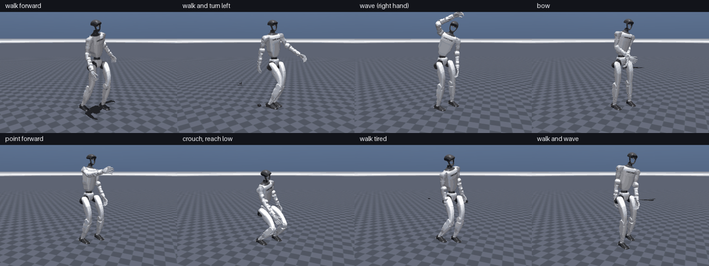

# Moving without training (works now, on an ordinary PC)

The G1 does what it is told - walk anywhere, turn, wave, bow, point, reach, crouch, walk tired or proud, wave while
walking - smoothly and physically balanced, with **no training**: no GPU, no server, no weeks. It starts in seconds.


Video: [`media/g1_moves_without_training.mp4`](../../media/g1_moves_without_training.mp4) (39.5 s, no falls).

On Windows: double-click `train/run_mover.bat` (or `run_mover.bat --claude`, or `run_mover.bat --local qwen3:8b`).
On Linux / macOS: `train/run_mover.sh`. The first run installs the packages, downloads the Bandai Namco motion dataset
and builds the motion library (about 10 minutes); a 3D window then shows the robot and you type in the terminal:
`walk`, `walk fast`, `turn left`, `stop`, `wave`, `bow`, `point`, `reach up`, `pick up`, `crouch`, `look left`,
`walk and wave`, `style tired`, `free` (it does whatever it likes), `list`. With `--claude` or `--local` you just talk
to it, and the language model turns what you say into moves, composing new ones from the parts below.

How it works (`mover.py`, all of it running live on one CPU core):

| Part | What it does | File |
|---|---|---|
| Brain | you, Claude, a local model or free will: chooses *what* to do | `live_mover.py` |
| Motion matching | finds the best frame in 1.3 h of human motion capture for the intent, ten times a second, and blends every switch away (inertialization). It searches with the robot's own feet, so the human arm swing stays in step with the robot's legs, as in people | `matching.py` |
| Walker | plans footsteps and a balanced centre-of-mass path (ZMP preview control) for any walking command, and moves a footstep to catch itself if it drifts | `walker.py` |
| Whole-body controller | turns all of it into 29 joint torques every 2 ms: balance first (centre of mass, feet, body spin), then hands, then the human style | `wbc.py` |
| Layers | an action for the arms only (wave while walking), hand targets, crouch, lean, look - combinable | `mover.py` |

Tested in MuJoCo, on the G1's real masses and torque limits:
- the scripted demo above, with no falls;
- walking from 0.15 to 0.35 m/s, backward, sideways, and turning on the spot and while walking;
- hands reaching their targets within 1–2.5 cm;
- a soak test (`soak_mover.py`): random intents, styles and layers, a new one every 1.5–6 s, for hours.

The soak results, step by step:

| Version | Falls |
|---|---|
| First version | 24 per hour |
| Final version, turning limited to 0.3 rad/s | 3 in 160 robot-minutes and 2,560 intents (about one per 850) |
| Standing actions only (gestures, reaching, crouching, leaning, looking) | 0 in 20 minutes |

The tests found and fixed these problems:
- arm swing out of step with the legs, which spun the robot on its standing foot;
- jumpy joint-speed targets;
- a QP that could become infeasible;
- walking clips of the wrong direction;
- gestures and posture changes starting before the robot had settled;
- commands that were too fast or too combined.

The live program stands the robot back up if it falls.

Limits, honestly:
- It walks at up to 0.35 m/s and turns at up to 0.3 rad/s. Faster walking works when it goes straight, but falls too
  often under random changes of command.
- It does not run, jump or climb, and it only walks on flat ground.
- Its actions come from the dataset (12 kinds of gesture in about 17 styles, plus walking in every direction and
  turning), plus whatever the layers can compose.
- It is a simulation. A real G1 would also need state estimation and Unitree's low-level interface.

The library is built from the Bandai Namco Research Motiondataset (CC BY-NC 4.0: non-commercial use, with
attribution). `python -m motion.library` builds one from AMASS and other datasets too. More data means more kinds of
movement, with no training.

Files: `mover.py` (the three combined), `live_mover.py` (live program), `demo_mover.py` (scripted run, video),
`soak_mover.py` (long random test), `build_bandai.py` (dataset download and library), `matching.py`, `walker.py`, `wbc.py`, `player.py`.

---

# Motion training: every dataset at once, one whole-body G1 controller

This folder is the program for `../MOTION_PLAN.md`: it reads AMASS, Bandai Namco, Nymeria and other mocap,
retargets it all onto the Unitree G1 (all 29 joints), and trains one controller that can copy those motions, using the
plan's six ideas. Striking motions (punches, kicks, bat swings, shoves) are always excluded: the robot must never
learn to strike anyone.

| Idea | Where |
|---|---|
| 1. Keep every clip, sample by novelty | `cluster.py` (window features, k-means, inverse-density weights) |
| 2. Retarget in one batch; make hard clips feasible instead of dropping them | `retarget.py` (differentiable IK in PyTorch), `feasible.py` (speed time-stretch, ground contact, smoothing, difficulty) |
| 3. Specialists in parallel, distilled into one | `trainers.py specialist` (one per motion family, one per GPU) and `trainers.py distill` (DAgger) |
| 4. Warm start from the data | `trainers.py warmstart` (behaviour cloning of feed-forward targets on reference states) |
| 5. Short windows, focus on failures | `track_env.py` (3 s episodes starting anywhere, reference-state start) and the failure-weighted sampling in `trainers.py` |
| 6. Lean simulation, massively parallel | `g1.py` (feet-only contact, no meshes, 50 Hz control), `vec.py` (simulation on every CPU core, learning on the GPUs) |

What it has been tested on: synthetic clips (`make_test_data.py`) and a synthetic AMASS-format clip with a stand-in
body model. Every stage runs end to end without errors (`train_all.py --smoke`), resumes after a stop, and the combat
filter catches a disguised punch while letting harmless motions through. It has **not** yet been trained at full
scale; the first real run will be the test of how well the methods work together.

## On the GPU machine

1. Get the code: download https://github.com/JustAdev742/codespace/archive/refs/heads/claude/dreamy-carson-f16476.zip
   (or `git clone -b claude/dreamy-carson-f16476 https://github.com/JustAdev742/codespace`). Once downloaded, it
   runs without internet; only the datasets have to be fetched.
2. `bash projects/kestrel-humanoid/train/motion/setup_gpu_machine.sh` installs PyTorch (CUDA 12.8, for RTX 50-series),
   MuJoCo and NumPy, prints the GPUs it sees, and runs the 2-minute smoke test.
3. Put the datasets on the machine, for example:
   * `/data/AMASS/<subset>/...` (SMPL+H G `.npz` files, unpacked) and `/data/smplh/{male,female,neutral}/model.npz`
     (the Extended SMPL+H model from mano.is.tue.mpg.de);
   * `/data/bandai/...` (`.bvh` from the Bandai Namco Research Motiondataset);
   * `/data/nymeria/...` (body motion as `.mvnx`; another format needs one more reader in `formats.py`).
4. Run, inside the venv (`. projects/kestrel-humanoid/train/.venv-motion/bin/activate`):

   ```bash
   cd projects/kestrel-humanoid/train
   python -m motion.train_all --data /data/AMASS /data/bandai /data/nymeria --smplh /data/smplh --out runs/motion --hours 22
   ```

   It uses every visible GPU (one specialist each) and every CPU core but two for the simulation. Running the same
   command again resumes where it stopped. Progress: `runs/motion/spec*/log.csv` and `train.log`, `runs/motion/distill.log`.
   Results: `runs/motion/final/policy.pt` (the controller) and `runs/motion/eval.json` (success on held-out clips).

To check a long run before paying for it: `--smoke` runs every stage for a few iterations on whatever data is given.
Preparing the library alone (`python -m motion.library --data ... --smplh ... --out runs/motion/library.npz`) is CPU work
and can be done at home first; copy `library.npz` to the GPU machine and `train_all.py` skips that stage.

## Files

`formats.py` readers -> `safety.py` combat filter -> `retarget.py` -> `feasible.py` -> `cluster.py` -> `library.py`
(the training library) -> `track_env.py` + `vec.py` (simulation) -> `trainers.py` (warm start, specialists,
distillation, evaluation) -> `train_all.py` (all stages, one command).
