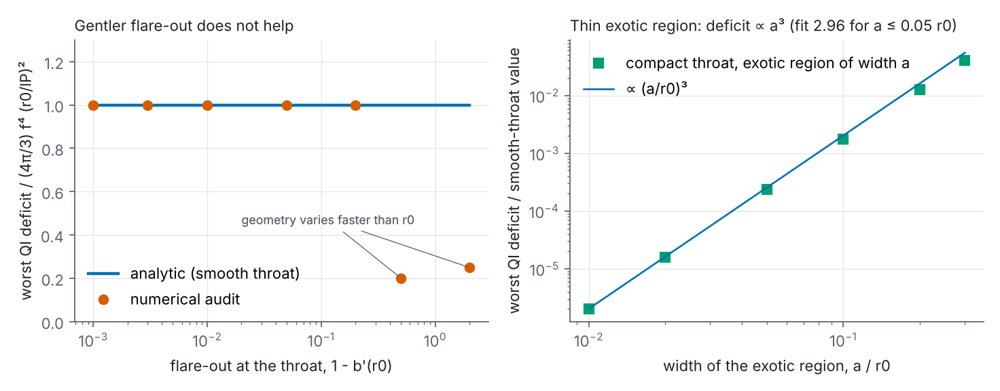
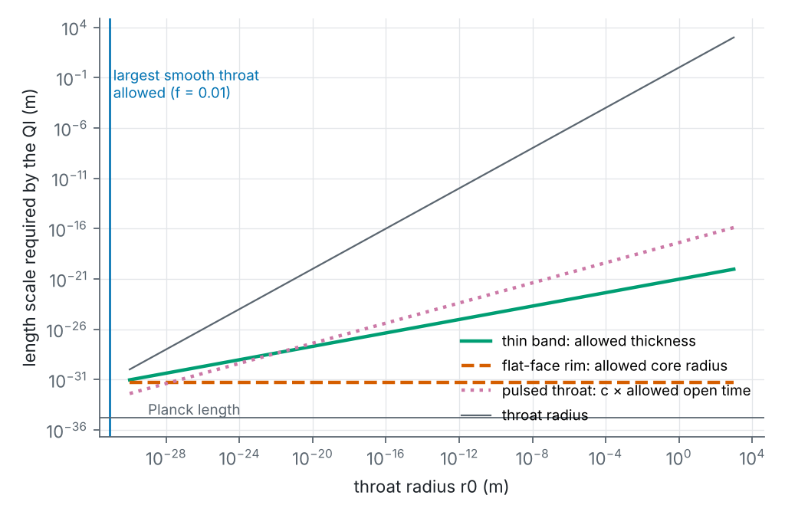
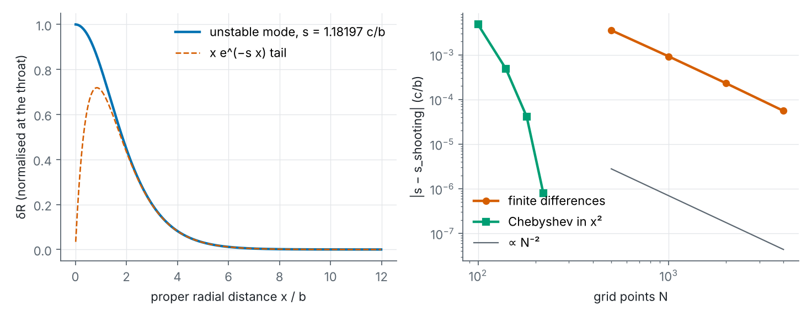
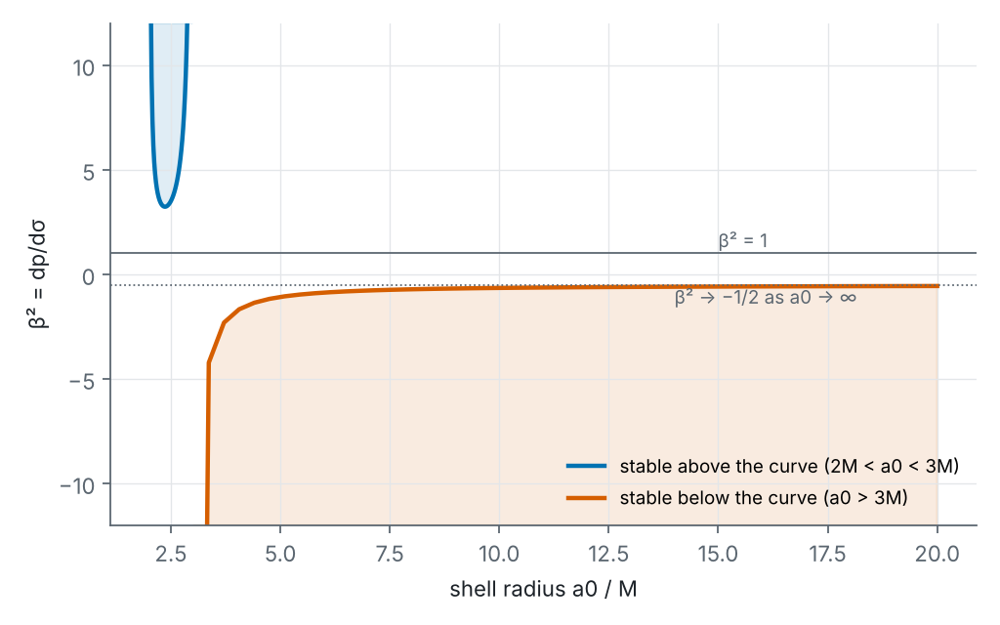
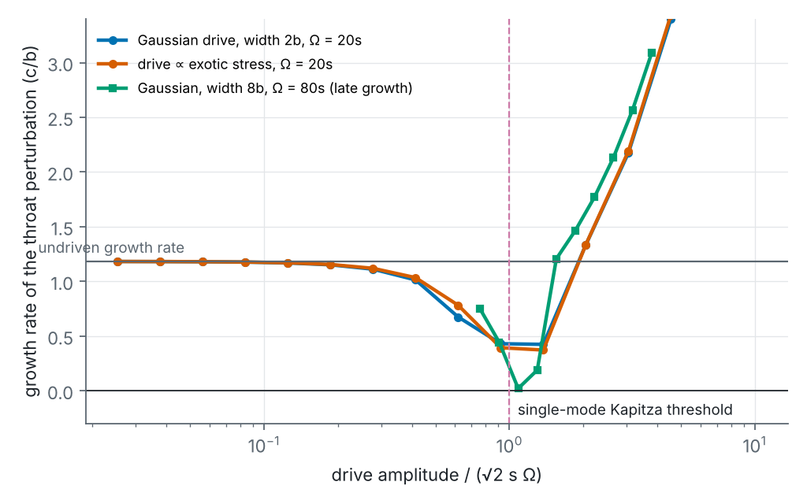
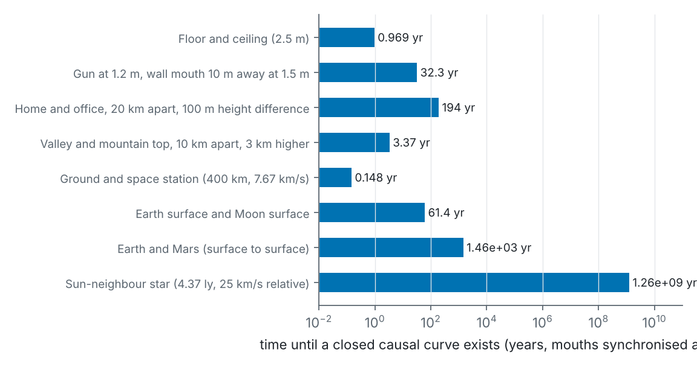

# What would a portal need? Coupled constraints, derivations and computational tests for traversable shortcuts

*Project Portal, phase II, deliverable 2. Written 2026-10-20. Code: [`../code/portal2/`](../code/portal2/);
results: [`../results/`](../results/); figures: [`../figures/`](../figures/). Every number in this paper is produced
by that code and re-checked by its tests (`../code/tests/`, 45 tests); section 10 records which results were
derived before the literature was consulted, how they compare with it, and which turned out to be known.*

## Abstract

We restate the portal-gun problem as a set of coupled constraints on a spacetime with a handle and test which
constraints can be satisfied together. Five results carry most of the weight. Each is labelled with what the
literature comparison of §10 found: **known** (published before, reproduced here independently), **sharpened**
(a published method made stronger or more general) or **not found** (not located in the literature we
searched, which is not the same as new).

1. **Quantum inequalities at a smooth throat do not depend on how gently it flares** (sharpened). Optimising
   the Ford–Roman method over the observer's speed and using the exact boosted curvature, the worst sampled
   deficit at a reflection-symmetric throat of radius $r_0$ is $D = \tfrac{4\pi}{3} f^4 (r_0/\ell_P)^2$ for every
   flare-out $0 < \varepsilon = 1-b'(r_0) \le 2$, provided its shape and redshift vary only over lengths of at
   least $r_0\sqrt{2/\varepsilon}$ (proof in §5.2; numerically $1.000 \pm 0.001$ times this for flare-outs from 0.2
   to 0.001). For $r_0 = 1$ m and $f = 0.01$, $D = 1.6\times10^{62}$. Shorter structure, such as a shallow
   redshift dip, lowers the deficit at the throat point itself, but the full value returns beside it. Ford &
   Roman's general bound weakens as $b'(r_0) \to 1$, and that weakening has been used to argue the inequality
   is "trivially satisfied" there. It is not: at $b'(r_0) = 1$ exactly, the deficit returns just beside the
   throat.
2. **The only escape that a walking traveller survives is a thin exotic band, and even that depends on a
   convention** (known). A redshift structure that would supply the needed short length scale turns the mouth
   into a gravitational well or hill: a traveller who starts at walking speed crosses at 0.93–0.999 c or not at
   all. A thin band gives $D \propto a^3$ and reaches $D = 1$ at a proper width of about $1.4\times10^{-21}$ m
   (Ford & Roman's result; Morris–Thorne's parameter $a_0 \approx 9\times10^{-22}$ m). It is tidally survivable
   (a ~1 m/s kick), but needs about $-1.0\times10^{64}$ J/m³. A random search over 400 throat designs, with
   traveller constraints fixed in advance, runs straight to this corner. The door exists only under Ford &
   Roman's choice of sampling window. If the window is set by the curvature radius alone, as Krasnikov (2003)
   argues, the band must be sub-Planckian (we find $a_0 < 3\times10^{-63}$ m for $f = 0.01$).
3. **Energy bookkeeping** (known in spherical symmetry; the general-shape step not found). For a static,
   spherically symmetric mouth, $\int_{r_0}^\infty 4\pi r^2\rho\,dr = M_{\rm ADM} - r_0c^2/2G$ (Visser, Kar &
   Dadhich 2003). A mouth is therefore either as heavy as a black hole of its own size (0.35 Jupiter masses for
   1 m) or contains negative energy of that size. For mouths of any shape whose throat is the outermost minimal
   surface, on time-symmetric or maximal slices, the Riemannian Penrose inequality still forces negative energy
   density somewhere outside a light mouth (for a pair of mouths in one universe it bounds their total mass). The
   ANEC integral along the radial null geodesic is $-\tfrac{c^4}{4\pi G}\int e^{-\Phi}(r'/r)^2 dl < 0$ for every
   static spherical wormhole (Visser 1995).
4. **Stability** (growth rate known; control and driving not found). Linearising the Einstein–phantom-scalar
   system about the Ellis wormhole in a gauge that is regular at the throat gives a single master equation.
   Its unstable mode has growth rate $s = 1.181973\,c/b$ (e-folding 2.822 ns for $b = 1$ m), found by four
   numerical methods and matching González, Guzmán & Sarbach (2009). Delayed feedback can hold it only if
   the whole sense–compute–act loop is faster than $\sqrt2/s$ = 3.99 ns per metre. Rapid periodic
   (Kapitza-type) driving suppresses the mode where single-mode theory says it should, but in the full field
   equation it never produced a stable run, and it needs oscillating exotic stress roughly 10² times the
   static support. Charge, which the literature shows can make the instability arbitrarily slow, does so in the
   family studied only by turning the mouth into a near-extremal black-hole exterior. For a 1 m throat that means
   about 0.7 Jupiter masses and a field $8\times10^8$ times the Schwinger field; in the case that lasts about an
   hour, a traveller from rest arrives at $\gamma \approx 1.5\times10^4$. Maldacena & Milekhin's long wormholes
   show the same costs.
5. **Topology and causality** (lemma known in substance; network method not found). In Morse-type topology
   change, the regions a new handle joins lie in the causal past of a single event, so a new handle's two
   mouths are born together. This is a corollary of Borde et al. (1999) and Dowker, Garcia & Surya (2000), and
   it does not extend to quantum nucleation, which can create mouths a finite distance apart (Horowitz et al.
   2019). A network of short throats is free of closed causal curves if and only if a "time function" exists
   on its mouths. This becomes a negative-cycle test on a graph, which we implement and validate (including a
   Roman ring). We did not find this formulation in the physics literature.

No new physical mechanism for a portal was found, and no result here changes the verdict of phase I. What was
established is a sharper and more general form of the obstacles, with their costs, together with
independent reproductions of several published results. The quantum-inequality obstruction cannot be evaded
by geometric shaping within static spherical symmetry, short of a band far below nuclear size (and below the
Planck length under the stricter window).

## 1. Scope, method and conventions

**What this paper does.** It takes the phase I baseline ([`report/06`](../../report/06-real-portal-engineering-study.md))
as a list of claims to reconstruct, derives the needed results from the field equations, and runs numerical
experiments where algebra stops. Stage A (independent derivation) was completed and committed to git
(commit `8109bcf`, 2026-10-20 07:47 UTC, [`../notes/stage-A-record.md`](../notes/stage-A-record.md)) before the specific
papers were consulted. Stage B (§10) compares each result with the literature and classifies it.

**What counts as new here.** We separate (i) reproductions of published results by a different route,
(ii) generalisations of published methods, (iii) results we have not found in the literature (with the search
recorded), and (iv) conjectures. A result in class (iii) is not thereby correct or important. It still has
to survive the tests of §5.9, §6.7 and §11.

**Conventions.** Geometric units $G = c = 1$ in derivations, with lengths in metres; SI where numbers are
quoted ($E = E_{\rm geo}c^4/G$, $M = E_{\rm geo}c^2/G$). Signature $(-,+,+,+)$; Riemann tensor in the MTW
convention, so a round 2-sphere of radius $a$ has $R_{\hat\theta\hat\phi\hat\theta\hat\phi} = 1/a^2$ and tidal
accelerations are $\ddot\xi^i = -R^i{}_{\hat t j \hat t}\xi^j$. $\ell_P = \sqrt{\hbar G/c^3} = 1.616\times10^{-35}$ m.
$r_0$ is the throat radius. "1 m portal" means $r_0 = 1$ m.

## 2. The portal problem as a constraint system

### 2.1 Definitions

A **portal pair** is a region of spacetime $(M, g)$ containing a handle $H \cong S^2\times I\times\mathbb R$ (or,
for flat-face designs, a cut-and-paste identification of two discs) whose two ends, the **mouths**, open
into regions $A$ and $B$ of the same universe. It is **traversable** by a body of length $\ell_b$ and width
$w_b$ if a timelike curve through $H$ exists along which:

- the body's proper acceleration is at most $a_{\max}$,
- the tidal tensor satisfies $|E_{ij}|\,\ell \le a_{\max}$ (with $E_{ij} = R_{i\hat0j\hat0}$ in the body's frame),
- the crossing takes a proper time below $\tau_{\max}$.

It is a **shortcut** if some causal curve through $H$ from an event $p$ near $A$ reaches an event $q$ near $B$
that no causal curve avoiding $H$ can reach from $p$. A **portal gun** must, in addition:

- create or select such a pair on command (topology or access),
- place mouths where the user chooses (endpoints),
- keep the pair open, stable and causal while it is used,
- close it, all from a device a person can carry.

### 2.2 The constraints

For a static, spherically symmetric throat (proper-length gauge
$ds^2 = -e^{2\Phi(l)}dt^2 + dl^2 + r(l)^2 d\Omega^2$, throat at $l = 0$), every constraint below becomes an
inequality on the two functions $r(l)$, $\Phi(l)$ and on the matter that must supply the stress:

| # | Constraint | Mathematical form | Where analysed |
|---|---|---|---|
| C1 | Throat (flare-out) | $r'(0) = 0$, $r''(0) > 0$ (or $r''$ vanishing with $r$ minimal) | §3 |
| C2 | Human size | $r_0 \gtrsim 1$ m | — |
| C3 | Einstein equations | $8\pi T_{\hat a\hat b} = G_{\hat a\hat b}[r,\Phi]$ (formulas in §3) | §3 |
| C4 | Matter exists | $T$ is produced by known fields in a realisable state; in particular quantum inequalities (QIs) hold | §5 |
| C5 | Averaged conditions | ANEC/AANEC along through-going null geodesics, given the shortcut property | §4 |
| C6 | Traveller tides | $c^2\ell_b\lvert R_{\hat t\hat l\hat t\hat l}\rvert \le a_{\max}$, $c^2 w_b\gamma^2\lvert R_{\hat t\hat\theta\hat t\hat\theta} + \beta^2R_{\hat l\hat\theta\hat l\hat\theta}\rvert \le a_{\max}$ | §5.4, §9 |
| C7 | Walk-in | redshift difference to the throat $\lvert\Delta\Phi\rvert c^2 \lesssim a_{\max}\times(1\text{ m})$, i.e. $\lvert\Delta\Phi\rvert \lesssim 10^{-16}$ | §5.4 |
| C8 | Mouth mass | ADM mass of each mouth $\ll r_0c^2/2G$ for a handheld device | §4.4 |
| C9 | Stability | no growing mode, or one controllable by a causal controller | §6 |
| C10 | Creation | a topology-changing process that produces the handle | §7 |
| C11 | Endpoints and causality | every cycle in the mouth network keeps positive weight | §8 |
| C12 | Environment | pressure and flux loads (phase I: 32 tonnes-force for 1 atm across 1 m radius) | §9 |

The point of writing them together is that the same few numbers enter several of them, so they cannot be
traded independently. $r_0$ and the shape of the flare enter C1, C4, C6 and C8. The redshift profile enters
C4 (through curvature), C6 and C7. The thickness of the exotic region enters C4, C6 and C9. Sections 4–9
work out these couplings; §9.1 collects them.

## 3. Geometry and stress-energy from the metric

The curvature was derived symbolically from the metric (`curvature.derive`), not transcribed. In the static
orthonormal frame:

$$R_{\hat t\hat l\hat t\hat l} = \Phi'' + \Phi'^2,\quad R_{\hat t\hat\theta\hat t\hat\theta} = \frac{\Phi' r'}{r},\quad
R_{\hat l\hat\theta\hat l\hat\theta} = -\frac{r''}{r},\quad R_{\hat\theta\hat\phi\hat\theta\hat\phi} = \frac{1-r'^2}{r^2},$$

$$8\pi\rho = \frac{1 - r'^2 - 2rr''}{r^2},\qquad 8\pi p_l = \frac{r'^2 - 1 + 2\Phi' r r'}{r^2},\qquad
8\pi p_t = \frac{r'' + \Phi'r' + r(\Phi'' + \Phi'^2)}{r},$$

$$\rho + p_l = \frac{\Phi' r' - r''}{4\pi r},\qquad \rho + p_l + 2p_t = \frac{2\Phi' r' + r(\Phi'^2 + \Phi'')}{4\pi r}.$$

Checks (tests): Schwarzschild is vacuum, with $R_{\hat t\hat r\hat t\hat r} = -2M/r^3$; the Ellis metric
$r = \sqrt{l^2 + r_0^2}$ gives the phantom-scalar stress $\rho = p_l = -p_t = -r_0^2/8\pi r^4$; substituting
$r'^2 = 1 - b/r$ recovers Morris & Thorne's $\rho = b'/8\pi r^2$. For a radially moving observer (speed $\beta$),
$R_{\hat t\hat l\hat t\hat l}$ and $R_{\hat\theta\hat\phi\hat\theta\hat\phi}$ are unchanged. With
$A = R_{\hat t\hat\theta\hat t\hat\theta}$ and $B = R_{\hat l\hat\theta\hat l\hat\theta}$, the other components become
$\gamma^2(A + \beta^2B)$, $\gamma^2(B + \beta^2A)$ and $\gamma^2\beta(A + B)$, and the observer sees energy density
$\rho' = \gamma^2(\rho + \beta^2 p_l)$. All of these were checked against a full tensor transformation.

At the throat, $r' = 0$, so $p_l(r_0) = -1/8\pi r_0^2$ whatever the shape and redshift (with $\Phi'$ finite):
**the radial tension at any smooth throat is $\tau_0 = c^4/(8\pi G r_0^2) = 4.8\times10^{42}$ Pa for 1 m.** This
reproduces Morris & Thorne (1988, eq. 51) and shows the number is a property of the class, not of a particular model.

## 4. Energy conditions: what must be violated, where, and how much

### 4.1 Pointwise

$\rho + p_l = -(r'' - \Phi' r')/4\pi r$. At the throat, $\Phi'r' = 0$, so flare-out ($r'' > 0$) forces
$\rho + p_l < 0$: the null energy condition (NEC) fails at every throat, for every redshift function. Away from
the throat, a redshift gradient with $\Phi' r' > r''$ can restore the NEC. This is the mechanism behind
wormholes with "arbitrarily small energy condition violations" (Visser, Kar & Dadhich 2003). By §5.4 it costs
a deep gravitational well; Visser, Kar & Dadhich's small-violation limit is a near-horizon one. A
convenient global form is that $\rho + p_l \propto (1 - b/r)\,\tfrac{d}{dr}\ln(-g_{tt}g_{rr})$: the NEC holds
exactly where $-g_{tt}g_{rr}$ is non-decreasing outward. Since this product is infinite at the throat and
tends to 1 at infinity, it must decrease somewhere. Where it decreases, the NEC fails.

### 4.2 Averaged along the through-going null geodesic

For the radial null geodesic through the throat, normalised so that $k^t = 1$ at infinity (affine
$d\lambda = e^{\Phi}dl$), substituting the formula for $\rho + p_l$ and integrating by parts gives

$$\int T_{ab}k^ak^b\,d\lambda = \int e^{-\Phi}(\rho + p_l)\,dl = -\frac{1}{4\pi}\int_{-\infty}^{\infty} e^{-\Phi}\Big(\frac{r'}{r}\Big)^2 dl < 0,$$

the boundary term $e^{-\Phi}r'/r$ vanishing at both ends. This is the Raychaudhuri defocusing identity
($\int R_{kk}d\lambda = -\int\theta^2/2\,d\lambda$, with $\theta = 2e^{-\Phi}r'/r$) written out for this class.
It shows the averaged null energy condition (ANEC) fails along the radial geodesic of **every** static
spherically symmetric wormhole. It also shows what sets the size of the violation: how fast $\ln r$ changes
along the throat. For Ellis it equals $-c^4/(8Gr_0) = -1.5\times10^{43}$ J/m² (1 m). It can be made small only
by making $r$ change slowly over a long distance, that is, by a long throat. *Prior art:* the same closed form
appears, in Schwarzschild-type coordinates, as eq. (7) of Visser, Kar & Dadhich (2003), who attribute the
integration by parts to Visser's book (1995, pp. 133–134). Our proper-length form is a change of variables.
Kar (2022) gives the Ellis value over one side, which doubles to ours.

Because the identity is pure geometry ($R_{ab}k^ak^b$, not $T_{ab}$), it holds in any metric theory of gravity:
a short throat needs $R_{ab}k^ak^b < 0$ along some null geodesic. Modified gravity can change what supplies
that negative "focusing", not whether it is needed. Santiago, Schuster & Visser (2022) make the same point
for warp drives: in modified gravity they still violate the purely geometric null convergence condition.
Theories that try to supply it without exotic matter run into stability problems. Horndeski theories admit
no stable, static, spherically symmetric, asymptotically flat wormholes (Rubakov 2016; Evseev & Melichev
2018). Beyond-Horndeski examples evade that no-go, but are shown stable only against high-energy modes,
with slow tachyonic instabilities unconstrained (Mironov, Rubakov & Volkova 2023).

### 4.3 The shortcut property and the achronal ANEC

If a portal is a shortcut, the fastest causal curve from $p$ (near $A$) through the handle to $B$ arrives
before anything that goes around. A fastest such curve is a null geodesic that is **achronal**: no two of
its points are joined by a timelike curve. If any two were, a faster route would exist. Achronal null
geodesics are the ones for which the achronal ANEC (AANEC) is conjectured to hold self-consistently
(Graham & Olum 2007). The defocusing argument of §4.2 applies to the congruence around this geodesic. So
**a shortcut requires an AANEC violation**, which known quantum field theory is conjectured never to
supply on macroscopic scales. Long wormholes, those slower than the route around, need no achronal
geodesic and evade this; that is why the controlled examples in the literature are all long (phase I
report, §2.11). Status: a conjecture-backed exclusion, not a theorem. *Prior art:* this is the standard
argument. Maldacena, Milekhin & Popov write that "traversable short wormholes that join very distant points
in space … are not allowed by the Einstein equations combined with the achronal average null energy
condition", and their wormholes always take longer than the outside route ($\pi\ell > d$). Horowitz et al.
(2019) add that this is expected of all traversable wormholes, from the generalised second law and boundary
causality "(when there is a field theory dual)", attributing the argument to "these papers" (Maldacena,
Milekhin & Popov and others).

### 4.4 Energy bookkeeping: the Misner–Sharp sum rule

With $b(r) = r(1 - r'^2)$ (twice the Misner–Sharp mass), $8\pi\rho = b'/r^2$ exactly, and at the throat
$b(r_0) = r_0$. Integrating outward on one side to infinity, where $b \to 2M_{\rm ADM}$:

$$\int_{r_0}^{\infty} 4\pi r^2\rho\,dr = M_{\rm ADM} - \frac{r_0}{2}\qquad\Big(\text{SI: } M_{\rm ADM} - \frac{r_0c^2}{2G}\Big).$$

So each mouth is either at least as heavy as a black hole of the throat's size ($r_0c^2/2G = 6.7\times10^{26}$ kg
= 0.35 Jupiter masses for 1 m), or it contains negative energy in this measure, $-0.35$ Jupiter masses per side
for a massless mouth. Conversely, a mouth with $M_{\rm ADM} \ge r_0c^2/2G$ can have $\rho \ge 0$ everywhere. The
NEC still fails, through tension exceeding energy density, but nothing static carries negative energy.
*Prior art:* the sum rule is eq. (8) of Visser, Kar & Dadhich (2003), "a simple generalization of the
ordinary mass formula for relativistic stars". Azreg-Aïnou (2015) states its corollary $M \ge r_0/2$ for
$\rho \ge 0$. Hafemann & Kontou (2025) prove that, for spherically symmetric data with vanishing momentum
density and an outermost MOTS (time-symmetric data included), the Penrose inequality is reversed exactly when
$\int r^2\rho\,dr < 0$, and apply this to a static throat. Our derivation reproduces these. For a pair of
mouths in one universe, $M_{\rm ADM}$ here means each mouth's own mass, the Misner–Sharp mass at distances
large compared with $r_0$ but small compared with the separation.

**Beyond spherical symmetry.** The sign statement survives without symmetry, as an existence result. On a
slice with vanishing extrinsic curvature (a $t$ = const slice of any static spacetime), the constraint
equation gives $R = 16\pi\rho$, with $\rho$ the energy density measured by the static observers (Bray 2001,
eq. 2; Hochberg & Visser 1997, eq. 14). Huisken & Ilmanen (2001) prove that an asymptotically flat end
whose exterior region (outside the outermost minimal surface $\Sigma$, containing no other compact minimal
surface) has $R \ge 0$ satisfies $M_{\rm ADM} \ge \sqrt{|\Sigma_i|/16\pi}$ for each component $\Sigma_i$ of
$\Sigma$. The theorem is a statement about one asymptotic end, so its use depends on the topology:

- **A wormhole between two asymptotic regions.** If the throat is the outermost minimal surface as seen from
  one end, the contrapositive reads:

  > *If a static mouth of any shape is lighter than a black hole with the throat's area,
  > $M < \sqrt{A/16\pi}\,c^2/G$, then static observers measure negative energy density somewhere between the
  > throat and that end's infinity.*

- **A portal pair in one universe.** There is only one end. Cutting along the throat leaves a region with two
  boundary copies of it, and the theorem then bounds the total mass of the universe: $M_{\rm tot} \ge
  \sqrt{A/16\pi}$ (Huisken & Ilmanen, per component) or $\sqrt{2A/16\pi}$ (Bray, total area). For two
  well-separated mouths of mass $m$ each, negative energy density is forced only if $m < 0.5\sqrt{A/16\pi}$, or
  $m < 0.71\sqrt{A/16\pi}$ with Bray's version. Mouths between those values and $\sqrt{A/16\pi}$ are not
  covered by this argument. (The spherical sum rule above still applies to each mouth separately.)

The same holds on maximal slices ($\mathrm{tr}K = 0$), where $R = 16\pi\rho + K_{ij}K^{ij} \ge 16\pi\rho$. The
$t$ = const slices of circular stationary axisymmetric metrics are maximal: their shift is $\beta =
-\omega\,\partial_\phi$ with $\omega$ independent of $\phi$ and $\partial_\phi$ a Killing field of the slice,
so $\mathrm{tr}K = D_i\beta^i/N = 0$. Slowly or rapidly rotating mouths are therefore covered, with $\rho$
measured by the zero-angular-momentum observers. Cautions:

- It gives existence, not an amount: there is no integral identity outside spherical symmetry.
- It uses the *outermost* minimal surface; Huisken & Ilmanen show the inequality can fail for larger minimal
  surfaces hidden behind it.
- Outermost minimal surfaces are spheres (Huisken & Ilmanen, Lemma 4.1), so "any shape" means any geometry
  whose throat is an outermost minimal sphere. Toroidal throats and distributional (rim) sources are outside
  it. The theorem also needs completeness and the asymptotic decay it states.

Schoen & Yau (1979) give the weaker statement that every end of a slice with $R \ge 0$ has positive mass
unless the slice is flat $\mathbb R^3$, so a zero-mass wormhole such as Ellis must have $\rho < 0$ somewhere.
The nearest prior statement we found is Ida & Hayward's (1999) remark that the Hawking energy of a spherical
wormhole throat is $\sqrt{A/16\pi}$, the starting point of the monotonicity argument behind Huisken &
Ilmanen's proof. We did not find the general-shape statement written for wormholes. It is a one-line
consequence of Huisken & Ilmanen's theorem.

Two further facts were checked numerically for every family:

- **Tolman (Komar) mass:** $(\rho + p_l + 2p_t)\,4\pi r^2 e^\Phi = \tfrac{d}{dl}(r^2\Phi'e^\Phi)$, a total
  derivative, so the active gravitational mass is a pure boundary term (the mouths' ADM masses). For
  $\Phi$ = const it vanishes pointwise.
- **Proper-volume integrals $\int\rho\,dV$ (both sides, 1 m):** Ellis $-(\pi/2)r_0c^2/G = -2.1\times10^{27}$ kg
  ($-1.11\,M_J$); thin shell or thin band $-2r_0c^2/G$ ($-1.42\,M_J$); Visser's flat-face rim
  $-(\pi/2)Rc^2/G$ ($-1.11\,M_J$; Gibbons & Volkov 2017 give "the mass of Jupiter" for a 1 m ring). A two-scale
  throat with zero ADM mass gives $+74.6\,r_0c^2/G$, which is **positive**.

The baseline's "about −1 Jupiter mass of negative mass-energy" is therefore model-specific. It measures
integrated energy density, which in all these configurations has **zero** active gravitational mass: the
tensions cancel it (§D7, B02).

### 4.5 Classification

| Configuration | NEC | ANEC (through-going) | AANEC | What blocks it |
|---|---|---|---|---|
| Smooth short throat (Ellis, MT, two-scale) | violated (theorem: flare-out) | violated (identity, §4.2) | violated if a shortcut (§4.3) | QI (§5): excluded by $10^{62}$ at 1 m |
| Same, NEC confined by a redshift well | violated near throat only | violated | violated if a shortcut | Near-horizon mouth: relativistic crossing, $10^{16}$–$10^{18}$ g tides (§5.4) |
| Thin exotic band ($a \lesssim 10^{-21}$ m) | violated in band | violated | violated if a shortcut | Not excluded by the QI method under Ford & Roman's window. Needs $-1.0\times10^{64}$ J/m³ from matter no theory supplies |
| Flat-face (polygonal) portal | violated on rims only | violated along rim-crossing geodesics | violated if a shortcut | Rims must be Planck-scale negative-tension strings (§5.5) |
| Long QFT-supported wormhole | violated | violated along non-achronal geodesics | **respected** (not a shortcut) | Not a portal: slower than going around |

The table separates a genuine violation of a theorem (none: every entry violates only conditions that the
geometry demands, which is consistent) from configurations outside a theorem's assumptions (long wormholes
and AANEC). It also separates configurations that obey the energy conditions they must but fail another
requirement (redshift wells) from those that need matter no known theory supplies (thin band, rims).

## 5. Quantum inequalities: a generalised audit

### 5.1 Method

The Ford–Roman quantum inequality for a massless minimally coupled scalar field in Minkowski space bounds
the Lorentzian-sampled energy density seen by an inertial observer:
$\frac{t_0}{\pi}\int \frac{\langle T_{00}\rangle\,d\tau}{\tau^2 + t_0^2} \ge -\frac{3\hbar}{32\pi^2c^3t_0^4}$ (Ford &
Roman 1995). Ford & Roman (1996) applied it in curved spacetime for sampling times
$t_0 = f\times$(smallest length scale)$/c$ with $f \ll 1$. In geometric units the bound is
$\rho_{\rm QI} = 3\ell_P^2/(32\pi^2L_0^4)$, $L_0 = ct_0$, and we define the **deficit**
$D = -\bar\rho'/\rho_{\rm QI}$. $D > 1$ means the method excludes the configuration; $D \le 1$ means only that it
cannot.

We generalise the prescription in four ways (`qi.py`):

1. The observer's speed is a free parameter, and we take the maximum over it.
2. The curvature length is $1/\sqrt{\max|R_{\hat a\hat b\hat c\hat d}|}$ over **all** components in the observer's frame.
3. The sampling length is also capped by the variation length: the static-frame proper distance over which
   the observer's density or curvature changes by order one (Ford & Roman's "proper distance to any
   boundaries"),
   Lorentz-contracted by $\gamma$, and by the proper-time scale of change along the worldline.
4. A second version evaluates the Lorentzian-sampled integral along the actual geodesic, with a
   self-consistent window, instead of assuming a constant density.

$f = 0.01$ throughout, as in Ford & Roman; §5.8 gives the sensitivity.

### 5.2 Theorem: smooth throats, any flare-out

*Setting.* A reflection-symmetric throat ($\Phi'(0) = 0$) with flare-out $\varepsilon \equiv 1 - b'(r_0) =
2r_0r''(0) \in (0, 2]$, redshift curvature $|\Phi''(0)|r_0^2 \le 1$, and variation lengths that do not cut the
window of the optimal observer ($\gamma_* = \sqrt{2/\varepsilon}$, curvature length $r_0$ in its frame). That
needs every static-frame scale over which that observer's density or curvature changes by order one to be at
least $\gamma_*r_0 = r_0\sqrt{2/\varepsilon}$. It includes the proper-time scale along its worldline: because
$\gamma e^{\Phi}$ is conserved, a redshift gradient changes the observer's speed and so its density, which
requires $|\Phi''(0)|r_0^2 \lesssim \varepsilon/4$, much stronger than the condition above. For a gentle flare the
throat region must also be long, at least $\sim r_0\sqrt{2/\varepsilon}$. That is the natural size of a throat
whose flare is gentle everywhere: $r$ grows by order $r_0$ only after $l \sim r_0\sqrt{2/\varepsilon}$.

*Claim.* The maximum local deficit over radial geodesic observers at the throat is

$$D_{\max} = \frac{4\pi}{3}f^4\Big(\frac{r_0}{\ell_P}\Big)^2,\qquad\text{reached at }\gamma^2 = 2/\varepsilon,$$

independent of $\varepsilon$.

*Proof.* At the throat $A = 0$, $B = -\varepsilon/2r_0^2$, $C = 1/r_0^2$, $R_{\hat t\hat l\hat t\hat l} = \Phi''(0)$,
$\rho = (1-\varepsilon)/8\pi r_0^2$ and $p_l = -1/8\pi r_0^2$. An observer with Lorentz factor $\gamma$ sees
$\rho' = \gamma^2(\rho + \beta^2p_l) = (1 - x)/8\pi r_0^2$ with $x \equiv \varepsilon\gamma^2 \ge \varepsilon$. The
boosted components are $\gamma^2\beta^2B$, $\gamma^2B$ and $\gamma^2\beta B$, together with the invariants $C$ and
$\Phi''(0)$. Their largest magnitude is $\max(x/2, 1)/r_0^2$ (using $\gamma^2\beta^2 \le \gamma^2$ and $|\Phi''|r_0^2 \le 1$).
With $L_0 = f r_0/\sqrt{\max(x/2,1)}$,
$D(x) = \tfrac{32\pi^2}{3}|\rho'|L_0^4/\ell_P^2 = \tfrac{4\pi}{3}f^4(r_0/\ell_P)^2\,(x-1)/\max(x/2,1)^2$ for $x > 1$.
On $1 < x \le 2$ this rises to 1 at $x = 2$. For $x \ge 2$ it equals $4(x-1)/x^2$, whose derivative
$4x(2-x)/x^4 \le 0$, so the maximum is 1 at $x = 2$. Since $\varepsilon \le 2$, $x = 2$ is reachable, at
$\gamma = \sqrt{2/\varepsilon}$. For $\varepsilon > 2$ the maximum is $4(\varepsilon - 1)/\varepsilon^2$, at rest. $\square$

*Meaning.* Making the flare-out gentler ($b'(r_0) \to 1$) shrinks the negative energy seen by slow observers.
But an observer fast enough to have $\gamma^2 = 2/\varepsilon$ sees it amplified back to $-1/8\pi r_0^2$, while the
curvature in their frame stays at $1/r_0^2$. The quantum inequality applies to every observer, so the gentle
flare buys nothing. For $r_0 = 1$ m: $D = 1.6\times10^{62}$. Compatibility requires $r_0 \le 0.49\,\ell_P/f^2 =
7.9\times10^{-32}$ m.

*Numerical confirmation* (`run_phase2.py`, [results/qi_results.json](../results/qi_results.json), Fig. 1 left).
Two-scale throats with long gentle regions give $D/D_{\rm ref} = 1.0000$ for $\varepsilon$ = 0.2, 0.05, 0.01,
0.003 and 0.001, at $\gamma$ within 0.4% of $\sqrt{2/\varepsilon}$. The sampled-integral version agrees within
0.5%. Where the window is cut, the factor drops: 0.25 for Ellis ($\varepsilon = 2$, variation length
$0.71\,r_0$) and 0.20 for the two-scale throat at $\varepsilon = 0.5$ (contracted variation length
$d/\gamma = 0.58\,r_0$). Those are O(1) changes against $10^{62}$.

*A shallow redshift dip* shows why the hypothesis matters and why it does not open a door. Adding
$\Phi = \phi_ae^{-l^2/w^2}$ ($w = 3\,r_0$) to the $\varepsilon = 0.01$ throat with $\Phi''(0)r_0^2$ = 0.0025, 0.01
and 0.1 lowers the deficit at the throat point to 0.29, 0.024 and $3\times10^{-4}\,D_{\rm ref}$, because the fast
observer's window is cut by the proper-time scale. The scan over positions still finds at least
$1.4\,D_{\rm ref}$ beside the dip, where the redshift no longer varies
([results/qi_results.json](../results/qi_results.json), `redshift_dip_at_gentle_throat`). The dip only moves
the worst observer. It is also already excluded for walk-in portals: even the shallowest (depth 0.011) is $10^{14}$ times
deeper than constraint C7 allows (§5.4).

*Relation to Ford & Roman.* Ford & Roman (1996) optimise the observer's speed in two examples. In one, $\Phi = 0$
and $b = r_0$, which is our $\varepsilon = 1$, they find $v = 1/\sqrt2$, our $\gamma^2 = 2/\varepsilon$; the other is a
"proximal Schwarzschild" throat (their eq. 84). Their
general bound for $b'(r_0) \ge 0$ (their eq. 95) leaves $v$ free and bounds the boosted curvature by
$\gamma^2/r_m^2$, which they call "a 'safe' bound … due to our rather conservative condition on $R'_{\max}$".
Optimised over $v$, it becomes $r_m/r_0 \lesssim \sqrt{2/\varepsilon}\,f^{-1}(\ell_P/r_0)^{1/2}$, which weakens
as $\varepsilon \to 0$; they remark that it "is weakest when $b'_0$ is extremely close to 1". The weakening
comes from the conservative curvature estimate. The exact boosted components at the throat are proportional
to $\varepsilon\gamma^2$, not $\gamma^2$, and with them the $\varepsilon$-dependence cancels. Fewster & Roman
(2005) use a null-contracted inequality along static observers, deliberately avoiding boosts; their bound
also weakens, as $\sqrt{1-b'_0}$, and they set aside $b'_0 = 1$ as non-generic, while noting that "one could
modify the analysis by considering static trajectories with r > r0 where NEC is violated".

*The case $b'(r_0) = 1$.* Kuhfittig (2006, 2008, 2012) chose $b'(r_0) = 1$ so that Ford & Roman's eq. (95)
is "trivially satisfied". At exactly $\varepsilon = 0$ no radial observer at the throat sees negative energy
(our $\rho' = (1 - \varepsilon\gamma^2)/8\pi r_0^2 > 0$), but the NEC still fails just off the throat, and the
argument above applies there with the local flare-out $\varepsilon_{\rm loc} = 2rr''/(1 - r'^2)$. For two-scale
throats with $b'(r_0) = 1$ and second scale $L$ = 1, 3, 10 $r_0$, the deficit is exactly 0 at the throat, and
its maximum over position and speed is 0.16, 0.44 and 1.10 times $D_{\rm ref}$, at $|l| \approx$ 0.9, 1.7 and
3.3 $r_0$ ([results/qi_results.json](../results/qi_results.json), `zero_flare_out_at_throat`). Zero
flare-out at the throat only moves the problem a short distance. (Kuhfittig himself notes that the
inequality "cannot simply be circumvented in this manner", and his 2008 paper extends the bound off the
throat by fine-tuning the redshift function, which is the redshift route of §5.3–5.4. What we did not find
is the quantitative, boost-optimised off-throat result.)

*Why no smooth shaping can help (an argument, not a proof).* With $\Phi$ = const the NEC fails exactly where
$r'' > 0$, and $r'$ must rise from 0 at the throat to 1 at infinity, so $\int r''\,dl = 1$ over the
NEC-violating region of each side. Either that region contains a point where $\varepsilon_{\rm loc}$ is of
order one and the geometry varies on a scale of order $r$, where the local deficit reaches order
$D_{\rm ref}(r)$; or the flare is gentle everywhere, so the region is long and the throat value applies; or the
integral is carried by a short length scale, which is the thin band of §5.3. A redshift function opens the
fourth possibility of §5.3, the redshift structure.

*Fig. 1.* Left: worst QI deficit at the throat, divided by $\tfrac{4\pi}{3}f^4(r_0/\ell_P)^2$, against flare-out.
Right: compact throats whose exotic region has proper width $a$; the deficit falls as $a^3$.

### 5.3 What the escape needs: a length scale far below $r_0$

The proof shows that $D$ can only drop below the smooth value through a small length scale inside the
exotic region. The scale can enter the curvature (making $L_0$ small) or the variation length. The
candidates are:

- **Thin exotic band** (spatial variation scale $a \ll r_0$). Static observers are the worst case. Boosted
  ones see a larger $|\rho'|$ but over a contracted window, and $D \propto \gamma^{-2}$. For the compact family,
  $D/D_{\rm ref}$ scales as $a^3$ (fitted exponent 3.0 for $a \le 0.05\,r_0$, Fig. 1 right). For
  Morris–Thorne's thin band, written with their parameter $a_0$ (the band runs from $r_0$ to $r_0 + a_0$, and
  its proper width is $(\pi/2)a_0$), $D \simeq \tfrac{32\pi}{3}f^4a_0^3/(r_0\ell_P^2)$. That reaches 1 at
  $a_0 = (3r_0\ell_P^2/32\pi f^4)^{1/3} = 9.2\times10^{-22}$ m for 1 m, a proper width of $1.4\times10^{-21}$ m;
  the compact family's $a^3$ law, in proper width, extrapolates to the same value. This reproduces Ford &
  Roman's $\sim10^{-21}$ m (their eq. 69, $a_0 \lesssim (r_0/8f^4\ell_P)^{1/3}\ell_P$; the factor-1.6 difference
  comes from how the variation length is measured).

  **This door depends on the window.** The $a^3$ law comes from capping the sampling window at the band
  width, Ford & Roman's "proper distance to any boundaries". A static observer at the throat sees a density
  that does not change in time, and the band's curvature radius is $\sqrt{a_0r_0}$, far larger than $a_0$.
  Krasnikov (2003, §II) makes exactly this comparison: with the window set by that curvature radius, the
  condition is "vastly more restrictive" than Ford & Roman's, and he concludes the band must be thinner than
  about $1/r_0$ in Planck units. With the sampling fraction kept, the same observer gives
  $D \simeq \tfrac{8\pi}{3}f^4a_0r_0/\ell_P^2$. That reaches 1 only at $a_0 = 3\ell_P^2/(8\pi f^4r_0) =
  3.1\times10^{-63}$ m, which is $2\times10^{-28}\,\ell_P$ (Krasnikov's estimate times $3/8\pi f^4$). Both
  prescriptions are implemented (`qi.local_deficit(window=...)`, and `qi.static_deficit_curvature_window`,
  which finds the window self-consistently); they agree with these formulas to 0.1–6% for $a_0 \le 0.01\,r_0$
  ([results/qi_results.json](../results/qi_results.json), `window_comparison`). They give identical results
  for smooth throats and rims, where the variation length is not the shortest scale. Neither has been derived
  from a curved-space QI with controlled remainders (milestone M0). Until one is, the thin band is "not
  excluded" only under the more permissive of two defensible conventions.
- **Redshift structure** (large boost-invariant $R_{\hat t\hat l\hat t\hat l} = \Phi''$). In the throat model the
  deficit becomes $\approx \tfrac{8\pi}{3}f^4/(|\Phi''|\ell_P^2)$ for $|\Phi''|r_0^2 \gg 1$. Compatibility then needs
  $|\Phi''| \ge \tfrac{8\pi}{3}f^4/\ell_P^2$, a Planckian curvature independent of $r_0$.
- **Sharp throat** (large $r''(0)$). The throat's own curvature radius $\sqrt{r_0/r''}$ must then be Planckian,
  and the lateral tide, integrated over that region, kicks a slow traveller by $\sim v\,w_b/\ell \gg$ km/s.

### 5.4 Which escape a traveller survives

Tidal loads were computed along the actual crossing (`tides.py`). The traveller is fixed in advance: it
starts at 1 m/s far away, is 2 m long and 0.5 m wide, and its local speed follows energy conservation
$\gamma e^\Phi$ = const.

- **Redshift structures are untraversable on foot.** A redshift well of depth 1 accelerates a walker to
  0.93 c with $4\times10^{16}$ g tides. A well of depth 3 gives 0.9988 c and $3\times10^{18}$ g. A hill of height
  0.01 needs at least 0.14 c to climb, and height 2 needs 0.99 c. The general reason is constraint C7: a
  redshift difference $\Delta\Phi$ is a gravitational potential difference $c^2\Delta\Phi$. Walking in and out
  needs $c^2|\Delta\Phi| \lesssim g\times(1\text{ m})$, i.e. $|\Delta\Phi| \lesssim 10^{-16}$. A curvature
  $|\Phi''| \ge \tfrac{8\pi}{3}f^4/\ell_P^2$ with $|\Delta\Phi| \le 10^{-16}$ would have to act over a width below
  $10^{-39}$ m, which is sub-Planckian. **The redshift escape is closed for walk-in portals.**
- **Thin bands are tidally survivable.** The lateral tide peaks at $v^2w_b|B| \sim v^2w_b/(ar_0)$ but lasts only
  $a/v$. The impulse is $\Delta v \approx v\,w_b\int|B|\,dl$, and $\int|B|\,dl = \int r''\,dl/r_0 = 2/r_0$ because
  $r'$ runs from $-1$ to $+1$ across the throat. So $\Delta v \approx 2v\,w_b/r_0 \approx 1$ m/s, independent of $a$:
  0.96–1.0 m/s for $a$ from 0.3 to 0.01 $r_0$ (computed), and the same 1 m/s at $10^{-21}$ m. The radial tide is
  zero for $\Phi$ = const.

**Design search** (`search.py`, [results/design_search.json](../results/design_search.json)). Over 400 random
compact designs, with the exotic width spanning 4 decades, redshift amplitude $|\phi_a| \le 3$ and width
0.01–3 m, the traveller constraints (crossing speed ≤ 0.01 c, tidal impulse ≤ 2 m/s, peak ≤ $10^4$ g) are
met by 120 designs, **all with no redshift structure**. Among those, the deficit falls only as the exotic
region thins (log-slope 2.5 overall, 3 at small $a$), and the optimum runs to the search's lower bound
($a = 1$ mm, $D = 3.7\times10^{53}$). Extrapolating the measured $a^3$ law reaches $D = 1$ at $\sim10^{-21}$ m.

**Result.** For a static, spherically symmetric, walk-in portal, the Ford–Roman method leaves exactly one
door open: a band of proper width $\lesssim 1.4\times10^{-21}\,(r_0/1\text{ m})^{1/3}$ m. Its energy density at the
throat is $|\rho| = c^4/(4\pi Ga_0r_0) = 1.0\times10^{64}$ J/m³ for 1 m. That is $10^{67.4}$ times the Casimir
energy density between plates 1 μm apart, or the Casimir density at a plate gap of $1.4\times10^{-23}$ m, which
is smaller than the band and about a hundred million times smaller than a proton. Under the curvature-only window of §5.3 the
door closes: the band would have to be sub-Planckian.

### 5.5 Flat-face portals push the problem into the rims

In Visser's cut-and-paste portal the faces are flat and the curvature sits on the rim, a conical defect with
excess angle $2\pi$ (the two rims are one closed curve with total angle $4\pi$). The defect needs a line tension
$\mu = -c^2/4G = -3.4\times10^{26}$ kg/m. Smoothed over a core of radius $w$, the energy density is
$\rho \approx -1/4\pi w^2$ with curvature radius $\sim w$, so $D \approx \tfrac{8\pi}{3}f^4(w/\ell_P)^2$, and
compatibility needs $w \le 0.35\,\ell_P/f^2 = 5.6\times10^{-32}$ m. A traveller crossing the face away from
the rim feels nothing (C6 satisfied identically). The cost is that **the rim must be a Planck-scale object
with a Planck-order tension**: $c^2/4G$ per metre is the Planck mass per Planck length divided by 4. This is a
quantum-gravity regime, where neither the QI used nor classical GR can be trusted.

*Prior art.* Visser (1989) derived the edge tension, $-\varphi/4\pi G$ for bending angle $\varphi$, for
polyhedra with straight edges. Static circular rims also exist as exact solutions: the zero-mass limit of
Kerr is a ring wormhole with tension $-c^4/4G$ (Gibbons & Volkov 2017), and Feng, Lemos & Matzner (2021)
construct smoothed axisymmetric "portals". So our earlier restriction to straight edges was unnecessary for
statics. Krasnikov (2003) reaches the same conclusion as this subsection for a smoothed portal: the hoops
must be about a Planck length thick, with about $10^{-2}$ solar masses of negative energy for human size.
We found no other QI analysis of rims. What remains open is dynamics. Strings of zero thickness are not
distributional sources in GR (Geroch & Traschen 1987), and idealised conical worldsheets are forced to be
totally geodesic (Unruh, Hayward, Israel & McManus 1989; Boisseau, Charmousis & Linet 1997). A moving rim
therefore needs a finite core, and no stability analysis of one exists.

### 5.6 Pulsed portals do not help

A throat held open only for a time $\tau_{\rm open}$, with stresses $\sim c^4/Gr_0^2$, gives
$D \sim (c\tau_{\rm open})^4/(\ell_P^2r_0^2)$. $D \le 1$ needs $\tau_{\rm open} \lesssim \sqrt{\ell_Pr_0}/c = 1.3\times10^{-26}$ s
for 1 m, far shorter than the time light takes to cross the throat. That is too short to form a throat,
let alone cross one. We found no QI-derived maximum open time for a pulsed Morris–Thorne wormhole in the
literature. The nearest results are wall thicknesses for warp bubbles and Krasnikov tubes (Pfenning & Ford
1997; Everett & Roman 1997), a Planck-scale back-reaction time for superluminal warp bubbles (Finazzi,
Liberati & Barceló 2009), and an explicit back-reaction calculation in which the Gao–Jafferis–Wall wormhole
stays open for less than a Planck time (Freivogel et al. 2020). This estimate is a scaling argument only.

*Fig. 2.* The length scale each design must contain for the QI method not to exclude it, against throat
radius. Every curve sits far below everyday and nuclear scales.

### 5.7 Tails

Exotic matter extending to infinity (Ellis, $\rho \propto -r^{-4}$) behaves differently under the two
reasonable choices of window. With the curvature length alone, $D \propto r^4$ in the tail. With the variation
length included (the more conservative reading of Ford & Roman), $D$ saturates at $D_{\rm ref}/256$, which is
1/64 of the Ellis throat value under the same window.
Both still exclude it ($6\times10^{59}$ for 1 m). Designs with a compact exotic region avoid the question.

### 5.8 Sensitivity: which assumptions dominate

$\log_{10}D = 62.2 + 4\log_{10}(f/0.01) + 2\log_{10}(r_0/1\text{ m}) - \log_{10}N + \log_{10}\kappa$.
Here $N$ is the number of free fields whose QIs add, and $\kappa \in [0.2, 1]$ is the window-prescription factor
(§5.2 numerics). Granting at once $f = 10^{-3}$ (−4), $N = 10^3$ (−3) and $\kappa = 0.2$ (−0.7) still leaves
$D \approx 10^{54}$ for a 1 m smooth throat. The thin-band width scales as $a_* \propto f^{-4/3}r_0^{1/3}N^{1/3}$:
even $N = 10^{12}$ fields only move it to $10^{-17}$ m. For smooth throats and rims the conclusion is
insensitive to every assumption we can vary. One assumption is not: the window prescription for thin bands
(§5.3) moves the required width from $10^{-21}$ m to $10^{-63}$ m. It matters only for the thin band, and only
in the direction of closing it. What everything rests on is the applicability of flat-space QIs, with any
$f \le 1$, in regions whose curvature radius is far above the Planck length (§11).

### 5.9 Falsification attempts and their outcomes

| Attempt | Outcome |
|---|---|
| Gentler flare-out removes the QI violation (the obvious objection to Ford & Roman) | Refuted (§5.2): an observer at $\gamma = \sqrt{2/\varepsilon}$ restores the full deficit |
| The observer-speed optimum is a numerical artefact | Analytic proof plus agreement of two independent numerical methods (local and sampled) |
| The result depends on the window prescription | Smooth throats: changes the deficit by ≤ 5× (κ); conclusion unchanged. Thin band: the curvature-only window (Krasnikov 2003) moves $a_*$ from $10^{-21}$ to $10^{-63}$ m, closing that door (§5.3) |
| $b'(r_0) = 1$ makes the QI "trivially satisfied" (Kuhfittig) | Refuted: the deficit is zero at the throat and 0.16–1.1 $D_{\rm ref}$ just beside it (§5.2) |
| The a³ law is a property of one family | Compact family and MT thin band both give exponent 3 at small width |
| A clever redshift profile helps | It does, but only by making the mouth untraversable on foot (§5.4); the search finds no exception |
| Limiting case $r_0 \to 0$ | $D \to 0$: Planck-scale throats are allowed by this method, as Ford & Roman found |
| Limiting case $a \to r_0$ | Compact family returns to the smooth-throat value (Fig. 1 right, $a = 0.3$) |

## 6. Stability

### 6.1 A regular master equation for the Ellis wormhole

The Ellis–Bronnikov wormhole is supported by a massless scalar field with the wrong-sign kinetic term,
$T_{ab} = -(\partial_a\phi\partial_b\phi - \tfrac12 g_{ab}(\partial\phi)^2)$, with
$\phi_0 = \arctan(x/b)/2\sqrt\pi$ and $R_0 = \sqrt{x^2 + b^2}$. We perturb
$ds^2 = -e^{2a}dt^2 + e^{2c}dx^2 + R^2d\Omega^2$ about $a = c = 0$, $R = R_0$. The gauge is **$\delta\phi = 0$**,
which is regular everywhere because $\phi_0'$ never vanishes. (The more common gauge $\delta R = 0$ is singular
at the throat, where $R_0' = 0$.) Sympy gives the linearised equations (scratch derivation reproduced in the
tests):

- the $tx$ equation gives $\delta c = \delta R'/R_0'$;
- the scalar equation gives $\delta a - \delta c = -2\delta R/R_0$;
- the $tt$ equation is then satisfied identically;
- the $xx$ equation becomes

$$\delta R_{tt} = \delta R_{xx} - \frac{2}{x}\delta R_x + \frac{2x^2 + b^2}{(x^2+b^2)^2}\,\delta R.$$

Checks:

- $\delta R = R_0$, a change of $b$ combined with the shift of $x$ that keeps $\phi$ fixed, solves it exactly.
- The indicial exponents at $x = 0$ are 0 (even, regular) and 3.
- For large $x$, $x\,e^{-sx}$ solves it exactly up to $O(x^{-4})$ terms in the potential.

### 6.2 The unstable mode, four ways

| Method | Growth rate $s$ ($c/b$) |
|---|---|
| Shooting from both ends, Wronskian matching | 1.1819727 |
| Chebyshev collocation in $z = x^2$ (even basis), N = 220 | 1.1819735 |
| Finite-difference matrix, N = 4000; Richardson from N = 1000/2000 | 1.182028; 1.181973 (second-order convergence) |
| Time-domain evolution of a Gaussian, N = 3000 (late-time fit) | 1.18215 |

There is a single growing mode, spherically symmetric and even. Its e-folding time is $0.846043\,b/c$, which is
**2.822 ns for a 1 m throat**, confirming the baseline's 2.8 ns by an independent derivation. Fig. 3 shows the
mode and the convergence.

*Prior art.* González, Guzmán & Sarbach (2009, Table I) give the e-folding time $0.846\,b/c$ for the massless
Ellis wormhole. They derive it from a gauge-invariant variable whose master equation has an infinite
potential wall at the throat, removed by a Darboux transformation (regularised potential
$W = -3/(1+x^2)^2$). Blázquez-Salcedo, Chew & Kunz (2018) and Azad et al. (2024) find $\omega_I = -1.182/r_0$.
Our number agrees with all three. The $\delta\phi = 0$ gauge itself is not new: GGS use it to rebuild the
regular metric perturbation (their §III D), and Blázquez-Salcedo et al. fix their gauge by $\delta\phi = 0$ and
integrate a first-order system. We did not find our single second-order equation for $\delta R$ in that gauge
in the papers read; it is equivalent to theirs. In the nonlinear evolution the throat collapses to a black
hole or expands, depending on the sign of the perturbation (GGS, part II; Shinkai & Hayward 2002). The
collapse time of Shinkai & Hayward grows logarithmically with the pulse energy, with a coefficient that
converts to about $0.85\,a$ in static time, close to the linear e-folding time (a cross-check made in the
stage B notes, not by those authors).

*Fig. 3.* Left: the unstable mode and its $x e^{-sx}$ tail. Right: error of the matrix methods against grid size.

### 6.3 What the growth rate means in practice

- **After a traveller.** A perturbation of fractional size $\delta$ reaches order one after
  $t \approx s^{-1}\ln(1/\delta)$. With $\delta \sim Gm/r_0c^2$, a 70 kg traveller crossing a 1 m throat gives
  $t \approx 164$ ns. This is an estimate, uncertain by a few ns because the order-one projection factor
  only enters the logarithm.
- **Uncontrolled lifetime.** Even with only Planck-scale seeds, $\delta = \ell_P/r_0$, an uncontrolled Ellis
  throat lasts at most $\approx s^{-1}\ln(r_0/\ell_P) = 68\,r_0/c$, about 230 ns for 1 m.

### 6.4 Thin shells

For two Schwarzschild exteriors glued at radius $a$, with surface energy
$\sigma = -\sqrt{1 - 2M/a + \dot a^2}/2\pi a$, the shell obeys $\dot a^2 + V(a) = 0$ with
$V = 1 - 2M/a - (2\pi a\sigma)^2$ and conservation law $\sigma' = -2(\sigma + p)/a$. Linearising the equation of
state as $p - p_0 = \beta^2(\sigma - \sigma_0)$, we evaluated $V''(a_0)$ in closed form (`stability.py`, Fig. 5):

- **$M = 0$:** stable iff $\beta^2 < -1/2$, at any radius.
- **$2M < a_0 < 3M$:** stable iff $\beta^2$ exceeds a critical value. Its minimum is $3/2 + \sqrt3 = 3.232$, at
  $a_0 = (3+\sqrt3)M/2$.
- **$a_0 > 3M$:** stable iff $\beta^2$ is below a critical value, which rises from $-\infty$ just above $3M$
  toward $-1/2$ as $a_0 \to \infty$.

Stability therefore always needs an equation of state with negative or "super-stiff" response, as Poisson &
Visser (1995) found; our regions reproduce theirs. For exotic matter $\beta^2$ need not be a sound speed, so this is not itself a causality
violation. It is, however, a further requirement on matter that is already unknown.

*Fig. 5.* Thin-shell wormhole stability in the $(a_0/M, \beta^2)$ plane.

### 6.5 Active feedback

Projected onto the unstable mode, the throat obeys $\ddot q = s^2q + u(t)$. With delayed PD control,
$u = -Kq(t-\tau) - D\dot q(t-\tau)$, we computed the rightmost characteristic root by the pseudospectral
infinitesimal-generator method (Breda, Maset & Vermiglio 2005) and minimised it over $(K, D)$. Stabilising
gains exist iff $s\tau < \sqrt2$: the boundary was found between 1.414 (root $-1\times10^{-4}$) and 1.420
($+3\times10^{-3}$), with the optimal gains degenerating at the boundary ($K \to s^2$, $D \to \tau s^2$). This is
the known critical delay for delayed PD control of an inverted pendulum, $\tau < \sqrt{2/a}$ for
$\ddot x = ax + \dots$ (Stépán 1989, 1994; Insperger, Milton & Stépán 2013). The stage A computation
reproduced it, and the stage A record had predicted the match. Proportional control alone cannot stabilise a
second-order unstable mode. Applying it
to a wormhole is, as far as we found, new: the literature has open-loop compensation, in which a traveller's
effect is cancelled by matched ghost radiation (Hayward, Kim & Lee 2002 in two dimensions), and Shinkai &
Hayward's (2002) remark that maintenance would need "continual adjustments", but no closed-loop controller.

For the Ellis throat: **loop delay < $1.196\,r_0/c$, i.e. 3.99 ns per metre of throat radius**. That covers
sensing, computation and actuation, and the actuator must apply stress with a negative null component (the
negative energy that holds the throat open) at that bandwidth. The usable margin vanishes at the boundary,
so a practical loop would need to be several times faster.

Three consequences:

- **Distributed control removes one baseline worry.** Local controllers acting on local patches of the throat
  need no global coordination, so "no controller can coordinate faster than light crosses the throat"
  (baseline item 16) is not the binding limit. The delay bound above is.
- **The actuator is itself QI-limited.** Delivering negative energy within $\tau \sim$ ns inside the throat
  is bounded by $\sim\hbar/(c^3\tau^4)$ per unit volume, about $10^{-26}$ J/m³. Compensating one traveller
  needs $\sim mc^2 = 6\times10^{18}$ J within ~3 ns.
- **Quantum interest (Ford & Roman 1999).** For free massless fields in flat space, a negative pulse of energy
  $|\Delta E|$ must be followed by a larger positive one within a maximum delay. Their delta-pulse bound in four
  dimensions is $\approx 0.338\,(A\hbar c/|\Delta E|)^{1/3}/c$ for collecting area $A$: about $2\times10^{-24}$ s for
  $|\Delta E| = mc^2$ of 70 kg and $A$ = 1 m². With their condition that the absorber be in causal contact
  before the positive pulse arrives, $A < (cT)^2$, it falls to $\approx 0.04\,\hbar/|\Delta E| \approx
  6\times10^{-55}$ s. (Our first draft gave only the two-dimensional form, $0.131\,\hbar/|\Delta E| =
  2\times10^{-54}$ s, without these assumptions.) These are necessary conditions only: Fewster & Teo (2000) find
  that in four dimensions a positive delta-function pulse can never compensate a negative one. Either way,
  compensation of a traveller-sized pulse is excluded wherever the free-field result applies.

### 6.6 Parametric (Kapitza) driving: a negative result

Could a rapidly oscillating drive stabilise the throat, as it stabilises an inverted pendulum?

**Single-mode theory works where predicted.** For $\ddot q = (s^2 + a\cos\Omega t)q$, the Floquet threshold is
$a = \sqrt2\,s\Omega$ to within 0.4–5% for $\Omega/s$ = 3–40, as averaging predicts. The averaged field operator
$L - a^2U^2/2\Omega^2$ also has no growing mode above threshold.

**The full linear field equation does not follow.** We solved $\delta R_{tt} = L\delta R + a\cos(\Omega t)U(x)\delta R$
with absorbing boundaries, sweeping:

- drive profile: Gaussians of width 0.5–16 $b$, and $U \propto$ the exotic stress itself;
- $\Omega$ = 5–160 $s$;
- 10–16 amplitudes per case.

Results:

- **Not one run was stable.**
- **Weak drives** slow the growth: to 0.28–0.74 $c/b$ for $\Omega \le 20s$, and to 0.12–0.35 $c/b$ at $\Omega = 40s$.
- **Near the single-mode threshold** with broad, fast drives ($\Omega$ = 80–160 $s$, $a \approx 1.1\sqrt2s\Omega$),
  the original mode is suppressed but a late-onset instability takes over. Its rate (0.06–0.9 $c/b$) changes
  with resolution and time step, so it is not converged; we report only that it persisted in every run.
- **Stronger drives** make it worse (growth 2–3 $c/b$, Fig. 4).

Even at the best point the drive is ~$1.1\sqrt2s\Omega b^2 \approx 10^2$–$10^{2.5}$ times the static throat
potential, at $\Omega \approx 3$–$6\times10^{10}$ rad/s (5–9 GHz) for 1 m. In stress terms that is oscillating exotic stress of order
$10^{44}$–$10^{45}$ Pa. **Status:** stabilisation not demonstrated; leading-order averaging is misleading for
this system; and even a successful drive would multiply the exotic-matter requirement rather than remove it.
*Prior art:* none in the peer-reviewed literature. The stage B search found no study of parametric, Kapitza or
Floquet stabilisation of a classical wormhole or of any other unstable gravitational soliton. The nearest are:

- a Floquet-driven SYK (Maldacena–Qi) wormhole, a quantum-mechanical model in which resonances close the
  wormhole;
- a stochastic-Kapitza argument for an unstable gravitational degree of freedom, the cosmological scale
  factor (Lozano & Mazzitelli 2021);
- one directly on-topic but unreviewed item, a public GitHub pull request dated five days before this work
  and titled "Kapitza dynamic-stabilisation screen for wormhole throats (derived, toy); paused", which we did
  not read.

*Fig. 4.* Growth rate of the throat perturbation against drive amplitude (scaled to the single-mode
threshold).

### 6.7 Charge, rotation, and what is established for each class

**Charge buys lifetime by turning the mouth into a black-hole exterior.** Adding an electric charge to the
Ellis wormhole (phantom scalar plus Maxwell field) does not remove the instability, but its rate falls
towards zero as the solution approaches the extremal Reissner–Nordström black hole, $Q_e = M = r_T$. For a
critical wormhole of throat radius 10 km, Blázquez-Salcedo et al. (2026) give $\tau_0 = 0.13$ s at
$Q_e/r_T = 0.95$ and about 1.1 years at 0.9999. At fixed $Q_e/r_T$ the rate scales as $1/r_T$, so a 1 m
throat would have $\tau_0 \approx 13$ μs and about 58 minutes. We worked out what that limit costs a portal,
using their background metric (`charged.py`,
[results/charged_results.json](../results/charged_results.json)):

| $Q_e/r_T$ (critical family) | 0.5 | 0.9 | 0.95 | 0.99 | 0.999 | 0.9999 |
|---|---|---|---|---|---|---|
| $M/r_T$ | 0.5 | 0.9 | 0.95 | 0.99 | 0.999 | 0.9999 |
| $-g_{tt}$ at the throat | 0.16 | $4.7\times10^{-3}$ | $1.1\times10^{-3}$ | $4.5\times10^{-5}$ | $4.4\times10^{-7}$ | $4.4\times10^{-9}$ |
| Lorentz factor at the throat, from rest at infinity | 2.5 | 15 | 30 | 150 | 1,500 | 15,000 |

- **A deep well.** The long-lived limit is the near-horizon limit: $-g_{tt}$ at the throat falls as
  $\approx \tfrac49(1 - Q_e/r_T)^2$ (the fitted coefficient tends to 0.444 as $Q_e/r_T \to 1$). A traveller who
  starts at rest arrives at $\gamma \approx 1.5/(1 - Q_e/r_T)$,
  which violates the walk-in constraint C7 ($|\Delta\Phi| \lesssim 10^{-16}$) by sixteen orders of magnitude in
  $\Delta\Phi$. This is the redshift trade-off of §5.4 again.
- **A heavy mouth.** $M \to r_Tc^2/G$, about 0.71 Jupiter masses for 1 m.
- **An impossible field.** At $Q_e = r_T$ = 1 m the field at the throat is $1.0\times10^{27}$ V/m, $7.9\times10^8$
  times the Schwinger field at which the vacuum breaks down into electron–positron pairs. Below the
  Schwinger field needs $r_T \gtrsim 8\times10^8$ m, the same arithmetic that makes small charged black holes
  shed their charge. The magnetic version escapes pair production but needs $1.1\times10^{34}$ Dirac monopoles,
  a particle never observed.
- **The phantom field is still there.** Charge adds to the exotic matter; it does not replace it.

The paper itself warns: "Of course this does not mean that other instabilities would not creep up, for
example in the non-linear regime." The same costs appear in the near-extremal, magnetically charged long
wormholes of Maldacena & Milekhin: their mouths have the extremal mass $r_ec^2/G$, a traveller acquires a
boost $\gamma = \ell/r_e \gg 1$, and their eq. (2.3) gives exactly our monopole count, $1.06\times10^{34}$ for
$r_e$ = 1 m. What we add is the quantitative trade-off for the charged Ellis–Bronnikov family (the redshift
law and lifetime scaling above) and the Schwinger limit for its electric version.

**Rotation.** In five dimensions, rotating Ellis wormholes with equal angular momenta lose the unstable mode
above $|J|/A = 0.10063$, for perturbations that preserve the symmetry (Dzhunushaliev, Folomeev, Kleihaus, Kunz
& Radu 2013). In four dimensions there are
slow-rotation indications of stabilisation near 30–50% of the extremal limit (Azad et al. 2024), and no
non-perturbative result. Rotation, like charge, pushes the exterior towards a black hole's (here extremal
Kerr).

| Class | Linear stability | Basis |
|---|---|---|
| Ellis–Bronnikov (phantom scalar) | Unstable, one mode, $s = 1.182\,c/b$ | Own derivation, four methods; agrees with GGS 2009, BCK 2018 |
| Charged Ellis–Bronnikov | Unstable for every charge; rate → 0 near extremality | GGS 2009 (charged); Blázquez-Salcedo et al. 2026; the cost analysis above is ours |
| Rotating Ellis | 5D: stable above $\lvert J\rvert/A = 0.10063$ (symmetry-preserving modes); 4D: open | Literature (stage B notes) |
| Phantom dust plus a radial field | Stable for $\ell = 0$ (if the equation-of-state function vanishes at the throat) and axial modes; polar $\ell \ge 1$ not done | Bronnikov, Lipatova, Novikov & Shatskiy 2013 |
| Beyond-Horndeski scalar–tensor | Free of ghosts and gradient instabilities at high energy; slow tachyonic modes unconstrained | Mironov, Rubakov & Volkova 2023; Horndeski itself has a no-go (Evseev & Melichev 2018) |
| Thin shells | Stable only for $\beta^2 < -1/2$ ($M = 0$), $\ge 3/2+\sqrt3$ near horizon, or below a negative bound for $a_0 > 3M$ | Own derivation; agrees with Poisson & Visser 1995 |
| Feedback-stabilised Ellis | Possible in principle only with loop delay < $\sqrt2/s$ and NEC-violating actuation | Own computation; the delay bound is Stépán's |
| Parametrically driven Ellis | Not stabilised in any run | Own computation; no prior study found |
| Flat-face rims | No stability analysis exists; static circular rims are exact solutions | §5.5 |

None of this proves that every possible throat is unstable. What fails is every route to stability examined
here, and each route that works mathematically does so by requiring more of the same unknown matter, or by
moving the mouth towards a black hole. Thin-shell equations of state and feedback are examples of the
first; charge and rotation of the second.

## 7. Topology change: can a connection be made on demand?

### 7.1 What the classical theorems assume

- **Geroch (1967):** a compact topology-changing region in a spacetime with a non-degenerate, time-oriented
  Lorentzian metric must contain closed timelike curves. This is kinematical: no field equation or energy
  condition is used. (We read the abstract; the precise hypotheses come from later restatements.)
- **Tipler (1977) and Borde (1994):** close the remaining doors under energy conditions (and generic or
  compactness assumptions). Tipler uses the Einstein equations with the weak energy condition. Borde's
  paper is an unpublished preprint, whose Theorem 3 uses a null generic condition and a null convergence
  condition.
- **Gibbons & Hawking (1992):** with a spinor structure and an everywhere non-singular Lorentzian metric,
  a single handle is forbidden and pairs are "kinematically possible", though closed timelike curves are
  still present (Geroch).

None of these excludes topology change through a **degenerate** metric, which is how it is usually modelled
(Horowitz 1991, who shows first-order gravity admits smooth topology change through metrics degenerate on a
set of measure zero; Sorkin's Morse-theory programme).

### 7.2 Lemma: new handles are born local

*Setting.* A Morse spacetime: a cobordism $W$ with Morse function $f$, background Riemannian metric $h$, and
$g = h(\nabla f,\nabla f)\,h - \zeta\,df\otimes df$ with $\zeta > 1$. The metric $g$ is Lorentzian except at
critical points of $f$, where it degenerates.

*Claim.* Let $p$ be a critical point of index $\lambda$. Every point of its attaching sphere lies in the
causal past of $p$, and the surgery that changes the topology is confined to an arbitrarily small
neighbourhood of $p$ in the slices just above $f(p)$.

*Proof.* $g(\nabla f, \nabla f) = (1-\zeta)|\nabla f|_h^4 < 0$ away from critical points, so the gradient flow
lines are timelike and future-directed (increasing $f$). The descending disc of $p$ is the union of flow
lines that end at $p$. Its boundary in the level set $f = f(p) - \delta$ is the attaching sphere
$S^{\lambda-1}$. Each of its points is joined to $p$ by a timelike flow line and so lies in $J^-(p)$, the
causal past of $p$, with $p$ approached as a limit point. The level sets just below and just above $f(p)$
differ by surgery on a tubular neighbourhood of the attaching sphere. Following the flow, that
neighbourhood is carried into a neighbourhood of the belt sphere, which shrinks to $p$ as $\delta \to 0$. $\square$

*Consequences.*

- **Locality.** A handle cannot join two regions that are not both in the causal past of one event, and when
  it appears, both mouths sit at that event. A 1-handle joining points $q_1$ and $q_2$ distance $d$ apart
  needs a creation event at least $d/2c$ in their future, and produces adjacent mouths there.
- **Remote creation reduces to local creation plus transport.** A "portal gun" that creates a connection to a
  remote place is either a device that creates locally and then transports a mouth (at most at $c$), or it
  needs closed timelike curves (Geroch), or it needs a non-classical spacetime.
- **Topology cannot tell distance; geometry can.** Two local handles and one long handle are the same
  manifold, $\#2(S^2\times S^1)$. What the lemma constrains is geometry: where the mouths are when the
  handle forms.

*Prior art.* Every ingredient of the proof is explicit in Borde, Dowker, Garcia, Sorkin & Surya (1999) and
Dowker, Garcia & Surya (2000): the gradient of $f$ is timelike, and the sets swept by the timelike curves
ending at and starting from the critical point "could be interpreted as the chronological past and future
of the critical point". For index 1 the past set splits into the two pieces the handle joins. Dowker & Surya
(1998) describe the index-1 case qualitatively: "parts of the universe which were spatially far apart
suddenly become close". What we did not find stated is the conclusion as we use it, that the joined
regions lie in the causal past of one event and the mouths are born together. We therefore class the
lemma as a corollary of their construction, not as a new theorem.

*What the lemma does not cover.* Quantum nucleation is outside it, and there the conclusion fails. Horowitz,
Marolf, Santos & Wang (2019) construct Euclidean instantons, in asymptotically anti-de Sitter backgrounds,
in which a test cosmic string breaks into two nearly static particles that stand in for black holes with
identified horizons: a wormhole created with its mouths **a finite distance apart** (a few AdS radii,
growing logarithmically as the background is tuned), not at one point. Its rate is $\Gamma = |K|e^{-2\Delta S}$,
which goes to zero in the exactly static limit. Its traversability is argued from earlier work, not
computed. So "mouths are born together" is a property of Morse topology change, not of topology change in
general. What survives for a portal gun is weaker and is an observation, not a theorem. In this example, as
in black-hole pair creation in background fields, the separation is set by a background that already spans
the gap (the string, the field), so choosing where the far mouth appears still requires having reached
that place first.

### 7.3 The causally continuous route

A handle $S^2\times S^1$ can be added with an index-1 critical point (a 1-handle) or with an index-2 point (a
2-handle attached along an unknotted circle with framing 0; 0-surgery on the unknot in $S^3$ gives
$S^2\times S^1$). In four dimensions the Borde–Sorkin conjecture associates indices 1 and 3 with causal
discontinuity, while index 2 is causally continuous. A separate conjecture of Sorkin's associates causal
discontinuity with singular behaviour of quantum fields (as in the 1+1 "trousers"). So **if** topology
change happens at all and both conjectures hold, the less singular way to make a single handle is surgery
on a small loop. By the lemma, its attaching circle lies in the creation event's
past, so its mouths are still born together. The route changes the creation physics, not the need for
transport.

*Prior art: this is known.* Dowker & Surya (1998, §5) and Dowker & Garcia (1998, §3.2) give exactly this
index-2 creation of $S^2\times S^1$ (and of "$\mathbb R^3$ with a handle", in Dowker's 2002 phrase), contrast it with the index-1 route
in which "two distant regions" touch, and note that "the index 2 cobordism for creation of a wormhole is
harder to visualise". It is the topology of black-hole pair creation (the Garfinkle–Strominger instanton,
as Dowker 2002 notes). By the Lickorish–Wallace theorem every 3+1 topology change has a cobordism with
index-2 points only (Dowker & Surya 1998, §4). The status of the conjecture is also narrower than our
first draft said. Borde & Sorkin never published it. Dowker, Garcia & Surya (2000) proved one direction:
an index-1 or index-$(n-1)$ point makes every Morse geometry built from that function causally discontinuous.
For the other indices only some geometries are shown to be causally continuous, and Dowker (2002) writes
that the general converse "remains to be proved". We rediscovered this route; the credit is theirs.

### 7.4 Does a portal gun need on-demand creation?

No. Architectures that use pre-existing connections or local creation plus transport avoid remote creation.
They do not avoid holding the throat open (§5), stability (§6) or chronology management (§8). The
comparison is in [D4](D4-competing-architectures.md).

## 8. Endpoints and chronology

### 8.1 Networks of short throats as difference constraints

**Model.** Mouths follow worldlines $x_i(t)$ in a weak field $U$ with proper-time rates
$\dot\tau_i = 1 + U(x_i)/c^2 - v_i^2/2c^2$. Each short link $k$ identifies the event at $a_k$ with proper time
$\tau$ with the event at $b_k$ with proper time $\tau + C_k$ (Morris, Thorne & Yurtsever 1988). Leaving $a_k$
at global time $t$, one arrives at $b_k$ at $t + \Delta_k(t) + L_k/c$, where
$\Delta_k = C_k + \tau_a(t) - \tau_b(t)$. External travel from $i$ to $j$ takes at least $d_{ij}/c$.

**Proposition.** Treat the configuration as fixed over the duration of a cycle. A closed causal curve passing
through at least one stretch of ordinary space exists iff the directed graph with external edges $d_{ij}/c$
and link edges $\pm\Delta_k + L_k/c$ has a cycle of weight ≤ 0 that contains an external edge. Equivalently
(for $L_k \to 0$), the difference constraints $T_{b_k} - T_{a_k} = \Delta_k$ and $T_j - T_i < d_{ij}/c$, with the
inequality strict, have no solution.

*Proof.* A cycle's weight is the global-time advance of a causal curve around it. Weight ≤ 0 returns the
curve to its starting event or earlier. Conversely, any such closed curve decomposes into external legs and
throat crossings, each at least as costly as the corresponding edge. For the second statement: a system of
difference constraints with some strict inequalities is feasible iff there is no cycle of negative weight
and no weight-zero cycle containing a strict edge (the duality behind Bellman–Ford). With non-strict external
inequalities, a weight-zero cycle, which is a closed null curve, would wrongly count as safe; the adversarial
review found this boundary case (D8 §7). $\square$

The solution $T$ is a discrete **time function on the mouths**, the network version of stable causality.
The **chronology margin** (the smallest weight of a cycle containing ordinary travel) is the quantity an
operator must keep positive. A throat crossed and immediately re-crossed is excluded: that is the
zero-length limit of a cycle of weight $2L/c$, not a time machine.

**Implementation and validation** (`chronology.py`, 7 tests):

- Floyd–Warshall margins, checked against Bellman–Ford on 300 random graphs.
- A vertical pair reaches a closed causal curve after $c/g$ = 353.8 days for any height.
- A 10 m horizontal pair with 0.3 m height difference does so after 32.3 years.
- A twin-paradox shift matches $2T\,v^2/2c^2$.
- A Roman ring of four links, each with a positive single-pair margin of 3.3 μs, is a time machine as a whole
  (the configuration of Visser 1997).

*Prior art.* The pieces are known; the formulation was not found. Morris, Thorne & Yurtsever (1988) made the
moving-mouth time machine, Frolov & Novikov (1990) the gravitational one. Visser (1994) adds the time shifts
around a two-wormhole loop ($\Delta T = T_1 + T_2 + 2\zeta$) and Visser (1997) the Roman ring, whose loop
interval $N^2(\ell^2 - T^2)$ our checker reproduces as a negative cycle. Everett & Roman (1997) observe that
a network of Krasnikov tubes avoids closed timelike curves only if there is "a preferred axis", which is
the existence of a time function in words. Frolov, Krtouš & Zelnikov (2023) describe the continuum version:
a non-potential acceleration field is a non-trivial first-cohomology class, and clocks drift apart around
non-contractible loops. We found no physics paper that treats a network of wormholes as a graph, defines a
time function on the mouths, or uses a negative-cycle test. The algorithm itself is textbook, and
programming-contest problems (UVa 558; USACO 2006) pose wormholes that lead into the past as Bellman–Ford
exercises, without light cones or proper-time drifts. What is ours is the relativistic version: light-time
edges, drift-dependent time shifts, the chronology margin as a single number, and the validation.

### 8.2 Drift budgets for a portal gun

Each time below is how long clocks synchronised at the start take to drift by the light-time margin
([results/chronology_results.json](../results/chronology_results.json), Fig. 6):

| Configuration | Time to a closed causal curve |
|---|---|
| Floor and ceiling (any height) | 354 days |
| Space station (400 km) and ground | 54 days (at closest approach) |
| Valley and mountain top (10 km, 3 km higher) | 3.4 years |
| Gun at 1.2 m and a wall mouth 10 m away at 1.5 m | 32 years |
| Earth and Moon surfaces | 61 years |
| Home and office (20 km, 100 m height difference) | 194 years |
| Earth and Mars at opposition | 1,460 years |
| The nearest star (25 km/s relative velocity) | $1.3\times10^9$ years |

A **launched mouth** (the "projectile" picture of a portal gun) fired at speed $\beta c$ and then stopped
keeps a margin fraction $1 - (1 - \sqrt{1-\beta^2})/\beta$: 0.95 at 0.1 c, 0.37 at 0.9 c, 0.13 at 0.99 c. It is
never a time machine by itself, but it approaches one as the launch speed approaches $c$.

The "$c/g$ for any height" rule for a vertical pair was not found stated in the sources read. It follows from
Frolov, Krtouš & Zelnikov's (2023) $T \approx \ell/I_C$ for a potential difference $I_C$ between the mouths
at separation $\ell$, on substituting a uniform field, $I_C = g\ell/c^2$.

*Fig. 6.* Time until a closed causal curve exists for linked mouths synchronised at the start.

### 8.3 Control

Keeping every cycle weight positive is a scheduling problem: bound $\int(U_a - U_b)\,dt/c^2$ and the velocity
terms for every link, and check rings. A portal gun that leaves floor-to-ceiling pairs in place for a year
creates a time machine. One that alternates the heights of a pair, or closes pairs within months, does not.
Two cautions:

- **Margin for vacuum polarisation.** The margin must be kept well above zero, not just positive, because
  vacuum polarisation grows as closed null geodesics are approached. Kim & Thorne (1991) estimate
  $T^{\mu\nu} \sim (b/D)^N/(D\,\Delta t^3)$ for throat radius $b$, loop length $D$ and proper time $\Delta t$ to
  the chronology horizon, and argue that a Planck-time cutoff leaves the metric perturbation tiny,
  $\sim\ell_P/D$. Hawking (1992) argues that the cutoff should be invariant, which makes the perturbation of
  order one. Visser's (1997) Roman ring keeps the back-reaction small all the way to the reliability horizon.
  The required safety factor is therefore not established, and the literature disagrees on its order.
- **Transport is the expensive part.** Every correction means moving a mouth, which needs the mouth-transport
  physics of milestone M6.

## 9. Can the macroscopic requirements be reconciled?

### 9.1 The coupled map

| Design route | C4 (QI) | C6–C7 (traveller) | C8 (mouth mass) | C9 (stability) | First constraint that excludes it |
|---|---|---|---|---|---|
| Smooth throat, $r_0 \ge 1$ m | ✗ by $10^{62}$ | ✓ (≤ 2.2 m/s for 1 g with a 2 m-wide body, 4.4 m/s at 0.5 m; 1 m Ellis) | negative energy −0.35 $M_J$/side, or heavy | ✗ (Ellis 2.8 ns) | C4 |
| Smooth throat, $r_0 \le 8\times10^{-32}$ m | ✓ | ✗ (nothing fits) | — | — | C2 |
| Redshift well or hill | reduced | ✗ (relativistic crossing, $10^{16}$–$10^{18}$ g) | — | — | C7 |
| Thin band, $a \le 10^{-21}$ m | ✓ (not excluded) under Ford & Roman's window; ✗ under the curvature-only window | ✓ (~1 m/s kick) | as smooth | thin-shell-like: needs $\beta^2 < -1/2$ or similar | C4′: needs $-10^{64}$ J/m³ from matter no theory supplies |
| Flat-face portal (polygonal or circular rim) | ✓ only with Planck-scale rims | ✓ (flat faces) | rim $-1.1\,M_J$ per metre of radius, zero Komar mass | unknown | Rim strings: quantum-gravity regime |
| Long QFT-supported wormhole | ✓ | case-dependent | case-dependent | case-dependent | Not a shortcut |

### 9.2 Conservation of difficulty

Each route that removes one obstacle moves it somewhere else. The new location is an extreme length scale,
an extreme mass or field, or the loss of what makes a portal useful:

| Route | Avoids | Where the obstacle reappears |
|---|---|---|
| Gentle flare-out | small $\rho$ for slow observers | boosted observers: deficit unchanged (§5.2) |
| Redshift structure | QI deficit | gravitational well or hill: relativistic, lethal crossing (§5.4) |
| Thin band | QI deficit | $10^{-21}$ m band at $10^{64}$ J/m³ (§5.4) |
| Flat faces | tides, QI for the traveller | Planck-scale rims (§5.5) |
| Pulsed operation | sustained exotic matter | open for $10^{-26}$ s (§5.6) |
| Long throat (QFT-allowed) | AANEC violation | no longer a shortcut (§4.3) |
| Pre-existing network | topology creation | existence and maintenance of the network (D4) |
| Local creation + transport | remote creation | mouth transport and chronology budget (§7, §8) |
| Feedback control | instability | NEC-violating actuation within 4 ns per metre (§6.5) |
| Parametric drive | instability | 10² × the exotic stress, and still unstable (§6.6) |
| Heavy mouth | negative energy density | a 0.35 Jupiter-mass mouth (§4.4) |
| Charge near extremality | fast instability | a black-hole exterior: 0.7 Jupiter masses, $8\times10^8$ times the Schwinger field, $\gamma \sim 10^4$ on arrival (§6.7) |
| Zero flare-out at the throat | negative energy at the throat | the same deficit just beside it (§5.2) |

A single principle seems to sit behind the QI rows. Free-field QIs bound negative energy density by
$\hbar c/\ell^4$, where $\ell$ is the shortest length in the region, while the Einstein equations demand
$c^4/(G L_1L_2)$ for curvature radii $L_1, L_2$. Compatibility then needs $\ell^4 \lesssim \ell_P^2L_1L_2$. Each case
above is an instance of this, after the observer's boost has been optimised:

| Case | Identification | Resulting condition |
|---|---|---|
| Smooth throat | $\ell = L_1 = L_2 = r_0$ | $r_0 \lesssim \ell_P$ |
| Thin band | $\ell = a$, $L_1L_2 = ar_0$ | $a^3 \lesssim \ell_P^2r_0$ |
| Rim | $\ell = L = w$ | $w \lesssim \ell_P$ |
| Pulsed throat | $\ell = c\tau$ | $c\tau \lesssim \sqrt{\ell_Pr_0}$ |

We offer this as a heuristic that organises the computed cases, not as a theorem.

### 9.3 Feasible region

Under the stated assumptions there is **no** feasible region at human scale. Those assumptions are: static
spherical symmetry or flat-face geometry, flat-space QIs with any $f \le 1$, a walking traveller, and matter
from known fields. What excludes it, in order:

1. the QI (smooth throats and every redshift design);
2. the absence of any matter reaching $10^{64}$ J/m³ in a $10^{-21}$ m band (thin bands; under the
   curvature-only window the band would have to be sub-Planckian, §5.3);
3. the quantum-gravity regime of the required rims (flat faces).

A feasible mathematical region exists only if one adds one of three assumptions: a source of NEC-violating
stress outside free-field QIs, a quantum-gravity theory with dynamical negative-tension strings, or a
macroscopic AANEC violation. Each is a milestone in [D6](D6-milestone-programme.md).

## 10. Comparison with the literature (stage B)

### 10.1 How the comparison was done, and its limits

Stage A was committed (commit `8109bcf`, 07:47 UTC) with a list of ten predictions about what the literature
would show ([`../notes/stage-A-record.md`](../notes/stage-A-record.md), §A7). Four literature reviews were then
run in parallel by AI agents. Each wrote a notes file with the sources it read, a statement of access
(full text, sections, abstract, or not accessed), verbatim quotations with equation numbers, and its own
arithmetic marked as such:

- [stageB-qi-energy.md](../notes/stageB-qi-energy.md): quantum inequalities, energy bookkeeping and rims
  (46 sources);
- [stageB-stability-control.md](../notes/stageB-stability-control.md): stability, control and driving;
- [stageB-topology-chronology.md](../notes/stageB-topology-chronology.md): topology change, chronology,
  alternatives and modified gravity;
- [stageB-penrose.md](../notes/stageB-penrose.md): the Penrose inequality and positive mass.

The comparison below rests on those notes. Its limits:

- Several key sources were **not accessed**: Morris & Thorne 1988, Visser's book (1995), and the full
  texts of Geroch 1967, Tipler 1977 and Frolov & Novikov 1990. For these we rely on later papers that quote
  them.
- Many sources were read in **part**. The searches were done by AI agents and are recorded in the notes;
  they are not exhaustive.
- **"Not found" means not found in those searches.** It is weak evidence of novelty, not proof.

Nine of the ten Stage A predictions were borne out as stated. The literature has the Ellis eigenvalue, the
thin-shell regions, Ford & Roman's band thickness, Kuhfittig-type claims about $b'(r_0) \to 1$, the Roman ring,
Stépán's $\sqrt2$, no parametric stabilisation, the Dowker–Surya index classification, and the mass formula in
some form. The tenth (whether thin curved loops are consistent sources) was narrowed: static circular rims
are exact solutions. The predictions were deliberately conservative, so this mainly shows that Stage A knew
where it stood.

### 10.2 Result by result

Classes: **K** known (published, reproduced here independently); **K+** known, with something added here;
**S** sharpening or generalisation of a published method; **NF** not found in the literature searched;
**C** our result corrected or narrowed by the comparison.

| Result | § | Class | Prior art, and what changed |
|---|---|---|---|
| Radial tension $c^4/8\pi Gr_0^2$ at any smooth throat | 3 | K | Morris & Thorne 1988, eq. 51 |
| NEC fails at every throat | 4.1 | K | Morris & Thorne 1988; Hochberg & Visser 1997 for general static throats |
| ANEC closed form along the radial geodesic | 4.2 | K | Visser, Kar & Dadhich 2003, eq. 7, citing Visser 1995; Kar 2022 for the Ellis value |
| A shortcut must violate the achronal ANEC | 4.3 | K | The standard argument (e.g. Maldacena, Milekhin & Popov); a conjecture-backed exclusion |
| Misner–Sharp sum rule; $M \ge r_0c^2/2G$ if $\rho \ge 0$ | 4.4 | K | Visser, Kar & Dadhich 2003, eq. 8; Azreg-Aïnou 2015; Hafemann & Kontou 2025; Weinbaum 2026 |
| A light mouth of any shape needs $\rho < 0$ somewhere (time-symmetric or maximal slices) | 4.4 | NF | A one-line corollary of Huisken & Ilmanen 2001, per asymptotic end; for a pair of mouths in one universe it bounds only the total mass. Nearest prior statement: Ida & Hayward 1999 (Hawking energy $\sqrt{A/16\pi}$ at a spherical throat) |
| Smooth-throat QI deficit independent of flare-out | 5.2 | S | Generalises Ford & Roman 1996 (speed optimised in two examples, including $\varepsilon = 1$ with the same optimal speed); their eq. 95 and Fewster & Roman 2005 weaken as $b'_0 \to 1$. Scope narrowed by the adversarial review: shape and redshift must vary no faster than over $r_0\sqrt{2/\varepsilon}$ |
| $b'(r_0) = 1$ does not evade the QI | 5.2 | NF | Refutes the \"trivially satisfied\" claims of Kuhfittig 2006–2012. Fewster & Roman 2005 and Kuhfittig 2008 pointed to the region off the throat; the quantitative, boost-optimised result was not found |
| Thin band, proper width $\approx 1.4\times10^{-21}$ m ($a_0 \approx 9\times10^{-22}$ m) | 5.3 | K, C | Ford & Roman 1996, eq. 69. The stricter curvature window and its sub-Planckian band are Krasnikov's (2003); we add the $f$-dependence and a self-consistent numerical window. Corrected by the review: proper vs coordinate width, and the density ($1.0\times10^{64}$ J/m³) |
| Redshift channel closed for walk-in portals ($\lvert\Delta\Phi\rvert \lesssim 10^{-16}$) | 5.4 | S | Ford & Roman: "large redshifts (or blueshifts)"; Fewster & Roman 2005: tidal constraints force huge $r_0$ or fine tuning; the walk-in form is ours |
| Thin-band tidal impulse $\approx v\,w_b/r_0$, independent of $a$ | 5.4 | NF | Not found in the sources read (Morris & Thorne 1988 not accessed) |
| Design search runs to the thin-band corner | 5.4 | NF | Computational |
| Rim core $w \le 5.6\times10^{-32}$ m | 5.5 | K+ | Krasnikov 2003 reaches the Planck-thickness estimate for smoothed portals; our bound is explicit |
| Pulsed throats need $\tau \lesssim \sqrt{\ell_Pr_0}/c$ | 5.6 | NF | A scaling estimate; no QI-derived open time for pulsed wormholes found |
| Length-scale hierarchy $\ell^4 \lesssim \ell_P^2L_1L_2$ | 9.2 | K+ | Instances in Ford & Roman 1996 (discrepancies \"of order $(l_p/r_0)^n$\") and Roman 2004 (\"the requisite large discrepancies in length scales implied by the QIs\"); the unified heuristic was not found |
| Ellis growth rate $1.181973\,c/b$ | 6.2 | K | González, Guzmán & Sarbach 2009 (0.846); Blázquez-Salcedo et al. 2018, Azad et al. 2024 (1.182) |
| Single $\delta R$ master equation in $\delta\phi = 0$ gauge | 6.1 | K+ | Gauge used by GGS (§III D) and Blázquez-Salcedo et al. 2018; the single second-order form not found |
| Traveller-triggered collapse in ~$s^{-1}\ln(r_0c^2/Gm)$ | 6.3 | K+ | Consistent with Shinkai & Hayward's logarithmic collapse law (2002) |
| Thin-shell stability regions | 6.4 | K | Poisson & Visser 1995 |
| Delayed PD control needs $s\tau < \sqrt2$ | 6.5 | K, NF | The bound is Stépán's (1989, 1994); applying it to wormholes was not found |
| Kapitza driving fails in the full field equation | 6.6 | NF | No peer-reviewed study of parametric stabilisation of wormholes or gravitational solitons; nearest are a stochastic-Kapitza argument for the scale factor (Lozano & Mazzitelli 2021) and an unreviewed GitHub note (not read) |
| Cost of charge-stabilised mouths | 6.7 | K+ | The same costs (extremal mass, large arrival boost, $10^{34}$ monopoles for 1 m) appear in Maldacena & Milekhin's long wormholes. Ours: the trade-off for the charged Ellis–Bronnikov family of Blázquez-Salcedo et al. 2026, and the Schwinger limit for its electric version |
| Morse topology change creates mouths together | 7.2 | K, C | A corollary of Borde et al. 1999 and Dowker, Garcia & Surya 2000. Narrowed: it fails for quantum nucleation (Horowitz et al. 2019) |
| Index-2 handle creation is causally continuous | 7.3 | K | Dowker & Surya 1998; Dowker & Garcia 1998. A rediscovery |
| Chronology of wormhole networks as a negative-cycle test | 8.1 | NF | Pieces in Visser 1994, 1997; Everett & Roman 1997; Frolov, Krtouš & Zelnikov 2023. The algorithm is textbook |
| Vertical pair: $c/g$ for any height | 8.2 | NF | Follows from Frolov, Krtouš & Zelnikov 2023 by substitution |
| Roman ring as a time machine | 8.1 | K | Visser 1997 |
| Launched-mouth margin fraction | 8.2 | NF | Elementary special relativity |
| Quantum-interest delay | 6.5 | C | Our first draft used the 2D form without its assumptions; now Ford & Roman's 4D bounds with and without their causal-contact condition, which are necessary conditions only (Fewster & Teo 2000) |
| Thin-band tidal impulse | 5.4 | C | The review found a factor 2: $\Delta v \approx 2v\,w_b/r_0 \approx 1$ m/s at every width |
| Network criterion with non-strict inequalities | 8.1 | C | The review found that weight-zero cycles (closed null curves) pass the non-strict test; the constraints are now strict |

### 10.3 What the comparison changed

1. **The thin-band door depends on a convention** (§5.3). Ford & Roman cap the sampling window at the
   band width; Krasnikov argues for the curvature radius. Under the second the band must be sub-Planckian.
   Our headline numbers keep Ford & Roman's choice and state the alternative.
2. **Born-together mouths are a Morse-theory property** (§7.2). Instanton nucleation (Horowitz et al. 2019)
   creates mouths a finite distance apart. In the framework, remote creation moves from THEOREM to ROBUST:
   a theorem classically, and true of every known quantum construction, but not proven in general.
3. **The index-2 creation route is not ours** (§7.3), and the Borde–Sorkin conjecture is proven only in one
   direction.
4. **Quantum interest**: Ford & Roman's 4D bounds, $2\times10^{-24}$ s for a 1 m² collector and about
   $6\times10^{-55}$ s with their causal-contact condition, are both necessary conditions only (§6.5). The first
   draft gave the 2D figure, $2\times10^{-54}$ s, without its assumptions.
5. **Rims need not be straight** (§5.5): static circular rims are exact solutions. Rim dynamics remain
   open.
6. **The Penrose extension holds, with three refinements** (§4.4):
   - Huisken & Ilmanen bound each connected component of the outermost minimal surface; Bray bounds the
     total area.
   - Huisken & Ilmanen need $R \ge 0$ only outside the minimal surface.
   - The topology of the exterior region needs no curvature condition at all (Huisken & Ilmanen 2001,
     Lemma 4.1).

   For general (non-maximal) data the weak energy condition is not enough: Jaracz (2023) gives WEC
   counterexamples to Penrose-type inequalities, so hypothesis H7 is restated with the dominant energy
   condition.
7. **Stage A arithmetic.** $r_0c^2/2G$ for 1 m is 0.355 Jupiter masses; the Stage A record says 0.34 (the
   reports used 0.35).
8. **Baseline citation.** Maldacena & Milekhin (2021) state no solar-mass figure. The baseline's
   "~10⁴ solar masses" per mouth is our arithmetic from their $M = r_ec^2/G$.
9. **The adversarial review** (D8 §7) found further errors, all now corrected:
   - the thin band's width mixed Morris–Thorne's coordinate parameter with the proper width (factor π/2),
     and its density was overstated (1.6 → 1.0×10⁶⁴ J/m³);
   - the thin-band tidal impulse was half its true value in one sentence;
   - the throat theorem's scope was overstated: it needs shape and redshift to vary no faster than over
     $r_0\sqrt{2/\varepsilon}$. A shallow redshift dip moves the worst observer off the throat but does not
     lower the maximum;
   - the Penrose corollary holds per asymptotic end; for a pair of mouths in one universe it bounds only
     the total mass;
   - the network criterion needs strict inequalities;
   - a coefficient in the charged-throat redshift law was wrong (4.5 for 4/9);
   - several prior-art credits were missing: Maldacena & Milekhin for the charge costs, Krasnikov for the
     window comparison, Fewster & Roman for the off-throat region at $b'(r_0) = 1$, and Gibbons & Volkov for
     the Jupiter-mass rim.

### 10.4 Is anything here new?

Nothing here is a new physical mechanism, and nothing changes the verdict that a portal gun is not possible
under known physics. Most of the physics content is **reproduction**: independent derivations, by
different routes, of published results (the throat tension, the sum rule, the ANEC identity, the band
thickness, the Ellis eigenvalue, the thin-shell regions, the critical delay, the Roman ring, the index-2
route).

The results we did not find in the literature, each modest:

- the flare-out-independent QI deficit at long, smooth throats, with the $b'(r_0) = 1$ case and the check
  that shorter structure only moves the worst observer. This is the most useful, because it answers a
  strategy that was published repeatedly;
- the general-shape "light mouth needs negative energy" statement, an elementary corollary of a known
  theorem, which for a pair of mouths in one universe bounds only their total mass;
- the charge-stabilisation trade-off for the charged Ellis–Bronnikov family, with its Schwinger limit (the
  same kind of cost appears in Maldacena & Milekhin's wormholes);
- feedback and parametric-driving analyses of wormhole stability (known control theory, newly applied;
  the second is a negative result);
- the graph formulation of chronology for wormhole networks, with its validation;
- the walk-in redshift constraint and the pulsed-throat estimate.

None has been checked by an independent expert. Each needs review before anyone relies on it; D8 lists what
was checked and how.

## 11. Limitations

- **The QI used is the flat-space, free massless scalar inequality**, applied in curved regions with $f = 0.01$.
  Curved-space and interacting-field QIs are proven only in special cases. The deficits are conservative in
  the sense that the method only excludes. The thin band and the rims are "not excluded", not "allowed".
  For thin bands the answer also depends on which window convention is right (§5.3).
- **The throat theorem's hypothesis.** §5.2 needs the throat's shape and redshift to vary no faster than over
  $r_0\sqrt{2/\varepsilon}$. Structure on shorter scales was tested only in examples, where the maximum
  deficit returned off the throat; there is no proof for general profiles.
- **Static, spherically symmetric geometry**, except the flat-face estimate and the Penrose corollary of
  §4.4. Rotation, charge, and genuinely dynamical throats are not covered by the theorem of §5.2. The charged
  analysis of §6.7 uses the published background and the published rates; we did not recompute the modes.
- **Stability:** the Ellis analysis is linear and radial (non-radial modes and nonlinear evolution are not
  computed here). The parametric experiment uses a model drive term, not a self-consistent oscillating
  background, and its late instability is unconverged.
- **The local-creation lemma** holds for Morse topology change. It says nothing about quantum-gravity processes
  without a classical spacetime description, and the one explicit instanton construction violates its
  conclusion (§7.2).
- **The chronology model** is first order in $U/c^2$ and $v^2/c^2$, treats throats as short, and assumes the
  network changes slowly over one cycle.
- **No external expert has reviewed this work.** Stage B is a literature comparison by AI agents, with the
  access limits of §10.1, and the adversarial check (D8) was done by AI.
