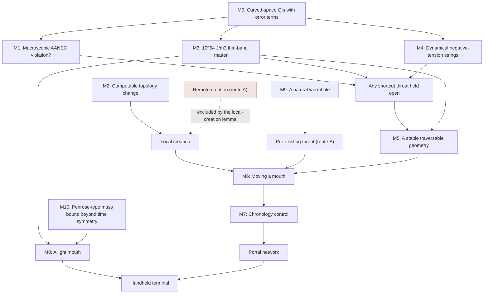

# Revised research milestone programme

*Project Portal, phase II, deliverable 6. Supersedes the R1–R10 chain of the baseline
([report 06 §5](../../report/06-real-portal-engineering-study.md)). The graph is generated from
[`feasibility.milestones()`](../code/portal2/feasibility.py) and checked to be acyclic
([results/milestones.mmd](../results/milestones.mmd)).*

## The dependency graph

The three ways to hold a throat open are alternatives: **any one** of M1, M3 or M4 succeeding is enough.
Creation is likewise **either** M2 (make one) **or** M9 (find one). Everything else is a chain.

## Milestones

Each entry gives:

- **Question**: the unresolved question;
- **Needed**: the mathematical or physical result required;
- **Counts if**: the assumptions under which that result would count;
- **Method**: how to investigate it;
- **Progress**: what would count as progress;
- **Stop**: what would falsify or terminate the line;
- **Unlocks / still unsolved**: what it would open, and what it would leave.

### M0. Quantum inequalities in curved spacetime with error terms (foundation)

- **Question.** The phase II audit applies flat-space QIs in curved regions with a sampling fraction $f$. Do
  QIs hold there, with explicit corrections?
- **Needed.** Worldline or null-smeared QIs on curved backgrounds with remainders bounded in terms of
  curvature and sampling time.
- **Counts if.** The remainders stay small for $f$ between 0.01 and 0.1 in throat geometries.
- **Method.** Hadamard-parametrix and point-splitting methods, building on existing curved-space QI work
  (stage B).
- **Progress.** Explicit bounds for the families of D2 §5.
- **Stop.** Explicit states that beat the flat-space form at these scales. That would reopen every static
  design.
- **Unlocks.** Rigour for M1, M3, M4. **Still unsolved:** everything physical.

### M1. Macroscopic AANEC violation

- **Question.** Can quantum fields coupled to gravity violate the achronal ANEC over regions larger than the
  curvature scale?
- **Needed.** A self-consistent semiclassical (or quantum-gravity) solution containing a macroscopic
  shortcut, or a proof that none exists.
- **Counts if.** Throat ≫ $\ell_P$, semiclassical Einstein equation satisfied, every known QI respected.
- **Method.** Curved-space ANEC proofs, holographic constructions, numerical semiclassical gravity.
- **Progress.** Any controlled AANEC violation over a region larger than its curvature radius.
- **Stop.** A proof of the AANEC (or of a QI whose loopholes are Planck-suppressed) in curved spacetime.
  This is the most likely termination point of the whole programme.
- **Unlocks.** Holding open any smooth shortcut. **Still unsolved:** creation, stability, endpoints.

### M2. Computable topology change

- **Question.** Is there a physical mechanism that creates a handle, with a rate?
- **Needed.** Nucleation rates in a theory of quantum gravity, and their dependence on fields a device could
  control.
- **Counts if.** The rate is non-negligible for a seed that can then be grown.
- **Method.** Euclidean instantons, Morse-index-weighted sums over histories, causal-set or spin-foam
  amplitudes.
- **Progress.** Show that the index-2 (causally continuous) route of D2 §7.3 gives finite particle production
  and a non-zero amplitude.
- **Stop.** Topology change shown to require Planck curvature with exponentially small rates for any
  macroscopic seed.
- **Unlocks.** Local creation (architectures C, D1, D2). **Still unsolved:** transport. Remote creation stays
  excluded by the local-creation lemma regardless.

### M3. Thin-band matter

- **Question.** Can known fields produce an energy density of about $-1.6\times10^{64}$ J/m³ in a layer about
  $10^{-21}$ m thick, while obeying all QIs?
- **Needed.** An explicit quantum state of Standard-Model (or other known) fields with that density and support.
- **Counts if.** It satisfies every known QI and the M0 bounds.
- **Method.** Optimise over states (squeezed, Casimir-type, multi-field); look for interacting-field QI violations.
- **Progress.** Any negative energy density above the free-field QI at the relevant scale.
- **Stop.** QIs proven for interacting fields at those densities.
- **Unlocks.** The only static walk-in design not excluded (D2 §5.4). **Still unsolved:** stability
  (thin-shell-like equations of state are needed), creation.

### M4. Dynamical negative-tension strings

- **Question.** Do codimension-2 objects with tension $-c^4/4G$ exist as movable, dynamical objects?
- **Needed.** A consistent theory containing them, with control over position and corners.
- **Counts if.** They can be placed, supported at polygon corners, and survive the QI (core ≲ $10^{-31}$ m).
- **Method.** Defects in string theory, effective field theories of strings, conical-defect QIs.
- **Progress.** A candidate object with adjustable position.
- **Stop.** Proof that negative-tension defects are always non-dynamical, or carry ghosts.
- **Unlocks.** Flat-face portals (architecture D2), the only design whose travellers meet no exotic matter.
  **Still unsolved:** creation of the cut-and-paste topology, rim dynamics.

### M5. A stable traversable geometry

- **Question.** Is any traversable geometry stable against generic perturbations and traffic?
- **Needed.** Spectral and nonlinear stability with physical matter.
- **Counts if.** All modes are stable (or controllable with loop delay < $\sqrt2/s$), including infalling matter.
- **Method.** Master equations as in D2 §6, time evolution, energy methods; extend the parametric experiment
  with converged numerics.
- **Progress.** One stable example whose matter satisfies M0 bounds.
- **Stop.** A general instability theorem for NEC-violating throats.
- **Unlocks.** Usable throats. **Still unsolved:** endpoints.

### M6. Moving a mouth

- **Question.** Can a mouth be accelerated and steered by applied forces?
- **Needed.** Equations of motion of a mouth, including its exotic support.
- **Counts if.** A mouth reaches speed $v$ and stops without destroying the throat.
- **Method.** Matched asymptotics, effective point-particle descriptions, numerical relativity.
- **Progress.** Controlled transport in a model.
- **Stop.** Transport inconsistent with QIs or stability.
- **Unlocks.** Networks and launchers (B, C, D1). **Still unsolved:** chronology management (engineering).

### M7. Chronology control

- **Question.** Can a network be operated without closed causal curves, with a safety margin?
- **Needed.** Control laws keeping every cycle weight above a semiclassical safety threshold.
- **Counts if.** Policies work for realistic networks.
- **Method.** The phase II checker plus vacuum-polarisation estimates near closed null geodesics.
- **Progress.** Demonstrated schedules.
- **Stop.** Required safety margins larger than any achievable control.
- **Unlocks.** Persistent networks. **Still unsolved:** none at this level.

### M8. A light mouth

- **Question.** Can a mouth weigh far less than $r_0c^2/2G$?
- **Needed.** The negative energy that the Misner–Sharp and Penrose bounds then require (D2 §4.4), confined.
- **Counts if.** It is consistent with M3 or M4.
- **Method.** Mass bookkeeping beyond spherical symmetry.
- **Progress.** Designs with smaller requirements.
- **Stop.** A general theorem (M10).
- **Unlocks.** Handheld devices. **Still unsolved:** everything upstream.

### M9. A natural wormhole

- **Question.** Do natural traversable wormholes exist?
- **Needed.** A detection, or a mechanism that creates and keeps them.
- **Counts if.** A confirmed object with a throat and no horizon.
- **Method.** Lensing searches, shadow imaging, gravitational-wave echoes.
- **Progress.** Any robust candidate.
- **Stop.** None: absence proves little.
- **Unlocks.** Route B without topology creation. **Still unsolved:** holding open, if it must be enlarged.

### M10. A mass bound beyond time symmetry

- **Question.** Does "heavy or negative" hold for rotating or dynamical mouths?
- **Needed.** A spacetime Penrose-type inequality for traversable throats.
- **Counts if.** It gives $M \ge \sqrt{A/16\pi}$ unless some observer sees negative energy density.
- **Method.** Marginally outer trapped surfaces; spacetime Penrose inequality methods.
- **Progress.** A proof for stationary rotating mouths.
- **Stop.** A light, positive-energy traversable mouth (a counterexample).
- **Unlocks.** Settles M8. **Still unsolved:** none upstream.

## Earliest bottlenecks, strongest investigations, terminating findings

| Bottleneck | Why it is earliest | Strongest way to investigate | Finding that would end the line |
|---|---|---|---|
| Holding a throat open (M1/M3/M4) | Blocks every causal shortcut architecture (D4) | Curved-space QI proofs (M0) and the AANEC (M1) | AANEC proven in curved spacetime |
| Creation (M2 or M9) | Needed before transport | Index-2 particle-production calculation; instanton rates | Exponentially suppressed rates for any growable seed |
| Stability (M5) | Every explicit model fails; feedback needs 4 ns per metre | Converged parametric and feedback studies; nonlinear evolution | A general instability theorem |

## Alternative paths: does any route avoid a prerequisite?

| Route | Prerequisite it avoids | Is the obstacle removed or relocated? |
|---|---|---|
| Pre-existing throat (M9 instead of M2) | Topology change | Relocated: detection, plus holding open if it must be enlarged |
| Long wormholes (QFT-supported) | M1 (AANEC) | Relocated: no longer a shortcut, so it fails the purpose |
| Flat-face portal (M4 instead of M1/M3) | Exotic matter on the traveller's path | Relocated: Planck-scale strings, quantum-gravity regime |
| Thin band (M3 instead of M1) | Macroscopic AANEC violation by smooth fields | Relocated: $10^{64}$ J/m³ in $10^{-21}$ m |
| Heavy mouth (instead of M8) | Negative energy density | Relocated: a 0.35 Jupiter-mass mouth for 1 m |
| Remote creation (skip M6) | Transport | Not available: excluded by the local-creation lemma (without CTCs) |

No route removes the underlying obstacle. Each relocates it to an extreme scale (D2 §9.2).

## Research with value even if no portal follows

M0, M1, M2 (index-2 particle production), M5 (stability of gravitating solitons under driving) and M10
(Penrose-type inequalities) are open problems in quantum field theory in curved spacetime, quantum gravity
and geometric analysis, with value of their own. The phase II tools are reusable for them:

- the QI audit, as a test bed for curved-space QIs;
- the master-equation and parametric-drive code, for soliton stability;
- the chronology checker, for causal analysis of multi-throat spacetimes.

## Compared with the baseline's R1–R10

| Baseline | Here | Change |
|---|---|---|
| R1 (AANEC) | M1 | Now preceded by M0, which the audit needs |
| R2 (topology change) | M2 | Remote creation removed as a target (lemma); index-2 route added |
| R3 (stable solution) | M5 | Quantitative controllability criterion added ($s\tau < \sqrt2$) |
| R4 (measure negative energy, test QIs) | M0, M3 | Recast as the thin-band question with its numbers |
| R5 (detect a natural wormhole) | M9 | Kept, as an alternative to M2 |
| R6–R7 (microscopic → macroscopic) | — | Folded into M1 and M3: enlarging a throat needs the same matter |
| R8 (stabilise at ns scales) | M5 | Criterion made quantitative |
| R9 (network, drift) | M6, M7 | Split: transport physics vs scheduling |
| R10 (handheld) | M8, M10 | The mass requirement made exact (Misner–Sharp, Penrose) |
| — | M4 | New: dynamical negative-tension strings, the flat-face door |
