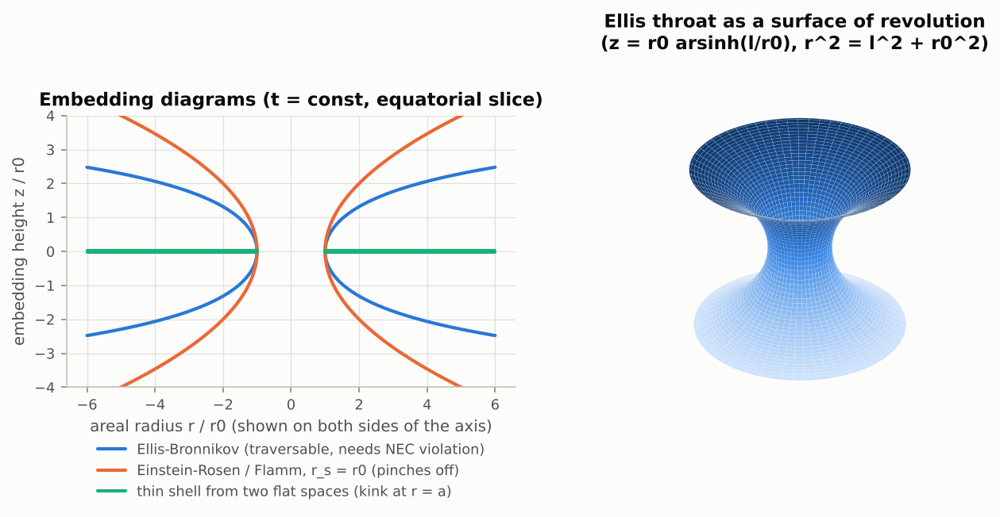
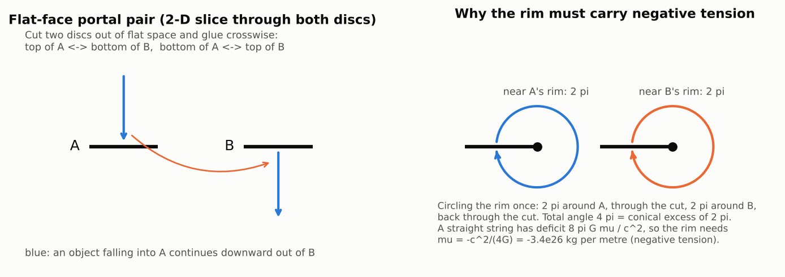
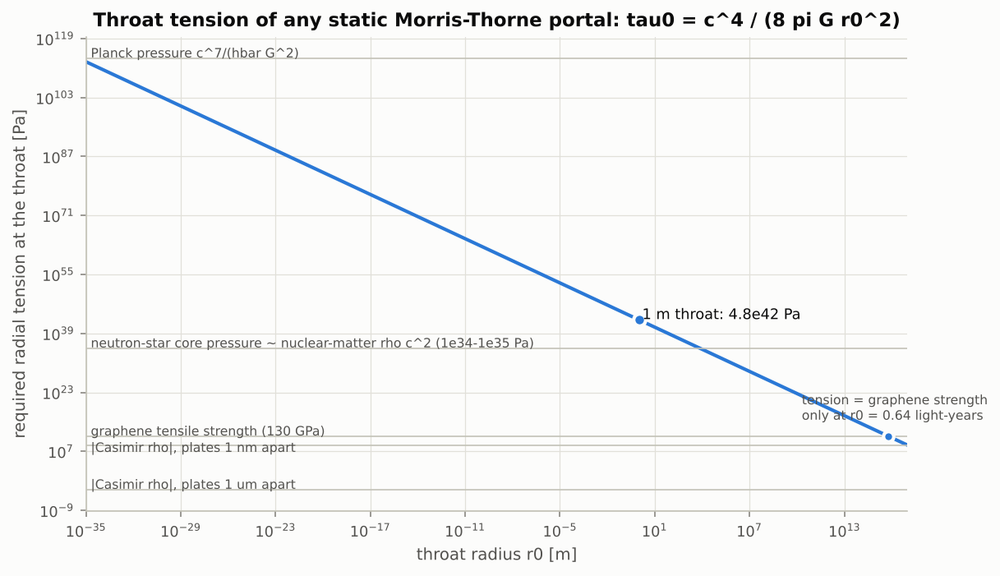
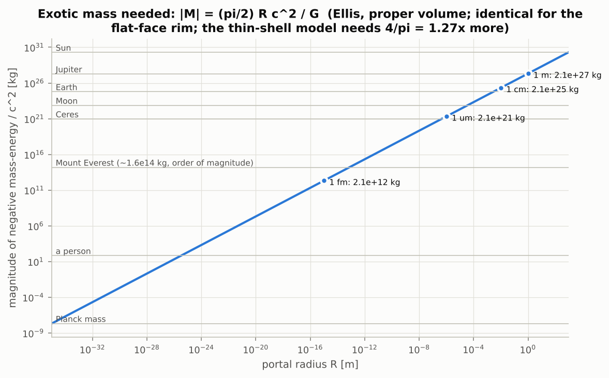
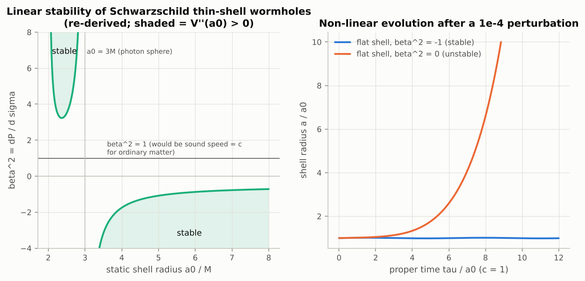
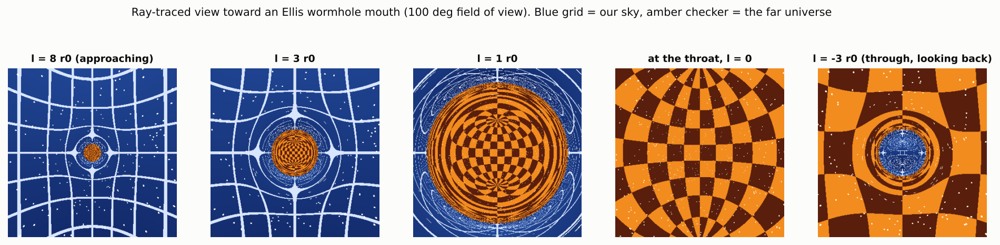
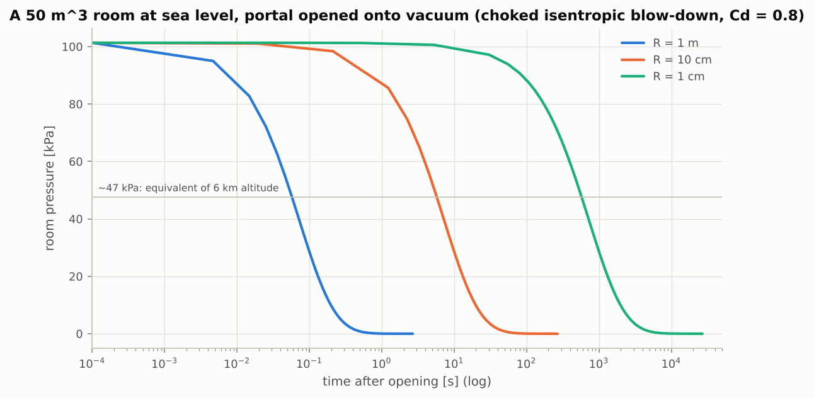
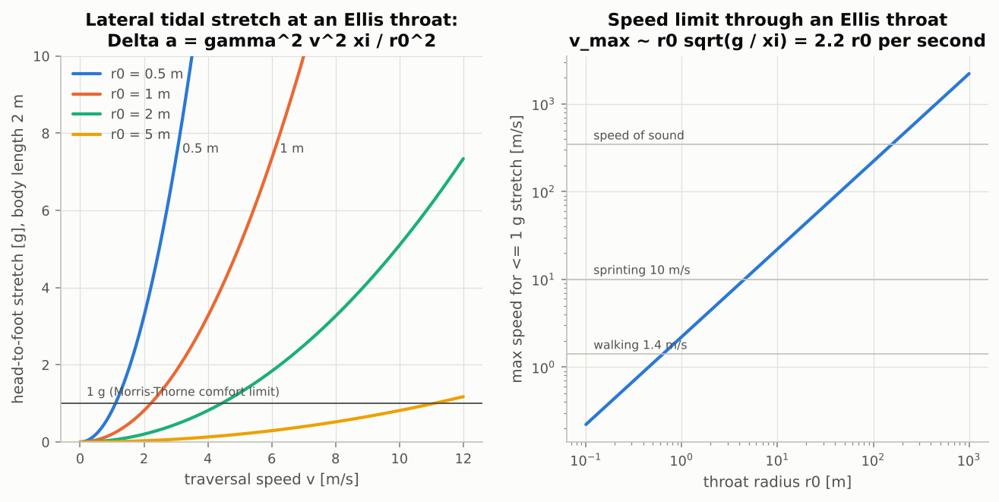
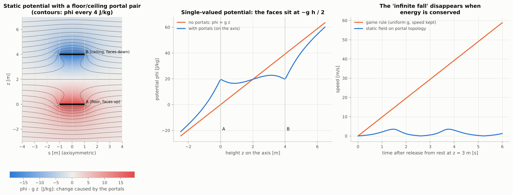
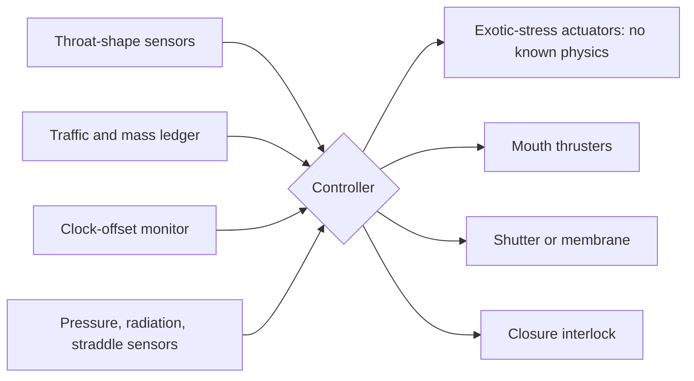

# Project Portal: technical research report

*Deliverable 2 of 8. Written 2026-10-19. Companion files: [verdict](01-executive-verdict.md),
[maths and computation](03-math-computational-appendix.md), [prop tutorial](04-prop-tutorial.md),
[simulator tutorial](05-simulator-tutorial.md), [engineering study](06-real-portal-engineering-study.md),
[references](07-references.md), [audit](08-research-audit.md).*

This report asks whether a handheld device could open a linked pair of apertures in space, the way
Rick's portal gun does, and what can honestly be studied, computed or built along the way. It covers
the physics (section 2), the full life of a portal under explicit models (section 3), what the show
actually establishes about the gun (section 4), experiments a person can really do (section 5), and
failure modes and safety (section 6).

## Contents

1. [What "portal" can mean in physics](#1-what-portal-can-mean-in-physics)
2. [The strongest theories, one at a time](#2-the-strongest-theories-one-at-a-time)
3. [The portal lifecycle under explicit models](#3-the-portal-lifecycle-under-explicit-models)
4. [Reverse-engineering the fictional gun](#4-reverse-engineering-the-fictional-gun)
5. [Experiments you can actually do](#5-experiments-you-can-actually-do)
6. [Failure modes and safety](#6-failure-modes-and-safety)
7. [Conclusions](#7-conclusions)

## 0. How to read this report

### 0.1 Evidence labels

Every substantive claim carries one of these labels, so that a reader can see at a glance how much
weight it bears.

| Label | Meaning |
|---|---|
| **[OBS]** | Measured or observed. Experimental physics with a cited measurement. |
| **[THM]** | A mathematical theorem. True if its stated assumptions hold; the assumptions are given. |
| **[LIT]** | A calculation published in the literature inside a stated model. Not tested by experiment. |
| **[CALC]** | A calculation done in this study, with code and tests in `models/`. Inside a stated model. |
| **[ARG]** | A plausibility argument from the literature that is not a theorem. |
| **[CONJ]** | A stated conjecture (for example, chronology protection or ER=EPR). |
| **[SPEC]** | Speculation, mine or the literature's, with nothing established behind it. |
| **[CANON] / [FAN]** | What the TV show depicts / what fans or wiki editors infer. Section 4 only. |

### 0.2 Units and conventions

SI units throughout, with *c* and *G* written explicitly. Metric signature (−,+,+,+). Inputs are CODATA
2018 values (`models/portalphys/constants.py`). Results are quoted to two or three significant figures,
because every model in this report is an idealisation whose own uncertainty is far larger than that.
When I quote a paper that used geometrised units (*G = c = 1*) I say so.

### 0.3 Where the numbers come from

- Literature: section numbers and access status (full text read, abstract only, or bibliographic only)
  for every source are in [07-references.md](07-references.md). I cite a source as established only to
  the extent that it was actually read.
- Computations: `models/portalphys/` (Python) with 69 unit tests in `models/tests/`. The figures in
  `figures/` and the values in `results/summary.json` are regenerated by `python models/run_all.py`.
  Worked derivations are in [03-math-computational-appendix.md](03-math-computational-appendix.md).

---

## 1. What "portal" can mean in physics

Several quite different things get called portals. Only the first three would actually move a person
from A to B by a short path, and all three exist only as solutions of equations.

| Candidate | Does matter go from A to B through a short path? | Status |
|---|---|---|
| Traversable wormhole (Morris–Thorne type) | Yes, in the model | Exact solutions of general relativity (GR) that need matter violating the null energy condition **[THM]** |
| Thin-shell or "flat-face" doorway wormhole (Visser) | Yes, in the model | As above, with the exotic matter concentrated on a shell or a rim **[LIT]** |
| Quantum "long" wormholes (Gao–Jafferis–Wall; Maldacena–Milekhin–Popov) | Yes, but never faster than going around through ordinary space | Controlled theoretical constructions; microscopic or astrophysical **[LIT]** |
| Einstein–Rosen bridge (Schwarzschild wormhole) | No: it pinches off before light can cross | Exact GR solution, non-traversable **[LIT]** |
| Quantum teleportation | No. A quantum *state* is transferred, and only with a light-speed classical message | Demonstrated, up to 1400 km to a satellite **[OBS]** |
| Metamaterial "wormholes" | No. One field is routed through a device | A DC magnetic version was built (Prat-Camps et al. 2015) **[OBS]** |
| Analogue-gravity "wormholes" | No. Waves in a moving fluid mimic a metric | Water-wave version observed (Euvé & Rousseaux 2017) **[OBS]** |
| Video "portals", Pepper's ghost, infinity mirrors | No. Images only | Common installations and stage effects **[OBS]** |

Unless stated otherwise, "portal" below means a traversable wormhole whose two mouths are both in our
own space: an intra-universe wormhole, which is what a portal gun would have to make.

---

## 2. The strongest theories, one at a time

Each subsection gives: what the theory proposes, its key equations, the evidence, what has been
demonstrated, what remains hypothetical, and how plausible it makes a portal gun.

### 2.1 General relativity

**Proposes.** Gravity is the curvature of spacetime, related to matter by Einstein's field equations

$$G_{\mu\nu} = \frac{8\pi G}{c^4}\,T_{\mu\nu}.$$

The left side is geometry; the right side is the stress-energy of matter and fields. Any geometry,
however strange, is a "solution" if you are willing to accept whatever $T_{\mu\nu}$ it implies. That is
how wormholes are designed: choose the geometry, then read off the matter it needs.

**Evidence and what is demonstrated [OBS].** The part of GR that matters most for portals is that
clocks at different heights run at different rates, by the fraction $gh/c^2$ near Earth:

- Pound and Rebka (1960) saw the gravitational redshift of 14.4 keV gamma rays over the ~22 m Harvard
  tower; Pound's 1961 review gives agreement "at least within about 4 percent".
- Hafele and Keating (1972) flew caesium clocks around the world: observed −59 ± 10 ns eastward and
  +273 ± 7 ns westward, against predictions of −40 ± 23 ns and +275 ± 21 ns.
- Chou et al. (2010) resolved a 33 cm height change with two aluminium-ion optical clocks: a fractional
  shift of (4.1 ± 1.6) × 10⁻¹⁷.
- Takamoto et al. (2020) compared clocks 452.6 m apart at Tokyo Skytree, constraining deviations from GR
  to (1.4 ± 9.1) × 10⁻⁵ (figures from the authors' 2025 review; the 2020 paper itself was not read).
- Bothwell et al. (2022) measured the redshift gradient across a single millimetre-scale cloud of
  strontium atoms: −9.8(2.3) × 10⁻²⁰ per mm against the predicted −1.09 × 10⁻¹⁹ per mm.

**Hypothetical.** GR's equations admit wormhole geometries, but no wormhole has ever been observed.
Searches give only upper limits (section 2.12).

**Plausibility for a portal gun.** GR is the right framework, and it permits the geometry. The problems
are all in the right-hand side of the equation (the matter needed), in the global structure (topology
and causality), and in stability.

### 2.2 The Einstein–Rosen bridge (1935)

**Proposes.** Einstein and Rosen wanted a singularity-free particle model and found that the
Schwarzschild solution can be written as two identical sheets joined by a "bridge" (abstract only was
accessible). With the substitution $u^2 = r - 2m$ (a secondary source attributes this to them; the
form below is my own algebra, in *G = c = 1*):

$$ds^2 = -\frac{u^2}{u^2+2m}\,dt^2 + 4(u^2+2m)\,du^2 + (u^2+2m)^2\,d\Omega^2,\qquad -\infty < u < \infty .$$

**Evidence.** It is an exact solution, part of the maximally extended Schwarzschild spacetime. Black holes
are observed, but astrophysical ones formed by collapse are not expected to have the second exterior:
Hayward and Koyama (2004) note that "Black holes formed by gravitational collapse of supernova remnants
would presumably not have the appropriate topology."

**Demonstrated.** Nothing traversable. Fuller and Wheeler (1962) showed the throat "pinches off in a
finite time and traps the signal in a region of infinite curvature" (abstract). Morris and Thorne
(1988) restate it: even at light speed one cannot get through.

**Plausibility for a portal gun.** None. The bridge has a horizon and collapses. It matters here for
two reasons: it is where the word "bridge" comes from, and it shows what "closing" means in GR (a
pinch-off into a singularity; see section 3.11).

### 2.3 Morris–Thorne traversable wormholes (1988)

**Proposes.** Morris and Thorne (MT88, full text read from a scan) turned the problem around: write
down a geometry that a person could cross, then ask what matter it needs. Their static, spherically
symmetric metric is

$$ds^2 = -e^{2\Phi(r)}c^2dt^2 + \frac{dr^2}{1-b(r)/r} + r^2\,d\Omega^2 ,$$

where $b(r)$ is the shape function (the throat is at $r = b_0$ where $b(b_0) = b_0$) and $\Phi(r)$ is the
redshift function, finite everywhere so that there is no horizon. In the static observers' frame the
field equations give the energy density $\rho$, radial tension $\tau$ and lateral pressure $p$:

$$\rho = \frac{b'}{8\pi G c^{-2} r^2},\qquad
\tau = \frac{b/r - 2(r-b)\Phi'}{8\pi G c^{-4} r^2}.$$

At the throat the tension is fixed by the throat radius alone (MT88 eq. 51):

$$\tau_0 = \frac{c^4}{8\pi G\,b_0^2} = 4.8\times10^{42}\ \text{Pa}\ \left(\frac{1\ \text{m}}{b_0}\right)^2 .$$

MT write this as ~5 × 10⁴¹ dyn/cm² for a 10 m throat, the same number. The requirement that the throat
flares outward ($b'(b_0) < 1$, eq. 54) is equivalent to $\tau_0 > \rho_0 c^2$, which they call exotic:
a fast enough observer crossing the throat measures a negative energy density (eq. 57). Don Page's
"note added in proof" extends the need for such matter to any traversable wormhole, static or not.

Traversal comfort was built in. MT bound the tidal acceleration across a 2 m body to one Earth gravity,
which is a curvature bound of $g_\oplus/(c^2 \times 2\ \text{m}) = 1/(1.35\times10^8\ \text{m})^2$; they
round it to $1/(10^8\ \text{m})^2$. For their zero-tidal-force example $b = \sqrt{b_0 r}$ this caps the
crossing speed at about 60 m/s for a 10 m throat, "a comfortable hour" for the whole trip (appendix A.1).

**What I verified.** I re-derived the field equations and the boosted-frame curvature components
symbolically (`symbolic_gr.py`, sympy). They match MT88 eqs. 47a and 47b exactly, and the throat
tension, the Schwarzschild limit and the Ellis case all check out **[CALC]**. With the exact bound
instead of MT's rounding, the appendix speed limit comes out as 44 m/s rather than 60 m/s (test
`test_reproduces_morris_thorne_appendix_speed_limit`).

**Evidence.** None observational. The construction is mathematically sound **[LIT]**.

**Hypothetical.** Everything that makes it physical: the exotic matter, its coupling to travellers
(MT suggest threading a vacuum tube through it, or a material that interacts like neutrinos), stability
(MT: wormholes "might be unstable and even unstabilizable"), and creation ("pulling a wormhole out of
... spacetime foam" is offered only as something to "imagine").

**Plausibility for a portal gun.** This is the best-studied blueprint, and the right starting point.
Each of its requirements, followed up below, runs into either an open problem or a negative result.

### 2.4 Ellis–Bronnikov, thin-shell and flat-face wormholes

**Ellis–Bronnikov.** The simplest MT wormhole, MT's own Box 2, is the massless "drainhole" found
independently by Ellis (1973; received 1969; abstract read) and Bronnikov (1973; not accessed):

$$ds^2 = -c^2dt^2 + d\ell^2 + (\ell^2 + r_0^2)\,d\Omega^2 ,$$

with energy density $\rho c^2 = -(c^4/8\pi G)\,r_0^2/r^4$, negative everywhere, supplied by a scalar field
with the wrong-sign kinetic term (a "ghost"). It has zero mass seen from outside, no radial tidal force,
and a lateral tidal stretch $\Delta a = \gamma^2 v^2 \xi / r_0^2$ for a body of size $\xi$ crossing at
speed $v$ **[CALC]**.

It is unstable. Gonzalez, Guzmán and Sarbach (2009, full text of the key sections) proved that every
static ghost-scalar wormhole has exactly one exponentially growing mode, with e-folding time
$0.85\,r_{\text{throat}}/c$ for the massless case: 2.8 ns for a 1 m throat. Shinkai and Hayward (2002)
had found numerically that a positive-energy pulse, "such as a traveller", collapses it to a black hole,
while a negative-energy pulse makes it inflate.

**Thin-shell wormholes.** Visser (1989, Nucl. Phys. B; full text) cut two copies of Schwarzschild space
at a radius $a > 2GM/c^2$ and glued them. All the exotic matter sits on the shell, with surface energy
density (geometrised units)

$$\sigma = -\frac{1}{2\pi a}\sqrt{1 - \frac{2M}{a} + \dot a^2}.$$

Poisson and Visser (1995) showed the static shell is linearly stable only if the equation-of-state
parameter $\beta^2 = \partial p/\partial\sigma$ satisfies $\beta^2 \le -1/2$ (large shells) or
$\beta^2 \ge 3/2 + \sqrt3 \approx 3.23$ (shells between $2M$ and $3M$). It is never stable for
$0 < \beta^2 \le 1$, the range an ordinary sound speed would give. I re-derived the stability condition
symbolically and reproduced both thresholds **[CALC]** (figure 8).

**Flat-face wormholes.** Visser's other 1989 paper (Phys. Rev. D; full text) removes a region with a flat
face from two copies of flat space and identifies the boundaries. Across a flat face there is no matter
and no curvature at all: a traveller "will feel no tidal forces and see no matter, exotic or otherwise",
and "will simply be shunted into the other universe". This is the closest GR analogue of Rick's flat
oval portals. The price moves to the edges, which must carry negative-tension strings with mass per
unit length $\mu = T/c^2 = -\phi c^2/(4\pi G)$ for a bending angle $\phi$. A cube edge ($\phi = \pi/2$)
needs $-c^2/(8G) = -1.7\times10^{26}$ kg per metre, or $-1.5\times10^{43}$ J/m. Visser: "No natural
mechanism for generating negative string tension is currently known."

Applying the same rule to a thin disc-shaped doorway pair (bending angle $\pi$ at the rim, equivalently a
conical *excess* of $2\pi$, total angle $4\pi$ around the rim) gives $\mu = -c^2/(4G) = -3.4\times10^{26}$
kg/m, or $-2.1\times10^{27}$ kg for the rim of a 1 m radius portal **[CALC]**. That is about 1.1 Jupiter
masses of *negative* mass, the same as the Ellis wormhole of the same size. A circular string loop
released from rest collapses in $\pi R/2c$ (5.2 ns for 1 m) whatever the sign of its tension, so the
rim would also have to be held open **[CALC]**.

**Plausibility for a portal gun.** The flat-face model shows that the *geometry* of a cartoon portal
(flat, undistorted, tide-free) is allowed by GR. It does nothing to make the required matter exist.

### 2.5 Energy conditions and exotic matter

**Proposes.** Energy conditions are inequalities that "reasonable" matter is expected to obey. With
$\rho$ the energy density and $p$ a pressure in some direction (perfect-fluid forms):

| Condition | Statement | Perfect fluid |
|---|---|---|
| Null (NEC) | $T_{\mu\nu}k^\mu k^\nu \ge 0$ for every null $k$ | $\rho c^2 + p \ge 0$ |
| Weak (WEC) | $T_{\mu\nu}u^\mu u^\nu \ge 0$ for every timelike $u$ | $\rho \ge 0$ and $\rho c^2 + p \ge 0$ |
| Dominant (DEC) | WEC, and energy flux is causal | $\rho c^2 \ge \lvert p \rvert$ |
| Averaged null (ANEC) | $\int T_{\mu\nu}k^\mu k^\nu\,d\lambda \ge 0$ along complete null geodesics | — |
| Achronal ANEC (AANEC) | ANEC on complete null geodesics with no two points timelike-related | — |

**Theorems that tie these to wormholes [THM].**

- *Flare-out forces NEC violation.* Hochberg and Visser (1997, static; 1998, dynamic; full text) showed,
  with no symmetry assumptions, that "NEC violations will occur at or near the throat of any spacetime
  configuration that deserves to be called a (traversable) wormhole."
- *Topological censorship.* Friedman, Schleich and Witt (1993; full text of arXiv v2): in a globally
  hyperbolic, asymptotically flat spacetime obeying the ANEC, every causal curve from past to future
  infinity can be deformed to a topologically trivial one: "any topological structure collapses too
  quickly to allow light to traverse it". (The abstract says null energy condition; the theorem uses the
  averaged one.)
- *Achronal ANEC.* Graham and Olum (2007) showed that self-consistent achronal ANEC would rule out
  traversable wormholes connecting *different* asymptotic regions, and time machines. They point out a
  loophole, credited to L. Ford: a wormhole within one universe whose throat is *longer* than the outside
  distance between the mouths. That loophole is exactly what the modern constructions in section 2.8 use.

**Evidence.** Quantum field theory violates every *pointwise* energy condition: the Epstein–Glaser–Jaffe
argument shows the energy density at a point is unbounded below over physical states **[THM]**. The
Casimir effect is a static example (section 2.6). The *averaged* conditions are much sturdier: ANEC has
been proved for quantum field theories in flat spacetime (Faulkner et al. 2016, from relative entropy;
Hartman et al. 2017, from causality) **[THM]**, and the review by Kontou and Sanders (2020) says AANEC
"has the best chance of being valid under all physically reasonable circumstances". Known violations
are either chronal (light rays that loop back) or need Planck-scale effects.

**Classical loopholes.** A classical scalar field coupled non-minimally to curvature can violate even the
ANEC, but only by reaching "trans-Planckian values somewhere in the geometry" (Barceló and Visser 2000,
abstract) where the effective gravitational constant changes sign. Butcher (2015, Phys. Rev. D 91, 124031)
proved that GR admits no asymptotically well-behaved static spherical wormholes supported by classical
scalar fields plus ordinary matter **[THM]**.

**Plausibility for a portal gun.** "Exotic matter" is not ruled out outright; small, local, short-lived
negative energy is routine in quantum theory. What a portal needs is the kind of violation (averaged,
macroscopic, sustained) that every result above protects.

### 2.6 The Casimir effect

**Proposes.** Two parallel conducting plates a distance $a$ apart change the electromagnetic vacuum
between them. Casimir (1948, full text from a reprint) found an attractive force per unit area
$\pi^2\hbar c/(240a^4)$, "0.013 dyne/cm²" at 1 µm. The vacuum stress tensor between ideal plates (Brown
and Maclay 1969, confirmed through three secondary sources because the paper itself was paywalled) is

$$\langle T^{\mu\nu}\rangle = \frac{\pi^2\hbar c}{720\,a^4}\,\operatorname{diag}(-1,\,1,\,1,\,-3),$$

so the energy density is negative: $-4.3\times10^{-4}$ J/m³ at $a$ = 1 µm.

**Evidence [OBS].** The *force* has been measured: Lamoreaux (1997) at 0.6–6 µm, claimed 5% (later
corrections and a published comment dispute the comparison); Mohideen and Roy (1998) at 0.1–0.9 µm, a 1%
deviation at the smallest separation; Bressi et al. (2002) with genuinely parallel plates at 0.5–3 µm,
15% precision. The negative energy *density* itself has not been measured; Ford and Roman (1995) make
this point explicitly.

**What it means for wormholes.** The NEC is violated between the plates for any light ray with a
component normal to them. But once the plates are included, the ANEC holds along complete light rays
(Graham and Olum 2005; Fewster, Olum and Pfenning 2007), who add: "Casimir plates would not seem to be
useful to support a wormhole ... because of the need to get through the plate."

Scale is the deeper problem. A 1 m throat needs a tension of $4.8\times10^{42}$ Pa, which is $1.1\times10^{46}$
times the Casimir energy density at 1 µm. Plates would have to be $3.1\times10^{-18}$ m apart, about
1/270 of a proton radius, to reach it **[CALC]**. Morris, Thorne and Yurtsever (1988, full text) built
the classic Casimir-supported model: plate separation ~10⁻¹⁰ cm for a throat the size of the Earth's
orbit (my value from the same physics is 1.2 × 10⁻¹⁰ cm; theirs is larger by $3^{1/4}$ because they
match the plates' tension rather than the energy density). They also noted that if the plates must have
a mass-to-charge ratio above the electron's, the separation must be below $0.029\,\hbar/(m_e c)$, a few
percent of the electron's reduced Compton wavelength, "which might well be forbidden".

**Plausibility for a portal gun.** The Casimir effect is the one laboratory-confirmed phenomenon
associated with negative energy density. It is 46 orders of magnitude too weak at accessible gaps, and
its plates restore the averaged energy condition that a throat must violate.

### 2.7 Quantum inequalities

**Proposes.** Quantum field theory allows negative energy, but limits how much, for how long. For a free
massless scalar field in flat spacetime, an inertial observer who averages the energy density with a
Lorentzian weight of width $t_0$ always finds (Ford and Roman 1995, full text)

$$\hat\rho \ge -\frac{3\hbar}{32\pi^2 c^3 t_0^4}.$$

Fewster and Eveson (1998) extended this to arbitrary smooth sampling functions, and Ford and Roman (1997)
found that the electromagnetic field allows twice as much. Sharp (box) averages are unbounded, so the
smoothness matters.

**Applied to wormholes [ARG].** Ford and Roman (1996, full text) applied the flat-space bound inside a
wormhole, over sampling times $t_0 = f \times$ (smallest local length scale) with $f \approx 0.01$, on the
argument that short-wavelength modes do not feel the curvature. Their conclusions:

- An Ellis-type throat must satisfy $r_0 \lesssim \ell_P/(2f^2) \approx 10^{-31}$ m (eq. 51).
- MT's "absurdly benign" wormhole, with exotic matter in a thin band of thickness $a_0$ around a throat of
  radius $r_0$, needs $a_0 \lesssim (r_0/(8f^4\ell_P))^{1/3}\,\ell_P$. For a 1 m throat that is about
  $10^{-21}$ m, "approximately a millionth of the proton radius". My implementation gives
  $1.5\times10^{-21}$ m **[CALC]**.
- Evading this with many fields would need about 10⁶² of them for a 1 m throat.
- Their summary: "it seems unlikely that quantum field theory allows macroscopic static traversable
  wormholes".

Fewster and Roman (2005) showed that the "arbitrarily small exotic matter" wormholes of Visser, Kar and
Dadhich (2003) fare no better: a human-traversable one would need a throat larger than about 10⁴⁶ m.
Flanagan and Wald (1996) reached the same place from a different direction: self-consistent
semiclassical wormholes, if they exist, "must be 'Planck scale'".

**Caveats.** The curved-space step is an argument, not a theorem. Later work made curved-spacetime
quantum energy inequalities rigorous for some fields (Fewster and Smith 2008; Kontou and Olum 2015, to
first order in curvature). Interacting fields need not obey state-independent bounds at all.
Krasnikov (2003, full text) argues that the inequalities do not forbid shortcuts, and sketches a
flat-hoop "portal" needing about 10⁻² solar masses of negative energy; he says himself that he is "not
concerned with ... how to create a wormhole".

**Plausibility for a portal gun.** This is the strongest quantitative obstacle. For the free fields to
which it rigorously applies, it confines macroscopic throats' negative energy to bands far thinner than
a nucleus.

### 2.8 Quantum gravity, ER=EPR and "long" wormholes

**Proposes.** Holography relates gravity in a volume to quantum mechanics on its boundary, and this has
produced the only well-controlled traversable wormholes known.

- *ER=EPR* (Maldacena and Susskind 2013) conjectures that entangled systems are connected by
  Einstein–Rosen bridges **[CONJ]**. They explicitly assume the bridges stay non-traversable: "If this
  were not true, the ER=EPR connection would be wrong."
- *Gao, Jafferis and Wall* (2016; JHEP 2017; full text) coupled the two boundaries of an eternal
  anti-de Sitter black hole. The coupling produces negative averaged null energy at one-loop order and
  makes the bridge briefly traversable. It "cannot be used to violate causality": the signal needs a
  causal channel through ordinary space anyway. Their summary: "traversable wormholes are like getting a
  bank loan: you can only get one if you are rich enough not to need it."
- *Maldacena, Stanford and Yang* (2017) bounded what can pass: no more information than was exchanged to
  set up the coupling.
- *Maldacena, Milekhin and Popov* (arXiv 2018; Class. Quantum Grav. 40, 155016, 2023; full text) built a
  4-D traversable wormhole from two magnetically charged black holes and Standard Model fermions, with no
  exotic Lagrangian. It is "long": the outside travel time $\pi\ell$ always exceeds the mouth separation
  $d$ (about 2.35 $d$ for large $d$). It is microscopic in the Standard Model version (mouths closer than
  the electroweak length) and "not safe for human travelers". If enough energy is sent through, "a pair
  of horizons will develop."
- *Maldacena and Milekhin* (2021) then engaged in what they call "science fiction": with a hypothetical
  dark sector, a humanly traversable version needs throat radius ≳ 1.5 × 10⁷ m; the traveller's own
  crossing takes about 0.16 s, while outside observers see it take ~10⁴ years; the wormhole must be kept
  colder than 10⁻²⁶ eV and "very clean"; and "We have not given any plausible mechanism for their
  formation."

**Evidence.** None for wormholes. Holography itself is a well-tested mathematical framework but not an
experimentally confirmed description of our universe.

**Plausibility for a portal gun.** These are the most physical wormholes on paper, and every one of them
is slower than going around, microscopic or astrophysically large, and without a way to make it. They
are the opposite of a shortcut.

### 2.9 The 2022 "wormhole on a quantum processor"

Jafferis et al. (Nature 612, 51–55, 2022; supplementary information and press release read, main text
paywalled) ran a teleportation protocol on Google's Sycamore chip, "164 two-qubit gates on a nine-qubit
circuit", using a machine-learned, sparsified version of the SYK model. The signal pattern was
interpreted, through holography, as matching a traversable wormhole in a dual two-dimensional gravity
theory. The Caltech release states plainly: "The experiment has not created an actual wormhole (a rupture
in space and time)." Kobrin, Schuster and Yao (2023) argued the learned model does not thermalise and
that the key signature appears generically in small commuting models; the authors replied that the
objections concern "counterfactual scenarios"; a 2025 author correction changed a figure caption to say
the thermalisation curve was "averaged over all fermions". **Plausibility for transport: none.** It is a
quantum simulation of a model, with an explicit coupling between the two halves of the chip.

### 2.10 Topology change: can a portal be created at all?

**Proposes.** Opening a portal changes the topology of space: a handle appears where there was none.

**Theorems [THM].**

- *Geroch (1967)* (abstract only; the theorem as restated in several full-text secondary sources): a compact region
  of spacetime in which the topology of space changes must contain closed timelike curves, or fail to be
  time-orientable. The result is purely kinematic; no field equation is used.
- *Tipler (1977)* and *Borde (1994, full text)*: with Einstein's equations and a reasonable energy
  condition, causally compact topology change is forbidden outright, singularities or not. Borde: such
  spacetimes "cannot satisfy Einstein's equation (with a reasonable source)".
- *Gibbons and Hawking (1992)*: with spinors (which exist), it is "impossible to create a single wormhole
  or attach a single handle"; wormholes can only be created in pairs.

**Escape routes [SPEC].** Degenerate metrics (Horowitz 1991: "if degenerate metrics play any role in
quantum gravity, topology change is unavoidable"); quantum tunnelling (Horowitz, Marolf, Santos and Wang
2019 describe nucleating a traversable wormhole with an instanton, mouths created adjacent, probability
not quantified in the abstract); enlarging a Planck-scale "foam" wormhole (MT88 and MTY88 invite us to
"imagine" it). Hayward and Koyama (2004) show how to turn a black hole into a traversable wormhole with
negative-energy radiation, but only starting from the eternal two-sided black hole that already has the
topology. In the Sorkin–Dowker programme, the intuitive route ("two distant regions of space coming
'close in hyperspace' and touching") is the kind of transition conjectured to be suppressed.

**Plausibility for a portal gun.** Nobody knows a physical process that creates a wormhole. Classical GR
forbids it without causality violation; quantum proposals give, at best, small adjacent mouths with
unknown probability.

### 2.11 Time dilation and time machines

**Proposes [LIT].** Clocks at the two mouths of a wormhole tick at their own local rates. If the throat is
short and keeps no record of the difference, any rate difference accumulates into a time offset, and once
the offset exceeds the light-travel time between the mouths, closed timelike curves form: the pair becomes
a time machine (Morris, Thorne and Yurtsever 1988, by moving one mouth; Frolov and Novikov 1990, by
gravity; Visser 1993; Schein, Aichelburg and Israel 1996; Frolov, Krtouš and Zelnikov 2023). In the weak
field, the offset grows at the rate $\Delta\Phi/c^2$ (the potential difference between the mouths), so

$$T_{\text{CTC}} \approx \frac{L/c}{\Delta\Phi/c^2} = \frac{L\,c}{\Delta\Phi}.$$

**Consequences for portals [CALC]** (`timeshift.py`, figure 10). For mouths stacked vertically in Earth's
field, $\Delta\Phi = gh$ and $L = h$, so $T = c/g$ = 354 days whatever the height. Other cases: a mouth in
low Earth orbit and one on the ground 400 km apart, 52 days (orbital time dilation dominates); a mouth
on the solar photosphere linked to Earth's orbit, 7.5 years; mouths 100 km apart with one on a 1 km
mountain, 97 years.

**Evidence.** The drift *rate* is exactly the gravitational time dilation measured by the clock
experiments in section 2.1 **[OBS]**. That a wormhole would carry it into a causality violation is a
calculation inside GR **[LIT]**.

### 2.12 Chronology protection

Hawking (1992, full text) conjectured that "The laws of physics do not allow the appearance of closed
timelike curves," arguing that vacuum fluctuations pile up on the Cauchy horizon as a time machine forms
**[CONJ]**. Kim and Thorne (1991) estimated the divergence to be "extremely weak"; Kay, Radzikowski and
Wald (1997) proved that semiclassical field theory must break down somewhere on any such horizon
**[THM]**, and Visser (2003) concluded the question needs "full quantum gravity". The Novikov
self-consistency principle (Friedman et al. 1990) is the alternative: only self-consistent histories
occur. **For a portal gun this is unfinished physics that any network of portals would run into within
months** (section 2.11).

### 2.13 Searches for natural wormholes

No wormhole has been detected **[OBS]**. Takahashi and Asada (2013) found no wormhole lensing among ~50,000 quasars in
the SDSS Quasar Lens Search, bounding Ellis wormholes with throats of 10–10⁴ parsecs below 10⁻⁴ $h^3$ Mpc⁻³; the Event Horizon
Telescope's Sagittarius A* analysis (2022) rules out the simplest non-spinning Morris–Thorne model as the
central object, while noting that some wormholes "could be particularly difficult to distinguish from a
black hole".

### 2.14 Summary

| Theory | What it gives a portal gun | Status | Plausibility for the gun |
|---|---|---|---|
| General relativity | The geometry of a portal is a permitted solution | Tested to high precision **[OBS]** | Necessary framework; not sufficient |
| Einstein–Rosen bridge | Nothing: it pinches off | Exact, non-traversable | None |
| Morris–Thorne wormholes | A traversable design with tolerable tides | Mathematical **[LIT]** | Requires everything below |
| Flat-face doorway | Cartoon-like flat portal with no tides | Mathematical **[LIT]** | Moves the problem into a negative-tension rim |
| Energy conditions | Says what the matter must do | Theorems **[THM]** | Must violate the averaged NEC macroscopically |
| Casimir effect | Real negative energy density | Force measured **[OBS]** | 10⁴⁶ times too weak; plates restore ANEC |
| Quantum inequalities | Bounds on negative energy | Proven in flat space; argued in curved **[THM]/[ARG]** | Confines it to sub-nuclear bands |
| Holographic long wormholes | Traversable, physical constructions | Calculations **[LIT]** | Never a shortcut; microscopic or astronomical |
| Topology change | How a portal would be created | No-go theorems **[THM]** | No known mechanism |
| Time machines / chronology | What portals do over time | Calculations, conjecture | Pairs drift into time machines in months to years |

---

## 3. The portal lifecycle under explicit models

To keep the numbers concrete, this section follows a **reference portal**: a door-sized circular
aperture of radius $R = 1$ m, with both mouths at sea level on Earth unless stated. Three geometries are
used, because each makes a different part of the problem visible:

- **E (Ellis).** The massless Ellis–Bronnikov wormhole with throat radius $r_0$ = 1 m: smooth, spherical
  mouths, negative energy spread through the region around the throat.
- **F (flat face).** A pair of flat discs of radius 1 m, Visser-style: flat space everywhere except a
  negative-tension string around each rim. This is the cartoon portal.
- **S (thin shell).** Two flat spaces glued on a sphere of radius 1 m, with all exotic matter on the shell.

All three are solutions of Einstein's equations *if* the stated matter exists. None says such matter exists.

### 3.1 Creation

**What must happen.** Space acquires a handle: two apertures appear, and paths through them connect
regions that were far apart. That is a change of topology.

**What physics says.**

- In classical GR this is forbidden without causality violation. Geroch's theorem requires closed
  timelike curves in any compact region where the spatial topology changes; Tipler's and Borde's results
  forbid it outright once Einstein's equations and a reasonable energy condition hold **[THM]**
  (section 2.10).
- Gibbons and Hawking's spinor rule allows handles to be created only two at a time in a compact region
  **[THM]**. Read literally, a gun that opened one linked pair per shot would have to open two.
- Quantum gravity offers only speculative routes **[SPEC]**: instanton nucleation of small mouths created
  next to each other (Horowitz, Marolf, Santos and Wang 2019), enlarging a Planck-scale wormhole from
  "spacetime foam" (an idea MT88 and MTY88 ask readers to "imagine"), or degenerate metrics.
- Hayward and Koyama (2004) convert an existing two-sided black hole into a traversable wormhole using
  negative-energy radiation, which shows that *enlarging and stabilising* can be modelled once the
  topology exists. It does not create the topology.

**What the reference portal would contain once made [CALC].** About $-2.1\times10^{27}$ kg of
negative mass-energy (models E and F; $-2.7\times10^{27}$ kg for S), roughly $-1.1$ Jupiter masses. For
the massless Ellis wormhole the mass seen from outside is exactly zero, because the positive mass
associated with the throat cancels the negative energy around it. So the number is not a fuel bill: it is
the amount of exotic matter that has to be present and held in place.

**Verdict for this stage.** No known physical process creates a portal. This is the first and most
basic missing piece.

### 3.2 Spacetime geometry

*Figure 1. Embedding diagrams of an equatorial slice: the Ellis catenoid, a Morris–Thorne throat and the
Schwarzschild (Flamm) paraboloid. The height has no physical meaning; it shows how the circumference
grows with distance from the throat.*

- **Ellis mouth.** A sphere you can approach from any direction. There is no "back": every direction into
  the sphere leads out of the partner sphere.
- **Flat-face pair.** Each disc has two faces. Walking into the front of A brings you out of the front of
  B, moving away from it; the backs are joined to each other in the same crosswise way (figure 12). Around
  the rim the total angle is $4\pi$ instead of $2\pi$: a conical excess of $2\pi$, which is what forces the
  negative tension (section 2.4).
- **Proper length.** For the flat face the throat has zero length: you are through instantly. For the
  Ellis wormhole the region of strong curvature is about $r_0$ long on each side.

*Figure 12. Left: a 2-D slice through a flat-face pair, showing which faces are glued. Right: why the rim
must carry negative tension.*

### 3.3 Pairing, linking and remote placement

**In the show** one trigger pull gives an entrance in front of Rick and an exit at a chosen remote
destination, with no line of sight (section 4).

**In physics.** A mouth cannot appear somewhere far away faster than a light signal could get there.

- In GR the geometry in any region depends only on initial data in that region's causal past (Hawking and
  Ellis 1973, chapter 7, full text) **[THM]**. Opening a mouth at a distant point B "now" would require
  influences from here to reach B faster than light, unless a connection already exists.
- Maldacena and Susskind (2013): "there does not seem to be any way to create a bridge between them
  without preexisting bridges". Mouths are made together and carried apart **[ARG]**.
- Krasnikov (1998, 2003): a shortcut that lets you reach a star 100 light-years away in a year "cannot
  be built in less than 99 yr" **[LIT]** (under his stated assumptions, including no tachyons).
- The holographic constructions (section 2.8) are consistent with this: their wormholes need an existing
  causal channel and are never faster than it.

**What that means for a gun.** For a target in the same room the delay is harmless: light crosses 10 m
in 33 ns. For a target on another planet, the far mouth must first be carried there, at most at light
speed. A physically consistent portal gun would therefore be a terminal for a pre-built network of
mouths, not a device that projects a far end anywhere it is aimed. Travel to "other dimensions" in the
show's sense has no counterpart at all: GR wormholes can connect separate universes only if the
connection already exists, and the branches of quantum mechanics are not places a mouth can be sent
**[ARG]**.

### 3.4 Stabilisation

**Stress.** Any static throat needs a radial tension $c^4/(8\pi G r_0^2)$ = $4.8\times10^{42}$ Pa at 1 m
(figure 2). Graphene, the strongest material measured, breaks at about $1.3\times10^{11}$ Pa (Lee et al.
2008); the required tension falls to that value only for a throat 0.64 light-years in radius. The
tension also has to exceed the energy density, which no material does: for graphene the ratio of
tensile strength to $\rho c^2$ is about $7\times10^{-10}$ **[CALC]**.

*Figure 2. Tension required at the throat against throat radius, with reference pressures.*

*Figure 3. Magnitude of the negative mass-energy required against portal radius (Ellis, proper volume).*

**Dynamics.** All the explicit models are unstable or need an exotic equation of state on top of exotic
matter:

| Model | Instability | Time scale for $R$ = 1 m | Source |
|---|---|---|---|
| E, Ellis (ghost scalar) | One growing mode; collapse to a black hole or runaway inflation | e-folding time 0.85 $r_0/c$ = 2.8 ns | Gonzalez, Guzmán & Sarbach 2009 **[LIT]** |
| F, flat face | An unsupported rim loop collapses (the equation of motion is the same for either sign of tension) | $\pi R/2c$ = 5.2 ns | **[CALC]** |
| S, thin shell | Stable only for $\beta^2 \le -1/2$ or $\beta^2 \ge 3.23$ | — | Poisson & Visser 1995; re-derived **[CALC]**, figure 8 |
| Ellis + traveller | Any positive-energy pulse, "such as a traveller", collapses it to a black hole | — | Shinkai & Hayward 2002 **[LIT]** |

*Figure 8. Left: the linear stability region of Schwarzschild thin-shell wormholes in the
($a_0/M$, $\beta^2$) plane, re-derived. Right: non-linear evolution after a small perturbation, which
agrees with the linear classification.*

**Can feedback save it?** MT88 suggested an advanced civilisation might stabilise a wormhole by feedback.
The numbers make that hard to imagine. The Ellis mode grows by a factor of about 10 in the time light
takes to cross the throat ($2r_0/c$ divided by the e-folding time $0.85\,r_0/c$ is about 2.4 e-folds), so a
stabiliser would have to act locally, everywhere on the throat, faster than any signal could coordinate
it **[CALC, from the published growth rate]**. And every traveller is itself a destabilising pulse.

### 3.5 Aperture: size, shape and what you see

**Size.** Everything scales with the throat radius: tension as $r_0^{-2}$, exotic mass as $r_0$, the safe
crossing speed as $r_0$, the instability time as $r_0$. Smaller portals need less exotic mass but more
extreme stress, and can only be crossed slowly. For the Ellis model **[CALC]**: 1 µm needs $-2.1\times10^{21}$
kg (about two Ceres masses), 1 cm needs $-2.1\times10^{25}$ kg (3.5 Earth masses), 1 m needs $-2.1\times10^{27}$
kg.

**Shape.** Rick's portals are flat ovals. The flat-face model reproduces that shape; my models use circles.
An oval changes the rim length and therefore the rim mass by a factor of order one, nothing more.

**What you see.**

- *Flat face:* an undistorted window onto the far side, exactly what the simulator renders.
- *Ellis:* a sphere filled with a lensed image of the far side, surrounded by thin ring images and an
  Einstein ring (James et al. 2015). Seen from distance $\ell$, the far side fills a disc of angular radius
  $\delta$ with $\sin\delta = r_0/\sqrt{\ell^2 + r_0^2}$ (Perlick 2004), exactly the size of a sphere of
  radius $r_0$: 7.1° at $\ell = 8r_0$, 18° at $3r_0$, 45° at $r_0$, and half the sky at the throat
  **[CALC]**. My ray tracer (figure 6) uses the exact light bending of the Ellis geometry,
  $\alpha(b) = 2K(r_0/b) - \pi$ (Nakajima and Asada 2012). The numerical quadrature it uses matches
  that closed form to $6\times10^{-16}$ relative error (figure 7), and direct integration of the
  geodesic equations agrees with the quadrature to $2\times10^{-6}$ rad (`test_raytrace.py`).

*Figure 6. Ray-traced views toward an Ellis mouth from five distances (100° field of view). Blue grid:
our sky; warm grid: the far side. The far side fills a disc of exactly the angular size a sphere of
radius $r_0$ would have.*

### 3.6 Aiming and targeting

A physical "aim" can only mean deciding where to put a mouth that you carry or launch (section 3.3).
Two engineering questions remain, and both are unanswered:

- **Inertia of a mouth.** The inertia of an isolated object is its mass seen from outside. For the
  massless Ellis wormhole that is zero; for the humanly traversable Maldacena–Milekhin wormhole it is a
  near-extremal black hole of about $2\times10^{34}$ kg, some $10^4$ solar masses (my arithmetic from their
  throat radius). How one would grip, push or steer a mouth is not addressed anywhere I found.
- **Where the far end goes.** The far mouth must already be at the destination.

What *can* be built is the interface: the prop uses a Class 1 time-of-flight range sensor and a display
(tutorial 04), and the simulator checks every placement against surface type, size, edge clearance,
overlap and line of sight (tutorial 05).

### 3.7 What crosses the boundary

| Through the aperture | Flat-face model | Ellis model | Physical consequence |
|---|---|---|---|
| Matter | Passes freely; no forces except at the rim | Passes, with lateral tidal stretch | See 3.8 |
| Light | Undistorted window | Lensed; a sphere of the far side | Figure 6 |
| Air, sound | Pass | Pass | Pressure differences drive flow (below) |
| Liquids | Pass | Pass | Depth differences drive jets (below) |
| Electric field lines | Thread the throat | Thread the throat | Mouths acquire apparent charge (below) |
| Gravity | Threads the throat | Threads the throat | Field near the mouths is rearranged (3.10) |

**Air [CALC]** (`environment.py`, figure 11). A 1 m-radius portal from sea level to vacuum is a choked
orifice: air leaves at the local speed of sound (311 m/s at the throat) at 758 kg/s, and the pressure
difference pushes on anything in the aperture with $3.2\times10^5$ N, the weight of about 32 tonnes. A
sealed 50 m³ room drops to half an atmosphere in 0.053 s through a 1 m portal, 5.3 s through 10 cm, and
526 s (about 9 minutes) through 1 cm (isentropic blow-down, discharge coefficient 0.8). The solver
reproduces the closed-form choked solution, and the half-pressure times match its exact inversion to one
part in a million (`test_environment.py`).

*Figure 11. A 50 m³ sea-level room opened onto vacuum through portals of different sizes.*

Within one atmosphere, height matters. If a portal simply joined two heights $h$ apart in still air, with
no effect on gravity, the pressure difference $\rho g h$ would drive a steady wind of speed $\sqrt{2gh}$:
7.7 m/s for a floor-to-ceiling pair 3 m apart and 44 m/s (hurricane force) for 100 m. Whether that wind
really blows depends on what the portal does to gravity: in a static equilibrium where the gravitational
potential is single-valued (section 3.10), pressure depends only on potential and there is no steady wind
**[CALC + ARG]**. A destination at a different temperature exchanges heat by radiation and convection:
the Sun's photosphere radiates $6.3\times10^7$ W/m², or about 200 MW through a 1 m-radius aperture.

**Liquids [CALC].** A portal 4 km down in the ocean faces a pressure difference of about 40 MPa: water
emerges at about 280 m/s, 546 m³/s through a 1 m-radius aperture (discharge coefficient 0.62), comparable
to a substantial river. At 10 m depth it is 14 m/s and 27 m³/s.

**Charge and mass.** Electric field lines run through a wormhole, so a charge that has passed through
still has its field lines threading back to the entrance (Wheeler's "charge without charge"). Susskind
(2005, a 2+1-dimensional heuristic, not peer reviewed) describes the bookkeeping: after a charge or mass
crosses from A to B, mouth A appears to carry it, and mouth B appears to carry the opposite; the total
seen from outside is unchanged. Gratus, Kinsler and McCall (2019) call this the accepted view and propose
an alternative. I found no accessible peer-reviewed 3+1-dimensional calculation **[LIT, weakly
supported]**. Taken at face value, a heavily used one-way portal accumulates a mass imbalance: a thousand
70 kg travellers would leave the exit mouth 70 tonnes lighter, and a mouth that started massless would
end up with negative mass, the "negative-mass natural wormhole" signature Cramer et al. (1995) proposed
searching for in microlensing data.

### 3.8 The traversal experience

**Tides [CALC]** (`tidal.py`, figure 5). At an Ellis throat the radial tidal force is zero and the
lateral stretch across a body of size $\xi$ crossing at speed $v$ is $\Delta a = \gamma^2 v^2 \xi/r_0^2$.
Holding it to MT's limit of one Earth gravity across 2 m gives

$$v_{\max} \approx r_0\sqrt{g/\xi} = 2.2\ \text{m/s}\times\frac{r_0}{1\ \text{m}},$$

a slow walk through a 1 m throat and 22 m/s through a 10 m one. A flat face has no tides at all, until
you touch the rim, whose effect on a body is not something the idealised models describe.

*Figure 5. Left: lateral tidal stretch at an Ellis throat against speed. Right: the speed limit against
throat radius.*

**Other effects.**

- *Contact with the exotic matter.* MT warned that matter with this tension could be "extremely
  uncomfortable" and suggested a vacuum tube through it or matter that barely interacts. The flat face
  avoids this by having no matter on the face.
- *Blue-shifted radiation.* Wormholes near the edge of forming a horizon blue-shift anything that falls in.
  Ford and Roman (1996) estimated that in the Morris–Thorne–Yurtsever Casimir model, 3 K background
  photons would arrive at about 10²³ K; in the Maldacena–Milekhin model the boost factor is about 10¹²
  and the wormhole must be kept in a "refrigerator" **[LIT]**.
- *Time.* A flat-face crossing is instantaneous. For Maldacena–Milekhin it takes the traveller ~0.16 s
  while ~10⁴ years pass outside.

### 3.9 Momentum and motion

**Static mouths [CALC].** A portal is a rigid map from the frame of A to the frame of B,
$T = M_B\,R_y(\pi)\,M_A^{-1}$, where $M_A$, $M_B$ are the mouths' frames and $R_y(\pi)$ turns "into A" into
"out of B". Position and velocity both map through it, so a ball rolling into a wall portal at 3 m/s rolls
out of its partner at 3 m/s in the mapped direction. This is the same transform used by three.js's own
portal example and by published game implementations (references, section on rendering), and it is what
the simulator does.

**Moving mouths [CALC].** If mouth A moves at $u_A$ and B at $u_B$, the Galilean rule is
$v_{\text{out}} = R\,(v_{\text{in}} - u_A) + u_B$, and the relativistic version maps four-momentum through
$L(u_B)\,\bar R\,L(u_A)^{-1}$ (boosts $L$). So a moving mouth that sweeps over a resting object throws it
out of the partner at the mouth's speed: the "speedy thing goes in, speedy thing comes out" trick of the
*Portal* video game. In the simulator's piston demo a resting 10 kg ball leaves at 8 m/s, and the ledger shows
the mouths supplying about 400 J (its new kinetic energy plus the 0.85 m it is raised).

**Who pays?** In a closed system the mouths must supply that energy and absorb the momentum. My model
keeps a ledger in which the entrance mouth gains and the exit mouth loses the traveller's four-momentum,
the same Gauss-law bookkeeping as for charge in 3.7. The literature support is thin (Susskind's heuristic;
the closest controlled analogue is the boundary "kick" in the two-dimensional model of Maldacena,
Stanford and Yang 2017), so I treat it as a modelling assumption **[CALC on an assumption]**.

**In the show,** no rule is stated, and the depictions are not consistent with momentum conservation
(section 4).

### 3.10 Gravity and environmental differences

**The floor/ceiling question.** Put portal A on the floor facing up and B on the ceiling facing down,
$h$ = 4 m apart. In video games a ball dropped into A falls out of B, falls into A again, and speeds up
forever: after 6 s it is moving at 58.9 m/s. Energy has come from nowhere. What does a self-consistent
gravitational field on this geometry do?

**Model [CALC]** (`newtonian_portal.py`, figure 9). I solved static Newtonian gravity, Laplace's equation
for the potential, on the actual topology of a flat-face pair: axisymmetric finite volumes with the
discs' faces glued crosswise, the uniform field $\phi \to gz$ imposed far away, and gravity allowed to pass
through the floor and ceiling (which it does). Results for $R$ = 1 m, $h$ = 4 m:

- The potential is single-valued, and both faces sit at about $gh/2$ (19.5 and 19.8 J/kg on the
  0.05 m grid, converging to the same value as the grid is refined).
- Gravity in the room is reduced and, near the floor portal, reversed: on the axis it is 0.40 g downward
  at mid-height, 0.33 g *upward* 0.5 m above A, and 2.15 g downward 0.5 m behind A, under the floor.
- A ball released 3 m up oscillates through the loop. Its top speed is 3.5 m/s and its energy is
  constant to $3\times10^{-6}$ J/kg (the integrator's error). The infinite fall is gone.

| Height $h$ | Mid-room field | 0.5 m above A | 0.5 m behind A | Potential range around the loop |
|---|---|---|---|---|
| 2 m | −0.11 g | −0.01 g | −1.61 g | 0.75 J/kg |
| 4 m | −0.41 g | +0.33 g | −2.15 g | 6.2 J/kg |
| 8 m | −0.68 g | +1.28 g | −3.20 g | 25.9 J/kg |
| 16 m | −0.84 g | +3.31 g | −5.27 g | 77.6 J/kg |

(Negative = downward. Grid check at $h$ = 4 m: the mid-room value is −0.415, −0.407 and −0.403 g at grid
spacings of 0.1, 0.05 and 0.025 m, first-order convergence; tripling the padding changes it by less than
0.2%. See the appendix.)

*Figure 9. Left: change in the potential caused by the portals. Centre: potential on the axis; both faces
sit near $gh/2$. Right: speed of a dropped ball under the game rule and in the self-consistent field.*

**What this means.** There are two ways a portal could treat gravity, and they correspond to two
physically different situations:

1. **The field rearranges** (my static solution). The potential is single-valued, nothing gains energy
   by looping, and the price is a strongly distorted field near the mouths: several g within a metre of
   them for a tall pair.
2. **It does not.** Then the potential changes by $gh$ around a loop through the portal, so each loop
   gains $gh$ of energy per kilogram. In GR this is the same configuration as clocks at the two mouths
   drifting apart at $gh/c^2$ per second (section 2.11), with the pair becoming a time machine after
   $c/g$ ≈ 354 days, and it matches Visser's (2003) description of light on a closed path through a
   time machine being boosted on every circuit.

In other words, the game's infinite fall and the time-machine instability are one phenomenon, seen as
energy in one picture and as time in the other **[ARG; my synthesis]**. Which global solution a real
formation process would produce is not settled here: Frolov, Krtouš and Zelnikov (2023) find the second
kind (a "non-potential" field) for a ring wormhole with a massive shell around one mouth.

**Other environmental differences.** Pressure, temperature and depth differences drive flows (3.7).
Stepping from Earth to a lower-gravity destination through a flat face changes the felt gravity over a
distance comparable to the portal size, not in a sudden jolt, in the static picture.

### 3.11 Closure

**In the show** portals close shortly after use; opening a portal through a body bisects it (S2E2); and
in S9E6 a closing portal severs Rick's head (section 4).

**In physics.**

- *Closing is topology change too.* A handle disappearing is subject to the same theorems as one
  appearing (Geroch, Tipler, Borde) **[THM]**. A portal cannot simply be switched off in classical GR.
- *What throats actually do is collapse.* Without its support an Ellis throat collapses to a black hole
  (Hayward 2009: it "can collapse to a black hole if its negative-energy source fails, or if enough
  positive-energy matter or radiation is pumped in"); the Schwarzschild bridge pinches off into a
  singularity (Fuller and Wheeler 1962) **[LIT]**. Anything straddling a collapsing throat meets
  unbounded tidal stress: much worse than a clean cut.
- *Shrinking a flat-face pair* sweeps the rim inward. The material bonds of anything straddling the
  aperture cross a surface that is ceasing to exist, so the object is cut along the rim's path **[ARG,
  mine]**. An unsupported rim does this in 5.2 ns for a 1 m portal.

So the show's severing is, if anything, generous. The simulator includes a closure interlock that refuses
to close a portal while a body straddles it (with an override that ejects the body).

### 3.12 Power and energy under explicit models

| Quantity, reference portal ($R$ = 1 m) | Model | Value | Label |
|---|---|---|---|
| Radial tension at the throat | Any static MT throat | $4.8\times10^{42}$ Pa | [LIT], checked [CALC] |
| Negative mass-energy | Ellis, proper volume | $-2.1\times10^{27}$ kg $= -1.9\times10^{44}$ J | [CALC] |
| | Flat-face rim | $-2.1\times10^{27}$ kg | [CALC] |
| | Thin shell, $M = 0$ | $-2.7\times10^{27}$ kg | [CALC] |
| Same energy expressed as solar output | — | $1.6\times10^{10}$ years of the Sun's total luminosity | [CALC] |
| Mass seen from outside | Massless Ellis | 0 | [LIT] |
| Casimir plate gap matching the required density | Ideal plates | $3.1\times10^{-18}$ m | [CALC] |
| Thickness allowed for the negative-energy band | Ford–Roman 1996, $f$ = 0.01 | $1.5\times10^{-21}$ m | [LIT], [CALC] |
| Instability e-folding time | Ellis | 2.8 ns | [LIT] |
| Unsupported rim collapse time | Flat face | 5.2 ns | [CALC] |
| Air loss to vacuum | Choked orifice | 758 kg/s; force $3.2\times10^5$ N | [CALC] |
| Water from 4 km depth | Bernoulli jet | 280 m/s; $5.6\times10^5$ kg/s | [CALC] |
| Radiation from the solar photosphere | Black body | ~200 MW | [CALC] |
| Time to become a time machine, vertical pair | Weak field | 354 days | [CALC] |

The striking feature is that none of these is an energy *bill* in the usual sense. The total mass of the
massless Ellis portal is zero. What the models require is not a large power supply but a kind and amount
of matter, held in a configuration, that no known physics supplies. In the show the gun's consumable is
"portal fluid"; nothing in physics plays that role.

### 3.13 Control system

If the rest were solved, a real portal would still need active control of several quantities at very
different speeds. This list is a specification of the problem, not a design.

| Function | Must sense | Must actuate | Time scale | Status |
|---|---|---|---|---|
| Throat stabilisation | Throat radius and shape everywhere | Exotic stress distribution | Nanoseconds (faster than light crosses the throat) | No physical mechanism **[SPEC]** |
| Traffic budget | Mass-energy entering per transit | Compensating negative energy | Per crossing | Required by Shinkai–Hayward collapse **[LIT]** |
| Mouth ledger | Mass, charge and momentum of each mouth | Thrust on the mouths | Per crossing | Bookkeeping only weakly established **[LIT]** |
| Chronology | Clock offset between mouths | Mouth motion to cancel drift | Days to years | Physics of the drift is standard **[LIT]**; compensation untested |
| Environment | Pressure, temperature, radiation on both sides | Shutter or membrane | Milliseconds (a room falls to half pressure in 0.05 s) | Ordinary engineering if a membrane could span a throat **[SPEC]** |
| Closure interlock | Bodies straddling the aperture | Refuse or delay closure | Milliseconds | Ordinary engineering; implemented in the simulator |

*Control diagram. Only the right-hand blocks A2–A4 correspond to anything that could be engineered today,
and only if the throat existed.*

---

## 4. Reverse-engineering the fictional gun

### 4.1 Sources and their limits

The canon here is the TV series (Adult Swim) through Season 9, which the Rick and Morty wiki lists as
airing 24 May to 26 July 2026. I could not watch episodes. The research used the wiki's fan transcripts
and plot summaries (read through the MediaWiki API, revision IDs recorded in the source notes), about 40
frame grabs that were viewed directly, entertainment journalism, and creator interviews. Fan transcripts
are partly caption dumps; several Season 5–9 transcripts have no speaker labels. Comics and games are
excluded. Confidence in each row follows the notes: dialogue and checked frames are high; a single plot
summary or recap is medium.

**No creator statement explains how the gun works.** Interviews treat it as a story device: showrunner
Scott Marder described the Season 6 portal outage as a deliberate limit on the family's "get out of jail
free card", and Dan Harmon described avoiding time travel as a writing policy.

### 4.2 Category A: canonical behaviour

"Explicit" means stated in dialogue or unambiguous on screen; "depicted" means consistently shown but
never stated as a rule; "interpretation" means it comes from fans or wiki editors rather than the show.

| # | Behaviour | Canon status | Evidence |
|---|---|---|---|
| A1 | Portals are a green swirl and opaque | Explicit by contrast | S6E6: the dinosaurs' portals are "see-through, not a green swirl, so now you can see where you're going" |
| A2 | Flat oval discs on walls and floors; also free-standing in a room or mid-air | Depicted | Frames from S1E1, S2E5, S3E7; mid-air placements in S1E10, S2E2 |
| A3 | One trigger pull gives a usable entrance and exit | Depicted, never stated | Every trip; S2E5 floor-to-ceiling hop |
| A4 | The exit appears at a remote destination with no line of sight | Depicted | S2E2: water poured on guards from an overhead portal, then drained through a floor portal |
| A5 | Several portals can be open at once | Depicted | S1E10 decoy portals |
| A6 | A dial and a top display select destinations; how the dial maps to places is never shown | Depicted | Frames; S2E5 |
| A7 | The gun keeps a destination history that can be scanned and used to navigate | Explicit | S1E10 "Don't look at another man's Portal Gun history"; S2E5 Birdperson |
| A8 | Destinations include other places, other planets and other dimensions | Explicit | S1E1 "a whole different dimension" |
| A9 | A reality can be chosen by its properties (search method never shown) | Explicit | S1E6, S3E9, S4E2 |
| A10 | The gun is never shown time travelling; Rick denies doing it | Explicit statement, not a device limit | S3E9 "that wasn't time travel"; S4E8 "I don't do time travel" |
| A11 | Portals close shortly after use; no duration or rule is stated | Depicted | S1E10, S2E5, S3E7, S5E10, S7E1, S7E5 |
| A12 | Partial insertion and two-way traffic work while a portal is open | Depicted | S1E5 pistol through a portal; S3E6 arm reaches through; S1E10 tentacles |
| A13 | Opening a portal through a body bisects it | Depicted once | S2E2 guard |
| A14 | A portal closing on someone severs them | Depicted (2026) | S9E6 *Erickerhead*; four sources agree |
| A15 | Destination gravity takes over; travellers fall out of elevated exits | Depicted | S1E1, S1E10, S2E5, S3E2, S3E6 |
| A16 | Momentum and orientation follow no stated rule; depictions are inconsistent with conservation | Not established | S3E2 car into a ground portal hangs from a ceiling exit |
| A17 | Liquids pass both ways | Depicted | S2E2 water; S3E7 and S5E10 blood |
| A18 | A gaseous being cannot pass ("He's gaseous. He's not gonna make it through a portal") | Explicit for that being only | S2E2. Fire and flamethrower blasts do come through (S1E10, S5E10) |
| A19 | Pressure or atmosphere differences between ends | Never addressed | — |
| A20 | The gun runs on "charge" (S1–S2), later a consumable "portal fluid" in a top vial, called "quantum transport solution" and "dangerously toxic" | Explicit | S1E1, S2E5, S3E7, S5E9, S5E10 |
| A21 | Fluid quantity per trip, battery, capacity | Never stated | — |
| A22 | Spilled fluid makes portals on whatever it touches | Depicted | S5E9, S9E2 |
| A23 | The gun detects contaminated fluid ("WEIRD FLUID DETECTED") | Depicted | S5E9 frame |
| A24 | Guns can be hacked remotely and traced; the Citadel detects compromised and unregistered guns | Explicit | S1E10, S3E1, S5E10 |
| A25 | Portal travel can fail system-wide; the "Portal Index" needs a reboot; a fluid reset returns travellers to their origin | Explicit | S6E1–S6E6 |
| A26 | No user authentication | Depicted | Morty, Summer, Birdperson and others use it |
| A27 | Form: handheld pistol grip, black dial, red top display, glass vial of glowing green fluid, three round green front emitters; a hidden switch under a flip cover | Depicted | Frames; S2E10 booby-trap |

**Common fan rules that the show does not establish.** "The gun can't time travel" (Rick chooses not
to); "gases can't pass" (one line about one being; fire passes); "momentum isn't conserved, so portals
break falls" (no rule stated); the colour code green/blue/gold (a wiki taxonomy the wiki itself calls "not
fully consistent"); portal fluid made from "rare green crystals Rick buys illegally" (implied at most).

### 4.3 Category B: a scientifically inspired interpretation

Each row reads a canonical behaviour through the physics of sections 2 and 3. These are interpretations,
not claims that the show "works".

| Behaviour | Closest physics | Interpretation |
|---|---|---|
| A1 opaque swirl | A flat-face portal is a clear window; an Ellis mouth shows a lensed sphere | Opacity needs something *in* the aperture, such as a membrane. A membrane that blocked gas would also explain why rooms don't empty through portals (3.7). **[SPEC]** |
| A2 portals on any surface or in mid-air | A mouth is a region of space, not a sticker | Surfaces don't matter physically, except as somewhere to anchor a heavy mouth (3.6) |
| A3, A4 instant remote exit | Mouths can't be placed faster than light (3.3) | Only consistent with a pre-built network of mouths. The "Portal Index" and its system-wide outage (A25) look like network infrastructure. **[SPEC]** |
| A7, A24 history, hacking, registration | Information systems | Entirely buildable; the prop's firmware already keeps a selected destination code |
| A10 no time travel | Portal pairs drift into time machines in months to years (2.11) | A real portal network would need active chronology management, so "I don't do time travel" reads well as an operating policy |
| A13, A14 bisecting and severing | Creation and closure are topology changes; throats collapse into singularities (3.11) | The show understates it |
| A15 falling out of exits | Destination gravity; the exit velocity follows the relative-velocity rule (3.9) | Consistent, if exits are placed high |
| A16 inconsistent momentum | Static mouths keep speed; moving mouths add their velocity | A car that drives into a ground portal should leave the partner at driving speed |
| A17, A18 liquids pass, gas questionable, fire passes | Fluids follow pressure differences | Gas and fire passing together is the physical expectation; the S2E2 line is about a being, not air |
| A20–A22 portal fluid | The throat needs exotic matter (2.5) | The nearest analogue to a "fluid" that makes portals on contact would be a store of exotic stress-energy. None is known. **[SPEC]** |
| S1E1 time anomaly (gone for seconds, says he "spent so much time") | Clocks at the two ends of a portal need not agree (2.11) | A time offset between mouths would produce exactly this. **[SPEC]** |

### 4.4 Category C: the breakthroughs the gun requires

| # | Required capability | What physics currently says |
|---|---|---|
| C1 | Create a handle in space on demand | Classical GR forbids it without closed timelike curves (Geroch) or forbids it outright (Tipler, Borde); handles come in pairs (Gibbons–Hawking). No quantum mechanism is known. |
| C2 | Supply macroscopic, sustained violation of the averaged null energy condition at ~10⁴² Pa | Quantum inequalities confine negative energy to bands ~10⁻²¹ m thick for a 1 m throat (free fields); the Casimir effect is 10⁴⁶ times too weak and restores ANEC |
| C3 | Place the far mouth anywhere, instantly, without line of sight | The geometry in a region depends only on its causal past (Hawking and Ellis); mouths must be carried |
| C4 | Reach other universes or "dimensions" | No mechanism: a connection between separate regions must already exist; quantum branches are not places |
| C5 | Stabilise a throat against nanosecond instabilities and against every traveller | Ellis throats e-fold in 0.85 $r_0/c$; travellers collapse them to black holes |
| C6 | Manage chronology | Mouths at different potentials or speeds drift into time machines in days to years |
| C7 | Pay for momentum and energy transfers | Mouths must recoil and change mass (weakly established bookkeeping) |
| C8 | Selective permeability (solids and liquids pass, gas does not; opaque surface) | Needs a membrane across the throat with no known physics |
| C9 | A flat, tide-free aperture | Possible in principle (Visser), but only with negative-tension rim strings, for which "no natural mechanism ... is currently known" |
| C10 | A portable store for all of the above: "portal fluid" | Nothing known |

---

## 5. Experiments you can actually do

### 5.1 What these experiments are, and are not

There is no experiment anyone can do, at home or in any laboratory, that creates a real spacetime
connection. That category ("real connection") is therefore empty. Everything else falls into one of these
kinds, and each experiment below says which:

- **Visual effect:** light made to look like a portal, with no claim about depth or connection (the prop's
  LEDs and display; a projected swirl).
- **Illusion:** an optical trick that makes a surface look like an opening onto somewhere else.
- **Virtual portal:** a transmitted or rendered image that behaves like a window.
- **Model:** a computation or physical analogue that tests the physics *used to reason about* portals.
- **Measurement of a real spacetime effect:** only professional experiments qualify (optical clocks;
  section 2.1). None is suitable for home use, so none is proposed.

The prop (tutorial 04) is the visual-effect item; it needs no separate protocol beyond its own acceptance
tests.

**Status.** I designed experiments 5.2–5.6 and did not perform them; I have no laboratory. The numbers
under "expected" are predictions, not results. Experiments 5.7 and 5.8 are computational and **were run
in this study**; their results are reported as observed.

All of them are low-energy. None uses lasers, mains wiring, high voltage, pressure vessels, vacuum
chambers, chemicals beyond water and food colouring, or radiation sources.

### 5.2 Infinity-mirror tunnel (illusion)

- **Hypothesis.** The "endless tunnel" seen in portal props is a stack of virtual images: with mirror
  spacing $d$, the $n$-th image appears $2nd$ behind the partial mirror, and its brightness falls by a
  constant factor per image (the product of the two mirrors' reflectances).
- **Equipment.** A deep picture frame or small box; an ordinary mirror tile; a sheet of acrylic with
  one-way mirror film; a battery-powered LED strip at low brightness (no flashing pattern); a ruler; a
  phone camera with manual exposure.
- **Procedure.** Build the box with the LEDs around the edge between the mirrors. Set $d$ = 2 cm. Photograph
  straight on at fixed exposure. Repeat at $d$ = 4 cm. Then move the camera sideways by a measured amount and
  photograph again.
- **Measurements.** Number of visible images; their relative brightness (pixel values in the photo); the
  sideways shift of each image between the two camera positions, which gives its depth.
- **Expected.** Images at depths $2d, 4d, 6d, \dots$; brightness falling geometrically; the number of
  visible images set by the camera's dynamic range, not by any depth in the box.
- **Justifies:** why portal props look deep. **Does not justify:** any connection; the true depth is $d$.

### 5.3 Pepper's ghost window (illusion)

- **Hypothesis.** A clear pane at 45° superimposes a lit, hidden scene on the real scene behind it; the
  ghost appears at the mirror-image position of the hidden scene (Pepper and Dircks's 1863 patent describes
  the stage version).
- **Equipment.** Clear acrylic sheet (about 3 mm), a cardboard box, black cloth, a tablet showing a slow,
  non-flashing portal animation, a ruler.
- **Procedure.** Lay the tablet face up in the box's floor, the acrylic above it at 45°, and view through
  the box's open front. Place a ruler behind the pane. Move your head sideways and note where the ghost
  stays fixed against the ruler.
- **Measurements.** Apparent depth of the ghost (from parallax against the ruler); visibility as room
  lighting changes.
- **Expected.** The ghost sits at the mirror image of the tablet; it fades as the background gets brighter.
- **Justifies:** stage portals. **Does not justify:** transport of anything except light.

### 5.4 Measuring the delay of a video "portal" (virtual portal)

- **Hypothesis.** A live video link adds a delay far larger than the light-travel time between its ends.
  For New York to Dublin (the 2024 Portal installation, about 5,110 km), the vacuum light time is 17 ms and
  about 25 ms in optical fibre.
- **Equipment.** Two devices on a video call; a third device showing a stopwatch with millisecond digits;
  a camera.
- **Procedure.** Point device A's camera at the stopwatch. Photograph the stopwatch and device B's screen in
  one frame. The difference between the two readings is the end-to-end delay. Repeat 20 times; repeat over
  a longer route if possible.
- **Measurements.** Median delay and spread.
- **Expected.** Tens to hundreds of milliseconds (an illustrative range, not a measurement).
- **Justifies:** a video portal is always a delayed image of the far side. **Does not justify:** anything
  about spacetime.

### 5.5 Draining a bottle (model of the fluid-flow numbers)

- **Hypothesis.** Flow through a small opening follows Bernoulli and Torricelli: for a tank of
  cross-section $A_t$ with water height $H$ draining through a hole of area $A_h$, the drain time is
  $t = (A_t/(C_d A_h))\sqrt{2H/g}$. The same law gave the deep-sea jet numbers in 3.7.
- **Equipment.** A straight-sided plastic bottle, a nail or drill to make holes of 3, 5 and 7 mm, a
  ruler, a phone stopwatch, a sink.
- **Procedure.** Mark a height scale on the bottle. Fill to $H$, open the hole, time the fall of the water
  level every 2 cm. Repeat for each hole size.
- **Measurements.** Level against time; drain time against hole area.
- **Expected.** The level falls with $\sqrt{H}$ decreasing linearly in time; drain time scales as
  $1/A_h$; the fitted discharge coefficient lies near 0.6 for a sharp-edged hole.
- **Justifies:** the orifice model behind the water and air numbers. **Does not justify:** anything
  about portals themselves.

### 5.6 A water-wave "horizon" (model; analogue gravity)

- **Hypothesis.** Waves trying to travel against a current faster than their own group speed are blocked,
  forming an analogue horizon of the kind Euvé and Rousseaux (2017) used for their hydrodynamic wormhole.
- **Equipment.** A long gutter or tray, a garden hose or battery aquarium pump for a gentle current, a
  wedge to speed up the flow locally, floating paper confetti, a phone recording slow-motion video, a ruler.
- **Procedure.** Measure the surface speed by timing confetti over 20 cm. Make small waves downstream by
  tapping the water at a steady rate and see whether they get past the wedge. Increase the current in steps.
- **Measurements.** Current speed at the wedge; wave period from the video; whether waves pass.
- **Expected.** Above a current of a few tenths of a metre per second (for waves of about 0.4 s period,
  whose deep-water group speed is $gT/4\pi \approx 0.3$ m/s), the waves stop at the wedge.
- **Justifies:** horizons as a property of how waves move in a flowing medium. **Does not justify:**
  wormholes in spacetime; "Navier-Stokes equations are different from Einstein's equations" (Euvé and
  Rousseaux).
- **Safety.** Keep mains devices away from the water; supervise children.

### 5.7 Simulator experiments (model; run in this study)

Open the simulator (tutorial 05) and use the demo buttons. These were run on 2026-10-19 in two ways:
the physics unit tests (`npm test`, 19 passed) and the end-to-end checks in headless Chromium
(`npm run test:browser`, 14 passed). The browser figures are snapshots at a fixed simulated time.

| Experiment | Hypothesis | Observed |
|---|---|---|
| Stacked floor/ceiling pair (10 m apart), game rule | Speed grows without bound | Unit test: above 50 m/s within 6 s. Browser: 34.9 m/s at 5 s, after 10 crossings |
| Same, energy-conserving rule | Speed never exceeds free fall from the 6 m release height (10.8 m/s); the ball never rises above 6 m | Unit test: both hold over 6 s. Browser: 7.7 m/s at 5 s |
| Fling: 9 m drop into a floor portal, exit on a wall | The drop speed becomes sideways speed | 12.9 m/s horizontally |
| Moving mouth (piston) onto a resting ball | The ball leaves at the mouth speed, 8 m/s; the mouths pay the energy | 7.96 m/s; ledger shows ~400 J supplied by the mouths |
| Walking into a portal that exits 6.9 m higher | Game rule: you pop out; conserving rule: you are turned back | As predicted (1 crossing; 6 reflections) |
| Aiming | Metal panel rejects, a narrow pillar is too small, open wall accepts | As predicted |

**Justifies:** that the paradoxes of game portals come from the momentum rule, and disappear when energy
is conserved. **Does not justify:** that real portals would follow either rule.

### 5.8 Python model experiments (model; run in this study)

`python models/run_all.py` (about 100 s) regenerates the 12 figures. The headline results are those in
section 3: the static floor/ceiling field (figure 9), the blow-down times (figure 11), the Ellis views
(figure 6). `python -m pytest models/tests` runs 69 checks against published formulas and closed-form
solutions; all passed on 2026-10-19 (appendix, section B).

---

## 6. Failure modes and safety

### 6.1 Demonstrated hazards (real today, for the prop and the experiments)

| Hazard | Evidence | Mitigation used in this study |
|---|---|---|
| Lithium cell fire | Adafruit's battery guide: incorrect charging or use "can cause explosion or fire"; UL's FSRI and the US CPSC give the same warnings | Protected cells only; charge at ≤0.5C with the board's charger, attended; firmware cut-off at 3.30 V; a no-lithium 4×AA NiMH variant (tutorial 04) |
| Photosensitive seizures | About 3% of people with epilepsy are photosensitive (Epilepsy Society); 3–30 flashes per second is the common trigger range; WCAG 2.2 SC 2.3.1 and ITU-R BT.1702-3 set ≤3 flashes per second | Default no-flash "Steady" mode; per-pixel and whole-ring flash limits tested on the host (≤3 per second, ≤1 for the ring) |
| Blue-light and glare from LEDs | IEC 62471 risk groups; the EU SCHEER opinion on blue LEDs in toys | Diffuser; brightness cap with a lower cap on blue; never aim at faces |
| Lasers | FDA: pointers limited to 5 mW; laser toys should stay within Class 1; the FAA recorded 10,993 laser strikes on aircraft in 2025 | No laser at all. The range sensor is Class 1, invisible 940 nm, with no added optics |
| Workshop burns and fumes | Hot-glue, soldering (rosin fume, lead) and 3D-printing emissions guidance (UC ANR; UK HSE; RPI EHS; UL CIRI) | Ventilation, stands, gloves and glasses, PLA or PETG |
| Prop mistaken for a weapon | Convention policies (San Diego Comic-Con, Dragon Con, New York Comic Con) | Bright sci-fi colours; no realistic features; expect inspection; carry covered |
| Motion sickness in the simulator | General property of first-person 3-D views | Field of view and movement speed kept moderate; demos can be watched without moving |

### 6.2 Model-dependent failure modes (if a portal existed, according to the explicit models)

| Failure | Model | Scale |
|---|---|---|
| Throat instability | Ellis | e-folds every 2.8 ns (1 m) |
| Collapse to a black hole when anything passes | Ellis (Shinkai–Hayward) | Any positive energy |
| Rim collapse | Flat face | 5.2 ns (1 m) |
| Explosive decompression | Choked flow | Room at half pressure in 0.05 s; 32-tonne push |
| Destination jets | Bernoulli | 280 m/s from 4 km depth |
| Tidal injury | Ellis tides | Above ~2.2 m/s per metre of throat radius |
| Lethal blue-shifted radiation | Near-horizon wormholes | 3 K photons arriving at ~10²³ K (MTY model, per Ford–Roman) |
| Gravity anomalies near the mouths | Static Newtonian field | Several g within a metre for tall pairs |
| Accidental time machine | Weak-field drift | 354 days for a vertical pair; 52 days ground-to-orbit |
| Mass and charge imbalance | Gauss-law ledger | Exit mouth loses the mass of everything sent through |
| Severing on closure | Collapse or rim sweep | Instantaneous |

### 6.3 Speculative failure modes

- Back-reaction of vacuum fluctuations as a time machine forms (Hawking's conjecture): whether it
  prevents the time machine, or destroys the portal, is unknown **[CONJ]**.
- Whatever quantum gravity does during topology change: unknown **[SPEC]**.
- "Portal fluid" toxicity: fiction (S5E9) **[CANON]**.

---

## 7. Conclusions

1. **Genuine spacetime portal travel is not achievable with known physics.** Each stage of a portal's life
   meets a theorem, a quantitative bound or an instability: creation (topology-change theorems), holding
   it open (energy conditions and quantum inequalities), placing the far end (causality), using it (tidal,
   pressure and stability limits) and keeping it (time-machine drift).
2. **General relativity allows the shape of a portal.** Flat, tide-free doorways are legitimate solutions
   if negative-tension matter exists. The physics problem is the matter, not the geometry.
3. **The best physical constructions are the opposite of a shortcut.** The controlled traversable
   wormholes of quantum gravity are always slower than going around, and either microscopic or
   astronomically large.
4. **Several of the show's behaviours are physically apt.** Closure severing, falling out of high exits
   and two-way flow of liquids all have counterparts in the models; opacity, instant remote exits and
   inter-dimensional reach do not.
5. **What can be built honestly:** a light-and-sound prop with a real range sensor (tutorial 04), an
   interactive simulator that makes the momentum and energy rules explicit (tutorial 05), and computational
   models that turn each obstacle into a number (appendix).
