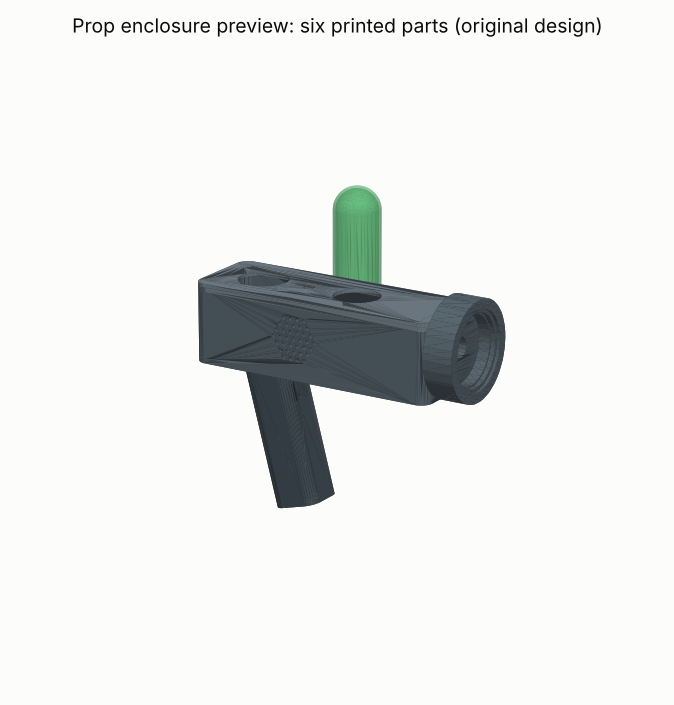
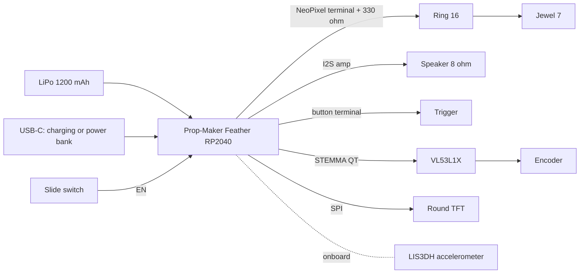
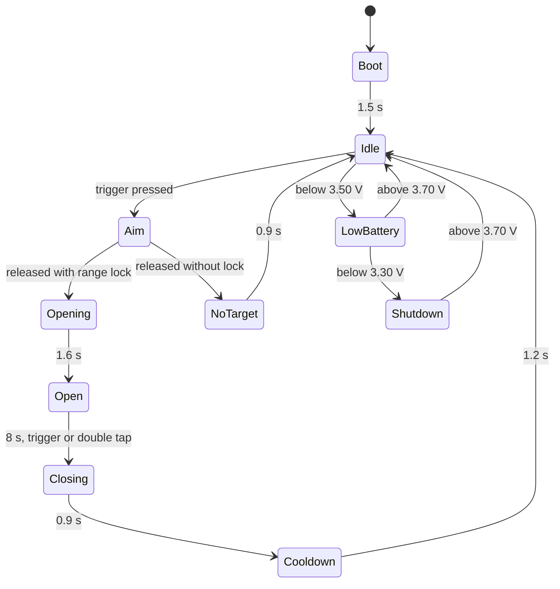

# Project Portal: build a safe portal-gun prop

*Deliverable 4 of 8. A light-and-sound prop with a real range finder, a round status display, a
destination dial and a glowing "fluid" canister. Firmware, host tests and printable enclosure are in
[`prop/`](../prop/).*



*The six printed parts, generated by `prop/enclosure/make_enclosure.py` (original design).*

## What this is, and what has been verified

This is a prop. It makes light and sound and measures distance with an eye-safe infrared sensor. It does
not open anything, emit anything harmful, or look like a real weapon.

| Part of the build | Status on 2026-10-19 |
|---|---|
| Parts list and prices | Every price below was read on the retailer's own page on 2026-10-19 (USD, before shipping and tax). Items marked *not priced* were not checked. Prices change. |
| Firmware | Compiles for the Adafruit Feather RP2040 Prop-Maker with arduino-cli: 96,276 bytes of flash (1%), 11,092 bytes of RAM (4%), no compiler warnings from the project's own files. |
| Firmware logic | 105 host tests pass: state machine, range lock, flash limits, LED current budget, battery cut-off, audio level. |
| Enclosure | Six watertight, printable solids; 7 automated fit checks pass (no part collides with any other or with the electronics' bounding boxes). |
| **Physical build** | **Not done.** I have no hardware. Nothing has been run on a real board, printed or assembled. Section 9 is a bring-up plan for the first person who does. |

Some enclosure dimensions are not published on the retailer pages and are marked **assumed** in
`make_enclosure.py` (display window diameter, encoder bushing, USB-C opening, range-sensor window). Check
them against your parts before printing the body.

## 1. Safety rules for this build

These come first because they shaped the design. Sources are in the [references](07-references.md).

1. **Lithium cells can catch fire.** Use only protected cells (the one listed is), charge only with the
   board's own charger, never unattended, and stop using a cell that swells, hisses, smells or gets hot.
   If you would rather not have a lithium cell in the prop at all, build Variant B.
2. **Flashing light can trigger seizures.** About 3% of people with epilepsy are photosensitive. The
   firmware's default "Steady" mode keeps every LED, and the ring as a whole, at or below three flashes in
   any second (WCAG 2.2 SC 2.3.1 / ITU-R BT.1702 heuristics) and never flashes saturated red. Keep Steady
   mode for public use. These are screen standards; applying them to a handheld light is a conservative
   choice, not a legal requirement.
3. **No lasers.** Do not add a laser pointer for "aiming". The range sensor is a Class 1, invisible 940 nm
   device that ST rates eye-safe only with its recommended settings and **no focusing optics**: do not put a
   lens in front of it.
4. **Do not stare into the LEDs.** The firmware caps brightness, with a lower cap on blue; the diffuser
   spreads the light. Keep the prop away from infants.
5. **Workshop.** Solder in a ventilated space with the iron in its stand; wear safety glasses; wash your
   hands after handling solder; use a glue-gun stand; print in a ventilated room.
6. **In public.** Use bright, obviously sci-fi colours. Conventions inspect props and some ban batteries in
   prop weapons or require tagging; ask the prop desk in advance, and carry the prop covered when you are
   outside the venue.

## 2. Parts

### 2.1 Variant A: lithium cell inside (the reference build)

| Qty | Part | Retailer, product ID | Price (verified 2026-10-19) |
|---|---|---|---|
| 1 | Adafruit RP2040 Prop-Maker Feather with I2S audio amplifier | Adafruit 5768 | \$19.95 |
| 1 | NeoPixel Ring, 16 × 5050 RGB LED (front emitter) | Adafruit 1463 | \$9.95 |
| 1 | NeoPixel Jewel, 7 × 5050 RGB LED (fluid canister) | Adafruit 2226 | \$5.95 |
| 1 | 1.28" 240 × 240 round TFT, GC9A01A, EYESPI | Adafruit 6178 | \$17.50 |
| 1 | VL53L1X time-of-flight distance sensor, ~30–4000 mm | Adafruit 3967 | \$14.95 |
| 1 | I2C STEMMA QT rotary encoder breakout with encoder | Adafruit 5880 | \$7.95 |
| 2 | STEMMA QT / Qwiic JST SH 4-pin cable, 100 mm | Adafruit 4210 | \$1.90 |
| 1 | Tactile switch buttons, 12 mm square, 10-pack (trigger) | Adafruit 1119 | \$2.50 |
| 1 | SPDT slide switch (power) | Adafruit 805 | \$0.95 |
| 1 | Thin plastic speaker, 8 Ω 0.25 W | Adafruit 1891 | \$1.75 |
| 1 | Lithium-ion polymer battery 3.7 V 1200 mAh, with protection circuit | Adafruit 258 | \$9.95 |
| 1 | Electrolytic capacitor 1000 µF 25 V | SparkFun COM-08982 | \$0.50 |
| 1 | Resistor 330 Ω 1/4 W, 20-pack | SparkFun PRT-14490 | \$1.25 |
| 2 | Silicone-cover stranded wire 26 AWG, 2 m (black 1881, white 1882) | Adafruit 1881, 1882 | \$1.90 |
| 1 | JST-PH battery extension cable, 500 mm | Adafruit 1131 | \$1.95 |
| 1 | Clear translucent PETG filament 1.75 mm, 1 kg (diffuser, canister) | MatterHackers M-AMP-JD1G | \$20.99 |
| | **Total** | | **\$119.89** |

Not priced: opaque filament for the body (any PLA or PETG), solder, hot glue or epoxy, paint, and two
100 kΩ resistors if you want the optional battery gauge (section 3.3).

### 2.2 Variant B: no lithium cell inside the prop

Same electronics and the same firmware, powered through the board's USB-C port from a power bank carried in
a pocket or bag. The bank's cells sit inside a finished product with its own protection (I did not verify
any particular bank's certification).

| Change from Variant A | Retailer, product ID | Price (verified 2026-10-19) |
|---|---|---|
| Remove the LiPo cell and the battery extension | — | −\$11.90 |
| Add a USB Li-ion power bank, 5000 mAh, 2 × 5 V outputs at 2.1 A | Adafruit 4288 | +\$26.95 |
| | **Total** | **\$134.94**, plus a USB-C cable (not priced) |

Adafruit notes that this bank "may 'fall asleep'" under loads below about 100 mA. If the prop switches off
while idle, raise the idle brightness slightly or use a bank without auto-off.

*Another option researched but not built:* an ItsyBitsy RP2040 (Adafruit 4888, \$9.95) with a MAX98357A
amplifier breakout (3006, \$5.95) and a 4 × AA holder (830, \$2.95) for **NiMH cells only** (four alkaline
cells give 6 V, which Adafruit calls too high). That parts list totals \$105.94 before cells and charger,
but **the firmware has not been ported or compiled for that board**, so it is not a supported variant.

## 3. Electronics

### 3.1 Wiring (Variant A and B)

| From | To | Notes |
|---|---|---|
| Prop-Maker NeoPixel terminal **+** | Ring 16 **5V**, then Jewel **5V** | Powered from the battery or USB, whichever is higher; switched off by the board's power-enable pin |
| Prop-Maker NeoPixel terminal **−** | Ring **GND**, then Jewel **GND** | Connect ground first, disconnect it last |
| Prop-Maker NeoPixel terminal **data** | 330 Ω resistor, then Ring **DIN** | Put the resistor at the ring end of the wire |
| Ring **DOUT** | Jewel **DIN** | The Jewel is pixels 16–22 in the firmware |
| 1000 µF capacitor | Across Ring **5V** and **GND** | Stripe (−) to GND |
| Prop-Maker **speaker** terminals | Speaker | The onboard 3 W amplifier drives it |
| Prop-Maker **button** terminal | One side of the trigger switch | The firmware enables the internal pull-up |
| Prop-Maker **GND** | Other side of the trigger switch | |
| Feather **STEMMA QT** | VL53L1X (cable 1) | I2C, address 0x29 |
| VL53L1X second STEMMA QT port | Encoder breakout (cable 2) | I2C, address 0x36 (seesaw) |
| Feather **3V** / **GND** | Display **Vin** / **GND** | |
| Feather **SCK** / **MO** | Display **SCK** / **MOSI** | Hardware SPI |
| Feather **D10 / D11 / D12 / D9** | Display **TCS / DC / RST / LITE** | Chip select, data/command, reset, backlight PWM |
| Slide switch | Feather **EN** and **GND** | Pulls EN low to switch the board off. It does not carry LED current (its rating is 0.5 A) |
| LiPo (Variant A) | Feather JST battery socket | Charges from USB-C |



### 3.2 Power budget

The LEDs dominate. Adafruit's worst-case figure is 60 mA per pixel at full white, so 23 pixels could draw
1.38 A. The firmware caps each colour channel (200 of 255, blue 110) and scales whole frames to a 500 mA
budget. In the host tests the highest estimated LED draw was 388 mA in Steady mode and 472 mA in Show mode.
That keeps a 1200 mAh cell at about 0.4C, inside Adafruit's 1–2C discharge guidance; at the full budget the
LEDs alone would empty it in roughly 2.4 hours (an estimate: the board's own consumption is not published,
so total runtime is not claimed).

Keep the LED power wires short. I did not verify a current rating for 26 AWG wire; if in doubt, use 22 AWG
hook-up wire (Adafruit 3111, \$19.95 for six 25 ft spools, verified) for the + and − runs.

### 3.3 Optional battery gauge

The firmware can read the cell voltage on A3 through a divider of two equal resistors from **BAT** to
**GND** (100 kΩ each, not priced). It warns and dims below 3.50 V, shuts the LEDs and amplifier off below
3.30 V (the cell's own protection trips at about 3.0 V), and recovers above 3.70 V. Without the divider,
delete the `#define BATTERY_SENSE_PIN` line in `PortalGunProp.ino`; for Variant B, always delete it.

## 4. Firmware

### 4.1 How it is organised

- `PortalGunProp/portal_core.h/.cpp`: every decision (states, patterns, limits, sounds). No Arduino
  headers, no heap allocation, so it compiles and is tested on a desktop.
- `PortalGunProp/PortalGunProp.ino`: moves data between the hardware and the core. Core 0 runs inputs, LEDs
  and the display at 100 Hz; core 1 synthesises sound and streams it to the I2S amplifier. No audio files.
- `test/test_portal_core.cpp` + `Makefile`: the host tests.

### 4.2 Run the host tests (any computer with g++)

```bash
cd research/portal-gun/prop/firmware/test
make            # builds and runs: 105 passed, 0 failed
```

The tests drive scripted and randomised sessions (seeds 1, 7, 42, 2026, 99991) and check, among other
things, that no pixel exceeds 3 flashes in any second (worst seen: 2 in Steady, 3 in Show), that the ring
average never exceeds 1, and that the estimated LED current never exceeds the 500 mA budget.

### 4.3 Build and upload

Versions used for the verified compile: arduino-cli 1.5.2-rc.1; board package "Raspberry Pi
Pico/RP2040/RP2350" by Earle Philhower 6.3.0; libraries Adafruit NeoPixel 1.15.5, Adafruit GC9A01A 1.1.1,
Adafruit GFX Library 1.12.6, Adafruit LIS3DH 1.3.0, Adafruit seesaw Library 1.7.9, Adafruit VL53L1X 3.1.2
(plus their dependencies, e.g. Adafruit BusIO 1.17.4).

```bash
arduino-cli config init
arduino-cli config add board_manager.additional_urls \
  https://github.com/earlephilhower/arduino-pico/releases/download/global/package_rp2040_index.json
arduino-cli core update-index
arduino-cli core install rp2040:rp2040@6.3.0
arduino-cli lib install "Adafruit NeoPixel@1.15.5" "Adafruit GC9A01A@1.1.1" "Adafruit GFX Library@1.12.6" \
  "Adafruit LIS3DH@1.3.0" "Adafruit seesaw Library@1.7.9" "Adafruit VL53L1X@3.1.2"
cd research/portal-gun/prop/firmware
arduino-cli compile --fqbn rp2040:rp2040:adafruit_feather_prop_maker PortalGunProp
arduino-cli upload  --fqbn rp2040:rp2040:adafruit_feather_prop_maker -p <port> PortalGunProp
```

In the Arduino IDE the same board appears as **Adafruit Feather RP2040 Prop-Maker**. If upload fails, add
`--output-dir build` to the compile command, hold BOOT while tapping RESET, and copy
`build/PortalGunProp.ino.uf2` onto the drive that appears.

### 4.4 Controls and behaviour

| Input | Effect |
|---|---|
| Turn the dial | Choose a destination code: C-137, 35-C, J19-Z7, D-716, LAB-01, HOME |
| Press the dial | Switch between Steady (default, gentler) and Show mode |
| Hold the trigger | Aim: the display shows the measured range; three consecutive readings within 6% between 40 mm and 4 m give a lock (a click sound) |
| Release with a lock | Open: 1.6 s opening animation and sound, then an 8 s "portal open" swirl with a hum |
| Release without a lock | "NO TARGET": error tone |
| Press the trigger or double-tap the body while open | Close early |
| Low cell (< 3.50 V) | "LOW BATT", dimmed; below 3.30 V the LEDs and amplifier are switched off and the display reads "CHARGE" |



Every number above is a field of `portal::Config` in `portal_core.h`; change them there and re-run the host
tests.

**Sound level.** The synthesiser's peak is capped at 35% of full scale. Scaling the MAX98357A's published
1.8 W into 8 Ω at full scale (5 V supply) by $0.35^2$ gives about 0.2 W, inside the speaker's 0.25 W rating
(my estimate; the Prop-Maker's amplifier gain setting was not checked).

## 5. Enclosure

### 5.1 Generate the parts

```bash
. .venv/bin/activate                 # numpy, manifold3d, trimesh, matplotlib
cd research/portal-gun/prop/enclosure
python make_enclosure.py             # writes out/*.stl, out/preview.png, out/report.json
python -m pytest -q                  # 7 fit checks
```

| Part | Material | Volume | What it holds |
|---|---|---|---|
| `body.stl` | Opaque PLA or PETG | 71.7 cm³ | Feather against the rear wall (USB-C opening), cell on the floor, range sensor behind a front window, speaker grille (left), switch slot (right) |
| `lid.stl` | Opaque | 23.6 cm³ | Display window, canister socket, dial hole; friction-fit lip |
| `emitter.stl` | Opaque | 45.0 cm³ | Ring 16 pocket, 3 mm air gap, rebate for the diffuser |
| `diffuser.stl` | Clear PETG | 4.2 cm³ | 2 mm disc in front of the ring |
| `canister.stl` | Clear PETG | 10.6 cm³ | Domed tube over the Jewel |
| `handle.stl` | Opaque | 78.1 cm³ | Angled grip with a 12 mm trigger pocket and a wire channel |

The body is 170 × 58 × 50 mm with 2.4 mm walls. All dimensions are parameters at the top of
`make_enclosure.py`.

### 5.2 Printing

MatterHackers lists 245 ± 10 °C nozzle and 60 ± 10 °C bed for this PETG. Everything else here is my
suggestion, not a verified setting: 0.2 mm layers, three perimeters, 20% infill; print the diffuser and
canister with more perimeters and no infill so they glow evenly. Print in a ventilated room.

## 6. Assembly

1. **Bench test first** (section 9, steps 1–4) with everything on the desk before anything goes in the shell.
2. Solder the 330 Ω resistor in line with the ring's DIN wire, at the ring. Solder the capacitor across the
   ring's 5V and GND pads. Chain the ring's DOUT, 5V and GND to the Jewel.
3. Seat the ring in the emitter pocket, then press the diffuser into the rebate. Pass the three wires through
   the emitter's centre hole and the body's front pass-through.
4. Mount the range sensor behind the front window, facing out, with nothing in front of the sensor but the
   opening. Do not glue anything over the sensor.
5. Fix the speaker behind the grille, the Feather against the rear wall with its USB-C port at the opening,
   and the cell flat on the floor in the front half, away from screw points and sharp edges. Use foam tape;
   do not put glue on the cell.
6. Fit the slide switch in its slot and wire it to EN and GND.
7. Wire the trigger button and push it into the handle's pocket, leads through the channel. Glue the handle
   (epoxy or cyanoacrylate) or drill it for two M3 screws.
8. Mount the display under the lid window and the encoder through the dial hole; seat the Jewel under the
   canister socket and push the canister in.
9. Connect the STEMMA QT cables (Feather → range sensor → encoder), close the lid, and run the bring-up
   checks again.

## 7. Using it

- Switch on: a short boot chime, the ring fades up green, the display shows "READY", the code and Steady mode.
- Point at a wall, hold the trigger, watch the range settle, release when it locks.
- Show mode is brighter (full rather than 80% brightness) and allows livelier per-pixel motion (2.5 Hz rather
  than 1.5 Hz), still within the flash limits. Keep Steady for crowds.
- Charge Variant A over USB-C while you are present; Adafruit recommends charging at or below 0.5C, which the
  board's charger does for this cell.

## 8. Troubleshooting

| Symptom | Likely cause |
|---|---|
| LEDs dark, display works | NeoPixel power is enabled by the firmware; check the terminal wiring and ground, and that the cell is above 3.30 V |
| First LED wrong colour or flickers | Missing 330 Ω resistor at the ring, or a long data wire |
| Range never locks | Something in front of the sensor window, a very dark or shiny target, or beyond 4 m |
| Dial does nothing | Encoder not detected at 0x36: check the STEMMA QT chain |
| Prop switches off on a power bank | The bank's low-load auto-off (Variant B) |

## 9. Bring-up and acceptance tests (to be done on real hardware)

None of these has been performed. Expected results come from the firmware's design and its host tests.

| # | Test | How | Pass if |
|---|---|---|---|
| 1 | Power-on | USB only, no cell, LEDs disconnected | Display shows READY; boot chime |
| 2 | I2C devices | Watch the display: range shows "-- m" if the sensor is missing | Range readings appear; dial changes the code |
| 3 | LEDs | Connect the ring and Jewel | Green fade-up; no first-pixel glitches |
| 4 | Current | USB power meter in the cable, Show mode, portal open | Below about 0.6 A total (500 mA LED budget plus the board) |
| 5 | Flash check | Film the open portal at 240 fps; step through | No pixel changes direction more than three times in any second in Steady mode |
| 6 | Switch off | Slide switch off; measure the NeoPixel terminal with a multimeter | 0 V at the terminal (confirms the enable pin cuts LED power) |
| 7 | Low battery | Optional gauge fitted; let a cell run down while you watch | LOW BATT and dimming at 3.50 V; LEDs off at 3.30 V |
| 8 | Heat | Run 30 min in Show mode | Nothing more than warm to the touch |

## 10. Credits, licences and limits

The enclosure and firmware are original work for this study. The portal gun is a design from *Rick and
Morty* (Adult Swim); this is a fan prop for personal use, and I did not research trademark questions.
Published fan builds were consulted for comparison only and none of their files are reused: Bannerz's
Printables model 606725 (CC BY-NC), JackSoldano's and korv's Instructables (CC BY-NC-SA 4.0), and
pomeroyb's firmware (no licence file). Adafruit has no official guide for this prop.
