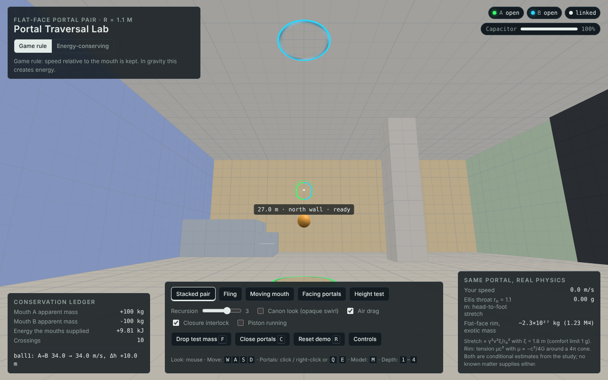
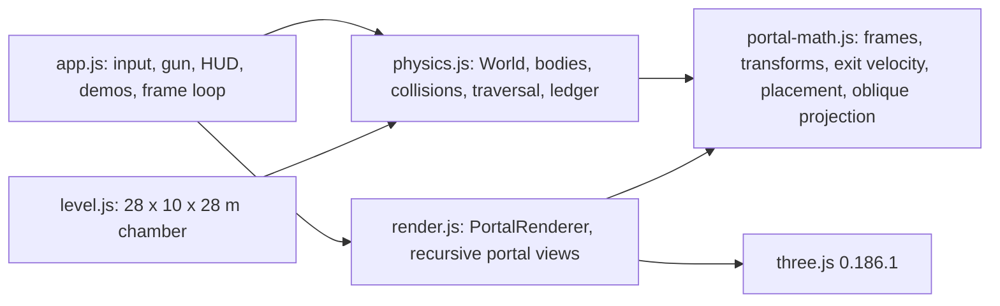

# Project Portal: the Portal Traversal Lab simulator

*Deliverable 5 of 8. An interactive browser simulator of a linked portal pair, built to make the
transform, rendering and momentum rules explicit and testable. Source in [`simulator/`](../simulator/).*

- **Try it:** https://claude.ai/artifact/EAyCZ9tn96UE9q7bbkfhHH (private to you until you share it).
- **Run it locally:** `cd research/portal-gun/simulator && npm install && npm run serve`, then open
  http://localhost:8080/.

*A floor portal under a ceiling portal, with the recursive view down the loop (game rule).*

## What it is, and what it is not

It is a game-engine simulation of the **flat-face** portal model: two planar discs, flat space on both sides,
and a rigid identification between them. Inside that model the rendering is exact optics (inside 84% of the
disc radius; the outer rim is blended into the animated swirl) and the transforms are exact geometry. It does
**not** simulate spacetime curvature, tides, fields leaking through, or fluids (see Limitations). Its main
scientific purpose is to compare two momentum rules side by side:

| Rule | What it does | Consequence |
|---|---|---|
| **Game rule** ("kinematic") | Velocity relative to the mouth is kept: $v' = R\,(v - u_A) + u_B$ | What *Portal* and most games do. In gravity it creates energy: a floor-to-ceiling loop accelerates until air drag balances it (or, with drag off, until the 200 m/s numerical cap) |
| **Energy-conserving** | As above, then the speed is adjusted so kinetic plus potential energy ($g \times$ height) is unchanged; an object that cannot climb the step is turned back | A lumped version of the static field computed in the report (section 3.10): the energy change is applied at the crossing |

## 1. Using it

| Action | Mouse and keyboard | Touch |
|---|---|---|
| Look | Mouse after you enter (pointer lock; Esc releases); without pointer lock, drag | Drag on the right part of the screen |
| Move | W A S D or arrow keys; Shift to run | Drag on the left 45% of the screen |
| Jump | Space | Jump button |
| Shoot portal A / B | Left / right click, or Q / E | A / B buttons |
| Drop a test mass | F, or "Drop test mass" | Mass button |
| Close both portals | C, or "Close portals" | "Close portals" button in the panel |
| Switch rule | M, or the "Game rule / Energy-conserving" buttons | Same buttons |
| Recursion depth | 1–4, or the slider | Slider |
| Canon look (opaque swirl) | V, or the checkbox | Checkbox |
| Piston on or off | P, or the checkbox | Checkbox |
| Re-run the current demo | R, or "Reset demo" | "Reset demo" button |
| Show the controls again | "Controls" button | Same |

**Demos:**

- *Stacked pair:* the infinite-fall loop.
- *Fling:* a 9 m drop into a floor portal comes out of a wall.
- *Moving mouth:* a piston brings portal A down onto a resting ball.
- *Facing portals:* recursive views.
- *Height test:* walk into a portal whose partner is 6.9 m higher.

**Options:** recursion depth; canon look (an opaque swirl instead of a clear window); air drag (**on by
default**); the closure interlock (**on by default**: it refuses to close a portal on a straddling body, and
the override ejects it); the piston.

**The HUD shows:**

- **Status:** whether each portal is open and whether they are linked.
- **Charge:** the gun's capacitor (each shot costs 0.34; it recharges at 0.45 per second).
- **Target readout:** under the crosshair, the distance along the aim path, the surface, and either "ready",
  "will slide to fit" or the reason a shot would fail.
- **Conservation ledger:** the apparent mass of each mouth, the mechanical energy the mouths have supplied,
  the number of crossings, and the last event. The crossing counter counts every recorded crossing,
  reflections included, and keeps the last 200.
- **"Same portal, real physics":** your speed; the head-to-foot stretch an Ellis throat of the same radius
  would impose at that speed ($\gamma^2v^2\xi/r_0^2$, $\xi$ = 1.8 m); and the exotic rim mass a flat-face portal
  of this size would need ($-\pi Rc^2/2G$, about −1.2 Jupiter masses for $R$ = 1.1 m).

## 2. Architecture

| File | Lines | Responsibility |
|---|---|---|
| `index.html` | 273 | Page, HUD, import map (three.js 0.186.1 from jsDelivr) |
| `src/portal-math.js` | 245 | Portal frames, $T(A\to B)$, exit velocity rules, Lengyel oblique projection, ray–box tests, placement validation |
| `src/physics.js` | 550 | Sub-stepped physics; collisions of spheres (balls, and a player built from three spheres) with boxes and rims; traversal; moving mouths; ledger; interlock |
| `src/render.js` | 417 | Render-to-texture portal views with recursion, virtual cameras, near-plane cap, clones, shaders |
| `src/app.js` | 469 | Input (pointer lock, keyboard, touch), shooting and aiming, demos, HUD |
| `src/level.js` | 38 | The test chamber |

## 3. Coordinates and transforms

- **Units and axes.** Metres, $y$ up, right-handed, as in three.js. Gravity is 9.81 m/s² along $-y$.
- **Portal frame.** Each portal has a centre and an orthonormal frame (right, up, normal), with the normal
  pointing out of the front face. Radius 1.1 m. For a portal on a wall, "up" is world up; for a floor or
  ceiling, it is the shooter's horizontal view direction, so the exit faces the way you were looking.
- **The pair transform.** Entering the front of A means leaving the front of B, so

  $$T(A\to B) = M_B\,R_y(\pi)\,M_A^{-1},$$

  where $M$ is the 4 × 4 matrix whose columns are the frame axes and centre. $T$ is a rigid motion
  (determinant +1) and $T(B\to A) = T(A\to B)^{-1}$; both are unit-tested. Points map through $T$,
  directions and velocities through its rotation part $R$. This is the transform used by three.js's own
  `webgl_portal` example (as a mirror of local $x$ and $z$) and by published game implementations
  ([references](07-references.md)).
- **Orientation after traversal.** The player's view direction and up vector are mapped through $R$ and
  converted back to yaw, pitch and roll. Roll then decays with a 0.25 s time constant, so you re-level after
  leaving a tilted portal. Looking straight up or down is handled separately to avoid a singular yaw.

## 4. Rendering

The technique is render-to-texture with a screen-space lookup:

1. For a visible portal P with partner Q, build a **virtual camera** $V = T(P\to Q)\cdot C$, where $C$ is
   the real camera. $V$ sits behind Q, looking out of it.
2. Give $V$ an **oblique near plane** lying in Q's surface (Lengyel 2005), so geometry behind Q is clipped.
   With the clip plane $C_p$ in camera space and projection matrix $M$: $C' = (M^{-1})^{T} C_p$,
   $q = M^{-1}(\operatorname{sgn}C'_x, \operatorname{sgn}C'_y, 1, 1)$, and the third row of $M$ is replaced by
   $\frac{2}{C_p\cdot q}\,C_p + (0, 0, 1, 0)$ (Lengyel's eq. 14 for a perspective matrix). The code uses
   three.js's element layout, as three.js's own `Reflector` does. A 2 mm offset avoids z-fighting.
3. Render the scene from $V$ into a half-float render target.
4. Draw P's disc with a shader that samples that target at the fragment's **screen** coordinate, so the
   pixels line up exactly with the real camera's view. From 84% of the radius outward the view is blended
   into the swirl, which marks the rim.
5. **Recursion.** Portals visible inside a portal view are rendered first, deepest level first, each
   (level, portal) with its own target, up to the chosen depth (1–4). Beyond the last level the disc shows
   the animated swirl.
6. **Near-plane cap.** When the camera is within the near-clip distance of a portal, a short tube drawn
   behind the disc keeps the view from tearing as you step through.
7. **Straddling objects** are drawn twice, at their position and at the mapped position, so half a ball
   sticks out of each portal.
8. **Layers.** The player's own body is drawn only in portal views (you can see yourself through a portal,
   not in your own view); placement previews are drawn only in the main view.

The end-to-end test checks the optics directly: it reads back pixels inside portal A and finds the west
wall's tint (rgb 56, 73, 124), which can only arrive through B, while pixels just outside A show the north
wall's sand (124, 101, 63).

## 5. Physics

- **Integration.** Semi-implicit (symplectic) Euler. Each frame's time step, capped at 50 ms, is split into
  up to 64 equal sub-steps of at most 1/240 s and, below about 128 m/s, at most 0.1 m of travel for the
  fastest body. Gravity; quadratic air drag (on by default: a test ball's terminal speed is 42 m/s); rolling
  resistance for balls (bodies do not spin, so sliding friction would be wrong); a 200 m/s numerical speed
  cap.
- **Collision.** Spheres against axis-aligned boxes. The player is three spheres of radius 0.3 m centred 0.3,
  0.9 and 1.5 m above the feet. A box hosting an open, linked portal has a circular hole: a body whose centre
  projects inside the aperture is exempt from the box and collides only with the rim circle, so off-axis
  balls bounce off the rim instead of clipping into the wall (tested).
- **Traversal.** A body crosses when its centre (the player's eye) goes from in front of a portal's plane to
  behind it, inside the aperture. The previous frame of a *moving* portal is kept every sub-step, so a fast
  mouth cannot skip over a body. Position and orientation map through $T$; velocity through the chosen rule.
- **Moving mouths.** The piston carries portal A; velocities are taken relative to the mouth, so a resting
  ball swept by the piston leaves B at the piston's speed.
- **Ledger.** Each crossing records the mass moved and the kinetic and potential energy change; the HUD
  shows the apparent mass of each mouth (entrance gains, exit loses: the Gauss-law bookkeeping of report
  section 3.7) and the energy the mouths must have supplied.
- **Closure interlock.** Closing is refused while any body straddles a portal; the override ejects it.

## 6. The gun: aiming and placement

The aim ray is cast from the camera and always continues through a linked portal (up to two hops). Distances
are measured along the whole path. A placement must pass all of these checks, each with its own on-screen
reason:

| Check | Reason shown |
|---|---|
| The ray hits something | `no-surface` ("Nothing to hit") |
| Within 80 m along the aim path | `out-of-range` |
| The surface accepts portals: not the metal panel; on the piston, only its underside | `surface-rejects` |
| The face is at least 2.2 m across in both directions (the disc's diameter; the 2 m pillar is not) | `surface-too-small` |
| If the disc overhangs an edge it slides inward to fit, by at most 1.2 m | `too-close-to-edge` |
| It does not overlap the other portal (after sliding) | `overlaps-other` |
| Nothing else mounted against the face (a box within 6 cm of it) covers the disc. The disc slides off a partial obstruction, but not one covering its centre | `obstructed` |
| Capacitor charged | `recharging` |

## 7. Tests and results (run 2026-10-19)

### 7.1 Unit tests: `npm test` (Node's built-in test runner), 19 passed

The unit tests build their worlds with air drag **off**, so the momentum rules are tested without it.

| # | Test |
|---|---|
| 1 | A dropped ball settles on the floor |
| 2 | A ball rolling into a wall portal exits the partner with the mapped velocity |
| 3 | Stacked floor/ceiling pair: the game rule exceeds 50 m/s within 6 s; the conserving rule never exceeds free fall from the release height and never rises above it |
| 4 | Conserving rule: walking into a portal that leads 6.9 m up is refused (reflected) |
| 5 | Piston: a resting ball leaves the far portal at the piston speed; the mouths pay the energy |
| 6 | The closure interlock refuses to close on a straddling body; the override ejects it |
| 7 | An unlinked portal is solid |
| 8 | Rim contact deflects an off-axis ball instead of letting it clip the wall |
| 9 | Portal frames are orthonormal and right-handed |
| 10 | $T(A\to B)$ is a proper rigid motion and $T(B\to A)$ is its inverse |
| 11 | A point just behind A maps just in front of B; inward velocity maps to outward |
| 12 | The game rule keeps relative speed; the conserving rule pays for height |
| 13 | Moving mouth: an object at rest leaves with the mouth's speed |
| 14 | Lengyel's oblique projection puts the clip plane on the near plane |
| 15 | Ray–box intersection |
| 16 | The closest point on the rim lies on the circle |
| 17 | A valid wall placement is nudged off the floor edge |
| 18 | Each failure state: metal, too small, edge, range, overlap, obstruction |
| 19 | Floor and ceiling portals shot facing the same way form a pure translation |

### 7.2 End-to-end: `npm run test:browser`, 14 of 14 passed

The browser checks need a Chromium build for Playwright. If you do not have one, run
`npx playwright install chromium` once.

The checks use headless Chromium with software WebGL (SwiftShader). three.js is served from `node_modules`,
so they run offline. They drive the app as a visitor would, so **air drag is on**. Values are snapshots at
fixed simulated times, not maxima. "Render passes" counts the main view plus one pass per portal view
rendered in that frame.

| Check | Result |
|---|---|
| Game rule: ball keeps accelerating through the loop | 34.6 m/s after 10 crossings (5 s). Without drag it would be 49 m/s; with the ball's drag the speed follows $v_t\tanh(gt/v_t)$, $v_t$ = 42 m/s, which gives 34.6 m/s |
| Energy-conserving: ball never exceeds free-fall speed from 6 m (10.8 m/s) | 7.24 m/s at 5 s |
| Portal views rendered, each rule | 3 render passes in the frame (main view + both portals) |
| Fling: ball leaves the west wall moving +x | 12.9 m/s (13.3 m/s without drag) |
| Moving mouth: resting ball leaves at the piston speed (8 m/s) | 7.96 m/s; mouths supplied ~400 J |
| Facing portals at depth 1 / depth 3 | 2 / 4 render passes (main view + 1 / 3 portal levels) |
| Height test, game rule: player pops out 6.9 m up | 1 crossing |
| Height test, energy-conserving: walking speed is reflected | 6 reflections |
| Aiming: metal panel rejects, narrow pillar too small, open wall accepts | As expected |
| Pixels through the portal: west-wall blue inside A, north-wall sand outside | rgb 56,73,124 inside; 124,101,63 outside |
| Phone width: no horizontal page scroll | Pass |
| No console or page errors | Pass |

Screenshots from the run are in `simulator/screenshots/` (00–07). Two problems found during development are
worth knowing about if you modify the code:

- Headless Chromium's pointer lock delivers a large spurious mouse movement on capture, so the app ignores
  the first three events and any jump over 250 px.
- A portal on the piston's underside correctly shows a black disc when the piston is flush with the floor,
  because the view behind it is inside the floor. The piston now stops 2 cm short.

## 8. Limitations

- **Flat-face model only.** No lensing, no curvature, no tides; the rim is a thin plate with a round hole,
  not a negative-tension string.
- **The energy-conserving rule is lumped.** The report's static field model spreads the potential change
  over the neighbourhood of the mouths, with forces of up to several g; the simulator applies it at the
  crossing instead.
- **No fluids, air flow, sound or fields** pass through the portals; no pressure differences.
- **Point traversal.** A body crosses when its centre does; the far half is drawn as a clone but has no
  physics of its own.
- **One pair of portals;** bodies do not rotate; stacking is not stable.
- **Recursion stops at depth 4.**
- **Performance has not been measured.** The tests run in software WebGL in a headless browser, at frame
  rates too low to say anything about real devices, which is why they advance simulated rather than wall-clock
  time.
- **Accessibility.**
  - Keyboard and touch controls and labelled HUD controls exist; the 3-D view itself is not available to
    screen readers.
  - The swirl is green for portal A and cyan for portal B, with no saturated red. It has four soft bands
    (fewer than the five light–dark pairs that ITU-R BT.1702 treats as a pattern risk), each passing a given
    pixel about 0.9 times per second at moderate contrast. That is below the three-flashes-per-second limit
    of WCAG 2.3.1.
  - With the operating system's reduced-motion setting, the swirl stops animating.
  - I did not run a formal photosensitivity analysis of the rendered video.

## 9. Extending it

- Add the report's static field (B.2 of the appendix) as a precomputed potential so the conserving rule
  acts smoothly.
- Add an Ellis-mode renderer using the ray-traced deflection in `models/portalphys/raytrace.py`.
- Add an air-flow mode using the orifice model in `models/portalphys/environment.py`.

Each change should come with a unit test in `tests/` and, if visible, a check in `tests/browser-check.mjs`.
